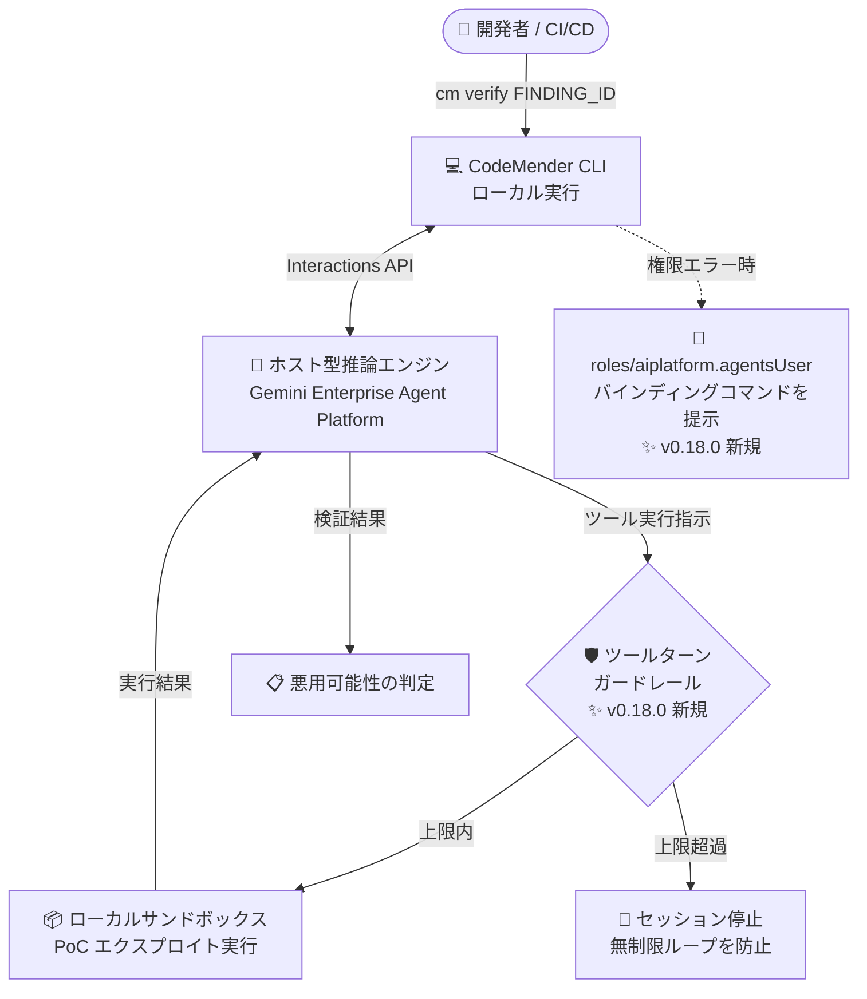

# Gemini Enterprise Agent Platform: CodeMender v0.18.0 アップデート

**リリース日**: 2026-11-05

**サービス**: Gemini Enterprise Agent Platform (CodeMender)

**機能**: CodeMender v0.18.0 - 検証セッションのガードレール強化と IAM 診断ガイダンス

**ステータス**: Fixed / 改善 (CodeMender 自体は Preview)

📊 [このアップデートのインフォグラフィックを見る](https://takech9203.github.io/google-cloud-news-summary/20261105-codemender-v0-18-0.html)

## 概要

Gemini Enterprise Agent Platform の AI コードセキュリティエージェント「CodeMender」の v0.18.0 がリリースされた。CodeMender は、コードベースの脆弱性をスキャン (`cm find`)、検証 (`cm verify`)、修正 (`cm fix`) する自律型エージェントであり、推論エンジンは Google Cloud 上でホストされ、ファイル読み取りやコマンド実行はローカルの CLI がサンドボックス内で行う「ローカルファースト」の実行モデルを採用している。

v0.18.0 の目玉は、`cm verify` セッションに探索的なツールターン (tool-turn) の上限を設けるガードレールの追加である。`cm verify` は脆弱性の悪用可能性を確認するために PoC (概念実証) エクスプロイトを生成・実行するコマンドであり、エージェントが無制限にコマンド実行ループを続けるリスクを抑制できるようになった。また、サービスアカウントや CI/CD 環境向けに `roles/aiplatform.agentsUser` の IAM バインディングコマンドを CLI のセットアップ時やエラーメッセージ内で具体的に提示する診断ガイダンスも追加され、権限エラーの解決が容易になった。

対象ユーザーは、CodeMender を利用してコードベースのセキュリティスキャン・脆弱性検証を行う開発チーム、および CI/CD パイプラインに CodeMender を組み込んでいる DevSecOps チームである。

**アップデート前の課題**

- `cm verify` セッションでエージェントの探索的なツール実行に上限がなく、コマンド実行ループが無制限に継続するおそれがあった (実行時間とトークン消費の予測が困難)
- CLI が新しいバージョンへの更新を促す際、変更内容を確認するためのリリースノートへの導線がなく、ユーザーが自分で DevSite を探す必要があった
- サービスアカウントや CI/CD 環境で IAM 権限が不足した場合、エラーメッセージから必要なロールと付与コマンドを自力で特定する必要があった
- 検証セッションや再開 (resume) セッション、シェル環境間の互換性、対話的なアクティベーション時のサインインフローに信頼性の課題があった

**アップデート後の改善**

- `cm verify` セッションに探索的ツールターンの上限が設けられ、無制限のコマンド実行ループが防止されるようになった
- CLI の更新プロンプトに DevSite リリースノートへの直接リンクが表示され、更新内容を即座に確認できるようになった
- CLI のセットアップおよびエラーメッセージに、`roles/aiplatform.agentsUser` の IAM バインディングを付与する実行可能なコマンドが表示され、サービスアカウント・CI/CD 環境での権限設定が容易になった
- エージェントセッション (検証・再開セッションを含む) の信頼性、シェル環境間の互換性、対話的アクティベーション時のサインインフロー、サービス一時停止時のエラーレポートが改善された

## アーキテクチャ図



`cm verify` の検証セッションにおいて、エージェントの探索的なツール実行回数がガードレールでチェックされ、上限を超えるとセッションが停止される。また、権限エラー発生時には必要な IAM バインディングコマンドが CLI から直接提示される。

## サービスアップデートの詳細

### 主要機能

1. **検証ツールターンのガードレール (Verification tool-turn guardrails)**
   - `cm verify` セッションに探索的なツールターンの上限を追加
   - エージェントが PoC エクスプロイトの生成・検証中に無制限のコマンド実行ループに陥ることを防止
   - 実行時間とリソース消費の予測可能性が向上

2. **更新プロンプトでのリリースノートリンク (Release notes link in update prompts)**
   - CodeMender が新しい CLI バージョンへの更新を促す際、DevSite のリリースノートへの直接リンクを表示
   - 更新前に変更内容 (新機能・破壊的変更・バグ修正) を確認可能に

3. **エージェント IAM 診断ガイダンス (Agent IAM diagnostic guidance)**
   - CLI のセットアップおよびエラーメッセージに `roles/aiplatform.agentsUser` の IAM バインディングを付与する実行可能なコマンドを追加
   - サービスアカウント環境および CI/CD 環境 (GitHub Actions、Cloud Build など) を対象とした具体的なガイダンス

4. **バグ修正 (Bug fixes)**
   - エージェントセッション (検証セッション・再開セッションを含む) の信頼性を改善
   - シェル環境間の互換性を改善
   - 対話的なアクティベーション時のサインインフローを改善
   - サービスが一時的に利用できない場合のエラーレポートを改善
   - セキュリティおよび安定性の改善を含む

## 技術仕様

### cm verify の実行モデル

| 項目 | 詳細 |
|------|------|
| 実行場所 | 推論はクラウド (Gemini Enterprise Agent Platform)、コマンド実行はローカルサンドボックス |
| サンドボックス | デフォルトで有効 (`--sandbox=true`)。ワークスペースディレクトリとコマンドポリシーに制限 |
| PoC 実行 | 検証時に PoC エクスプロイトを生成・実行し、悪用可能性を確認 |
| ツールターン上限 | v0.18.0 で探索的ツールターンの上限を追加 (無制限ループを防止) |
| ファイル書き込み | `cm verify` の書き込みはプロジェクトルート配下の `.exploit/` に制限 (v0.16.0 より) |

### 関連する IAM ロール

| ロール | 用途 |
|--------|------|
| `roles/aiplatform.agentsUser` | v0.18.0 で CLI のセットアップ・エラーメッセージに付与コマンドのガイダンスが追加されたロール |
| `roles/aiplatform.user` | CI/CD 統合ドキュメントで案内されている Agent Platform User ロール |

## 設定方法

### 前提条件

1. CodeMender へのアクセス権を持つ Google Cloud プロジェクト (CodeMender は限定された顧客向けの Public Preview)
2. CodeMender CLI のインストールと Application Default Credentials (ADC) の設定

### 手順

#### ステップ 1: CLI を最新バージョンに更新

```bash
cm update
```

v0.18.0 以降、更新プロンプトには DevSite リリースノートへの直接リンクが表示されるため、更新前に変更内容を確認できる。

#### ステップ 2: 接続と権限のヘルスチェック

```bash
cm health --strict
```

資格情報 (exit code 10)、設定 (20)、ネットワーク到達性 (30)、プロジェクト IAM 権限 (40) のどのレイヤーで問題が発生しているかを切り分けられる。v0.18.0 では、権限不足時に `roles/aiplatform.agentsUser` のバインディングコマンドが実行可能な形で提示される。

#### ステップ 3: 検証セッションの実行

```bash
# cm report または cm find の出力から FINDING_ID を取得して実行
cm verify FINDING_ID
```

v0.18.0 では探索的ツールターンの上限がガードレールとして機能し、セッションが無制限に継続することはない。

## メリット

### ビジネス面

- **コスト予測可能性の向上**: 検証セッションの実行ループに上限が設けられたことで、トークン消費と実行時間の予測が容易になり、CI/CD での運用コストを管理しやすくなった
- **運用負荷の軽減**: IAM 権限エラーの解決コマンドが CLI から直接提示されるため、DevSecOps チームのトラブルシューティング時間を短縮できる

### 技術面

- **安全な自律実行**: エージェントによる PoC 実行の暴走 (無制限コマンド実行ループ) をプラットフォーム側で防止し、サンドボックスと合わせた多層防御が強化された
- **CI/CD 環境との親和性向上**: サービスアカウント環境向けの IAM 診断ガイダンスにより、GitHub Actions や Cloud Build などの自動化パイプラインでのセットアップが容易になった
- **セッション信頼性の向上**: 検証セッション・再開セッションの信頼性改善により、長時間のスキャン・検証ワークフローが安定した

## デメリット・制約事項

### 制限事項

- CodeMender は Public Preview であり、限定された顧客のみ利用可能 (利用には Google の営業チームへの問い合わせが必要)
- Pre-GA Offerings Terms が適用され、サポートが限定される場合がある

### 考慮すべき点

- `cm verify` はコマンドの実行やファイルの変更をホストシステム上で行う可能性があるため、サンドボックスを無効化 (`--sandbox=false`) する場合は隔離された VM やコンテナでの実行が推奨される
- ツールターン上限により、複雑な脆弱性の検証セッションが上限到達で終了する可能性がある点に留意する
- CLI のバージョンアップは機能差分が大きいため (v0.16.0〜v0.18.0 で `cm health` 追加やフラグ変更など)、リリースノートリンクで変更点を確認してから更新することが望ましい

## ユースケース

### ユースケース 1: CI/CD パイプラインでの脆弱性検証の安定運用

**シナリオ**: GitHub Actions でプルリクエストごとに `cm find --diff` でスキャンし、検出された CRITICAL/HIGH の脆弱性を `cm verify` で検証するパイプラインを運用している。従来は検証セッションが長時間化するリスクがあり、パイプラインのタイムアウト設計が難しかった。

**実装例**:
```bash
# パイプラインの preflight でヘルスチェック (権限エラーを早期検出)
cm health --strict --json

# PR の差分をスキャン
cm find . --diff=origin/main

# 検出された脆弱性を検証 (v0.18.0 ではツールターン上限により実行が有界)
cm verify FINDING_ID -y
```

**効果**: ツールターンのガードレールにより検証セッションの実行時間が有界となり、CI のタイムアウト設計とコスト見積もりが容易になる。権限エラー時も具体的な `roles/aiplatform.agentsUser` バインディングコマンドが表示され、復旧が迅速になる。

### ユースケース 2: サービスアカウント環境での初期セットアップ

**シナリオ**: Workload Identity Federation を使った CI/CD 環境で CodeMender を新規セットアップする際、403 Forbidden エラーの原因特定に時間がかかっていた。

**効果**: v0.18.0 では CLI のセットアップ・エラーメッセージに実行可能な IAM バインディングコマンドが直接表示されるため、ドキュメントを往復することなく権限設定を完了できる。

## 料金

CodeMender の利用はセッションのトークン使用量に基づいて課金される (`cm stats` で確認できるトークン数は課金使用量と一致する)。詳細は公式ドキュメントおよび Gemini Enterprise Agent Platform の料金ページを参照。

- [Gemini Enterprise Agent Platform 料金](https://cloud.google.com/vertex-ai/pricing)

## 利用可能リージョン

CodeMender はグローバルに利用可能 (限定された顧客向けの Public Preview)。

## 関連サービス・機能

- **Gemini Enterprise Agent Platform (Interactions API)**: CodeMender のホスト型推論エンジンとローカル CLI 間の通信に使用される API 基盤
- **Cloud Build / GitHub Actions**: CodeMender の CI/CD 統合先。v0.18.0 の IAM 診断ガイダンスはこれらの環境でのサービスアカウント設定を支援する
- **IAM (Identity and Access Management)**: `roles/aiplatform.agentsUser` などのロールバインディングで CodeMender へのアクセスを制御
- **Workload Identity Federation**: GitHub Actions から鍵レスで Google Cloud に認証するための仕組み。CodeMender の CI/CD 統合で推奨されている

## 参考リンク

- 📊 [インフォグラフィック](https://takech9203.github.io/google-cloud-news-summary/20261105-codemender-v0-18-0.html)
- [公式リリースノート](https://docs.cloud.google.com/release-notes#November_05_2026)
- [CodeMender ドキュメント](https://docs.cloud.google.com/gemini-enterprise-agent-platform/agents/codemender)
- [CodeMender 環境セットアップ (IAM・サンドボックス)](https://docs.cloud.google.com/gemini-enterprise-agent-platform/agents/codemender/set-up-environment)
- [脆弱性のスキャンと検証 (cm verify)](https://docs.cloud.google.com/gemini-enterprise-agent-platform/agents/codemender/scan-and-verify)
- [CI/CD 統合ガイド](https://docs.cloud.google.com/gemini-enterprise-agent-platform/agents/codemender/integrate-with-cicd)

## まとめ

CodeMender v0.18.0 は、`cm verify` のツールターン上限による実行ガードレールと、`roles/aiplatform.agentsUser` の IAM 診断ガイダンスにより、自律型セキュリティエージェントを CI/CD で安全かつ予測可能に運用するための重要な改善である。CodeMender を利用中のチームは `cm update` で最新 CLI に更新し、パイプラインの preflight に `cm health --strict` を組み込むことを推奨する。

---

**タグ**: #GeminiEnterpriseAgentPlatform #CodeMender #セキュリティ #AIエージェント #CICD #IAM #DevSecOps
