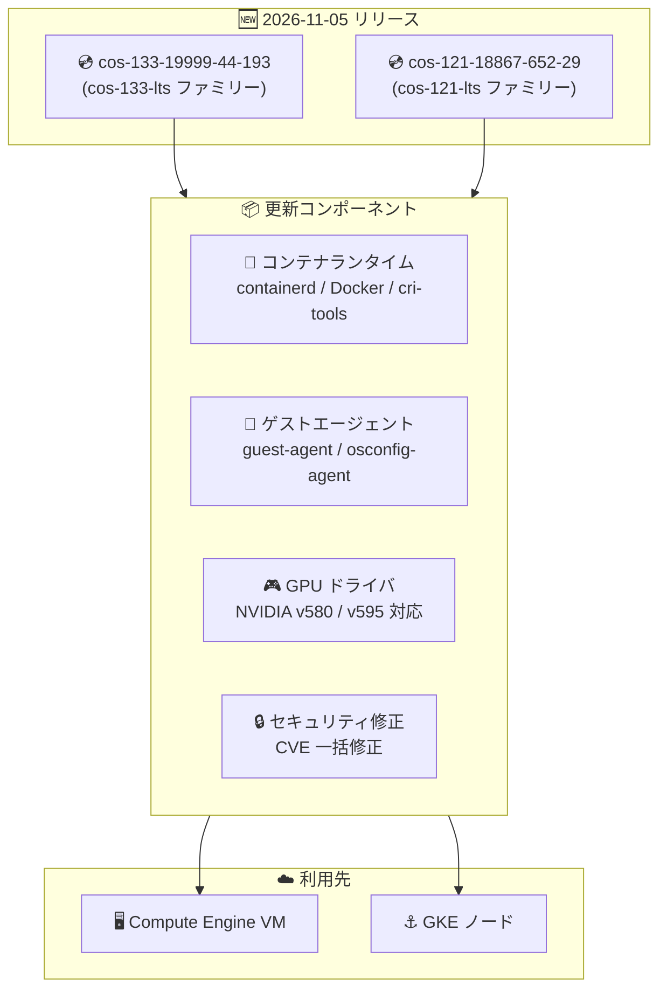

# Container-Optimized OS: COS 133 / COS 121 LTS イメージリリース (cos-133-19999-44-193, cos-121-18867-652-29)

**リリース日**: 2026-11-05

**サービス**: Container-Optimized OS

**機能**: LTS イメージ更新 (セキュリティ修正、NVIDIA ドライバ追加、パッケージ更新)

**ステータス**: GA (リリース済み)

📊 [このアップデートのインフォグラフィックを見る](https://takech9203.github.io/google-cloud-news-summary/20261105-container-optimized-os-cos-updates.html)

## 概要

Container-Optimized OS (COS) の 2 つのアクティブな LTS マイルストーンに対して、新しいイメージ `cos-133-19999-44-193` (COS 133 LTS) と `cos-121-18867-652-29` (COS 121 LTS) がリリースされた。COS は Google Cloud 上でコンテナワークロードを実行するために最適化された OS イメージであり、Compute Engine VM や GKE ノードの基盤として広く利用されている。

今回のリリースの中心はセキュリティ修正である。containerd / Docker / cri-tools / cni-plugins / Kubernetes といったコンテナランタイムスタック、guest-agent / google-osconfig-agent などの Google Cloud ゲストエージェント群、node-problem-detector / cos-extensions などのノード運用コンポーネント、さらに Linux カーネルやシステムライブラリ (brotli、expat など) にまたがる多数の CVE が修正されている。機能面では、COS 133 で 64k ページサイズカーネル向けの PCI peer-to-peer DMA の有効化、NVIDIA ドライバ v580.196.07 / v595.112.07 のサポート追加、cos-gpu-installer v2.7.12 への更新 (r615 以降の GPU ドライバ向け ucode ファームウェアのインストールに対応) が含まれる。

COS の LTS マイルストーンは 26 ヶ月間サポートされ、サポート期間中はセキュリティ脆弱性のスキャンと修正が継続的に適用される。COS 133 LTS は 2028 年 11 月まで、COS 121 LTS は 2027 年 3 月までサポートされる。

**アップデート前の課題**

- 従来のイメージには、コンテナランタイムスタックやゲストエージェントに複数の未修正 CVE が含まれていた
- COS 133 では NVIDIA ドライバ v580.196.07 / v595.112.07 が利用できず、COS 121 では v580.196.07 が利用できなかった
- cos-gpu-installer が r615 以降の GPU ドライババージョン向け ucode ファームウェアのインストールに対応していなかった
- COS 133 の 64k ページサイズカーネルで PCI peer-to-peer DMA が有効化されていなかった

**アップデート後の改善**

- コンテナランタイム、ゲストエージェント、ノード監視コンポーネント、カーネル・システムライブラリの CVE がまとめて修正された
- 新しい NVIDIA ドライババージョンがサポートされ、GPU ワークロードで最新ドライバを選択できるようになった
- cos-gpu-installer v2.7.12 により、r615 以降の GPU ドライバ向け ucode ファームウェアが自動的にインストールされるようになった
- ca-certificates、timezone-data (2026f)、sqlite、nss、gnutls など基盤パッケージが最新化された

## アーキテクチャ図



COS 133 / COS 121 の各 LTS イメージファミリーに新イメージが公開され、コンテナランタイム・ゲストエージェント・GPU ドライバ・セキュリティ修正が Compute Engine VM と GKE ノードに提供される。

## サービスアップデートの詳細

### リリースされたイメージとコンポーネントバージョン

| 項目 | cos-133-19999-44-193 (COS 133 LTS) | cos-121-18867-652-29 (COS 121 LTS) |
|------|-------------------------------------|-------------------------------------|
| カーネル | COS-6.18.55 | COS-6.6.159 |
| Docker | v29.4.3 | v27.5.1 |
| Containerd | v2.4.1 | v2.0.10 |
| GPU ドライバ | バージョンリスト参照 (v580.196.07 / v595.112.07 を追加) | バージョンリスト参照 (v580.196.07 を追加) |
| イメージファミリー | cos-133-lts / cos-arm64-133-lts | cos-121-lts / cos-arm64-121-lts |
| サポート終了 | 2028 年 11 月 | 2027 年 3 月 |

### 主要な変更点

1. **セキュリティ修正 (両マイルストーン共通のテーマ)**
   - **コンテナランタイムスタック**: containerd、Docker、cri-tools、cni-plugins、Kubernetes にまたがる CVE 群を修正 (CVE-2026-84304、CVE-2026-84445、CVE-2026-33186、CVE-2024-41110 ほか)
   - **Google Cloud ゲストエージェント群**: guest-agent、google-guest-agent、google-osconfig-agent の CVE を修正 (CVE-2026-29181、CVE-2026-39883 ほか)
   - **ノード運用コンポーネント**: node-problem-detector (CVE-2026-63209)、cos-extensions (CVE-2026-24051、CVE-2026-34986 ほか) の CVE を修正
   - **カーネル・システムライブラリ (COS 121)**: Linux カーネル (KCTF-d095321)、brotli 1.0.10 (CVE-2026-111497)、expat v2.8.4 (CVE-2026-76957) を修正

2. **GPU サポートの強化**
   - COS 133: NVIDIA ドライバ v580.196.07 と v595.112.07 のサポートを追加
   - COS 121: NVIDIA ドライバ v580.196.07 のサポートを追加
   - COS 133: cos-gpu-installer を v2.7.12 に更新し、r615 以降の GPU ドライババージョン向けに ucode ファームウェアをインストールするようになった

3. **機能追加 (COS 133)**
   - 64k ページサイズカーネルで PCI peer-to-peer 直接メモリアクセス (DMA) を有効化
   - sys-apps/casfs を v0.1.24 にアップグレード

4. **パッケージ更新**
   - 両マイルストーン共通: google-guest-configs (v20261027.00)、docker-credential-helpers (v0.9.12)、vim / vim-core (v9.2.1229)、ca-certificates (v20260816.3.131.1)、sqlite (v3.54.1)、nss (v3.132)、libxcrypt (v4.4.38-r1)
   - COS 133: oslogin、sosreport、bzip2、jq、talloc、cifs-utils、gnutls、mdadm、libcap-ng など
   - COS 121: gzip、rsync、less、timezone-data (v2026f) など

## 技術仕様

### COS LTS マイルストーンのライフサイクル

| 項目 | 詳細 |
|------|------|
| LTS サポート期間 | 26 ヶ月 (セキュリティ修正と重大バグ修正を継続提供) |
| 高優先度の修正 | オンデマンドでリリース |
| 中・低優先度の修正 | 3 ヶ月ごとの「LTS Refresh」リリースに集約 |
| イメージプロジェクト | cos-cloud |
| アーキテクチャ | x86 (cos-{MILESTONE}-lts) / Arm (cos-arm64-{MILESTONE}-lts) |

## 設定方法

### 手順

#### ステップ 1: 最新イメージの確認

```bash
gcloud compute images list \
  --project=cos-cloud \
  --filter="family:(cos-133-lts OR cos-121-lts)" \
  --sort-by=~creationTimestamp
```

cos-cloud プロジェクトで公開されている最新の LTS イメージを確認する。

#### ステップ 2: イメージファミリーを指定して VM を作成

```bash
gcloud compute instances create my-cos-vm \
  --image-family=cos-133-lts \
  --image-project=cos-cloud \
  --zone=us-central1-a
```

イメージファミリーを指定すると、ファミリー内の最新イメージ (今回の `cos-133-19999-44-193` など) が自動的に使用される。

## メリット

### ビジネス面

- **セキュリティコンプライアンスの維持**: コンテナランタイムからゲストエージェントまで多数の CVE が一括修正され、脆弱性スキャンでの指摘事項を減らせる
- **長期サポートによる計画性**: COS 133 は 2028 年 11 月、COS 121 は 2027 年 3 月までサポートされ、移行計画を立てやすい

### 技術面

- **GPU ワークロードの選択肢拡大**: NVIDIA ドライバ v580 / v595 系に対応し、新しいドライバを必要とするワークロードに追従できる
- **ファームウェア管理の自動化**: cos-gpu-installer v2.7.12 が r615 以降のドライバ向け ucode ファームウェアを自動インストールする
- **基盤パッケージの最新化**: ca-certificates、timezone-data、暗号ライブラリ (nss、gnutls、libxcrypt) などが更新され、証明書・タイムゾーン・暗号処理の互換性問題を回避できる

## デメリット・制約事項

### 考慮すべき点

- COS 133 と COS 121 では Docker / Containerd のメジャーバージョンが異なる (v29.4.3 / v2.4.1 と v27.5.1 / v2.0.10) ため、マイルストーン間の移行時はランタイム互換性の検証が必要
- イメージファミリー参照で VM を作成している場合、新規インスタンスは自動的に新イメージを使用するため、ロールアウト前に検証環境での動作確認を推奨
- 既存の実行中インスタンスには自動適用されない。セキュリティ修正を反映するにはノード・VM の再作成 (GKE ではノードのアップグレード) が必要

## ユースケース

### ユースケース 1: GPU ノードのドライバ更新

**シナリオ**: COS 133 ベースの GPU ノードで、新しい NVIDIA ドライバ (v580 / v595 系) を必要とする ML ワークロードを実行したい。

**実装例**:
```bash
# COS 上で cos-extensions を使用して GPU ドライバをインストール
sudo cos-extensions install gpu -- -version=580.196.07
```

**効果**: 新イメージがサポートするドライババージョンを指定してインストールでき、r615 以降のドライバでは ucode ファームウェアも自動で導入される。

### ユースケース 2: 脆弱性対応としての定期的なイメージ更新

**シナリオ**: セキュリティポリシーにより、コンテナ基盤の既知 CVE を一定期間内に解消する必要がある。

**効果**: LTS ファミリーの最新イメージへローリング更新するだけで、コンテナランタイム・ゲストエージェント・カーネルの CVE 修正をまとめて適用できる。

## 関連サービス・機能

- **Compute Engine**: COS イメージ (cos-cloud プロジェクト) を使用して VM を作成する実行基盤
- **Google Kubernetes Engine (GKE)**: ノードイメージとして COS (containerd) を使用。ノード自動アップグレードで新イメージが順次展開される
- **cos-extensions / cos-gpu-installer**: COS 上で NVIDIA GPU ドライバとファームウェアを管理するツール

## 参考リンク

- 📊 [インフォグラフィック](https://takech9203.github.io/google-cloud-news-summary/20261105-container-optimized-os-cos-updates.html)
- [公式リリースノート](https://docs.cloud.google.com/release-notes#November_05_2026)
- [COS 133 リリースノート](https://docs.cloud.google.com/container-optimized-os/docs/release-notes/m133)
- [COS 121 リリースノート](https://docs.cloud.google.com/container-optimized-os/docs/release-notes/m121)
- [COS バージョニングと LTS ライフサイクル](https://docs.cloud.google.com/container-optimized-os/docs/concepts/versioning)
- [COS サポートポリシー](https://docs.cloud.google.com/container-optimized-os/docs/resources/support-policy)
- [COS で GPU を実行する](https://cloud.google.com/container-optimized-os/docs/how-to/run-gpus)

## まとめ

COS 133 / COS 121 の両 LTS マイルストーンに、コンテナランタイム・ゲストエージェント・カーネルにまたがる広範なセキュリティ修正と新しい NVIDIA ドライバサポートを含むイメージがリリースされた。COS を利用する Compute Engine VM や GKE ノードでは、検証環境で動作確認のうえ、早期に最新イメージへのローリング更新を実施することを推奨する。

---

**タグ**: Container-Optimized OS, COS, LTS, セキュリティ, CVE, NVIDIA, GPU, containerd, Docker, GKE, Compute Engine
