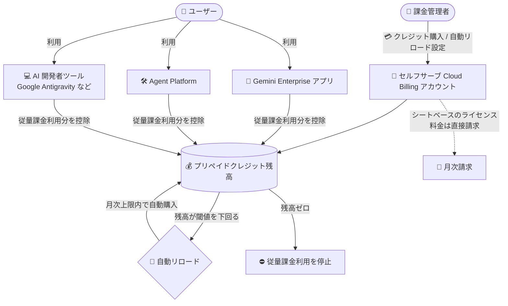

# Gemini Enterprise: Pay-as-you-go サブスクリプションとクォータ超過利用向けプリペイドクレジットが GA

**リリース日**: 2026-11-05

**サービス**: Gemini Enterprise

**機能**: Pay-as-you-go サブスクリプションおよびクォータ超過利用向けプリペイドクレジット

**ステータス**: GA (一般提供)

📊 [このアップデートのインフォグラフィックを見る](https://takech9203.github.io/google-cloud-news-summary/20261105-gemini-enterprise-prepaid-credits-ga.html)

## 概要

Gemini Enterprise のプリペイドクレジットが、セルフサーブ (オンライン) の Cloud Billing アカウント向けに一般提供 (GA) となりました。請求書払い (invoiced) の Cloud Billing アカウントを持たない組織でも、事前にクレジットを購入することで Gemini Enterprise の従量課金 (Pay-as-you-go) 利用分を支払えるようになります。

課金アカウントのクレジット残高は、Pay-as-you-go エディションの全利用分と、Standard / Plus などのライセンスベースエディションにおけるクォータ超過分の従量課金利用をカバーします。対象は Gemini Enterprise アプリ、Gemini Enterprise Agent Platform、そして Google Antigravity などの AI 開発者ツールです。Pay-as-you-go サブスクリプションにはライセンス料金がなく、使った分だけ従量課金レートで支払います。一方、Standard や Plus などのエディションにおけるシートベースのライセンス料金は、従来どおり Cloud Billing アカウントに直接請求されます (クレジットでは支払えません)。

クレジットカードさえあればオンラインで購入・自動リロード設定ができるため、請求書契約を結んでいない中小規模の組織やスタートアップが、Gemini Enterprise と AI 開発者ツールをスモールスタートで導入しやすくなるアップデートです。

**アップデート前の課題**

- Pay-as-you-go 利用分 (従量課金) の支払いには請求書払いの Cloud Billing アカウントが実質的に必要で、セルフサーブ (オンライン) アカウントのユーザーは利用のハードルが高かった
- 従量課金利用のコストを事前に確定・制御する手段が限られていた

**アップデート後の改善**

- セルフサーブ (オンライン) の Cloud Billing アカウントでも、プリペイドクレジットを購入して Pay-as-you-go エディションやクォータ超過分の従量課金利用を支払えるようになった
- クレジット残高・トランザクション履歴の追跡、月次の自動チャージ上限 (任意) 付きの自動リロード (auto-reload) 設定が可能になった
- クレジット残高がゼロになるかプロジェクトが月次支出上限に達すると利用が自動的に停止するため、前払い額を超えた予期しない支出を抑制できる
- Gemini Enterprise アプリ / Agent Platform / AI 開発者ツール横断の 30 日間コスト表示と、前払い (prepayment) 請求書・月次消費 (consumption) 請求書の表示・ダウンロードに対応した

## アーキテクチャ図

セルフサーブ課金アカウントで購入したプリペイドクレジットが、Gemini Enterprise アプリ・Agent Platform・AI 開発者ツールの従量課金利用分を一括してカバーし、残高が閾値を下回ると自動リロードで補充される仕組みです。

## サービスアップデートの詳細

### 主要機能

1. **クレジット購入と自動リロード**
   - Google Cloud コンソールの「Gemini Enterprise > Plans & billing」ページ (Credit balance タブ) または Cloud Billing の「お支払い方法」からクレジットを購入
   - 自動リロードでは「リロード金額」「残高の閾値」「月次自動チャージ上限 (任意)」を設定可能。上限に達すると翌請求月の開始まで自動リロードが一時停止する (手動購入は上限にカウントされない)
   - 残高・支払い設定・トランザクション履歴は Credit balance タブで確認できる

2. **クレジットが適用される範囲**
   - Pay-as-you-go エディションの全利用分 (ライセンス料金なし、全利用が従量課金レート)
   - Standard / Plus などライセンスベースエディションで「クォータ超過時の従量課金利用 (pay-as-you-go usage above quota)」を有効化した場合の超過利用分
   - 対象プロダクト: Gemini Enterprise アプリ、Gemini Enterprise Agent Platform、AI 開発者ツール (Google Antigravity、Antigravity for IDEs、Android Studio)
   - シートベースのライセンス料金 (Standard / Plus など) はクレジットの対象外で、従来どおり Cloud Billing アカウントへ直接請求される

3. **利用停止による支出制御**
   - クレジット残高がゼロになるか、プロジェクトが月次支出上限 (spend limit) に達すると、従量課金利用がブロックされる
   - クレジットの控除は利用発生後に行われるため、控除が実行される前に利用が発生すると残高が一時的にマイナスになる場合がある (マイナス分はアカウントに請求される)

4. **セルフサーブアカウントでの AI 開発者ツール利用**
   - アップグレード済みの有料セルフサーブ課金アカウントと、有効な非トライアルの Gemini Enterprise サブスクリプションがあれば、AI 開発者ツールを有効化してプリペイドクレジットで支払い可能
   - 対象エディション: Standard、Plus、対象となる Standard Emerging Market、Pay-as-you-go
   - 無料トライアルのサブスクリプション、無料枠 (free-tier) の課金アカウント、リセラー管理のサブアカウントは対象外

5. **コストと請求書のモニタリング**
   - 「Usage & spend」ページの Spend タブで、Gemini Enterprise アプリ / Agent Platform / AI 開発者ツール横断の直近 30 日間のコスト (クレジット・割引適用後の純額) と推移を表示
   - 前払い請求書 (Prepayment for Gemini Enterprise) と月次消費請求書 (Charges for Gemini Enterprise) を Cloud Billing の Documents ページで表示・ダウンロード可能

## 技術仕様

### クレジットの購入・残高の上限

| 項目 | 内容 |
|------|------|
| 最低購入額 | USD 5 (アカウントによってはより高い最低額が適用され、購入時に表示される) |
| 最大クレジット残高 | USD 10,000 (残高がこれを超える購入は不可) |
| 自動リロード閾値の最小値 | USD 1 |
| 自動リロード金額・閾値の最大値 | 各 USD 5,000 |
| 地域別制限 (例) | オーストラリア: 最大残高 AUD 5,000 (USD 建ての場合 USD 3,000)、自動リロード金額・閾値は各 AUD 2,500 / インド: 自動リロード金額・閾値は 1 トランザクションあたり各 INR 15,000 |

### クレジットの有効期限・その他の仕様

| 項目 | 内容 |
|------|------|
| 有効期限 | 購入から 1 年で失効 |
| 払い戻し | 原則不可 (Supplemental Paid Credit Terms で認められる場合を除く)。課金アカウントを閉鎖すると残高は失われる |
| 残高のスコープ | クレジット残高は Cloud Billing アカウントに帰属し、同じ課金アカウントにリンクされた全プロジェクトが同一残高から消費する |
| 他のクレジットとの関係 | Google AI Studio の Gemini API 用プリペイドクレジットとは別物で、相互利用は不可 |
| 支払い方法 | クレジット/デビットカード (購入・自動リロード)、UPI (インド)、RuPay (インド、1 回購入のみ)、PIX (ブラジル、1 回購入のみ)。PayPal・SEPA 口座は非対応 |

### 必要な IAM ロール

| ロール | 用途 |
|--------|------|
| Gemini Enterprise Admin (`roles/discoveryengine.agentspaceAdmin`) | プロジェクトで Plans & billing ページを開く |
| Billing Account Administrator (`roles/billing.admin`) | プリペイドクレジットのセットアップ、購入、自動リロード設定、支払い方法の管理 |
| Billing Account Viewer (`roles/billing.viewer`) | クレジット残高の閲覧のみ |

なお、Billing Account User (`roles/billing.user`) にはクレジットの閲覧・購入権限は含まれません。

## 設定方法

### 前提条件

1. プロジェクトが、アップグレード済みで良好な状態にあるオープンな有料セルフサーブ Cloud Billing アカウントにリンクされていること (無料トライアルアカウント、リセラー管理のサブアカウントは非対応)
2. プリペイドクレジットは、Pay-as-you-go エディションへの初回サブスクライブ時、またはクォータ超過時の従量課金利用を初めて有効化した時に課金アカウントへセットアップされる
3. 上記 IAM ロールが付与されていること

### 手順

#### ステップ 1: クレジットを購入する

1. Google Cloud コンソールで「Gemini Enterprise > Plans & billing」ページに移動
2. 「Credit balance」タブで「Make a payment」をクリック
3. 金額と支払い方法を選択し、プロンプトに従って購入を完了 (支払いが確認された後に残高へ反映される)

#### ステップ 2: 自動リロードを設定する

1. 「Credit balance」タブの Credit balance カードで「Set up auto-reload」(有効化済みの場合は「Manage auto-reload」) をクリック
2. 「リロード金額」「残高の閾値」「月次自動チャージ上限 (任意)」を設定して保存

#### ステップ 3: コストをモニタリングする

1. 「Gemini Enterprise > Usage & spend」ページの Spend タブで直近 30 日間のコストを確認
2. 詳細な内訳や請求書は「View details in Billing」から Cloud Billing コンソールで確認・ダウンロード

## メリット

### ビジネス面

- **導入ハードルの低下**: 請求書契約なしに、セルフサーブアカウントとクレジットカードだけで Gemini Enterprise の従量課金利用と AI 開発者ツールを開始できる
- **予算の事前確定**: 前払い方式のため支出の上限を事前に制御でき、残高ゼロで利用が停止するため予算超過リスクを抑えられる
- **コストの可視性向上**: アプリ / Agent Platform / AI 開発者ツール横断の 30 日コスト表示と、前払い・月次消費の 2 種類の請求書で支出を追跡できる

### 技術面

- **自動リロードによる運用自動化**: 残高が閾値を下回ると自動補充され、月次自動チャージ上限で過剰購入も防止できる
- **複数の支出制御の組み合わせ**: プロジェクト単位の月次支出上限 (Vertex AI をスコープとする予算設定) とクレジット残高の両方が機能し、どちらかに達した時点で利用が停止する
- **課金モデル間の柔軟な移行**: ライセンスベースと Pay-as-you-go の併用・移行時もクレジット残高は課金アカウントに維持される

## デメリット・制約事項

### 制限事項

- クレジットは購入から 1 年で失効し、原則払い戻し不可。課金アカウント閉鎖時に残高は失われる
- 最大クレジット残高は USD 10,000 (国・地域によってはさらに低い上限あり)
- 無料トライアルのサブスクリプション、無料枠の課金アカウント、リセラー管理のサブアカウントは対象外
- シートベースのライセンス料金 (Standard / Plus など) はクレジットでは支払えない
- PayPal や SEPA 銀行口座は支払い方法として使用できない
- Google AI Studio の Gemini API 用プリペイドクレジットとは別管理で、相互流用は不可

### 考慮すべき点

- クレジットの控除は利用発生後に行われるため、残高が一時的にマイナスになり、その分がアカウントに請求される可能性がある
- 支払いが拒否されると残高に反映されず、残高ゼロで利用が停止するため、支払い方法の有効性を維持する必要がある (支払い方法によっては確認に数日かかる)
- 利用停止の反映には時間がかかる場合があり、上限を超えた課金が発生する可能性がある
- 請求書払いアカウントへ移行してもクレジットは購入元のセルフサーブアカウントに残る

## ユースケース

### ユースケース 1: スタートアップが Pay-as-you-go エディションでスモールスタート

**シナリオ**: 請求書契約を持たないスタートアップが、ライセンス料金なしで Gemini Enterprise を試したい。

**実装例**: セルフサーブ課金アカウントで Pay-as-you-go エディションにサブスクライブし、サブスクライブ時にクレジットを購入。自動リロードを「残高 USD 20 を下回ったら USD 50 購入、月次上限 USD 200」のように設定する。

**効果**: ライセンス費用ゼロで利用した分だけ支払いつつ、月あたりの支出上限を前払い額で機械的に制御できる。

### ユースケース 2: Standard エディション利用組織のクォータ超過対策

**シナリオ**: Gemini Enterprise Standard を利用中の組織で、月末にプールされたクォータを使い切り、アシスタントや Antigravity の利用が止まってしまう。

**実装例**: クォータ超過時の従量課金利用 (pay-as-you-go usage above quota) を有効化し、プリペイドクレジットを購入。あわせて Vertex AI (`aiplatform.googleapis.com`) をスコープとする月次支出上限をプロジェクトに設定する。

**効果**: クォータ枯渇後も業務を中断せず従量課金レートで利用を継続でき、クレジット残高と支出上限の二重の歯止めでコストを管理できる。

## 料金

プリペイドクレジット自体に手数料はなく、購入したクレジットが従量課金利用分から控除されます。Pay-as-you-go エディションにはサブスクリプション料金・ライセンス料金がなく、以下のような従量課金レートが適用されます (USD、税別。サポートサービスに応じた変動サポート料が加算される場合があります)。

### 料金例 (Pay-as-you-go エディションの主な従量課金レート)

| 項目 | 料金 |
|--------|-----------------|
| ストレージ + データインデキシング | $5 / GiB / 月 |
| アシスタント (Gemini モデル)、エージェント利用、Deep Research、画像・動画生成 | Agent Platform の料金に準拠 |
| Claude モデル (例: Claude Sonnet 5.5) | 入力 $2.00 / 出力 $10.00 (100 万トークンあたり) |
| Claude モデル (例: Claude Opus 5.5) | 入力 $4.00 / 出力 $20.00 (100 万トークンあたり) |

詳細は [Quotas and pay-as-you-go usage](https://docs.cloud.google.com/gemini/enterprise/docs/quotas-and-pay-as-you-go-usage) および [Agent Platform の料金ページ](https://cloud.google.com/gemini-enterprise-agent-platform/generative-ai/pricing) を参照してください。

## 関連サービス・機能

- **Cloud Billing**: クレジット残高は課金アカウントに帰属し、前払い請求書・月次消費請求書の確認、支払い方法の管理、予算 (月次支出上限) の設定を Cloud Billing で行う
- **Gemini Enterprise Agent Platform**: AI モデル・エージェントの構築とデプロイの費用がクレジットの対象。従量課金レートも Agent Platform の料金に準拠する
- **Google Antigravity / Antigravity for IDEs / Android Studio (AI 開発者ツール)**: 非トライアルのサブスクリプションがあれば有効化でき、Pay-as-you-go 利用分・クォータ超過分をクレジットで支払える
- **Vertex AI**: プロジェクトの月次支出上限は Vertex AI (`aiplatform.googleapis.com`) をサービススコープとする予算で設定する

## 参考リンク

- 📊 [インフォグラフィック](https://takech9203.github.io/google-cloud-news-summary/20261105-gemini-enterprise-prepaid-credits-ga.html)
- [公式リリースノート](https://docs.cloud.google.com/release-notes#November_05_2026)
- [Manage prepaid credits](https://docs.cloud.google.com/gemini/enterprise/docs/manage-prepaid-credits)
- [Configure pay-as-you-go usage above quota](https://docs.cloud.google.com/gemini/enterprise/docs/configure-pay-as-you-go-usage-above-quota)
- [Quotas and pricing for the Pay-as-you-go edition](https://docs.cloud.google.com/gemini/enterprise/docs/quotas-and-pay-as-you-go-usage)
- [AI developer tools overview](https://docs.cloud.google.com/gemini/enterprise/docs/ai-developer-tools-overview)
- [View costs](https://docs.cloud.google.com/gemini/enterprise/docs/view-costs)
- [Manage costs overview](https://docs.cloud.google.com/gemini/enterprise/docs/manage-costs-overview)

## まとめ

プリペイドクレジットの GA により、請求書契約のないセルフサーブ課金アカウントでも Gemini Enterprise の Pay-as-you-go 利用と Google Antigravity などの AI 開発者ツールを前払い方式で安全に利用できるようになりました。従量課金の支出を残高・自動リロード上限・月次支出上限で多重に制御できるため、まずは少額のクレジット購入と自動リロード設定から導入を検討することを推奨します。クレジットは購入から 1 年で失効する点に注意し、利用計画に見合った金額で運用してください。

---

**タグ**: Gemini Enterprise, プリペイドクレジット, Pay-as-you-go, Cloud Billing, Google Antigravity, Agent Platform, GA, コスト管理
