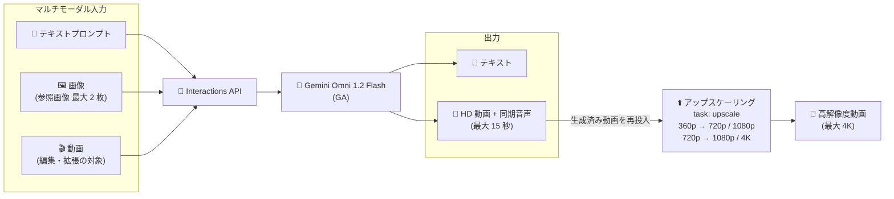

# Gemini Enterprise Agent Platform: Gemini Omni 1.2 Flash が GA (一般提供) に

**リリース日**: 2026-11-05

**サービス**: Gemini Enterprise Agent Platform

**機能**: Gemini Omni 1.2 Flash (gemini-omni-1.2-flash) の一般提供開始

**ステータス**: GA (一般提供)

📊 [このアップデートのインフォグラフィックを見る](https://takech9203.github.io/google-cloud-news-summary/20261105-gemini-omni-1-2-flash-ga.html)

## 概要

Gemini Enterprise Agent Platform において、オムニモーダル基盤モデル **Gemini Omni 1.2 Flash** (`gemini-omni-1.2-flash`) が一般提供 (GA) になりました。Gemini Omni 1.2 Flash は、テキスト・画像・動画の入力を処理し、Interactions API を通じてテキストおよび同期音声付きの高解像度動画を生成するモデルです。

今回の GA では、単体の動画アップスケーリング (`task: "upscale"`)、最大 15 秒への動画生成・編集時間の拡張、参照画像を使った動画編集・拡張、`seed` 指定による決定論的な生成、課金ラベルの付与といった新機能が追加されました。消費オプションとして Standard Pay-as-you-go (PayGo) と Provisioned Throughput (1 GSU あたり 685 トークン/秒) の両方が利用できます。

Preview 段階の Gemini Omni Flash 系モデル (Gemini Omni 1.1 Flash Preview など) を評価していたユーザーにとって、本番ワークロードへの採用を検討できる重要なマイルストーンです。動画生成・編集をアプリケーションに組み込みたい開発者、広告・マーケティング・メディア制作のパイプラインを自動化したい企業が主な対象です。

**アップデート前の課題**

- Gemini Omni Flash 系モデルは Preview 提供 (`gemini-omni-1.1-flash-preview` など) であり、GA モデルとしての本番利用ができなかった (初代 `gemini-omni-flash-preview` は 2026 年 11 月 6 日に廃止予定)
- 高解像度化 (1080p / 4K) は動画生成時の `resolution` パラメータでのみ指定でき、過去に生成した動画を後からアップスケールする単体機能がなかった
- 生成・編集できる動画の長さは 3〜10 秒に制限されていた
- 参照画像は動画生成 (reference-to-video) で利用できたが、既存動画の編集・拡張時に参照画像を併用することはできなかった
- 出力の再現性を制御する `seed` 指定や、リクエスト単位の課金ラベル付与に対応していなかった

**アップデート後の改善**

- `gemini-omni-1.2-flash` が GA となり、本番ワークロードでの利用が可能になった
- `task: "upscale"` により、生成済み動画を 360p から 720p / 1080p へ、720p から 1080p / 4K へ単体でアップスケールできるようになった
- text-to-video、image-to-video、reference-to-video、動画編集の各タスクで最大 15 秒の動画を生成・編集できるようになった (最初と最後のフレーム補間および動画拡張は最大 10 秒)
- 動画の編集・拡張時に、入力動画と合わせて最大 2 枚の参照画像を指定できるようになった
- `seed` 指定による再現性のある動画生成と、Interactions API リクエストへのカスタム課金ラベルの付与が可能になった
- Standard PayGo と Provisioned Throughput (1 GSU あたり 685 トークン/秒) の両方の消費オプションが利用可能になった

## アーキテクチャ図



テキスト・画像・動画のマルチモーダル入力を Interactions API 経由で Gemini Omni 1.2 Flash に渡し、テキストと同期音声付き HD 動画を生成します。生成済みの動画は `task: "upscale"` で最大 4K まで単体アップスケールできます。

## サービスアップデートの詳細

### 主要機能

1. **単体の動画アップスケーリング (Standalone video upscaling)**
   - `task: "upscale"` を指定することで、過去に生成した動画を単体でアップスケール可能
   - 360p の動画は 720p または 1080p へ、720p の動画は 1080p または 4K へ変換できる
   - 従来は生成時の `resolution` パラメータでしか高解像度出力を指定できなかったため、低解像度でドラフトを量産し、採用したものだけを高解像度化するワークフローが実現できる

2. **動画生成・編集時間の拡張 (最大 15 秒)**
   - text-to-video、image-to-video、reference-to-video、動画編集の各タスクで最大 15 秒の動画を生成・編集可能
   - 最初と最後のフレーム補間 (first-and-last-frame interpolation) と動画拡張 (video extension) は最大 10 秒
   - 従来モデル (Gemini Omni 1.1 Flash Preview) の出力動画は 3〜10 秒だった

3. **参照画像を使った動画編集・拡張 (Reference-guided editing and extension)**
   - 動画の編集・拡張時に、入力動画と合わせて最大 2 枚の参照画像を指定可能
   - 被写体やスタイルを参照画像で指示しながら、既存動画の一貫性を保った編集・継続生成ができる

4. **決定論的な生成と課金ラベル**
   - `seed` を指定することで再現性のある動画出力を得られる
   - Interactions API リクエストにカスタムラベルを付与でき、課金の内訳管理 (チーム別・用途別のコスト配賦など) に活用できる

5. **Standard PayGo と Provisioned Throughput**
   - Standard Pay-as-you-go (PayGo) による従量課金での利用が可能
   - Provisioned Throughput (1 GSU あたり 685 トークン/秒) により、本番ワークロード向けにスループットを事前購入できる

## 技術仕様

### モデル概要

| 項目 | 詳細 |
|------|------|
| モデル ID | `gemini-omni-1.2-flash` |
| ステータス | GA (一般提供) |
| 入力モダリティ | テキスト、画像、動画 |
| 出力モダリティ | テキスト、HD 動画 (同期音声付き) |
| API | Interactions API |
| 動画生成・編集の最大時間 | 15 秒 (text-to-video / image-to-video / reference-to-video / 動画編集) |
| フレーム補間・動画拡張の最大時間 | 10 秒 |
| アップスケーリング | 360p → 720p / 1080p、720p → 1080p / 4K (`task: "upscale"`) |
| 編集・拡張時の参照画像 | 最大 2 枚 |
| 再現性制御 | `seed` パラメータ |
| 消費オプション | Standard PayGo、Provisioned Throughput (685 トークン/秒 / GSU) |

### Interactions API のタスク構成

Gemini Enterprise Agent Platform の Interactions API では、`generation_config.video_config.task` で動画タスクを指定します。アップスケーリングでは `task: "upscale"` を使用します。

```json
{
  "model": "gemini-omni-1.2-flash",
  "input": [
    { "type": "video", "uri": "gs://video-bucket/input/draft_720p.mp4", "mime_type": "video/mp4" }
  ],
  "response_format": [
    {
      "type": "video",
      "delivery": "uri",
      "resolution": "4k",
      "gcs_uri": "gs://video-bucket/output/"
    }
  ],
  "generation_config": {
    "video_config": {
      "task": "upscale"
    }
  }
}
```

## 設定方法

### 前提条件

1. 課金が有効な Google Cloud プロジェクト
2. Agent Platform API の有効化
3. Interactions API を呼び出すための認証情報 (OAuth トークンなど)

### 手順

#### ステップ 1: Interactions API で動画を生成する

```bash
curl -X POST \
  -H "Authorization: Bearer $(gcloud auth print-access-token)" \
  -H "Content-Type: application/json; charset=utf-8" \
  -d '{
    "model": "gemini-omni-1.2-flash",
    "input": "A drone shot of a mountain landscape at sunrise.",
    "response_format": [
      { "type": "video", "delivery": "uri", "resolution": "720p", "gcs_uri": "gs://video-bucket/output/" }
    ]
  }' \
  "https://aiplatform.googleapis.com/v1beta1/projects/PROJECT_ID/locations/global/interactions"
```

テキストプロンプトから同期音声付きの動画を生成します。`resolution` と `duration` を明示的に指定すると、Provisioned Throughput 利用時のリクエストサイズ推定が正確になり、PayGo への不要なスピルオーバーを防げます。

#### ステップ 2: 生成済み動画をアップスケールする

```bash
curl -X POST \
  -H "Authorization: Bearer $(gcloud auth print-access-token)" \
  -H "Content-Type: application/json; charset=utf-8" \
  -d '{
    "model": "gemini-omni-1.2-flash",
    "input": [
      { "type": "video", "uri": "gs://video-bucket/output/draft_720p.mp4", "mime_type": "video/mp4" }
    ],
    "response_format": [
      { "type": "video", "delivery": "uri", "resolution": "4k", "gcs_uri": "gs://video-bucket/output/" }
    ],
    "generation_config": { "video_config": { "task": "upscale" } }
  }' \
  "https://aiplatform.googleapis.com/v1beta1/projects/PROJECT_ID/locations/global/interactions"
```

`task: "upscale"` を指定して、720p の動画を 4K にアップスケールします。詳細な手順は公式ドキュメントの「Upscale videos」を参照してください。

## メリット

### ビジネス面

- **本番利用が可能に**: Preview から GA へ昇格したことで、本番ワークロードでの動画生成パイプラインを構築できる
- **コスト効率の高い制作フロー**: 低解像度 (360p / 720p) でドラフトを量産し、採用カットのみを 1080p / 4K にアップスケールする段階的ワークフローが可能
- **コスト配賦の可視化**: リクエストへのカスタム課金ラベル付与により、チーム別・プロジェクト別のコスト管理が容易になる
- **柔軟な調達オプション**: 変動の大きいワークロードは Standard PayGo、安定した本番トラフィックは Provisioned Throughput と使い分けられる

### 技術面

- **単一モデルでのオムニモーダル処理**: テキスト・画像・動画の入力からテキストと同期音声付き動画の出力までを 1 つのモデル・1 つの API (Interactions API) で完結できる
- **再現性の確保**: `seed` 指定により、同じ入力から同じ動画出力を得られ、テストや A/B 比較がしやすくなる
- **一貫性のある編集**: 最大 2 枚の参照画像を編集・拡張に併用でき、被写体やスタイルの一貫性を保ちやすい
- **より長い尺の生成**: 最大 15 秒への拡張により、ショート広告や SNS 向けクリップなど実用的な長さの動画を 1 回の生成でカバーできる

## デメリット・制約事項

### 制限事項

- 最初と最後のフレーム補間 (first-and-last-frame interpolation) と動画拡張 (video extension) は最大 10 秒まで (15 秒対応は生成・編集タスクのみ)
- アップスケーリングの変換パスは「360p → 720p / 1080p」「720p → 1080p / 4K」に限定される
- 編集・拡張時に指定できる参照画像は最大 2 枚

### 考慮すべき点

- Provisioned Throughput では、Gemini Omni モデルは購入 GSU 数に応じたクォータ適用ウィンドウ (quota enforcement window) が設定され、小規模な GSU 購入ではウィンドウが長くなる (従来モデルの例では 1 GSU で 2,000 秒)。高頻度に動画を生成する場合は GSU 数の増加を検討する
- 長尺・高解像度 (特に 4K) のリクエストは 1 つのウィンドウに収まらない場合、PayGo へスピルオーバーする可能性があるため、`duration` と `resolution` を明示的に指定することが推奨される
- 旧 Preview モデル (`gemini-omni-flash-preview` は 2026 年 11 月 6 日廃止予定) を利用中の場合は、GA モデルへの移行計画が必要

## ユースケース

### ユースケース 1: 低解像度ドラフト + 選択的アップスケールによる広告動画制作

**シナリオ**: マーケティングチームが SNS 広告用の 15 秒動画を多数のバリエーションで試作し、採用した数本だけを高画質で配信したい。

**実装例**:
```
1. text-to-video で 720p・15 秒のドラフトを複数生成 (seed を変えてバリエーション展開)
2. 社内レビューで採用カットを選定
3. 採用した動画のみ task: "upscale" で 4K にアップスケール
4. 課金ラベルでキャンペーン別にコストを集計
```

**効果**: 全バリエーションを最初から高解像度で生成する場合と比べ、生成コストを抑えながら最終成果物の品質を確保できる。

### ユースケース 2: 参照画像を使ったブランド一貫性のある動画編集

**シナリオ**: 既存のプロモーション動画に対し、ブランドキャラクターや商品画像を参照として与えながらシーンを編集・拡張したい。

**効果**: 入力動画と最大 2 枚の参照画像を組み合わせることで、キャラクターや商品の見た目の一貫性を保ったまま動画の編集・継続生成ができ、手作業の合成・修正工数を削減できる。

## 料金

Gemini Omni 1.2 Flash は以下の 2 つの消費オプションで利用できます。

- **Standard Pay-as-you-go (PayGo)**: 使用量に応じた従量課金
- **Provisioned Throughput**: 1 GSU あたり 685 トークン/秒のスループットを事前購入

具体的な単価は公式料金ページを参照してください: [Gemini Enterprise Agent Platform の料金](https://cloud.google.com/gemini-enterprise-agent-platform/generative-ai/pricing#gemini-omni)

## 利用可能リージョン

従来の Gemini Omni Flash 系モデルは `global` リージョンで提供されています。Gemini Omni 1.2 Flash の最新の提供状況は [モデルの利用可能リージョン](https://docs.cloud.google.com/gemini-enterprise-agent-platform/resources/locations) を参照してください。

## 関連サービス・機能

- **Interactions API**: Gemini Omni モデルで動画生成・編集を行うための API。ステートフルなマルチターン編集 (`previous_interaction_id`) や非同期実行 (`background: true`) に対応
- **Cloud Storage**: 入力動画の読み込み (`gs://` URI) と生成動画の出力先 (`gcs_uri`) として利用
- **Provisioned Throughput**: 本番ワークロード向けにスループット (GSU) を事前購入する仕組み。GSU 見積もりツールが Google Cloud コンソールで利用可能
- **Content Credentials (C2PA)**: Gemini Omni 系モデルの生成動画に対応するコンテンツ来歴情報

## 参考リンク

- 📊 [インフォグラフィック](https://takech9203.github.io/google-cloud-news-summary/20261105-gemini-omni-1-2-flash-ga.html)
- [公式リリースノート](https://docs.cloud.google.com/release-notes#November_05_2026)
- [動画の編集 (Edit videos)](https://docs.cloud.google.com/gemini-enterprise-agent-platform/models/video/edit-videos)
- [動画の拡張 (Extend videos)](https://docs.cloud.google.com/gemini-enterprise-agent-platform/models/video/extend-videos)
- [Provisioned Throughput と Gemini Omni モデル](https://docs.cloud.google.com/gemini-enterprise-agent-platform/models/provisioned-throughput/gemini-omni-models)
- [料金ページ](https://cloud.google.com/gemini-enterprise-agent-platform/generative-ai/pricing#gemini-omni)

## まとめ

Gemini Omni 1.2 Flash の GA により、テキスト・画像・動画から同期音声付き HD 動画を生成するオムニモーダルモデルを本番環境で利用できるようになりました。単体アップスケーリングと最大 15 秒への尺の拡張、seed による再現性確保は、動画制作パイプラインの実用性を大きく高めます。Preview モデル (特に 2026 年 11 月 6 日廃止予定の `gemini-omni-flash-preview`) を利用中の場合は、GA モデルへの移行を早めに計画することを推奨します。

---

**タグ**: #GeminiEnterpriseAgentPlatform #GeminiOmni #VideoGeneration #InteractionsAPI #GA #GenerativeAI
