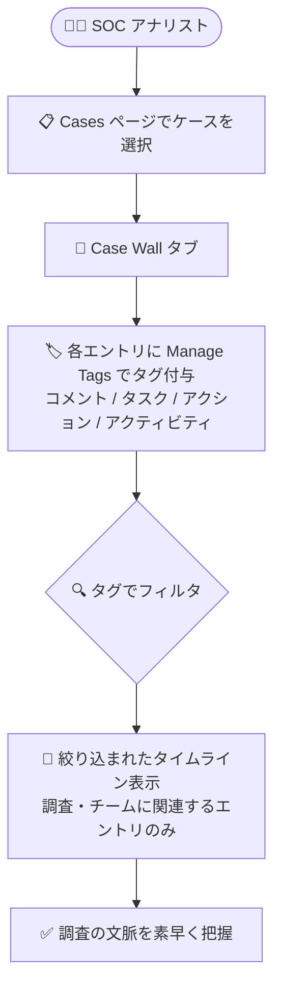

# Google SecOps: Case Wall アクティビティタグ付け (Case activity tagging)

**リリース日**: 2026-11-05

**サービス**: Google Security Operations (Google SecOps)

**機能**: Case Wall のアクティビティ単位のカスタムタグ付けとタグによるフィルタリング

**ステータス**: Feature (Spotlight Feature)

📊 [このアップデートのインフォグラフィックを見る](https://takech9203.github.io/google-cloud-news-summary/20261105-google-secops-case-activity-tagging.html)

## 概要

Google SecOps の SOAR ケース管理機能に、**Case Wall 上の個々のアクティビティ、コメント、タスク、アクションに対してカスタムタグを付与し、タグで Case Wall の表示をフィルタリングできる機能**が追加されました。今回のアップデートは Release Notes で「Spotlight Feature」として紹介されている注目機能です。

Case Wall は、ケースの作成からクローズまでのすべてのイベントとアクション (タスク、ユーザーコメント、手動/システムアクション、添付ファイルなど) を時系列で表示するタブです。従来のタグはケース単位・アラート単位でのみ付与できましたが、今回のアップデートにより、Case Wall 上の**個別のエントリ単位**で自由形式のタグを付与できるようになりました。これにより、特定の観察事項をカテゴリ分けし、タイムラインを自分の調査やチームに関連するエントリだけに絞り込んで表示できます。

長期化するインシデント調査では Case Wall のエントリが大量に蓄積されるため、SOC アナリストやインシデント対応チームにとって、調査の文脈に関係する記録だけを素早く抽出できることは調査効率の大きな向上につながります。

**アップデート前の課題**

- タグはケース単位 (Case tags) またはアラート単位 (Alert tags) でしか付与できず、Case Wall 上の個々のコメントやアクションを分類する手段がなかった
- Case Wall の絞り込みは、エントリ種別のアイコン (アクション、ステータス変更、タスク、コメントなど) やタイムスタンプによるソート、お気に入り (スター) に限られていた
- エントリが多いケースでは、調査に関連する特定の観察事項や記録を探すためにタイムライン全体を目視で確認する必要があった

**アップデート後の改善**

- Case Wall 上の個別のアクティビティ、コメント、タスク、アクションに自由形式のカスタムタグを付与できるようになった
- 付与したタグで Case Wall の表示をフィルタリングし、調査やチームに関連するエントリだけを表示できるようになった
- 「侵害の兆候」「対応済み」「チーム A 向け」など、チームの運用に合わせた分類軸でタイムライン上の観察事項を整理できるようになった

## アーキテクチャ図

アナリストが Case Wall 上の個々のエントリにカスタムタグを付与し、そのタグでタイムラインをフィルタリングして、調査に関連する記録だけを表示するフローを示しています。

## サービスアップデートの詳細

### 主要機能

1. **アクティビティ単位のカスタムタグ付与**
   - Case Wall 上の個別のアクティビティ、コメント、タスク、アクション (ログエントリ) にタグを付与できる
   - タグは自由形式の文字列 (free-form string) で、1 つのエントリに複数のタグを付与可能
   - ケース単位の Case tags やアラート単位の Alert tags、グローバルタグとは独立した仕組み

2. **タグによる Case Wall のフィルタリング**
   - 付与したタグで Case Wall の表示を絞り込み、関連するエントリのみを表示できる
   - 調査の論点ごと、担当チームごとなど、任意の分類軸でタイムラインを整理できる

3. **時系列調査 (chronological investigation) の効率化**
   - エントリ数が多いケースでも、特定の観察事項や対応記録を素早く抽出できる
   - 公式ドキュメントでは「時系列調査を効率化 (streamline chronological investigations)」するための機能と位置付けられている

## 技術仕様

### タグの種類の比較

| 項目 | Case tags | Alert tags | Case activity tags (今回追加) |
|------|-----------|-----------|------------------------------|
| 付与対象 | ケース全体 | 個別のアラート | Case Wall 上の個別エントリ (アクティビティ、コメント、タスク、アクション) |
| 形式 | タグテーブル管理 (自動付与ルールあり) | タグテーブル管理 | 自由形式の文字列 (グローバルタグとは別物) |
| 主な用途 | ケースの検索・分類・プレイブックトリガー | アラートの追跡・分類 | タイムラインの分類とフィルタリング |

## 設定方法

### 前提条件

1. Google SecOps のケース管理機能 (SOAR) を利用できる環境であること
2. ケース管理に関する標準の権限を持っていること (ケースタグの管理には SLA モジュールの有効化が必要。新規タグの作成可否はユーザー権限に依存)

### 手順

#### Case Wall のアクティビティにタグを付与する

1. **Cases** ページに移動し、対象のケースを選択する
2. **Case Wall** タブを開き、タグ付けしたいアクティビティ (エントリ) を見つける
3. 対象エントリの **More options** (縦三点メニュー) をクリックする
4. **Manage Tags** をクリックする
5. **Manage Tags** ダイアログでタグ名を入力して Enter キーを押す (複数タグを追加する場合はこの操作を繰り返す)
6. **Save** をクリックする

#### タグで Case Wall をフィルタリングする

タグ付与後、Case Wall のフィルタで対象タグを選択すると、そのタグが付与されたエントリのみがタイムラインに表示されます。

## メリット

### ビジネス面

- **調査時間の短縮**: 大量のエントリから関連する記録だけを即座に抽出でき、MTTR (平均対応時間) の短縮に寄与する
- **チーム間の引き継ぎ効率化**: チームや論点ごとのタグで整理することで、シフト交代やエスカレーション時に必要な文脈を素早く共有できる
- **監査・レビューの容易化**: 重要な観察事項や意思決定の記録をタグで分類しておくことで、事後レビューや報告書作成が効率化される

### 技術面

- **柔軟な分類**: 自由形式の文字列タグのため、事前のタグテーブル整備なしにチームの運用に合わせた分類が可能
- **既存のタグ体系との併用**: ケースタグ・アラートタグと組み合わせて、「ケース → アラート → 個別アクティビティ」の各粒度で分類を使い分けられる

## デメリット・制約事項

### 考慮すべき点

- Case activity tags は自由形式のため、タグテーブルで集中管理されるケースタグ/アラートタグと異なり、表記ゆれを防ぐにはチーム内での命名規則の整備が必要
- ケースタグ/アラートタグとは別の仕組みであり、グローバルタグとは区別される点に注意 (タグの自動付与ルールや プレイブックのタグトリガーは従来どおりケース/アラートタグが対象)

## ユースケース

### ユースケース 1: 長期化したインシデント調査の論点整理

**シナリオ**: ランサムウェア感染のケースで調査が数日間に及び、Case Wall に数百件のコメント・アクション結果が蓄積されている。初期侵入経路に関する観察事項だけを振り返りたい。

**実装例**: 初期侵入に関するコメントや調査アクション結果に `initial-access` タグを付与し、Case Wall を同タグでフィルタリングする。

**効果**: タイムライン全体を目視で追うことなく、初期侵入経路に関する記録だけを時系列で確認でき、調査レポート作成も効率化される。

### ユースケース 2: チーム間のハンドオフ

**シナリオ**: フォローアップが必要な項目を夜間シフトのチームに引き継ぎたい。

**効果**: `handoff-night-shift` のようなタグを対象のタスクやコメントに付与しておくことで、引き継ぎを受けたチームはタグでフィルタリングするだけで対応すべきエントリを漏れなく把握できる。

## 料金

本機能は Google SecOps のケース管理機能の一部として提供され、追加料金に関するアナウンスはありません。Google SecOps はパッケージ (Standard / Enterprise / Enterprise Plus) ベースのライセンス体系です。詳細は料金ページを参照してください。

- [Google SecOps の料金](https://cloud.google.com/chronicle/docs/preview/pricing)

## 関連サービス・機能

- **Case tags / Alert tags**: ケース単位・アラート単位のタグ。**Settings > Investigation > Tags** で管理し、条件に基づく自動タグ付けルールや CSV インポートにも対応。今回の Case activity tags はこれらを補完する、より細かい粒度のタグ
- **プレイブック (SOAR Playbooks)**: ケースタグをトリガーにプレイブックを起動したり、`Case Tag` アクションでタグを自動付与したりできる
- **Chronicle API (`cases.addTag`)**: REST API 経由でケースにタグを追加できる (`chronicle.cases.updateTag` 権限が必要)
- **Case Overview タブ**: 「Latest case wall activity」ウィジェットで Case Wall のアクティビティのタイムラインを表示できる

## 参考リンク

- 📊 [インフォグラフィック](https://takech9203.github.io/google-cloud-news-summary/20261105-google-secops-case-activity-tagging.html)
- [公式リリースノート](https://docs.cloud.google.com/release-notes#November_05_2026)
- [ドキュメント: Add a tag to a Case Wall activity](https://docs.cloud.google.com/chronicle/docs/soar/investigate/working-with-cases/define-tags-in-cases-admin#add-activity-tag)
- [ドキュメント: Manage case and alert tags](https://docs.cloud.google.com/chronicle/docs/soar/investigate/working-with-cases/define-tags-in-cases-admin)
- [ドキュメント: ケースの概要 (Case Wall タブ)](https://docs.cloud.google.com/chronicle/docs/soar/investigate/working-with-cases/cases-overview)

## まとめ

Case Wall のアクティビティ単位でタグ付けとフィルタリングができるようになったことで、エントリが大量に蓄積される大規模インシデントの調査でも、関連する記録だけを素早く抽出できるようになりました。Google SecOps でケース管理を運用しているチームは、調査の論点や引き継ぎ用途に合わせたタグの命名規則を定め、日々の調査ワークフローに組み込むことを推奨します。

---

**タグ**: Google SecOps, SOAR, ケース管理, Case Wall, タグ付け, SOC, インシデント対応, セキュリティ運用
