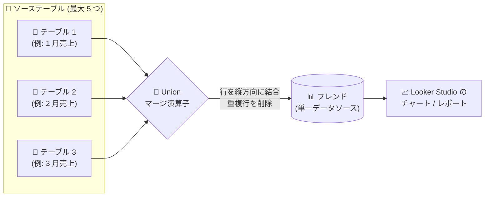

# Looker Studio (Data Studio): ブレンドで Union マージ演算子が利用可能に

**リリース日**: 2026-11-05

**サービス**: Looker Studio (Data Studio)

**機能**: ブレンドにおける Union マージ演算子によるテーブルの縦方向結合

**ステータス**: 一般提供 (Feature)

📊 [このアップデートのインフォグラフィックを見る](https://takech9203.github.io/google-cloud-news-summary/20261105-looker-studio-union-merge-operator.html)

## 概要

Looker Studio (リリースノート上の表記は Data Studio) のデータブレンド機能に、**Union マージ演算子**が追加されました。これにより、最大 5 つのテーブルの行を縦方向に積み重ねて (append) 結合できるようになります。Union 演算子は結合時に重複行を自動的に削除し、テーブル間で一意な行のみを返します。

従来のブレンドは 5 種類の結合 (join) 演算子による**横方向の結合** (列の追加) のみをサポートしていましたが、今回のアップデートで**縦方向の結合** (行の追加) もノーコードで実現できるようになりました。月別の売上テーブルを四半期分析用に 1 つにまとめるといった、構造が同一の複数テーブルの統合が、SQL を書かずにブレンドエディタ上で完結します。

あわせて、ブレンド UI のラベルが join と union の両方を包含する「merge」という表現に変更されました。具体的には「Merge another table (別のテーブルをマージ)」「Merge conditions (マージ条件)」「Hide repeated merge fields (繰り返しマージフィールドを非表示)」などの表記になります。

**アップデート前の課題**

- ブレンドのマージ演算子は 5 種類の join (Inner / Left outer / Right outer / Full outer / Cross) のみで、データを横方向 (列の追加) にしか結合できなかった
- 月別・リージョン別など構造が同じテーブルを 1 つのデータセットに積み上げるには、BigQuery の `UNION` クエリなどデータソース側での事前加工が必要だった
- UI のラベル (「Join another table」「Join conditions」など) は join 操作を前提とした表現だった

**アップデート後の改善**

- Union マージ演算子により、最大 5 テーブルの行を縦方向に結合する操作がブレンドエディタ上でノーコードで可能になった
- Union は重複行を自動的に削除し、テーブル間で一意な行のみを返すため、重複排除の後処理が不要になった
- UI ラベルが「merge」ベースの表現に統一され、join と union の両操作を一貫した用語で扱えるようになった

## アーキテクチャ図



同一構造の複数テーブルを Union 演算子で縦方向に積み上げ、重複行を除去した単一のブレンドとしてチャートやレポートから参照するデータフローです。

## サービスアップデートの詳細

### 主要機能

1. **Union マージ演算子**
   - 右側テーブルの行を左側テーブルに追加 (append) し、縦方向に積み重ねて結合する
   - テーブル間の重複行は削除され、一意な行のみが返される (DISTINCT 相当の挙動)
   - 1 つのブレンドで最大 5 テーブルまで結合可能

2. **Union のマージ条件 (フィールドペアリング)**
   - 各テーブルのディメンションとメトリクスを、もう一方のテーブルの同じデータ型のフィールドとペアリングし、同じ出力列に値を積み上げる
   - フィールド名が一致している必要はなく、Looker Studio は名前とデータ型が一致するフィールドを自動でペアリングする (手動調整も可能)
   - ペアリングの順序が列の縦方向の整列を決定するため、対応するフィールドを同じ順序でペアリングする必要がある

3. **ブレンド UI ラベルの「merge」への統一**
   - 「Merge another table」「Merge conditions」「Hide repeated merge fields」など、join と union の両方を包含する表現に変更
   - 機能自体の変更ではなく、用語の一貫性向上を目的としたラベル変更

## 技術仕様

### Union ブレンドのルールと制約

| 項目 | 詳細 |
|------|------|
| マージ演算子の種類 | join 5 種 (Inner / Left outer / Right outer / Full outer / Cross) + Union |
| テーブル数の上限 | 1 ブレンドあたり最大 5 テーブル |
| マージタイプの混在 | 不可。1 つのブレンドは全 join または全 union のいずれかで構成する |
| 重複行の扱い | Union は重複行を削除し、一意な行のみを返す |
| フィールドペアリング | 両テーブルでディメンションとメトリクスの数が一致し、すべてのフィールドが同一データ型のフィールドとペアリングされている必要がある |
| Hide repeated merge fields | Union では既定で有効かつロックされ、結合テーブル間の重複フィールドを自動的に非表示にする |

### Join と Union の違い

| 観点 | Join (結合) | Union (和集合) |
|------|-------------|----------------|
| 結合方向 | 横方向 (列を追加) | 縦方向 (行を追加) |
| 主な用途 | 共通キーによるデータのエンリッチ | 同一構造のデータセットの積み上げ |
| マージ条件 | 一致する値を持つフィールドのリンク (等価条件のみ) | 同一データ型フィールド同士のペアリング |

## 設定方法

### 前提条件

1. Looker Studio でブレンドを作成・編集できる権限があること
2. Union するテーブル同士でディメンションとメトリクスの数が同じであり、各フィールドに同じデータ型の対応フィールドが存在すること

### 手順

#### ステップ 1: マージ構成を開く

ブレンドエディタで、2 つのテーブルの間にあるマージ構成ボックスをクリックします。

#### ステップ 2: Union 演算子を選択

マージ演算子として **Union** を選択します。

#### ステップ 3: フィールドのペアリングを確認

**Merge conditions** でフィールドのペアリングを確認します。Looker Studio は名前とデータ型が一致するフィールドを自動でペアリングします。フィールド名が異なる場合や整列を調整したい場合は、各ディメンションとメトリクスを手動でペアリングし、値が同じ出力列に表示されるようにします。

#### ステップ 4: 保存

**Save** をクリックしてブレンドを保存します。

**補足**: ブレンド前に各テーブルはディメンションに基づいてグループ化・集計されます。ディメンションにレコードの一意な識別子が含まれない場合、この事前グループ化の段階で同一行が集約されるため、各レコードを区別したい場合は主キーや行 ID などの一意な識別子フィールドを各テーブルのディメンションに追加してください。

## メリット

### ビジネス面

- **ノーコードでのデータ統合**: SQL を書かずに、月別・部門別などに分かれたテーブルを 1 つのデータセットに統合して分析でき、非エンジニアでも横断分析が可能になる
- **データ準備工数の削減**: データソース側 (BigQuery など) で UNION ビューを事前に用意する作業が不要になり、レポート作成までのリードタイムが短縮される

### 技術面

- **重複排除の自動化**: Union が一意な行のみを返すため、テーブル間の重複排除処理を別途実装する必要がない
- **自動フィールドペアリング**: 名前とデータ型が一致するフィールドは自動でペアリングされ、設定の手間が少ない
- **一貫した UI 用語**: 「merge」ベースのラベルにより、join と union を同じメンタルモデルで扱える

## デメリット・制約事項

### 制限事項

- 1 つのブレンドに含められるテーブルは最大 5 つ
- 1 つのブレンド内で join と union を混在させることはできない (すべて join またはすべて union)
- Union では両テーブルのディメンションとメトリクスの数が一致し、すべてのフィールドが同一データ型のフィールドとペアリングされていないとブレンドを保存できない
- Union では「Hide repeated merge fields」オプションが既定で有効かつロックされており、無効化できない

### 考慮すべき点

- Union は重複行を削除する (DISTINCT 相当) ため、重複行をそのまま保持したい集計 (単純な append) には向かない。重複を保持したい場合は各テーブルのディメンションに一意な識別子を含める必要がある
- マージ条件でのフィールドペアリングの順序が列の整列を決めるため、順序を誤るとデータが誤った列に積み上がる
- ブレンド前の事前グループ化により、ディメンションに一意な識別子がないと行数が想定より減る可能性がある

## ユースケース

### ユースケース 1: 月次売上テーブルの四半期統合

**シナリオ**: 1 月・2 月・3 月の売上データが同一構造 (Date / Region / Revenue) の別テーブルに分かれており、四半期全体のトレンドを 1 つのチャートで可視化したい。

**実装例**:
```text
ブレンド構成:
  テーブル 1: January Sales  (Date, Region, Revenue)
  テーブル 2: February Sales (Date, Region, Revenue)
  テーブル 3: March Sales    (Date, Region, Revenue)
  マージ演算子: Union (テーブル間ごとに設定)
  マージ条件: Date ⇔ Date, Region ⇔ Region, Revenue ⇔ Revenue
```

**効果**: 3 つの月次テーブルが縦方向に積み上がった単一のブレンドとなり、SQL なしで四半期全体の売上分析チャートを作成できる。

### ユースケース 2: フィールド名が異なる複数ソースの統合

**シナリオ**: 複数のシステムから出力されたデータで、同じ意味のフィールドが異なる名前 (例: `customer_ID` と `cust_id`) になっているテーブルを 1 つのデータセットとして可視化したい。

**効果**: Union のマージ条件では、フィールド名が一致していなくてもデータ型が一致していれば手動でペアリングできるため、ソース側のスキーマ変更なしにデータを統合できる。

## 関連サービス・機能

- **BigQuery**: 従来はデータソース側で SQL の `UNION` を用いて事前統合するのが一般的だった。小規模な統合は Looker Studio のブレンドで完結できるようになり、使い分けが可能になる
- **Looker Studio の join 演算子**: 横方向の結合 (列の追加) には引き続き Inner / Left outer / Right outer / Full outer / Cross join を使用する。Union と合わせて 6 種類のマージ演算子から選択できる

## 参考リンク

- 📊 [インフォグラフィック](https://takech9203.github.io/google-cloud-news-summary/20261105-looker-studio-union-merge-operator.html)
- [公式リリースノート](https://docs.cloud.google.com/release-notes#November_05_2026)
- [ドキュメント: How blends work in Data Studio](https://docs.cloud.google.com/data-studio/how-blends-work)
- [ドキュメント: Create, edit, and manage blends](https://docs.cloud.google.com/data-studio/create-edit-and-manage-blends)

## まとめ

Looker Studio のブレンドが join による横方向の結合に加えて Union による縦方向の結合に対応し、同一構造の複数テーブルの統合がノーコードで可能になりました。これまで BigQuery などデータソース側で UNION クエリを用意していたケースでは、ブレンドへの置き換えを検討する価値があります。Union は重複行を削除する点と、join と union を混在できない点に注意して設計してください。

---

**タグ**: #LookerStudio #DataStudio #ブレンド #Union #データ可視化 #BI
