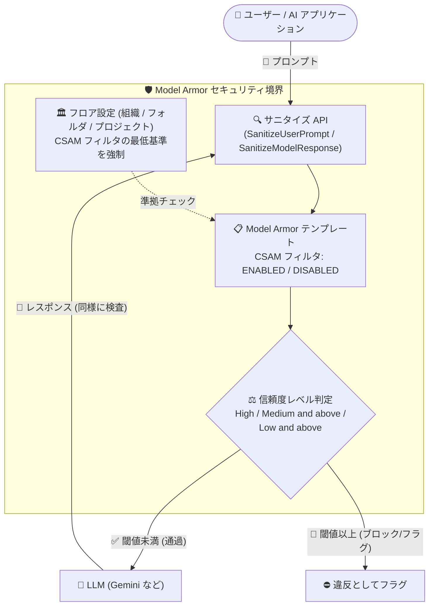

# Model Armor: CSAM フィルタの有効化/無効化と信頼度レベルのきめ細かな設定

**リリース日**: 2026-11-05

**サービス**: Model Armor

**機能**: CSAM フィルタの設定 (有効化/無効化、信頼度レベルの指定)

**ステータス**: Feature

📊 [このアップデートのインフォグラフィックを見る](https://takech9203.github.io/google-cloud-news-summary/20261105-model-armor-csam-filter-configuration.html)

## 概要

Google Cloud の LLM 向けセキュリティサービスである Model Armor において、児童性的虐待コンテンツ (CSAM: Child Sexual Abuse Material) フィルタの設定が可能になりました。Model Armor テンプレートおよびフロア設定 (floor settings) の両方で、CSAM フィルタの有効化/無効化を切り替えられるほか、きめ細かな信頼度レベル (High、Medium and above、Low and above) を構成できます。

CSAM 検出は、ユーザープロンプトとモデルレスポンスの両方をスキャンし、指定した信頼度レベルに基づいて違反をフラグします。フィルタ設定を指定しない場合のデフォルト動作も明確に定義されており、フロア設定ではデフォルトで High 信頼度レベルで有効、テンプレートでは CSAM 検出をサポートするリージョン (またはデータレジデンシー コンプライアンスが無効な場合) で High 信頼度レベルで有効になります。

生成 AI アプリケーションを運用する企業にとって、CSAM のような高リスクコンテンツへの対策は法令遵守の観点からも必須です。今回のアップデートにより、組織のリスク許容度やアプリケーション特性に応じて検出感度を調整できるようになり、誤検知 (false positive) と見逃し (false negative) のバランスを制御可能になりました。

**アップデート前の課題**

- CSAM フィルタの検出感度 (信頼度レベル) をワークロードごとに調整する手段がなく、アプリケーション特性に応じた誤検知と検出率のバランス制御ができなかった
- テンプレートとフロア設定の両方で CSAM フィルタの挙動を統一的に管理する設定項目が提供されていなかった
- データレジデンシー要件のあるリージョンにおける CSAM フィルタの挙動をテンプレート単位で制御できなかった

**アップデート後の改善**

- テンプレートとフロア設定の両方で CSAM フィルタの有効化/無効化を明示的に設定できるようになった
- 信頼度レベルを High (確度の高い違反のみ検出)、Medium and above (中程度以上)、Low and above (わずかな兆候も検出) の 3 段階から選択できるようになった
- フロア設定で CSAM フィルタの最低基準 (フィルタ有効化や信頼度レベル) を定めることで、組織・フォルダ・プロジェクト配下のテンプレートに準拠を強制できるようになった

## アーキテクチャ図



プロンプトとレスポンスは Model Armor テンプレートの CSAM フィルタで検査され、設定した信頼度レベル以上の検出があればフラグされます。フロア設定はテンプレートが組織の最低基準に準拠していることを保証します。

## サービスアップデートの詳細

### 主要機能

1. **CSAM フィルタの有効化/無効化**
   - `csamFilterSettings.filterEnforcement` で `ENABLED` / `DISABLED` を指定可能
   - テンプレートとフロア設定の両方で設定できる
   - 未指定の場合はデフォルトで有効 (High 信頼度レベル)。ただしデータレジデンシー (DRZ) 準拠リソースで CSAM 検出が未サポートのリージョンではデフォルト無効

2. **きめ細かな信頼度レベルの設定**
   - `csamFilterSettings.confidenceLevel` で 3 段階の閾値を指定可能
     - **High**: 違反の可能性が非常に高いコンテンツのみフラグ (誤検知リスク: 非常に低い)
     - **Medium and above**: 中程度以上の確度でフラグ (誤検知リスク: 中程度)
     - **Low and above**: わずかな兆候でもフラグ (誤検知リスク: 高い)
   - 検出信頼度が指定レベル以上の場合にポジティブマッチとして報告される

3. **フロア設定によるガバナンス強制**
   - フロア設定で CSAM フィルタの `ENABLED` を要求すると、配下のテンプレートで `DISABLED` に設定できない
   - フロア設定で `MEDIUM_AND_ABOVE` を指定すると、テンプレートはそれより緩い `HIGH` を設定できない (信頼度レベルの優先順位ルール)
   - 違反するテンプレートが存在する場合、Security Command Center (Premium/Enterprise ティア) に高重大度の検出結果が生成される

## 技術仕様

### CSAM フィルタのデフォルト動作

| 設定対象 | 条件 | デフォルト動作 |
|------|------|------|
| フロア設定 | グローバルリソースのため常に | 有効 (High 信頼度レベル) |
| テンプレート | CSAM 検出サポートリージョン、またはデータレジデンシー コンプライアンス無効時 | 有効 (High 信頼度レベル) |
| テンプレート | CSAM 検出未サポートリージョンでデータレジデンシー コンプライアンス有効時 | 無効 (テンプレートでデータレジデンシー コンプライアンスを無効化しない限り、CSAM 検出有効のテンプレートを作成・更新不可) |

### 信頼度レベルの選択指針

| 信頼度レベル | 検出確率 | 誤検知リスク | 推奨ユースケース |
|------|------|------|------|
| High | 違反がほぼ確実なコンテンツのみフラグ | 非常に低い | ユーザー体験の中断を最小化したい本番環境 |
| Medium and above | バランスの取れた確度でフラグ | 中程度 | 標準的なエンタープライズ アプリケーション |
| Low and above | わずかな兆候でもフラグ | 高い | 見逃し防止が最優先の高リスクカテゴリ (慎重に使用) |

### CsamFilterSettings の JSON 表現

```json
{
  "csamFilterSettings": {
    "filterEnforcement": "ENABLED",
    "confidenceLevel": "HIGH"
  }
}
```

- `filterEnforcement`: `CSAM_FILTER_ENFORCEMENT_UNSPECIFIED` / `ENABLED` / `DISABLED`
- `confidenceLevel`: フィルタ有効時のみ使用される検出閾値

**注意**: CSAM フィルタの構成は Model Armor API 経由でのみ可能で、Google Cloud コンソールからは設定できません。

## 設定方法

### 前提条件

1. Model Armor API が有効化されたプロジェクトがあること
2. テンプレートの作成・更新権限 (Model Armor 管理者ロールなど) を持っていること
3. フロア設定を組織・フォルダレベルで構成する場合は API を使用すること (UI はプロジェクトレベルのみ)

### 手順

#### ステップ 1: CSAM フィルタを含むテンプレートを作成する

```bash
export FILTER_CONFIG='{
  "filterConfig": {
    "raiSettings": {
      "raiFilters": [
        { "filterType": "HATE_SPEECH", "confidenceLevel": "MEDIUM_AND_ABOVE" },
        { "filterType": "SEXUALLY_EXPLICIT", "confidenceLevel": "MEDIUM_AND_ABOVE" }
      ]
    },
    "piAndJailbreakFilterSettings": {
      "filterEnforcement": "ENABLED",
      "confidenceLevel": "HIGH"
    },
    "maliciousUriFilterSettings": { "filterEnforcement": "ENABLED" },
    "csamFilterSettings": {
      "filterEnforcement": "ENABLED",
      "confidenceLevel": "HIGH"
    }
  }
}'

curl -X POST \
  -d "$FILTER_CONFIG" \
  -H "Content-Type: application/json" \
  -H "Authorization: Bearer $(gcloud auth print-access-token)" \
  "https://modelarmor.LOCATION.rep.googleapis.com/v1/projects/PROJECT_ID/locations/LOCATION/templates?template_id=TEMPLATE_ID"
```

`csamFilterSettings` で CSAM フィルタを有効化し、信頼度レベルを `HIGH` に設定しています。`MEDIUM_AND_ABOVE` や `LOW_AND_ABOVE` に変更することで検出感度を上げられます。

#### ステップ 2: 既存テンプレートの CSAM フィルタ設定を更新する

```bash
export FILTER_CONFIG='{
  "filterConfig": {
    "csamFilterSettings": {
      "filterEnforcement": "ENABLED",
      "confidenceLevel": "MEDIUM_AND_ABOVE"
    }
  }
}'

curl -X PATCH \
  -H "Authorization: Bearer $(gcloud auth print-access-token)" \
  -H "Content-Type: application/json" \
  -d "$FILTER_CONFIG" \
  "https://modelarmor.LOCATION.rep.googleapis.com/v1/projects/PROJECT_ID/locations/LOCATION/templates/TEMPLATE_ID?updateMask=filterConfig.csamFilterSettings"
```

`updateMask` に `filterConfig.csamFilterSettings` を指定することで、CSAM フィルタ設定のみを更新できます。

#### ステップ 3: フロア設定で CSAM フィルタの最低基準を強制する (任意)

フロア設定は組織 (`organizations/ORGANIZATION_ID`)、フォルダ (`folders/FOLDER_ID`)、プロジェクト (`projects/PROJECT_ID`) の各レベルで構成できます。フロア設定で CSAM フィルタの有効化や信頼度レベルを定めると、配下のテンプレートはそれより緩い設定で作成・更新できなくなります。詳細は [フロア設定の構成](https://docs.cloud.google.com/model-armor/configure-floor-settings) を参照してください。

## メリット

### ビジネス面

- **コンプライアンス強化**: CSAM という法的リスクの高いコンテンツカテゴリに対し、組織ポリシーに沿った検出基準を明示的に定義・強制できる
- **ガバナンスの一元化**: フロア設定により、分散した開発チームが作成するテンプレートにも組織全体で最低限の CSAM 対策を保証できる
- **ユーザー体験との両立**: 本番環境では High、リスク重視環境では Low and above など、アプリケーション特性に応じた感度調整が可能

### 技術面

- **プロンプトとレスポンスの双方向検査**: ユーザー入力だけでなくモデル出力も CSAM 検出の対象となる
- **API によるコード管理**: フィルタ設定が JSON で表現されるため、IaC やパイプラインでのテンプレート管理に組み込みやすい
- **Security Command Center 連携**: フロア設定違反のテンプレートは高重大度の検出結果として可視化される (Premium/Enterprise ティア)

## デメリット・制約事項

### 制限事項

- CSAM フィルタの構成は Model Armor API 経由でのみ可能で、Google Cloud コンソールからは設定できない
- CSAM 検出をサポートしないリージョンでデータレジデンシー コンプライアンスが有効な場合、CSAM 検出を有効にしたテンプレートの作成・更新ができない (テンプレートでデータレジデンシー コンプライアンスを無効化する必要がある)
- フロア設定はテンプレートの準拠を検証するが、Sensitive Data Protection の準拠は検証しない

### 考慮すべき点

- Low and above は誤検知リスクが高く、無害なコンテンツをブロックする可能性があるため、一般的な用途での使用は慎重に判断する
- フロア設定で厳しい基準 (例: `MEDIUM_AND_ABOVE`) を設定すると、配下のテンプレートはより緩い `HIGH` を選択できなくなるため、組織全体への影響を事前に評価する
- 検出感度を下げる (閾値を Low and above にする) と検出イベントが増え、運用上のレビュー負荷が増加する可能性がある

## ユースケース

### ユースケース 1: 一般消費者向けチャットアプリケーションの安全性強化

**シナリオ**: 不特定多数のユーザーが利用する生成 AI チャットサービスで、CSAM 関連コンテンツの入出力を確実に遮断したい。誤検知による正常な会話のブロックは最小限にしたい。

**実装例**:
```json
{
  "csamFilterSettings": {
    "filterEnforcement": "ENABLED",
    "confidenceLevel": "HIGH"
  }
}
```

**効果**: 違反がほぼ確実なコンテンツのみをブロックするため、ユーザー体験を損なわずに高リスクコンテンツ対策を実現できる。

### ユースケース 2: 組織全体への CSAM 対策の強制 (フロア設定)

**シナリオ**: 複数のプロジェクトチームがそれぞれ Model Armor テンプレートを作成している組織で、どのテンプレートでも CSAM フィルタが無効化されないことを保証したい。

**効果**: 組織レベルのフロア設定で CSAM フィルタの `ENABLED` と最低信頼度レベルを定義することで、準拠しないテンプレートの作成・更新を防止し、違反は Security Command Center の高重大度の検出結果として検知できる。

## 料金

Model Armor の料金は公式料金ページを参照してください。Security Command Center との統合利用やスタンドアロン利用で体系が異なります。

- [Security Command Center 料金 (Model Armor を含む)](https://cloud.google.com/security-command-center/pricing)

## 利用可能リージョン

CSAM 検出のリージョンサポートはリージョンによって異なります。データレジデンシー コンプライアンスとの組み合わせによりデフォルト動作が変わるため、以下の公式ドキュメントで対象リージョンを確認してください。

- [リージョン別のサポート機能](https://docs.cloud.google.com/model-armor/feature-availability-by-region)

## 関連サービス・機能

- **Security Command Center**: フロア設定に違反するテンプレートを高重大度の検出結果として報告 (Premium/Enterprise ティア)
- **Sensitive Data Protection**: Model Armor の機密データ検出フィルタとして統合されており、CSAM フィルタと組み合わせて多層防御を構成できる
- **Vertex AI / Gemini**: フロア設定のインライン適用により、Gemini モデルへのリクエストをアプリケーションコードの変更なしに検査できる
- **組織ポリシーサービス**: カスタム組織ポリシーで Model Armor テンプレートに必須フィルタの適用を強制できる

## 参考リンク

- 📊 [インフォグラフィック](https://takech9203.github.io/google-cloud-news-summary/20261105-model-armor-csam-filter-configuration.html)
- [公式リリースノート](https://docs.cloud.google.com/release-notes#November_05_2026)
- [Model Armor フィルタ (CSAM 検出)](https://docs.cloud.google.com/model-armor/overview#ma-csam-detection)
- [テンプレートの作成と管理](https://docs.cloud.google.com/model-armor/manage-templates#configure-detections)
- [フロア設定の構成](https://docs.cloud.google.com/model-armor/configure-floor-settings)
- [CsamFilterSettings API リファレンス](https://docs.cloud.google.com/model-armor/reference/rest/v1/projects.locations.templates)

## まとめ

今回のアップデートにより、CSAM という最も高リスクなコンテンツカテゴリに対して、有効化/無効化と 3 段階の信頼度レベルによるきめ細かな制御が可能になりました。生成 AI アプリケーションを運用している組織は、まずフロア設定で組織全体の最低基準を定義し、各テンプレートでアプリケーション特性に応じた信頼度レベルを設定することを推奨します。CSAM フィルタの構成は API 経由のみである点に留意してください。

---

**タグ**: Model Armor, CSAM, AI セキュリティ, 生成 AI, フロア設定, テンプレート, Security Command Center, コンテンツフィルタリング
