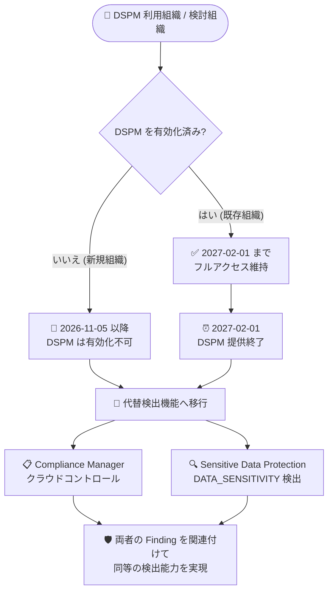

# Security Command Center: Data Security Posture Management (DSPM) の非推奨化

**リリース日**: 2026-11-05

**サービス**: Security Command Center

**機能**: Data Security Posture Management (DSPM) の非推奨化と提供終了スケジュール

**ステータス**: Deprecated (非推奨)

📊 [このアップデートのインフォグラフィックを見る](https://takech9203.github.io/google-cloud-news-summary/20261105-security-command-center-dspm-deprecation.html)

## 概要

Security Command Center の Data Security Posture Management (DSPM) が非推奨となり、新規組織では利用できなくなりました。DSPM は、Google Cloud 上の機密データの所在を可視化し、データ中心のセキュリティポスチャ (公開アクセス、CMEK 未使用、過剰な権限などのリスク) を継続的に評価・是正するための機能です。

すでに DSPM を有効化している組織は、**2027 年 2 月 1 日の提供終了 (シャットダウン) まで引き続きフルアクセスを維持**できます。公式の非推奨一覧によると、DSPM の非推奨日は 2026 年 9 月 14 日、提供終了日は 2027 年 2 月 1 日以降とされています。提供終了後は DSPM のダッシュボード、データセキュリティフレームワーク、関連するクラウドコントロールは利用できなくなります。

DSPM を利用している組織のセキュリティ管理者は、提供終了までに代替の検出機能への移行を計画する必要があります。Google は代替手段として、**Compliance Manager のクラウドコントロールと Sensitive Data Protection の検出機能を組み合わせる**ことで、DSPM のベースラインコントロールと同等の検出能力を実現できるとしています。

**アップデート前の状況**

- DSPM は Security Command Center の Standard / Premium / Enterprise 各ティアで利用可能で、新規組織でも有効化できた
- BigQuery や Cloud Storage などの機密データの自動検出・分類、データガバナンスコントロール (Data Access Governance、Data Flow Governance など) の適用、コンプライアンスモニタリングを単一機能で提供していた
- 「Data security and privacy essentials framework」により、機密データを含むリソースに対する CMEK 強制や公開アクセスのブロックなどを一元的に監視できた

**アップデート後の変更**

- 2026 年 11 月 5 日時点で、DSPM は新規組織では有効化できなくなった
- 既存の有効化済み組織は 2027 年 2 月 1 日の提供終了までフルアクセスを維持できる
- 提供終了後は、Compliance Manager と Sensitive Data Protection の組み合わせによる代替検出機能への移行が必要になる
- 関連して、Security Command Center Enterprise ティア自体も 2027 年 5 月 21 日に提供終了し、Premium ティアへ自動移行される予定

## アーキテクチャ図



DSPM の非推奨から提供終了までのタイムラインと、提供終了後の移行先 (Compliance Manager + Sensitive Data Protection の組み合わせ) を示しています。

## サービスアップデートの詳細

### 主要な変更点

1. **新規組織での DSPM 利用停止**
   - 2026 年 11 月 5 日の発表時点で、DSPM は新規組織では利用できない
   - DSPM を有効化していない組織は、今後 DSPM のデータセキュリティフレームワークや DSPM ダッシュボードを新たに利用開始できない

2. **既存組織の猶予期間**
   - DSPM をすでに有効化している組織は、2027 年 2 月 1 日の提供終了までフルアクセスを維持できる
   - 提供終了後 (2027 年 2 月 1 日以降)、DSPM は利用できなくなる

3. **代替検出機能の提供**
   - DSPM の「Data security and privacy essentials framework」のベースラインコントロールは、Compliance Manager のクラウドコントロールと Sensitive Data Protection の検出機能 (DATA_SENSITIVITY) を組み合わせることで同等の検出能力を実現できる
   - 両サービスの Finding を関連付けて調査する手順が公式ドキュメントで案内されている

### 提供終了スケジュール

| イベント | 日付 |
|------|------|
| 非推奨発表日 (Deprecated date) | 2026 年 9 月 14 日 |
| 新規組織での利用停止 (今回のリリースノート) | 2026 年 11 月 5 日 |
| 提供終了 (Shutdown date) | 2027 年 2 月 1 日以降 |
| (参考) Security Command Center Enterprise ティアの提供終了 | 2027 年 5 月 21 日以降 (Premium ティアへ自動移行) |

## 技術仕様

### DSPM が提供していた主な機能 (Premium / Enterprise ティア)

| 機能 | 内容 |
|------|------|
| データ検出と分類 | BigQuery、Cloud Storage などの機密データリソースを自動検出・分類 |
| データガバナンス | Google のベストプラクティスやコンプライアンスフレームワークに対するポスチャ評価 |
| コントロールの適用 | Data Access Governance、Data Flow Governance などのデータガバナンスコントロールへのマッピング |
| コンプライアンスモニタリング | 適用したデータセキュリティフレームワークに対する違反の監視と監査証跡の生成 |

### ベースラインコントロールと代替検出機能の対応

DSPM の「Data security and privacy essentials framework」に含まれる以下のクラウドコントロールは、Compliance Manager と Sensitive Data Protection の検出を組み合わせることで同等の検出能力を得られます。

| DSPM クラウドコントロール | 代替 (Compliance Manager + Sensitive Data Protection) |
|------|------|
| `SENSITIVE_DATA_BIGQUERY_TABLE_CMEK_DISABLED`<br>(機密データを含む BigQuery テーブルへの CMEK 強制) | CM: `BIGQUERY_TABLE_CMEK_DISABLED` + SDP: `DATA_SENSITIVITY` |
| `SENSITIVE_DATA_DATASET_CMEK_DISABLED`<br>(機密データを含む BigQuery データセットへの CMEK 強制) | CM: `DATASET_CMEK_DISABLED` + SDP: `DATA_SENSITIVITY` |
| `SENSITIVE_DATA_PUBLIC_DATASET`<br>(機密データを含む BigQuery データセットの公開アクセスブロック) | CM: `PUBLIC_DATASET` + SDP: `DATA_SENSITIVITY` |
| `SENSITIVE_DATA_PUBLIC_SQL_INSTANCE`<br>(機密データを含む Cloud SQL インスタンスの公開アクセスブロック) | CM: `PUBLIC_SQL_INSTANCE` / `SQL_PUBLIC_IP` + SDP: `DATA_SENSITIVITY` |
| `SENSITIVE_DATA_SQL_CMEK_DISABLED`<br>(機密データを含む Cloud SQL インスタンスへの CMEK 強制) | CM: `SQL_CMEK_DISABLED` + SDP: `DATA_SENSITIVITY` |

CM = Compliance Manager、SDP = Sensitive Data Protection

### 高度なデータガバナンスコントロール

DSPM には以下の高度なコントロールも含まれていました。これらを利用している組織は、提供終了までに運用上の代替策 (組織ポリシー、IAM、Cloud KMS、Cloud Storage の保持ポリシーなど) を検討する必要があります。

- **Restrict Access to Sensitive Data to Permitted Users**: 指定外のプリンシパルによる機密データアクセスの検出
- **Restrict Flow of Sensitive Data Across Geographic Jurisdictions**: 指定した地理的 (国) 境界外からの機密データアクセスの検出
- **CMEK 強制コントロール群**: CMEK なしで作成された機密データの検出
- **Govern the Maximum Retention Period for Sensitive Data**: 機密データの最大保持期間ポリシー違反の検出
- **Cloud Storage オブジェクト向けコントロール (Preview)**: 最小保持期間の強制、CMEK 必須化、公開アクセス制限

## 移行の推奨アクション

### 前提条件

1. 組織レベルで Security Command Center が有効化されていること
2. DSPM の利用状況 (適用中のフレームワーク、デプロイ済みコントロール) を把握していること

### 手順

#### ステップ 1: 現在の DSPM 利用状況の棚卸し

DSPM ダッシュボードで、適用中のデータセキュリティフレームワーク、デプロイ済みのクラウドコントロール、アクティブな Finding を確認し、どの検出能力を維持する必要があるかを整理します。

#### ステップ 2: Sensitive Data Protection の検出プロファイルを構成

Sensitive Data Protection のディスカバリ (データプロファイリング) を有効化し、`DATA_SENSITIVITY` の Finding を Security Command Center に送信するように構成します。これにより機密データの所在と分類情報を維持できます。

#### ステップ 3: Compliance Manager でフレームワークを適用

Compliance Manager で Security Essentials などのフレームワークを適用し、CMEK や公開アクセスに関するクラウドコントロール (`BIGQUERY_TABLE_CMEK_DISABLED`、`PUBLIC_DATASET` など) による監視を開始します。

#### ステップ 4: Finding の関連付け運用を確立

Compliance Manager の構成ミス検出と Sensitive Data Protection の機密度 Finding を関連付けて調査する運用手順 (公式ドキュメントの「Correlate findings」参照) をチームに展開します。

## デメリット・制約事項

### 制限事項

- 新規組織は 2026 年 11 月 5 日以降、DSPM を有効化できない
- 2027 年 2 月 1 日以降、既存組織も DSPM を利用できなくなる
- 代替手段は「単一のデータ中心ダッシュボード」ではなく、Compliance Manager と Sensitive Data Protection の 2 つのサービスの Finding を組み合わせる運用になる

### 考慮すべき点

- DSPM 固有の高度なコントロール (地理的管轄 (国) を越えるデータフローの検出、許可ユーザー以外のアクセス検出など) は、ベースラインコントロールの対応表に含まれておらず、個別に代替策の検討が必要
- Security Command Center Enterprise ティア自体も 2027 年 5 月 21 日に提供終了し Premium ティアへ自動移行されるため、ティア戦略全体を含めて移行計画を立てることが望ましい
- Premium / Enterprise から Standard へダウングレードした場合、DSPM のフレームワークは削除され、Finding は非アクティブ化される (再アップグレードしても自動復元されない) 点にも注意

## ユースケース

### ユースケース 1: DSPM でベースラインコントロールを運用中の組織の移行

**シナリオ**: 金融系企業が DSPM の Data security and privacy essentials framework を使い、機密データを含む BigQuery データセットの公開アクセスと CMEK 未使用を監視している。

**実装例**:
```
1. Sensitive Data Protection のディスカバリを組織レベルで有効化し、
   結果を Security Command Center に送信するよう設定
2. Compliance Manager で PUBLIC_DATASET / DATASET_CMEK_DISABLED を
   含むフレームワークを適用
3. DATA_SENSITIVITY Finding と Compliance Manager Finding を
   リソース単位で関連付けるクエリ・運用手順を整備
4. 2027 年 2 月 1 日までに DSPM 側の監視を段階的に停止
```

**効果**: DSPM 提供終了後も、機密データに対する公開アクセス・CMEK 未使用の検出能力を同等レベルで維持できる。

### ユースケース 2: DSPM 未導入組織のデータセキュリティ設計

**シナリオ**: これから Google Cloud 上でデータセキュリティポスチャ管理を始めたい新規組織。DSPM はすでに有効化できない。

**効果**: 最初から Sensitive Data Protection (機密データの発見・分類) + Compliance Manager (ポリシー監視) の組み合わせでアーキテクチャを設計することで、提供終了予定の機能に依存しないデータセキュリティ運用を構築できる。

## 料金

DSPM は Security Command Center のサービスティア (Standard / Premium / Enterprise) に含まれる機能であり、今回の変更自体による追加料金はありません。移行先の Sensitive Data Protection のディスカバリにはスキャン対象データ量に応じた料金が発生します。詳細は各料金ページを参照してください。

- [Security Command Center の料金](https://cloud.google.com/security-command-center/pricing)
- [Sensitive Data Protection の料金](https://cloud.google.com/sensitive-data-protection/pricing)

## 関連サービス・機能

- **Compliance Manager**: DSPM の移行先。フレームワークとクラウドコントロールにより構成ミス (公開アクセス、CMEK 未使用など) を検出する
- **Sensitive Data Protection**: 機密データ (PII、シークレットなど) の発見・分類・プロファイリングを担い、`DATA_SENSITIVITY` Finding を Security Command Center に提供する
- **Security Command Center Premium / Enterprise ティア**: DSPM の提供元ティア。Enterprise ティアは 2027 年 5 月 21 日に提供終了予定で、Premium ティアへ自動移行される
- **Cloud KMS (CMEK)**: DSPM が検出していた CMEK 未使用リスクへの対策として、顧客管理の暗号鍵を利用する

## 参考リンク

- 📊 [インフォグラフィック](https://takech9203.github.io/google-cloud-news-summary/20261105-security-command-center-dspm-deprecation.html)
- [公式リリースノート](https://docs.cloud.google.com/release-notes#November_05_2026)
- [DSPM の概要と代替検出機能 (Data security framework)](https://docs.cloud.google.com/security-command-center/docs/dspm-data-security#data-security-framework)
- [Security Command Center の非推奨・提供終了機能一覧](https://docs.cloud.google.com/security-command-center/docs/deprecations)
- [Compliance Manager の概要](https://docs.cloud.google.com/security-command-center/docs/compliance-manager-overview)
- [Sensitive Data Protection の概要](https://docs.cloud.google.com/sensitive-data-protection/docs/sensitive-data-protection-overview)
- [Security Command Center の料金](https://cloud.google.com/security-command-center/pricing)

## まとめ

Security Command Center の DSPM は新規組織で利用できなくなり、既存組織も 2027 年 2 月 1 日に提供終了を迎えます。DSPM を利用中の組織は、Compliance Manager のクラウドコントロールと Sensitive Data Protection の `DATA_SENSITIVITY` 検出を組み合わせた代替構成への移行を、約 3 か月の猶予期間内に計画・実施することを推奨します。特に高度なデータガバナンスコントロールを利用している場合は、対応表にない機能の代替策を早めに検討してください。

---

**タグ**: Security Command Center, DSPM, Deprecated, データセキュリティ, Compliance Manager, Sensitive Data Protection, CMEK
