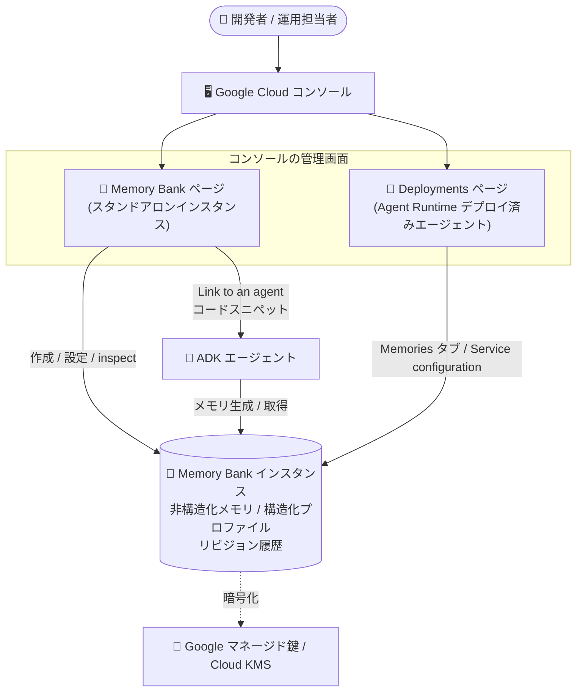

# Gemini Enterprise Agent Platform: Google Cloud コンソール専用の Memory Bank 管理機能

**リリース日**: 2026-11-06

**サービス**: Gemini Enterprise Agent Platform (Agent Platform Memory Bank / Agent Runtime)

**機能**: Google Cloud コンソールにおける専用 Memory Bank ページと管理機能

**ステータス**: リリース済み (Feature)

📊 [このアップデートのインフォグラフィックを見る](https://takech9203.github.io/google-cloud-news-summary/20261106-agent-platform-memory-bank-console.html)

## 概要

Gemini Enterprise Agent Platform の Memory Bank を、Google Cloud コンソールの専用「Memory Bank」ページから作成・設定・inspect (検査) できるようになりました。Memory Bank は、ユーザーとエージェントの会話から長期記憶 (メモリ) を LLM で自動生成・統合し、セッションをまたいだパーソナライズを実現するマネージドサービスです。今回のアップデートにより、スタンドアロンの Memory Bank インスタンスが、デプロイ済みエージェントを管理する「Deployments」ページとは独立した専用ページで一覧・管理できるようになりました。

コンソール上では、インスタンスの作成 (Google マネージド暗号鍵または Cloud KMS 暗号鍵の選択を含む)、非構造化/構造化メモリの閲覧・フィルタリング・編集、メモリのリビジョン履歴の確認、Generation / Retrieval / Retention といった動作設定、プロファイルスキーマの追加・編集までを GUI で完結できます。さらに「Link to an agent」をクリックすると、プロジェクト ID・リージョン・Memory Bank ID が埋め込まれた Python コードスニペットが提示され、Agent Development Kit (ADK) との接続やメモリ取得をすぐに始められます。

Agent Runtime にデプロイ済みのエージェント側でも、Deployments ページの Memories タブに key:value スコープフィルタリングと「View revisions」が追加され、Service configuration の Memory bank セクションから Generation / Retrieval / Retention の設定が可能になりました。エージェント開発者だけでなく、運用担当者やデータ管理者がコードを書かずにメモリの状態を監査・管理できるようになる点が、このアップデートの主要な価値です。

**アップデート前の課題**

- Memory Bank インスタンスの作成や設定 (メモリトピック、埋め込みモデル、TTL など) は、Agent Platform SDK (`google-cloud-agentplatform`) や REST API 経由で行う必要があった
- 生成されたメモリやそのリビジョン履歴の確認・監査にも、`RetrieveMemories` / `ListMemoryRevisions` などの API 呼び出しが必要で、非エンジニアによる確認が難しかった
- スタンドアロンの Memory Bank インスタンスを、デプロイ済みエージェントと区別してコンソール上で一元的に把握する専用画面がなかった

**アップデート後の改善**

- 専用の Memory Bank ページから、スタンドアロンインスタンスの一覧・作成・基本情報/ラベルの編集・削除が GUI で完結するようになった
- Memories タブで非構造化/構造化メモリの切り替え表示、スコープ (key:value) によるフィルタリング、メモリの編集・削除、リビジョン履歴の確認が可能になった
- Configuration タブで Generation (メモリ抽出のオン/オフ、パースペクティブ、マネージド/カスタムトピック)、Retrieval (埋め込みモデル)、Retention (有効期限とリビジョン履歴の TTL)、プロファイルスキーマを閲覧・編集できるようになった
- 「Link to an agent」により、自分の環境に合わせて事前入力された ADK 連携用コードスニペットを取得でき、エージェントへの組み込みが容易になった

## アーキテクチャ図



スタンドアロンの Memory Bank インスタンスは専用の Memory Bank ページで、Agent Runtime にデプロイ済みのエージェントに紐づくメモリは Deployments ページで管理し、どちらからも Generation / Retrieval / Retention の設定とメモリの inspect が可能です。

## サービスアップデートの詳細

### 主要機能

1. **Memory Bank の一覧と作成 (Memory Bank ページ)**
   - スタンドアロンの Memory Bank インスタンスを、デプロイ済みエージェント (Deployments ページ) とは別の専用ページで一覧・管理
   - 基本情報やラベルの編集、インスタンスの削除が可能
   - 「Create memory bank」から、デフォルトのメモリ設定と Google マネージド暗号化または Cloud KMS (CMEK) 暗号化を選択してインスタンスを作成

2. **メモリの inspect とフィルタリング (Memories タブ)**
   - Unstructured (非構造化) ビューと Structured (構造化) ビューの切り替え
   - key:value のスコープペアまたはスコープチップによるメモリのフィルタリング
   - 非構造化メモリの編集・削除
   - Memory details パネルで構造化メモリプロファイルと背後のファクトを inspect
   - 「View revisions」でメモリのリビジョン履歴を確認

3. **インスタンスとスキーマの設定 (Configuration タブ)**
   - **Details**: インスタンスの基本情報
   - **Generation**: メモリ抽出のトグル、パースペクティブ (一人称/三人称)、マネージドまたはカスタムのメモリトピック
   - **Retrieval**: 類似検索に使用する埋め込みモデル (最初のメモリを保存する前のみ変更可能)
   - **Retention**: メモリの有効期限とリビジョン履歴の TTL
   - **Schemas**: 構造化プロファイルのスキーマの追加・編集

4. **エージェント連携スニペット (Link to an agent)**
   - プロジェクト ID・リージョン・Memory Bank ID が事前入力されたインストールコマンドと Python コードを取得
   - Agent Development Kit (ADK) との接続や、メモリ取得コードの雛形として利用可能

5. **Agent Runtime 側のメモリ管理強化 (Deployments ページ)**
   - デプロイ済みエージェントの Memories タブに key:value スコープフィルタリングと「View revisions」を追加
   - Service configuration の Memory bank セクションから Generation / Retrieval / Retention を設定可能

## 技術仕様

### Memory Bank の主な構成要素とデフォルト設定

| 項目 | 詳細 |
|------|------|
| メモリ生成モデル (Generation) | デフォルトは `gemini-3.5-flash` (抽出・統合に使用) |
| 類似検索の埋め込みモデル (Retrieval) | デフォルトは `text-embedding-005` (最初のメモリ保存前のみ変更可能) |
| リビジョン履歴 TTL (Retention) | デフォルトは 365 日 |
| マネージドメモリトピック | `USER_PERSONAL_INFO` / `USER_PREFERENCES` / `KEY_CONVERSATION_DETAILS` / `EXPLICIT_INSTRUCTIONS` (デフォルトで全て有効)。カスタムトピックの定義も可能 |
| メモリの種類 | 非構造化メモリ (自然言語のファクト) と構造化プロファイル (`STRUCTURED_PROFILE`、スキーマに沿って LLM が生成・更新) |
| スコープ | `{"user_id": "123"}` のような key:value ペア。メモリはスコープ単位で分離され、スコープは生成時に決まり不変 |
| 暗号化 | Google マネージド暗号鍵または Cloud KMS (CMEK)。global エンドポイントでは CMEK 不可。スタンドアロンインスタンスはリージョナル/マルチリージョナル (us / eu) で CMEK 可、Agent Runtime にデプロイ済みの場合はシングルリージョンのみ CMEK 対応 |
| エンドポイント | リージョナルに加え、マルチリージョナル (`us` / `eu`) とグローバル (`global`) をサポート |

### 必要な IAM ロール

| 操作 | ロール |
|------|--------|
| Memory Bank インスタンスの作成・更新 | Agent Platform User (`roles/aiplatform.user`) |
| メモリの読み取り・書き込み・生成 | Agent Platform Memory Bank User (`roles/aiplatform.memoryUser`) |

### メモリリビジョン

- メモリが生成・更新・削除されるたびにリビジョン (`MemoryRevision`) が自動作成され、変化の履歴と抽出時のコンテキストを追跡可能
- `RollbackMemory` で過去のリビジョンへのロールバックが可能
- メモリ削除後もリビジョンは最大 48 時間アクセス可能で、この回復ウィンドウ内であればロールバックによる復元が可能

## 設定方法

### 前提条件

1. Google Cloud プロジェクトで必要な API を有効化していること (`serviceusage.services.enable` 権限が必要)
2. 上記の IAM ロール (`roles/aiplatform.user`、`roles/aiplatform.memoryUser`) が付与されていること

### 手順 (コンソール)

#### ステップ 1: Memory Bank インスタンスの作成

Google Cloud コンソールの **Memory Bank** ページを開き、**Create memory bank** をクリックします。デフォルトのメモリ設定でインスタンスが作成され、暗号化方式として Google マネージド暗号鍵または Cloud KMS 鍵を選択できます。

#### ステップ 2: 動作の設定

**Configuration** タブで以下を確認・編集します。

- **Generation**: メモリ抽出のオン/オフ、パースペクティブ、マネージド/カスタムトピック
- **Retrieval**: 埋め込みモデル (最初のメモリを保存する前に設定)
- **Retention**: メモリの有効期限とリビジョン履歴の TTL
- **Schemas**: 構造化プロファイル用スキーマの追加・編集

#### ステップ 3: エージェントとの接続

**Link to an agent** をクリックすると、プロジェクト・リージョン・Memory Bank ID が埋め込まれたインストールコマンドと Python コードが表示されます。SDK で接続する場合の例:

```bash
pip install "google-cloud-agentplatform>=2.0.1"
```

```python
import agentplatform

client = agentplatform.Client(
    project="PROJECT_ID",
    location="LOCATION",  # Memory Bank がサポートするリージョン、us / eu / global も指定可能
)

# メモリの取得 (スコープベース)
results = client.memory_banks.memories.retrieve(
    name=memory_bank_name,
    scope={"user_id": "123"},
)
```

#### ステップ 4: メモリの inspect

**Memories** タブで Unstructured / Structured ビューを切り替え、key:value スコープでフィルタリングします。Memory details パネルで構造化プロファイルと背後のファクトを確認し、**View revisions** でリビジョン履歴を追跡できます。

## メリット

### ビジネス面

- **運用の民主化**: SDK や API を使わずにメモリの状態を監査・管理できるため、エンジニア以外の運用担当者やデータ管理者もメモリのガバナンスに参加できる
- **導入までの時間短縮**: 事前入力されたコードスニペットにより、Memory Bank をエージェントに組み込むまでのセットアップ時間を短縮できる

### 技術面

- **可観測性の向上**: スコープフィルタリングとリビジョン履歴の GUI 表示により、「いつ・どの会話からメモリがどう変化したか」をコードなしで追跡できる
- **構成管理の一元化**: Generation / Retrieval / Retention / Schemas の設定を、スタンドアロンインスタンスとデプロイ済みエージェントの両方でコンソールから統一的に管理できる
- **セキュリティ要件への対応**: インスタンス作成時に Cloud KMS (CMEK) 暗号化を選択でき、コンプライアンス要件に合わせた構成が GUI で可能

## デメリット・制約事項

### 制限事項

- Retrieval の埋め込みモデルは、最初のメモリを保存する前にのみ設定可能 (保存後は変更不可)
- global エンドポイント (`location="global"`) では CMEK を使用できない。Agent Runtime にデプロイ済みのエージェントに紐づくインスタンスは、シングルリージョンの場合のみ CMEK に対応
- コンソールで編集・削除が明示されているのは非構造化メモリで、構造化プロファイルは Memory details パネルでの inspect とリビジョン確認が中心

### 考慮すべき点

- Memory Bank は生成 AI 機能であり、Generative AI Service Specific Terms が適用される
- Agent Runtime の組み込み Memory Bank を使用している場合、Agent Runtime インスタンスを削除するとメモリも削除される
- 削除したメモリのリビジョンにアクセスできるのは削除後 48 時間以内。復元が必要な場合はこの回復ウィンドウ内にロールバックする必要がある

## ユースケース

### ユースケース 1: 運用チームによるメモリの監査とクリーンアップ

**シナリオ**: カスタマーサポートエージェントが蓄積したユーザーメモリに、誤った情報や古い情報が含まれていないかを運用チームが定期的に確認したい。

**実装例**: コンソールの Memories タブで `user_id:<対象ユーザー>` のスコープフィルタを適用し、非構造化メモリを確認。誤った内容があれば GUI 上で編集・削除し、「View revisions」で変更の経緯を監査する。

**効果**: API を呼び出すスクリプトを用意することなく、メモリの品質管理とガバナンスを運用フローに組み込める。

### ユースケース 2: 構造化プロファイルのスキーマ設計と検証

**シナリオ**: ユーザーの技術スタックや好みを固定スキーマの構造化プロファイルとして保持し、セッション開始時に低レイテンシで読み込みたい。

**実装例**: Configuration タブの Schemas からプロファイルスキーマを追加し、エージェントとの会話を経て生成されたプロファイルを Memory details パネルで確認。各フィールドのリビジョン履歴から、どの会話がどのフィールドを更新したかを検証する。

**効果**: スキーマ設計から生成結果の検証までを GUI で反復でき、プロファイル駆動のパーソナライズを短いサイクルで改善できる。

### ユースケース 3: 新規エージェントへの Memory Bank 組み込み

**シナリオ**: 新しく開発する ADK エージェントに長期記憶を持たせたいが、セットアップコードを一から書きたくない。

**実装例**: Memory Bank ページでインスタンスを作成し、「Link to an agent」から自分のプロジェクト・リージョン・Memory Bank ID が入った Python コードを取得してエージェントに組み込む。

**効果**: 接続情報の転記ミスを防ぎつつ、ADK エージェントへのメモリ機能追加を最短手順で実現できる。

## 関連サービス・機能

- **Agent Runtime (Agent Platform)**: デプロイ済みエージェントのマネージドランタイム。Deployments ページから組み込み Memory Bank のメモリ管理・設定が可能
- **Agent Development Kit (ADK)**: `VertexAiMemoryBankService` を通じて Memory Bank をデフォルトのメモリサービスとして利用できるエージェント開発フレームワーク
- **Agent Platform Sessions**: セッションに蓄積した会話イベントからメモリ生成をトリガーする際に組み合わせて使用
- **Cloud KMS**: Memory Bank インスタンスの CMEK (顧客管理暗号鍵) 暗号化に使用
- **IAM**: `roles/aiplatform.memoryUser` などのロールや IAM Conditions により、スコープ単位でのメモリアクセス制御が可能

## 参考リンク

- 📊 [インフォグラフィック](https://takech9203.github.io/google-cloud-news-summary/20261106-agent-platform-memory-bank-console.html)
- [公式リリースノート](https://docs.cloud.google.com/release-notes#November_06_2026)
- [Memory Bank 概要](https://docs.cloud.google.com/gemini-enterprise-agent-platform/scale/memory-bank)
- [Set up Memory Bank](https://docs.cloud.google.com/gemini-enterprise-agent-platform/scale/memory-bank/setup)
- [Fetch memories](https://docs.cloud.google.com/gemini-enterprise-agent-platform/scale/memory-bank/fetch-memories)
- [Memory Profiles](https://docs.cloud.google.com/gemini-enterprise-agent-platform/scale/memory-bank/profiles)
- [Memory revisions](https://docs.cloud.google.com/gemini-enterprise-agent-platform/scale/memory-bank/revisions)

## まとめ

Memory Bank の作成・設定・監査が Google Cloud コンソールで完結するようになり、エージェントの長期記憶の運用ハードルが大きく下がりました。すでに SDK/API で Memory Bank を利用しているチームは、コンソールの Memories タブとリビジョン履歴をメモリ監査フローに組み込むことを推奨します。これから導入するチームは、専用ページからのインスタンス作成と「Link to an agent」のコードスニペットを起点にするとスムーズです。

---

**タグ**: #GeminiEnterpriseAgentPlatform #MemoryBank #AgentRuntime #ADK #GoogleCloudConsole #AIエージェント
