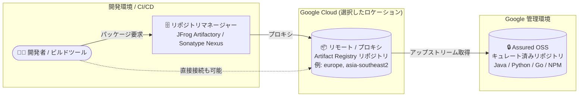

# Assured Open Source Software: Premium ティアのリモート (プロキシ) Artifact Registry リポジトリがリージョン / マルチリージョンに対応

**リリース日**: 2026-11-06

**サービス**: Assured Open Source Software

**機能**: Premium ティアにおけるリモート (プロキシ) Artifact Registry リポジトリの Google Cloud リージョン / マルチリージョン対応

**ステータス**: 一般提供 (Feature)

📊 [このアップデートのインフォグラフィックを見る](https://takech9203.github.io/google-cloud-news-summary/20261106-assured-oss-premium-regional-support.html)

## 概要

Assured Open Source Software (Assured OSS) の Premium ティアにおいて、リモート (プロキシ) Artifact Registry リポジトリが Google Cloud の複数リージョンおよびマルチリージョンをサポートするようになりました。Assured OSS は、Google が自社で使用するものと同じプロセスでビルド・スキャン・署名したオープンソースパッケージ (Java、Python、Go、JavaScript/NPM) を提供するサービスで、SLSA レベル 3 準拠のビルド、署名付きプロベナンス、SBOM を備えています。

これまで Assured OSS のパッケージは Google 管理の Artifact Registry リポジトリ (例: `us-maven.pkg.dev/cloud-aoss/...` のような `us` ベースのエンドポイント) から取得する構成が基本でした。今回のアップデートにより、Premium ティアのユーザーは、アジア、オーストラリア、ヨーロッパ、北米の各リージョンや `europe` / `us` マルチリージョンにあるリモートリポジトリを経由して Assured OSS パッケージを取得できます。

対象ユーザーは、Security Command Center Premium / Enterprise とともに Assured OSS Premium ティアを利用しており、データ所在地 (データレジデンシー) 要件やレイテンシの観点から、米国以外のロケーションでパッケージ配信を行いたい組織です。

**アップデート前の課題**

- Premium ティアの Assured OSS プロキシサービスがプロビジョニングするリポジトリは `us` (米国) のみをサポートしており、ヨーロッパやアジアなどのロケーションを選択できなかった
- データレジデンシー要件を持つ組織 (特に EU 圏) が、パッケージ取得経路を自国・自地域内に収めることが難しかった
- 米国から地理的に離れたリージョンで動作する CI/CD パイプラインでは、パッケージ取得が米国のエンドポイント経由となっていた

**アップデート後の改善**

- リモート (プロキシ) Artifact Registry リポジトリを、11 のリージョンと 2 つのマルチリージョン (`europe`、`us`) に配置できるようになった
- `europe` マルチリージョンや各国リージョンを選択することで、データレジデンシー要件に沿ったパッケージ配信構成を取りやすくなった
- JFrog Artifactory や Sonatype Nexus などのリポジトリマネージャーから、`https://LOCATION-maven.pkg.dev/...` のようにロケーションを指定したエンドポイントに接続できるようになった

## アーキテクチャ図



Premium ティアのリモート (プロキシ) リポジトリを任意のサポート対象リージョン / マルチリージョンに配置し、開発者やリポジトリマネージャーがそこを経由して Google 管理の Assured OSS パッケージを取得する構成です。

## サービスアップデートの詳細

### 主要機能

1. **リモート (プロキシ) リポジトリのマルチロケーション対応**
   - Premium ティアのリモート (プロキシ) Artifact Registry リポジトリが、複数の Google Cloud リージョンおよびマルチリージョンをサポート
   - 対応ロケーションは、アジア (`asia-southeast2`)、オーストラリア (`australia-southeast1` / `australia-southeast2`)、ヨーロッパ (`europe-north1` / `europe-north2` / `europe-west1`〜`west4`)、北米 (`northamerica-northeast1` / `northamerica-northeast2`)、およびマルチリージョン `europe` / `us`

2. **ロケーションを指定したエンドポイント**
   - リモートリポジトリへの接続 URL は `https://LOCATION-maven.pkg.dev/PROJECT_ID/assuredoss-java` のようにロケーションを含む形式 (Python / NPM / Go も同様のパターン)
   - JFrog Artifactory や Sonatype Nexus のリモートリポジトリ設定でこの URL を指定して利用

3. **セキュリティメタデータは `us` マルチリージョンに限定**
   - パッケージ本体の配信はマルチロケーション対応だが、セキュリティメタデータ (SBOM、VEX など) のサポートは `us` マルチリージョンに限定される点に注意

## 技術仕様

### サポート対象ロケーション (Premium ティア・リモートリポジトリ)

| 種別 | ロケーション |
|------|-------------|
| アジア | `asia-southeast2` |
| オーストラリア | `australia-southeast1`, `australia-southeast2` |
| ヨーロッパ | `europe-north1`, `europe-north2`, `europe-west1`, `europe-west2`, `europe-west3`, `europe-west4` |
| 北米 | `northamerica-northeast1`, `northamerica-northeast2` |
| マルチリージョン | `europe`, `us` |

### 接続エンドポイントの形式 (例)

| 言語 | リモートストレージ URL の例 |
|------|---------------------------|
| Java (Maven) | `https://LOCATION-maven.pkg.dev/PROJECT_ID/assuredoss-java` |
| Python | `https://LOCATION-python.pkg.dev/PROJECT_ID/assuredoss-python` (pip では末尾に `/simple` を付与) |

認証にはユーザー名 `_json_key_base64` と、Base64 エンコードしたサービスアカウント JSON キーを使用します。

## 設定方法

### 前提条件

1. Assured OSS Premium ティアの利用 (Security Command Center Premium または Enterprise の組織レベル有効化が必要)
2. Assured OSS と Security Command Center の統合、および利用するサービスアカウントの接続検証が完了していること

### 手順 (JFrog Artifactory の例)

#### ステップ 1: リモートリポジトリの作成

リポジトリマネージャーで Maven / PyPI / npm / Go タイプのリモートリポジトリを作成し、Remote Storage URL にサポート対象ロケーションを含むエンドポイントを指定します。

```text
https://LOCATION-maven.pkg.dev/PROJECT_ID/assuredoss-java
```

#### ステップ 2: 認証情報の設定

```text
Username: _json_key_base64
Password: (サービスアカウント JSON キーを 1 行の Base64 文字列にしたもの)
```

Go の場合は Advanced Settings で「Bypass HEAD Requests」を有効にします。Python の場合は pip の `index-url` 用に URL 末尾へ `/simple` を付与します。

## メリット

### ビジネス面

- **データレジデンシー対応**: `europe` マルチリージョンや各国リージョンを選択することで、パッケージ配信経路に関する地域要件 (EU のデータ所在地要件など) に対応しやすくなる
- **コンプライアンス姿勢の強化**: ソフトウェアサプライチェーンの保護 (SLSA レベル 3、SBOM、署名付きプロベナンス) と地域要件への対応を両立できる

### 技術面

- **既存ワークフローとの統合**: JFrog Artifactory / Sonatype Nexus などの既存リポジトリマネージャーからロケーション指定のエンドポイントに接続するだけで利用可能
- **地理的に近いロケーションの選択**: CI/CD パイプラインやビルド環境に近いリージョンを選択できる

## デメリット・制約事項

### 制限事項

- 本機能は Premium ティア (Security Command Center Premium / Enterprise 契約が前提) が対象
- セキュリティメタデータのサポートは `us` マルチリージョンに限定される
- サポートされるのは上記 11 リージョン + 2 マルチリージョンであり、すべての Google Cloud リージョンに対応しているわけではない (例: 日本リージョンは現時点で対象外)

### 考慮すべき点

- セキュリティメタデータ (SBOM / VEX など) を利用するワークフローがある場合は、メタデータ取得が `us` に依存する点を設計時に考慮する必要がある
- Security Command Center Enterprise ティアは 2027 年 5 月 21 日に終了が予定されており、Enterprise 利用組織は Premium ティアに自動移行されるとドキュメントに記載されている

## ユースケース

### ユースケース 1: EU データレジデンシー要件下での OSS パッケージ配信

**シナリオ**: EU 域内でサービスを運用する企業が、ビルドに使用する OSS パッケージの取得経路を欧州内に収めたい。

**実装例**:
```text
JFrog Artifactory のリモートリポジトリの Remote Storage URL:
https://europe-maven.pkg.dev/PROJECT_ID/assuredoss-java
```

**効果**: Google が検証・署名した OSS パッケージを `europe` マルチリージョン経由で取得でき、サプライチェーンセキュリティと地域要件への対応を両立できる。

### ユースケース 2: アジア太平洋リージョンの CI/CD パイプライン

**シナリオ**: `asia-southeast2` やオーストラリアリージョンで CI/CD を運用しており、地理的に近いロケーションから Assured OSS パッケージを取得したい。

**効果**: ビルド環境と同一地域のリモートリポジトリを経由してパッケージを取得する構成を取れる。

## 料金

Assured OSS の Premium ティアは、Security Command Center Premium または Security Command Center Enterprise の購入時に利用可能になります (Free ティアは無償で利用可能)。料金の詳細は Security Command Center の料金ページを参照してください。

- [Security Command Center の料金](https://cloud.google.com/security-command-center/pricing)

## 利用可能リージョン

リモート (プロキシ) Artifact Registry リポジトリのサポート対象: `asia-southeast2`、`australia-southeast1`、`australia-southeast2`、`europe-north1`、`europe-north2`、`europe-west1`、`europe-west2`、`europe-west3`、`europe-west4`、`northamerica-northeast1`、`northamerica-northeast2`、およびマルチリージョン `europe`、`us`。

最新のリストは [Supported regions](https://docs.cloud.google.com/security-command-center/docs/integrate-aoss-with-scc#supported-regions) を参照してください。

## 関連サービス・機能

- **Artifact Registry**: Assured OSS パッケージの格納・配信基盤。リモート (プロキシ) リポジトリ機能を本アップデートで複数ロケーションに展開可能
- **Security Command Center (Premium / Enterprise)**: Assured OSS Premium ティアの提供前提となるサービス。コードセキュリティ統合も提供
- **Software supply chain security (SLSA / SBOM / プロベナンス)**: Assured OSS は GKE や Cloud Run などのランタイムを含むサプライチェーン保護ソリューションの一部

## 参考リンク

- 📊 [インフォグラフィック](https://takech9203.github.io/google-cloud-news-summary/20261106-assured-oss-premium-regional-support.html)
- [公式リリースノート](https://docs.cloud.google.com/release-notes#November_06_2026)
- [Assured OSS の概要 (リポジトリオプション)](https://docs.cloud.google.com/assured-open-source-software/docs/overview)
- [Premium ティア: リモートリポジトリ経由でのパッケージダウンロード](https://docs.cloud.google.com/security-command-center/docs/aoss-remote-repository-access)
- [Assured OSS と Security Command Center の統合 (Supported regions)](https://docs.cloud.google.com/security-command-center/docs/integrate-aoss-with-scc#supported-regions)
- [Security Command Center の料金](https://cloud.google.com/security-command-center/pricing)

## まとめ

Assured OSS Premium ティアのリモート (プロキシ) Artifact Registry リポジトリが米国以外のリージョン / マルチリージョンに対応し、データレジデンシー要件を持つ組織でも Google が検証した OSS パッケージを地域内経路で取得しやすくなりました。EU やアジア太平洋で CI/CD を運用している Premium ティアユーザーは、リポジトリマネージャーの接続先をサポート対象ロケーションのエンドポイントへ切り替えることを検討してください。セキュリティメタデータは引き続き `us` マルチリージョン限定である点には注意が必要です。

---

**タグ**: #AssuredOSS #ArtifactRegistry #SoftwareSupplyChain #SecurityCommandCenter #DataResidency #SLSA
