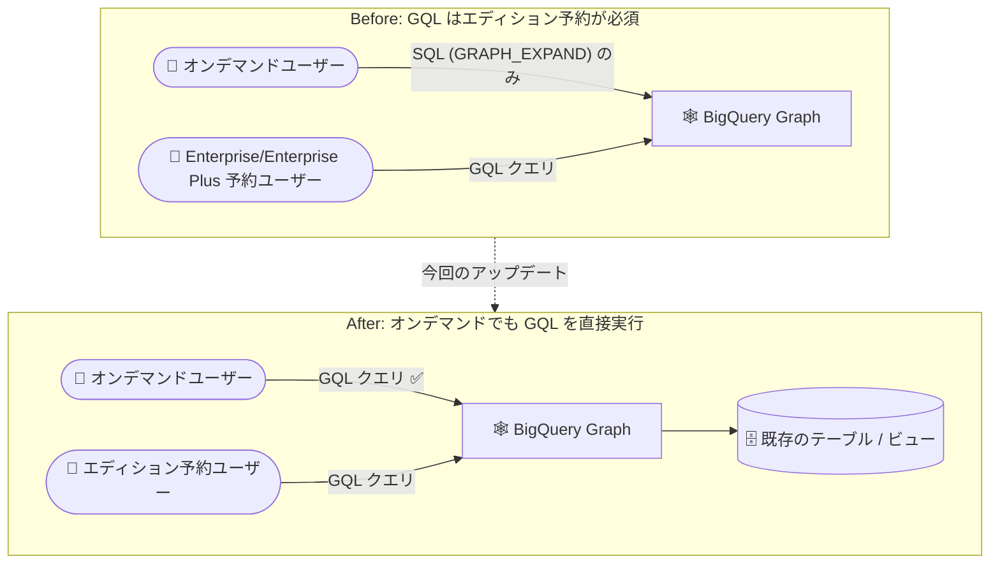

# BigQuery: BigQuery Graph / GQL クエリがオンデマンド料金で利用可能に

**リリース日**: 2026-11-06

**サービス**: BigQuery

**機能**: BigQuery Graph および Graph Query Language (GQL) クエリのオンデマンド料金対応

**ステータス**: 発表 (Announcement)

📊 [このアップデートのインフォグラフィックを見る](https://takech9203.github.io/google-cloud-news-summary/20261106-bigquery-graph-gql-on-demand-pricing.html)

## 概要

BigQuery Graph と Graph Query Language (GQL) クエリが、オンデマンド料金 (on-demand pricing) でも利用できるようになりました。BigQuery Graph は、既存のテーブルやビューからノード・エッジを定義してプロパティグラフを構築し、ISO GQL 標準に準拠したグラフクエリで複雑な関係性 (不正検知、推薦、ナレッジグラフなど) を大規模に分析できる機能です。

従来、GQL クエリの実行には Enterprise または Enterprise Plus エディションの予約 (キャパシティベース料金) が必要であり、オンデマンド料金のユーザーは GRAPH_EXPAND 関数による SQL クエリでグラフを扱うことしかできませんでした。今回のアップデートにより、予約を購入していないオンデマンドユーザーでも、スキャン量ベースの従量課金のまま BigQuery Graph と GQL クエリをそのまま利用できます。

グラフ分析を小規模に試したいチームや、予約管理の運用負荷を避けたいユーザーにとって、BigQuery Graph 導入のハードルが大きく下がるアップデートです。

**アップデート前の課題**

- GQL クエリの実行には Enterprise または Enterprise Plus エディションの予約 (スロットのキャパシティベース料金) が必要だった
- オンデマンド料金のユーザーは、GRAPH_EXPAND 関数を呼び出して SQL クエリとしてグラフを操作する方法に限定されていた
- グラフ分析を試すためだけにエディション予約の購入・管理が必要で、PoC や小規模利用の障壁になっていた

**アップデート後の改善**

- オンデマンド料金のまま BigQuery Graph を利用し、GQL クエリを直接実行できるようになった
- 予約 (Reservation) の作成や割り当てなしで、スキャンしたデータ量に応じた従量課金でグラフ分析を開始できる
- オンデマンドの無料枠 (月間 1 TiB のクエリ処理) の範囲でグラフ分析を試すことも可能

## アーキテクチャ図



従来はオンデマンドユーザーが GRAPH_EXPAND 関数経由の SQL に限定されていたのに対し、今回のアップデートで GQL クエリをオンデマンド料金のまま直接実行できるようになったことを示しています。

## サービスアップデートの詳細

### 主要機能

1. **オンデマンド料金での GQL クエリ実行**
   - 予約 (Enterprise / Enterprise Plus エディション) を購入せずに、GQL クエリを実行可能
   - オンデマンドのクエリ料金 (スキャンしたデータ量ベース) で課金される

2. **BigQuery Graph の主な特徴 (再掲)**
   - ISO GQL 標準および ISO SQL/PGQ 標準に準拠したグラフクエリインターフェース
   - 既存のテーブル・ビューからノード / エッジテーブルを直接定義でき、データの複製や ETL が不要
   - ベクトル検索・全文検索との統合、グラフ可視化、Spanner Graph とのスキーマ / クエリ言語の互換性

3. **SQL とグラフの相互運用**
   - GRAPH_TABLE 演算子などにより、リレーショナルクエリとグラフクエリを組み合わせて利用可能
   - 会話型分析 (Conversational Analytics) から自然言語でグラフに質問することも可能

## メリット

### ビジネス面

- **導入障壁の低減**: エディション予約の契約・管理なしでグラフ分析を開始でき、PoC やスモールスタートが容易になる
- **コストの最適化**: 利用頻度が低いグラフ分析ワークロードでは、スロット予約よりスキャン量ベースの従量課金の方が安価になる場合がある

### 技術面

- **運用負荷の軽減**: 予約 (Reservation) やスロット割り当ての管理が不要
- **標準 GQL をそのまま利用**: GRAPH_EXPAND による SQL への書き換えが不要になり、Spanner Graph と共通の GQL クエリ資産を活用できる

## デメリット・制約事項

### 考慮すべき点

- オンデマンド料金はスキャンしたデータ量に基づいて課金されるため、大規模なグラフ走査を頻繁に実行する場合はエディション (キャパシティベース) 料金の方が予測可能でコスト効率が良い場合がある
- オンデマンドモデルでのコスト制御手段は、プロジェクト / ユーザー単位のカスタムクエリクォータの設定が中心となる
- 最新の利用条件・エディションごとの機能差は [BigQuery editions の紹介](https://docs.cloud.google.com/bigquery/docs/editions-intro) を確認すること

## ユースケース

### ユースケース 1: 不正検知のスモールスタート

**シナリオ**: 金融サービス企業が、ユーザー・口座・取引の関係性から不正パターン (マネーロンダリングなど) を検出するグラフ分析を試したいが、専用のスロット予約を契約するほどの規模ではない。

**実装例**:
```sql
GRAPH my_dataset.FinGraph
MATCH (p:Person)-[:Owns]->(a:Account)-[t:Transfers]->(sus:Account {is_blocked: TRUE})
RETURN p.name, a.id, t.amount
```

**効果**: オンデマンド料金のまま GQL で複雑な関係性分析を実行でき、効果検証後に必要に応じてエディション予約へ移行できる。

### ユースケース 2: 既存オンデマンドプロジェクトへのグラフ分析追加

**シナリオ**: オンデマンド料金で BigQuery を運用中のチームが、顧客 360 分析や推薦のためにグラフクエリを追加したい。

**効果**: 課金モデルを変更することなく、既存のテーブルの上にプロパティグラフを定義して GQL クエリを実行できる。

## 料金

BigQuery Graph のコンピューティング料金は、利用する料金モデルに従います。

- **オンデマンド料金**: スキャンしたデータ量に基づく課金 ($6.25/TiB〜、毎月最初の 1 TiB は無料)
- **キャパシティベース料金 (エディション)**: スロット時間に基づく課金 ($0.04/スロット時間〜)
- **ストレージ**: グラフの元になるテーブルのストレージに対して 1 回だけ課金され、グラフモデルの数には依存しない (標準の BigQuery ストレージ料金)

詳細は [BigQuery の料金ページ](https://cloud.google.com/bigquery/pricing) を参照してください。

## 関連サービス・機能

- **Spanner Graph**: BigQuery Graph と同じグラフスキーマ・クエリ言語 (GQL) を共有。運用系グラフワークロードは Spanner、分析系は BigQuery という使い分けが、データの再モデリングなしで可能
- **BigQuery の会話型分析 (Conversational Analytics)**: 自然言語でグラフに質問でき、エージェントが SQL / GQL クエリを生成して可視化まで行う
- **BigQuery のベクトル検索・全文検索**: グラフ分析と組み合わせて、意味的な類似性やキーワードを使った関係性分析が可能

## 参考リンク

- 📊 [インフォグラフィック](https://takech9203.github.io/google-cloud-news-summary/20261106-bigquery-graph-gql-on-demand-pricing.html)
- [公式リリースノート](https://docs.cloud.google.com/release-notes#November_06_2026)
- [BigQuery Graph の概要](https://docs.cloud.google.com/bigquery/docs/graph-overview)
- [Graph Query Language (GQL) の紹介](https://docs.cloud.google.com/bigquery/docs/reference/standard-sql/graph-intro)
- [BigQuery editions の紹介](https://docs.cloud.google.com/bigquery/docs/editions-intro)
- [料金ページ](https://cloud.google.com/bigquery/pricing)

## まとめ

BigQuery Graph と GQL クエリがオンデマンド料金で利用可能になり、エディション予約なしでグラフ分析を始められるようになりました。不正検知や推薦などのグラフユースケースを検討しているチームは、まずオンデマンドの従量課金 (無料枠含む) でスモールスタートし、ワークロードの成長に応じてキャパシティベース料金への移行を検討することを推奨します。

---

**タグ**: BigQuery, BigQuery Graph, GQL, Graph Query Language, オンデマンド料金, グラフ分析, データ分析
