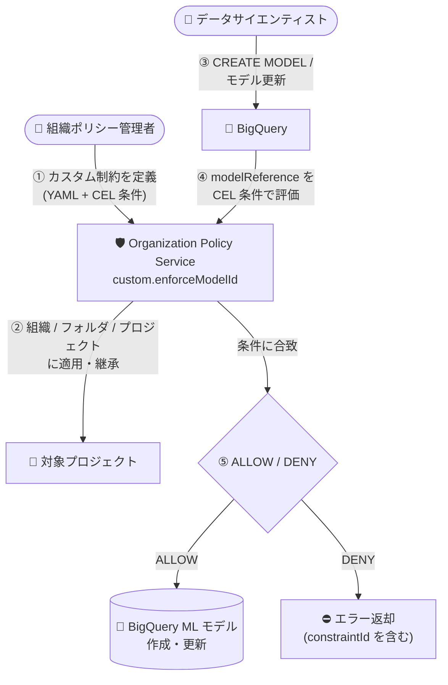

# BigQuery: モデルに対するカスタム組織ポリシーのサポート (Preview)

**リリース日**: 2026-11-06

**サービス**: BigQuery

**機能**: カスタム組織ポリシー (カスタム制約) によるモデル操作の許可・拒否

**ステータス**: Preview

📊 [このアップデートのインフォグラフィックを見る](https://takech9203.github.io/google-cloud-news-summary/20261106-bigquery-models-custom-org-policy-preview.html)

## 概要

BigQuery のモデル (BigQuery ML で作成するモデルリソース) に対して、Organization Policy Service のカスタム制約 (custom constraints) を使用して特定の操作を許可または拒否できるようになりました。本機能は Preview として提供されます。

カスタム組織ポリシーは、組織・フォルダ・プロジェクトのいずれかのレベルで適用でき、CEL (Common Expression Language) 条件でリソースのフィールド値を評価して、CREATE / UPDATE 操作を `ALLOW` または `DENY` できます。今回のアップデートで、サポート対象リソースにデータセット、テーブル、ルーティン、行アクセスポリシー、データアクセスポリシー、予約関連リソースに加えて `bigquery.googleapis.com/Model` が追加され、モデルの作成・更新操作をガバナンス対象にできるようになりました。

対象ユーザーは、組織全体で BigQuery ML モデルの命名規則や作成ルールを統制したい組織ポリシー管理者やデータガバナンス担当者です。

**アップデート前の課題**

- BigQuery のカスタム制約のサポート対象リソースにモデルが含まれておらず、モデルの作成・更新操作をカスタム組織ポリシーで統制できなかった
- データセットやテーブルには命名規則などのカスタム制約を適用できる一方、モデルには同等のきめ細かなガバナンスを適用する手段がなかった

**アップデート後の改善**

- `bigquery.googleapis.com/Model` リソースをカスタム制約の対象として参照できるようになり、モデルの CREATE / UPDATE 操作を条件付きで許可・拒否できるようになった
- `resource.modelReference.projectId` / `resource.modelReference.datasetId` / `resource.modelReference.modelId` のフィールドを CEL 条件で評価でき、モデル ID の命名規則の強制などが可能になった
- 組織・フォルダ・プロジェクトの各レベルでポリシーを適用でき、ポリシーは配下のリソースに継承される

## アーキテクチャ図



組織ポリシー管理者が定義したカスタム制約が、BigQuery モデルの作成・更新リクエストに対して CEL 条件で評価され、操作を許可または拒否するフローです。

## サービスアップデートの詳細

### 主要機能

1. **モデルリソースへのカスタム制約の適用**
   - サポート対象リソースに `bigquery.googleapis.com/Model` が追加された
   - CREATE / UPDATE メソッドに対して制約を適用でき、条件に合致した操作を `ALLOW` または `DENY` できる

2. **モデル参照フィールドによる条件定義**
   - `resource.modelReference.projectId`、`resource.modelReference.datasetId`、`resource.modelReference.modelId` を CEL 条件で参照できる
   - 例: `resource.modelReference.modelId.contains('test')` でモデル ID に特定文字列を含む操作を拒否

3. **リソース階層でのきめ細かな適用**
   - 組織・フォルダ・プロジェクトの各レベルでポリシーを適用可能
   - デフォルトでポリシーは配下のリソースに継承される (継承動作は変更可能)

## 技術仕様

### カスタム制約の仕様

| 項目 | 詳細 |
|------|------|
| 対象リソース | `bigquery.googleapis.com/Model` |
| 参照可能フィールド | `resource.modelReference.projectId` / `resource.modelReference.datasetId` / `resource.modelReference.modelId` |
| 対象メソッド | `CREATE`、`UPDATE` |
| アクション | `ALLOW` / `DENY` |
| 条件 | CEL 条件 (最大 1,000 文字) |
| 制約数の上限 | 多くのリソースタイプで最大 20 個のカスタム制約 |
| 適用レベル | 組織 / フォルダ / プロジェクト (配下に継承) |
| ステータス | Preview (Pre-GA Offerings Terms が適用) |

### カスタム制約の定義例 (公式ドキュメントの例)

```yaml
name: organizations/ORGANIZATION_ID/customConstraints/custom.enforceModelId
resourceTypes:
- bigquery.googleapis.com/Model
methodTypes:
- CREATE
- UPDATE
condition: "resource.modelReference.modelId.contains('test')"
actionType: DENY
displayName: Reject models with names that contain 'model'.
description: Deny new models with names that contain 'model'.
```

## 設定方法

### 前提条件

1. 組織 ID を確認しておく
2. 組織リソースに対する Organization Policy Administrator (`roles/orgpolicy.policyAdmin`) ロールが付与されていること
3. BigQuery リソースの作成・管理には別途 BigQuery の権限が必要

### 手順

#### ステップ 1: カスタム制約の YAML を作成し登録する

```bash
# constraint.yaml を作成後、カスタム制約を登録
gcloud org-policies set-custom-constraint constraint.yaml
```

カスタム制約 (前述の YAML 例) を組織に登録し、組織ポリシーで利用可能にします。

#### ステップ 2: カスタム制約を組織ポリシーとして適用する

```bash
# policy.yaml の例:
# name: projects/PROJECT_ID/policies/custom.enforceModelId
# spec:
#   rules:
#   - enforce: true

gcloud org-policies set-policy policy.yaml
```

登録した制約を組織・フォルダ・プロジェクトのいずれかに適用し、適用を有効化 (`enforce: true`) します。Google Cloud コンソールの「組織ポリシー」ページからも設定できます。

## メリット

### ビジネス面

- **ガバナンスの一元化**: モデルを含む BigQuery リソース全体の操作ルールを組織レベルで集中管理でき、コンプライアンス要件への対応が容易になる
- **ポリシー違反の予防**: 違反する操作はリクエスト時点で拒否されるため、事後的な検出・是正の運用負荷を削減できる

### 技術面

- **きめ細かな条件定義**: CEL 条件により、モデル ID・データセット ID・プロジェクト ID に基づく柔軟な許可・拒否ルールを定義できる
- **階層的な適用と継承**: 組織・フォルダ・プロジェクトの階層に沿ってポリシーが継承されるため、個別プロジェクトでの設定漏れを防げる

## デメリット・制約事項

### 制限事項

- Preview のため、Pre-GA Offerings Terms が適用され、サポートが限定される場合がある
- データセット以外のリソース (モデルを含む) に対するカスタム制約でアクセスが拒否された場合、BigQuery 監査ログに `PolicyViolationInfo` は公開されない (エラーメッセージには拒否した `constraintId` が含まれる)
- 多くのリソースタイプで作成できるカスタム制約は最大 20 個まで

### 考慮すべき点

- `UPDATE` メソッドで制約を適用すると、既に制約に違反している既存リソースへの変更は、違反を解消する変更でない限りブロックされる
- `ALLOW` アクションは条件に合致する操作のみ許可し、それ以外をすべてブロックするため、条件設計に注意が必要

## ユースケース

### ユースケース 1: 本番環境でのテスト用モデル作成の禁止

**シナリオ**: 本番プロジェクトで、命名規則に反するテスト用モデル (モデル ID に `test` を含む) の作成・更新を防ぎたい。

**実装例**:
```yaml
name: organizations/123456789/customConstraints/custom.enforceModelId
resourceTypes:
- bigquery.googleapis.com/Model
methodTypes:
- CREATE
- UPDATE
condition: "resource.modelReference.modelId.contains('test')"
actionType: DENY
displayName: Reject test models
description: Deny models whose model ID contains 'test'.
```

**効果**: 命名規則に違反するモデルの作成・更新がリクエスト時点で拒否され、本番環境の整合性を維持できる。

### ユースケース 2: モデル作成先データセットの統制

**シナリオ**: ML モデルを特定のデータセットにのみ作成させたい組織で、`resource.modelReference.datasetId` を条件にした `ALLOW` ポリシーを適用する。

**効果**: 承認済みデータセット以外へのモデル作成がブロックされ、モデル資産の配置を標準化できる。

## 関連サービス・機能

- **Organization Policy Service**: 本機能の基盤。カスタム制約の定義・適用・継承を提供する
- **BigQuery ML**: 統制対象となるモデル (`CREATE MODEL` などで作成) を提供する機能
- **IAM**: 組織ポリシーの管理には `roles/orgpolicy.policyAdmin` が必要。IAM によるアクセス制御と組み合わせて多層的なガバナンスを実現
- **Cloud Audit Logs (BigQuery 監査ログ)**: ポリシー拒否時のログ連携先。ただしデータセット以外のリソースでは `PolicyViolationInfo` が公開されない制限がある

## 参考リンク

- 📊 [インフォグラフィック](https://takech9203.github.io/google-cloud-news-summary/20261106-bigquery-models-custom-org-policy-preview.html)
- [公式リリースノート](https://docs.cloud.google.com/release-notes#November_06_2026)
- [ドキュメント: Use organization policies to apply custom constraints to BigQuery resources](https://cloud.google.com/bigquery/docs/custom-constraints)
- [ドキュメント: Custom organization policies (Organization Policy Service)](https://docs.cloud.google.com/organization-policy/overview#custom-organization-policies)

## まとめ

BigQuery のカスタム組織ポリシーがモデルリソースに拡張され、BigQuery ML モデルの作成・更新操作を組織レベルで統制できるようになりました。データガバナンスを強化したい組織は、まず dry-run を含むポリシー設計を検討し、モデルの命名規則や作成先データセットの統制から段階的に適用することを推奨します。Preview のため、本番適用時は Pre-GA の提供条件と監査ログの制限事項を確認してください。

---

**タグ**: #BigQuery #OrganizationPolicy #CustomConstraints #BigQueryML #DataGovernance #Preview
