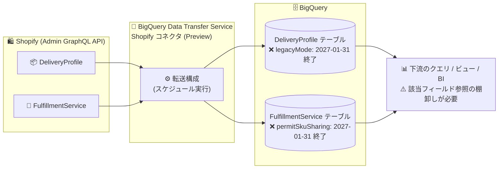

# BigQuery: Data Transfer Service Shopify コネクタの一部フィールドサポート終了 (2027 年 1 月 31 日)

**リリース日**: 2026-11-06

**サービス**: BigQuery (BigQuery Data Transfer Service)

**機能**: Shopify コネクタにおける `legacyMode` / `permitSkuSharing` フィールドのサポート終了

**ステータス**: 破壊的変更 (Breaking Change) - 2027 年 1 月 31 日発効

📊 [このアップデートのインフォグラフィックを見る](https://takech9203.github.io/google-cloud-news-summary/20261106-bigquery-shopify-transfer-field-removal.html)

## 概要

BigQuery Data Transfer Service の Shopify コネクタにおいて、2027 年 1 月 31 日以降、以下の 2 つのフィールドがサポートされなくなることが発表されました。

- `DeliveryProfile` データセットスキーマの `legacyMode` フィールド
- `FulfillmentService` データセットスキーマの `permitSkuSharing` フィールド

この変更は、Shopify API 側の変更に対応するものです。2027 年 1 月 31 日以降、すべての転送構成 (transfer configuration) でこれらのフィールドがサポートされなくなります。Shopify コネクタは Shopify の GraphQL ベースのリソース (Orders、Collections、DeliveryProfiles、FulfillmentServices など) を定期的に BigQuery に転送する機能で、現在 Preview として提供されています。

対象ユーザーは、Shopify コネクタで `DeliveryProfiles` または `FulfillmentServices` オブジェクトを転送しており、転送先テーブルの該当フィールドを下流のクエリ、ビュー、BI ダッシュボードなどで参照しているユーザーです。該当フィールドへの依存を 2027 年 1 月 31 日までに解消する必要があります。

**変更前の状態**

- Shopify コネクタの `DeliveryProfile` データセットスキーマには `legacyMode` フィールドが含まれていた
- Shopify コネクタの `FulfillmentService` データセットスキーマには `permitSkuSharing` フィールドが含まれていた
- これらのフィールドを参照するクエリやビューが動作していた

**変更後の状態 (2027 年 1 月 31 日以降)**

- すべての転送構成で `legacyMode` (DeliveryProfile) と `permitSkuSharing` (FulfillmentService) がサポートされなくなる
- Shopify API 側の変更に追随する形でコネクタのスキーマが整理される
- 該当フィールドに依存するクエリ・ビュー・ダッシュボードは事前の修正が必要になる

## アーキテクチャ図



Shopify コネクタによるデータフローと、2027 年 1 月 31 日にサポート終了となる 2 フィールドの位置づけを示しています。影響は転送先テーブルを参照する下流のクエリやダッシュボードに波及します。

## サービスアップデートの詳細

### 変更内容

1. **`DeliveryProfile` データセットスキーマから `legacyMode` フィールドを削除**
   - `DeliveryProfiles` オブジェクトは Shopify の配送プロファイル情報を転送するデータオブジェクト (必要スコープ: `read_products`、`read_shipping`)
   - 2027 年 1 月 31 日以降、このフィールドはサポートされない

2. **`FulfillmentService` データセットスキーマから `permitSkuSharing` フィールドを削除**
   - `FulfillmentServices` オブジェクトは Shopify のフルフィルメントサービス情報を転送するデータオブジェクト (必要スコープ: `read_locations` または `read_inventory`、および `read_fulfillments` / `read_products` / `read_custom_fulfillment_services` / `assigned_fulfillment_orders` のいずれか)
   - 2027 年 1 月 31 日以降、このフィールドはサポートされない

3. **変更の背景**
   - 公式ドキュメントによると、この変更は Shopify API 側の変更に対応するためのもの
   - 2027 年 1 月 31 日以降、すべての転送構成に適用される (オプトアウト不可)

## 技術仕様

### サポート終了フィールドの一覧

| 項目 | 詳細 |
|------|------|
| 対象コネクタ | BigQuery Data Transfer Service for Shopify (Preview) |
| 対象フィールド 1 | `DeliveryProfile` スキーマの `legacyMode` |
| 対象フィールド 2 | `FulfillmentService` スキーマの `permitSkuSharing` |
| 発効日 | 2027 年 1 月 31 日 |
| 適用範囲 | すべての転送構成 |
| 変更理由 | Shopify API の変更への対応 |

## 対応方法

### 推奨される移行手順

#### ステップ 1: 影響範囲の確認

BigQuery の `INFORMATION_SCHEMA` や依存関係を調べ、該当フィールドを参照しているクエリ・ビューを棚卸しします。

```sql
-- 保存済みビューの定義から該当フィールドの参照を検索する例
SELECT table_name, view_definition
FROM `project_id.dataset_id.INFORMATION_SCHEMA.VIEWS`
WHERE LOWER(view_definition) LIKE '%legacymode%'
   OR LOWER(view_definition) LIKE '%permitskusharing%';
```

#### ステップ 2: クエリ・ダッシュボードの修正

2027 年 1 月 31 日より前に、該当フィールドへの参照を SQL クエリ、ビュー、スケジュールクエリ、BI ダッシュボード (Looker、Looker Studio など) から削除または代替ロジックに置き換えます。

#### ステップ 3: 履歴データの保全 (必要な場合)

過去に転送済みのデータを引き続き分析に利用する場合は、既存テーブルのスナップショットやコピーを検討します。

## デメリット・制約事項

### 制限事項

- 2027 年 1 月 31 日以降、`legacyMode` と `permitSkuSharing` は転送構成でサポートされない
- この変更はオプトアウトできず、すべての転送構成に適用される

### 考慮すべき点

- 該当フィールドを参照するクエリ・ビュー・ダッシュボードは、発効日までに修正しないとエラーや欠損の原因になり得る
- Shopify コネクタ自体は Preview 段階であり、Pre-GA Offerings Terms が適用される (サポートが限定される場合がある)
- Shopify API 側の変更に起因する今後のスキーマ変更に備え、公式の「transfer-changes」ページを定期的に確認することが望ましい

## 料金

Shopify コネクタは Preview 期間中、Shopify データの BigQuery への転送自体に料金はかかりません。BigQuery に格納されたデータのストレージ料金およびクエリ料金は通常どおり発生します。

- [BigQuery の料金](https://cloud.google.com/bigquery/pricing)

## 関連サービス・機能

- **BigQuery Data Transfer Service**: Shopify を含む各種 SaaS / Google サービスから BigQuery へのマネージドなデータ転送基盤。他コネクタ (Salesforce、MySQL、PostgreSQL など) でも同様のスキーマ変更が随時アナウンスされている
- **Shopify Admin GraphQL API**: コネクタのデータソース。今回の変更は Shopify API 側の変更への追随
- **Looker / Looker Studio**: 転送先テーブルを参照するダッシュボードは該当フィールド削除の影響を受ける可能性がある

## 参考リンク

- 📊 [インフォグラフィック](https://takech9203.github.io/google-cloud-news-summary/20261106-bigquery-shopify-transfer-field-removal.html)
- [公式リリースノート](https://docs.cloud.google.com/release-notes#November_06_2026)
- [BigQuery Data Transfer Service の転送変更情報 (Shopify セクション)](https://docs.cloud.google.com/bigquery/docs/transfer-changes)
- [Shopify データの BigQuery への読み込み](https://docs.cloud.google.com/bigquery/docs/shopify-transfer)
- [BigQuery の料金](https://cloud.google.com/bigquery/pricing)

## まとめ

BigQuery Data Transfer Service の Shopify コネクタで、2027 年 1 月 31 日から `DeliveryProfile` の `legacyMode` と `FulfillmentService` の `permitSkuSharing` の 2 フィールドがサポート終了になります。発効まで約 3 か月の猶予があるため、該当オブジェクトを転送しているユーザーは、早めに下流のクエリ・ビュー・ダッシュボードを棚卸しし、該当フィールドへの依存を解消しておくことを推奨します。

---

**タグ**: BigQuery, BigQuery Data Transfer Service, Shopify, Breaking Change, スキーマ変更, データ転送
