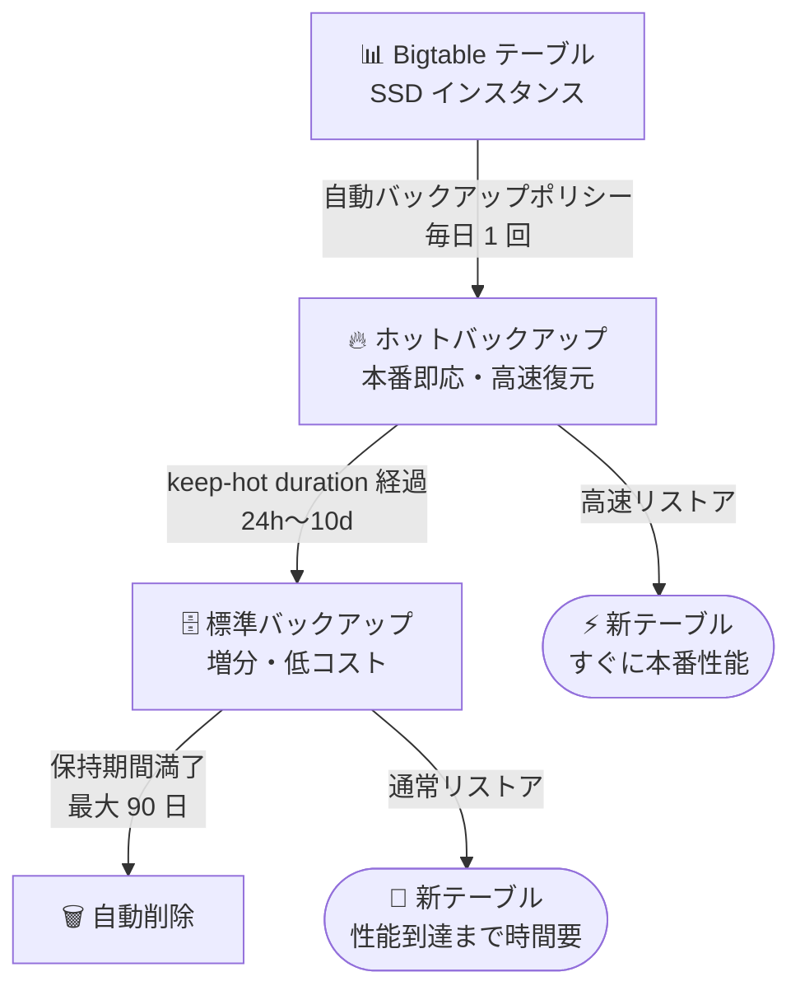

# Bigtable: 自動バックアップポリシーによるホットバックアップの作成が GA

**リリース日**: 2026-11-06

**サービス**: Bigtable

**機能**: SSD インスタンスにおける自動バックアップポリシーでのデイリーホットバックアップ作成

**ステータス**: GA (一般提供)

📊 [このアップデートのインフォグラフィックを見る](https://takech9203.github.io/google-cloud-news-summary/20261106-bigtable-automated-backup-hot-backups-ga.html)

## 概要

Bigtable の SSD インスタンスで、自動バックアップポリシー (automated backup policy) を構成して毎日のホットバックアップを作成できる機能が一般提供 (GA) となりました。あわせて、各バックアップがホット状態を維持する期間 (keep-hot duration) を指定でき、期間経過後は自動的に標準バックアップへ移行します。

ホットバックアップは、迅速な復旧に最適化された本番即応状態のバックアップです。標準バックアップからの復元と比べて、復元直後から本番レベルのパフォーマンス (低レイテンシの読み取り) に到達するまでの時間が大幅に短縮されます。今回の GA により、ホットバックアップの作成・ホットから標準への移行までを自動バックアップポリシーに組み込めるようになり、RTO (目標復旧時間) の短い本番ワークロードを運用するユーザーが、手動運用なしで「最新のバックアップは常にホット、古いバックアップは低コストの標準」という構成を維持できます。

**アップデート前の課題**

- 自動バックアップポリシーが作成するのは標準バックアップであり、復元後に本番性能へ到達するまでの時間が長かった
- ホットバックアップを継続的に維持するには、オンデマンドのホットバックアップを定期的に作成し、各バックアップのホットから標準への移行時刻を個別に設定する運用が必要だった
- 「最新のバックアップのみホットに保ち、古いものは標準に移行してコストを抑える」構成を自前のスケジュール運用で実現する必要があった

**アップデート後の改善**

- 自動バックアップポリシーに keep-hot duration を設定するだけで、毎日ホットバックアップが自動作成されるようになった
- keep-hot duration (24 時間〜10 日) の経過後、各バックアップは自動的に標準バックアップへ移行し、残りの保持期間は低コストで保管される
- keep-hot duration を 24 時間 (1 日) に設定すれば、「常に最新の 1 世代のみホット」という災害復旧とコストのバランスが取れた構成を自動化できる

## アーキテクチャ図



自動バックアップポリシーが毎日ホットバックアップを作成し、指定した keep-hot duration の経過後に標準バックアップへ自動移行、保持期間満了で削除されるライフサイクルを示しています。

## サービスアップデートの詳細

### 主要機能

1. **自動バックアップポリシーでのホットバックアップ作成 (GA)**
   - SSD インスタンスのテーブルに対し、自動バックアップポリシーでデイリーのホットバックアップを作成可能
   - テーブル作成時、自動バックアップ有効化時、既存ポリシーの更新時のいずれでも構成できる (Google Cloud コンソールまたは gcloud CLI)

2. **keep-hot duration (ホット保持期間) の指定**
   - 各デイリーバックアップがホット状態を維持する期間を指定する必須設定
   - 24 時間 (1 日) 〜 10 日の範囲で指定し、ポリシーの保持期間 (retention period) を超えることはできない
   - コンソールのデフォルトは 3 日。期間経過後は残りの保持期間、標準バックアップとして保管される

3. **「最新バックアップのみホット」構成の自動化**
   - keep-hot duration を 24 時間に設定すると、翌日の自動バックアップ作成とともに前日分が標準バックアップへ移行
   - 高速な災害復旧とストレージコストのバランスを自動で維持できる

4. **バックアップタイプの切り替え**
   - ポリシーのバックアップタイプを Hot から Standard に戻すことも可能
   - タイプ変更は作成済みバックアップには影響せず、既存のホットバックアップは移行期間満了までホットのまま維持される

## 技術仕様

### ホット自動バックアップの仕様

| 項目 | 詳細 |
|------|------|
| 対象インスタンス | SSD インスタンスのみ (HDD インスタンスは非対応) |
| バックアップ頻度 | 24 時間ごと (デイリー) |
| keep-hot duration | 24 時間 (`24h`/`1d`) 〜 10 日 (`10d`)、保持期間以下であること (必須設定) |
| コンソールのデフォルト | ホットから標準への移行: 3 日 |
| 保持期間 | デフォルト 7 日、自動バックアップポリシーでは最大 90 日 |
| 移行後の扱い | 標準バックアップとして残りの保持期間保管 (保持期間・有効期限は変化しない) |
| 非対応 | 階層型ストレージ (tiered storage) が有効なテーブル |
| 大規模クラスタ | 400 TB 超の SSD ストレージを使用するクラスタで有効化する場合は Cloud カスタマーケアへの連絡が必要 |

### その他の制限事項 (ホットバックアップ共通)

- ホットバックアップから標準バックアップへの変換は可能だが、標準からホットへの変換は不可
- ホットバックアップのコピーは常に標準バックアップになる (コピーには高速復元特性は引き継がれない)

## 設定方法

### 前提条件

1. テーブルが SSD インスタンス上にあること
2. テーブルで階層型ストレージが有効になっていないこと

### 手順

#### ステップ 1: gcloud CLI で keep-hot duration を設定

```bash
gcloud bigtable tables update TABLE_ID \
  --instance=INSTANCE_ID \
  --automated-backup-retention-period=15d \
  --automated-backup-keep-hot-duration=24h
```

`--automated-backup-keep-hot-duration` でホット保持期間 (例: `24h`、`2d`) を指定します。変更したいパラメータのフラグのみ指定すればよく、省略したパラメータは既存値が維持されます。

**注意**: `--enable-automated-backup` フラグを既存ポリシーのあるテーブルに再指定すると、保持期間や keep-hot duration がデフォルト値 (保持期間 7 日、標準バックアップ) にリセットされます。

#### ステップ 2: コンソールで設定する場合

1. Bigtable インスタンス一覧から対象の SSD インスタンスを選択
2. **Tables** ページで対象テーブルの **Edit** をクリック
3. **Configure automated backup** セクションで **Enable automated backup** を選択
4. **Backup type** で **Hot** を選択
5. **Set hot to standard** に 1〜10 の整数 (日数) を入力 (デフォルト: 3 日、Retention period 以下)
6. **Save** をクリック

ポリシーの変更が反映されるまで最大 1 時間かかる場合があります。

## メリット

### ビジネス面

- **RTO の短縮**: 障害発生時にホットバックアップから高速に復元でき、復元直後から本番レベルの低レイテンシ読み取りが可能なため、サービス停止の影響を最小化できる
- **運用コストの最適化**: 最新世代のみホットに保ち古い世代を標準に自動移行することで、高速復旧能力と保管コストのバランスを自動で維持できる

### 技術面

- **運用の自動化**: オンデマンドホットバックアップの定期作成や移行時刻の個別設定といった手動運用・スクリプト運用が不要になる
- **ポリシーベースの一貫管理**: バックアップタイプ、keep-hot duration、保持期間 (最大 90 日) を単一の自動バックアップポリシーで一元管理できる

## デメリット・制約事項

### 制限事項

- SSD インスタンス限定 (HDD インスタンスでは利用不可)
- 階層型ストレージが有効なテーブルでは利用不可
- keep-hot duration は 24 時間以上 10 日以下で、保持期間を超えられない
- 400 TB 超の SSD ストレージを使用するクラスタでは有効化にカスタマーケアへの連絡が必要

### 考慮すべき点

- ホットバックアップはテーブル全体の論理コピーとして課金されるため、増分共有される標準バックアップよりストレージ単価・課金対象サイズの両面でコストが高い (keep-hot duration を必要最小限にすることが重要)
- レプリケーション構成のインスタンスでは各クラスタにデイリーバックアップが作成されるためコストが増加しうる (Enterprise Plus エディションでは特定ロケーションのみの有効化で軽減可能)
- `--enable-automated-backup` フラグの再指定はポリシーをデフォルトにリセットするため、更新時は個別フラグを使用する

## ユースケース

### ユースケース 1: 低 RTO が求められる本番サービスのディザスタリカバリ

**シナリオ**: ユーザー向けアプリケーションのバックエンドとして Bigtable (SSD) を使用しており、障害時には最新バックアップから短時間で本番性能に復帰する必要がある。

**実装例**:
```bash
gcloud bigtable tables update prod-user-table \
  --instance=prod-instance \
  --automated-backup-retention-period=30d \
  --automated-backup-keep-hot-duration=24h
```

**効果**: 常に直近 24 時間以内のホットバックアップが存在し、高速復元が可能。前日以前の世代は標準バックアップとして 30 日間低コストで保持される。

### ユースケース 2: 週次メンテナンスに備えた数日間のホット保持

**シナリオ**: 大規模なスキーマ変更やデータ移行を行う週は、直近数日分のバックアップから即座にロールバックできる状態を維持したい。

**効果**: keep-hot duration を 3〜10 日に設定することで、作業期間中の複数世代をホットのまま保持し、どの時点にも高速に復元できる。作業後はポリシー更新で標準バックアップ運用に戻せる。

## 料金

バックアップの作成・コピー・復元などの操作自体は無料で、バックアップの物理サイズに基づくストレージ料金が発生します。ホットバックアップは即応状態で保管されるため、標準バックアップのような増分課金ではなく、テーブル全体の論理コピーに対して課金されます。ホットから標準への移行時に追加料金は発生せず、ホット期間はホット料金、移行後は標準料金が適用されます。

### 料金例 (最低料金、リージョンにより異なる)

| 項目 | 料金 (概算) |
|--------|-----------------|
| ホットバックアップ ストレージ | $0.12/GB/月 〜 |
| 標準バックアップ ストレージ | $0.026/GB/月 〜 |

詳細は [Bigtable 料金ページ](https://cloud.google.com/bigtable/pricing) を参照してください。

## 関連サービス・機能

- **Bigtable オンデマンドホットバックアップ**: 任意のタイミングで作成するホットバックアップ。移行時刻の設定は任意で、自動バックアップとの併用も可能
- **Bigtable 階層型ストレージ (tiered storage)**: 有効化したテーブルではホットバックアップが利用できないため、設計時にトレードオフの検討が必要
- **Bigtable Enterprise Plus エディション**: 自動バックアップを特定クラスタロケーションのみに限定する構成が可能で、レプリケーション環境のバックアップコストを最適化できる

## 参考リンク

- 📊 [インフォグラフィック](https://takech9203.github.io/google-cloud-news-summary/20261106-bigtable-automated-backup-hot-backups-ga.html)
- [公式リリースノート](https://docs.cloud.google.com/release-notes#November_06_2026)
- [バックアップの概要 (ホットバックアップ)](https://docs.cloud.google.com/bigtable/docs/backups)
- [バックアップの管理 (ホット自動バックアップの構成)](https://docs.cloud.google.com/bigtable/docs/managing-backups#configure-hot-automated-backups)
- [料金ページ](https://cloud.google.com/bigtable/pricing)

## まとめ

Bigtable の自動バックアップポリシーでデイリーホットバックアップと keep-hot duration を設定できる機能が GA となり、高速復旧とコスト最適化を両立するバックアップ運用をポリシーだけで自動化できるようになりました。SSD インスタンスで低 RTO が求められるワークロードを運用している場合は、keep-hot duration を 24 時間に設定した「最新世代のみホット」構成から導入を検討することをおすすめします。

---

**タグ**: #Bigtable #Backup #DisasterRecovery #GA #Storage
