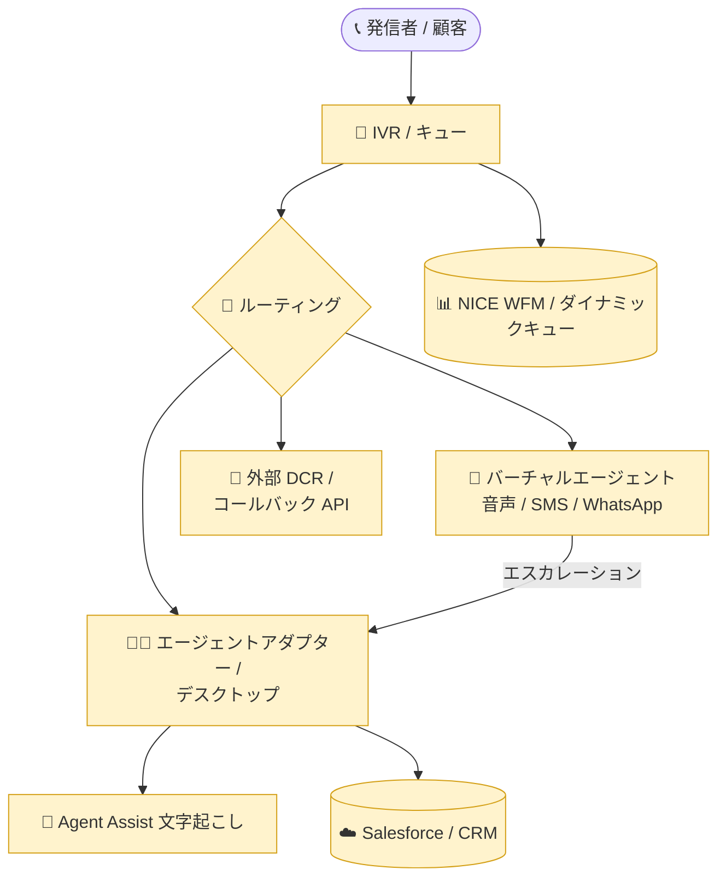

# Google Cloud Contact Center as a Service (CCaaS): バージョン 6.32 リリース (約 30 件の不具合修正)

**リリース日**: 2026-11-06

**サービス**: Google Cloud Contact Center as a Service (CCaaS)

**機能**: バージョン 6.32 リリース (不具合修正)

**ステータス**: Announcement / Fixed

📊 [このアップデートのインフォグラフィックを見る](https://takech9203.github.io/google-cloud-news-summary/20261106-ccaas-6-32-release.html)

## 概要

Google Cloud Contact Center as a Service (CCaaS) の **バージョン 6.32 が正式リリース** されました。2026 年 11 月 4 日に公開されたプレリリースノート ([解説レポート](./2026-11-04-ccaas-6-32-prerelease.md)) の内容が、そのまま正式リリースとして提供されたものです。各インスタンスへの適用タイミングは、顧客が選択しているデプロイスケジュールに依存します。

本バージョンは新機能の追加ではなく、**約 30 件の不具合修正 (Fixed) に特化した品質改善リリース**です。修正範囲は、コールルーティングとキュー管理、エージェントアダプター / エージェントデスクトップ、バーチャルエージェント (SMS / WhatsApp チャネルを含む)、アウトバウンドキャンペーンとコールバック、Salesforce や NICE WFM・外部 Dynamic Contact Routing (DCR) などの外部連携まで多岐にわたります。特に「インバウンドコールがキューに滞留してルーティング不能になる」「特定エージェント宛の音声転送が永久に保留される」「通話切断などの操作に最大 72 秒かかる」といった、コンタクトセンターの運用と顧客体験に直接影響する問題が解消されます。

CCaaS を運用する管理者やオペレーション担当者は、自社で遭遇していた既知の問題が本リリースで解消されるかを確認し、デプロイスケジュールに沿った適用と適用後の検証を計画することが推奨されます。

**アップデート前の課題**

このリリースで修正された主な問題は以下のとおりです。

- 放棄 (abandoned) キューレコードの待ち時間が、放棄した特定のキューに入った時刻ではなく、コールが最初にキューに入った時刻から誤って計算されていた
- エージェントのブラウザがタイムアウト後に遅延した接続リクエストを送ると、インバウンドコールがルーティング不能になり、放棄されるまでキューに滞留していた
- 特定エージェント宛の音声転送が対象エージェントに提示されず、期限切れにもならないため、発信者が無期限に保留されたままになっていた
- 通話の切断やステータス更新などの通話関連操作の完了に最大 72 秒かかることがあった
- 一時的なネットワークエラーやクォータエラーの後、Agent Assist の文字起こしが恒久的に停止していた
- 一時停止したキャンペーンが再開されず、コールセッションの失敗や参加者情報の欠落が繰り返し発生していた
- バーチャルエージェントのみが対応した音声コールに対して、設定が無効でも Salesforce のケースと取引先責任者が誤って作成されていた

**アップデート後の改善**

バージョン 6.32 の適用により、以下が改善されます。

- 放棄キューの待ち時間計算、スケジュールされたコールバック容量の計算 (丸め誤差) などのレポーティング / 容量計算の精度が向上した
- ルーティング起因でコールやエージェントがスタックする複数の問題が解消され、インバウンドコールの取りこぼしが減る
- エージェントアダプター / デスクトップのフリーズ、ステータス表示・変更の不具合が解消され、エージェント体験が改善された
- SMS / WhatsApp のバーチャルエージェントチャットが応答不能になり人間のエージェントにエスカレーションされない問題が解消された
- Salesforce・NICE WFM・外部 Dynamic Contact Routing (DCR) との連携における不整合が解消された

## アーキテクチャ図

バージョン 6.32 の修正は、上図のハイライトされたコンポーネント全域 (キュー / ルーティング、エージェント体験、バーチャルエージェント、Agent Assist、CRM / WFM / DCR 連携) に及びます。

## サービスアップデートの詳細

バージョン 6.32 で修正された問題を、領域別に整理します。

### ルーティング・キュー関連の修正

1. **放棄キューレコードの待ち時間計算**
   - コールが最初に入ったキューではなく、放棄した特定のキューに入った時刻から待ち時間を計算するように修正
2. **インバウンドコールのキュー滞留・切断**
   - エージェントのブラウザがタイムアウト後に遅延した接続リクエストを送った場合に、コールがルーティング不能になり放棄まで滞留する問題を修正
   - 初回接続リクエストがタイムアウトして再試行された場合に、インバウンドコールが途中で切断される問題を修正
3. **エージェントの状態スタック**
   - ルーティングの瞬間に発信者がコールを放棄した場合、エージェントが projected 状態のままになりコールを受けられなくなる問題を修正
   - コールアダプターが既に着信中に新しい deltacast オファーが到着した場合、不在着信ではなく誤って Unresponsive ステータスに設定される問題を修正
4. **音声転送**
   - 特定エージェント宛の音声転送が対象に提示されず期限切れにもならないため、発信者が無期限に保留される問題を修正
5. **ダイナミックキューと WFM 連携**
   - WFM のスタッフィングがゼロまたは 1 未満のスロットの場合でも、ダイナミックキューが最低 1 スロットを誤って提供していた問題を修正
   - Dynamic Agent Availability キューが必須のカスタムキュー識別子なしで保存され、ワークフォースマネジメントの同期がサイレントに失敗する問題を修正

### エージェントアダプター / デスクトップの修正

1. **表示・UI の問題**
   - SmartActions およびバーチャルタスクアシスタント画面で、コールアダプターのヘッダータイトルが省略記号で切り詰められ全文を確認できない問題を修正
   - CRM で電話番号が一致しない場合に、コールアダプターに Not Found バナーが誤って表示される問題を修正
   - バーチャルタスクアシスタントの入力プレースホルダーで、大文字の頭字語フィールド名の先頭文字が誤って小文字化される問題を修正
2. **ステータスバー**
   - エージェントデスクトップの In-email ステータスバーが白く表示される問題を修正
   - In-email ステータスのエージェントがステータスバーから直接ステータスを変更できない問題を修正
3. **動作・パフォーマンス**
   - 応答されなかったアプリ内コール後のリカバリーコールで、エージェントアダプターが Calling のままフリーズし顧客に発信しない問題を修正
   - 切断やステータス更新などの通話関連操作の完了に最大 72 秒かかる問題を修正
   - アウトバウンドコール中に特定のエージェントがディレクトリに表示されず、転送や通話への追加ができない問題を修正

### バーチャルエージェント・チャネルの修正

1. **資格情報とエスカレーション**
   - プラットフォーム検証中の一時的なネットワークエラーにより、バーチャルエージェントの資格情報が誤って無効とマークされる問題を修正
   - カスタムペイロードの検証エラー発生時に、SMS / WhatsApp のバーチャルエージェントチャットが応答不能になり人間のエージェントにエスカレーションされない問題を修正
2. **コールバックとルーティング**
   - Apps API 経由で予約された強制バーチャルエージェントコールバックが、要求された宛先ではなく元のコールのキューに誤ってルーティングされる問題を修正
   - 外部 Dynamic Contact Routing (DCR) 経由のバーチャルコールバックで、バーチャルエージェントのカスタムパラメーターが欠落し、ルーティングエンジンが発信者のインテントを失う問題を修正
3. **Agent Assist**
   - 一時的なネットワークエラーまたはクォータエラーの後、Agent Assist の文字起こしが恒久的に停止する問題を修正

### アウトバウンド・キャンペーンの修正

1. **キャンペーン**
   - 一時停止後にキャンペーンが再開されず、コールセッションの失敗や参加者情報の欠落が繰り返される問題を修正
2. **コールバックと番号検証**
   - アウトバウンドコールバック中の一時的なキャリアタイムアウトが、無効な番号として誤分類される問題を修正
   - 新しい市外局番を使用する有効なカナダの電話番号が Callback call API で拒否される問題を修正
   - スケジュールされたコールバック容量が、数学的な丸め誤差により過小計算される問題を修正
3. **発信制限**
   - Allow unrestricted international calling 設定が有効なエージェントに、アウトバウンド電話番号の制限ルールが適用されない問題を修正

### ポータル・外部連携の修正

1. **CCaaS ポータル**
   - 言語を英語からスペイン語に切り替えた際、有効なスペイン語 IVR キューが誤って「Setup is required」と表示されグレーアウトされる問題を修正
2. **Salesforce 連携**
   - 「Create CRM records for calls attended by Virtual Agents」設定が無効でも、バーチャルエージェントのみが対応した音声コールに対して Salesforce のケースと取引先責任者が誤って作成される問題を修正
3. **NICE WFM 連携**
   - サブドメインが 20 文字を超えるインスタンスで、NICE WFM セッションデータのエクスポートが生成されない問題を修正

## メリット

### ビジネス面

- **顧客体験の改善**: コールのキュー滞留、無期限の保留、チャットのエスカレーション不能など、顧客に直接影響する問題が解消され、応答率と顧客満足度の向上が期待できる
- **レポーティング精度の向上**: 放棄キューの待ち時間計算やコールバック容量計算の修正により、KPI 測定と要員計画の精度が向上する
- **CRM データの正確性**: バーチャルエージェントのみが対応したコールで不要な Salesforce レコードが作成されなくなり、CRM データの品質が保たれる

### 技術面

- **一時的エラーへの耐性向上**: ネットワークエラー、キャリアタイムアウト、クォータエラーなどの一時的な障害が恒久的な機能停止 (資格情報の無効化、文字起こし停止、番号の誤分類) につながらなくなる
- **WFM 連携の信頼性向上**: Dynamic Agent Availability キューの同期失敗や NICE WFM エクスポートの生成失敗が解消される
- **操作レスポンスの改善**: 通話関連操作が最大 72 秒かかる問題の修正により、エージェントの作業効率が向上する

## デメリット・制約事項

### 考慮すべき点

- **適用タイミング**: インスタンスへのアップデート適用時期は、各顧客が選択しているデプロイスケジュールに依存する。自社インスタンスの適用時期を確認すること
- **新機能は含まれない**: 本バージョンは不具合修正が中心であり、新機能を期待する場合は別のリリース (例: 6.26 など) を確認する必要がある
- **適用後の検証**: 連携まわり (Salesforce、NICE WFM、DCR) で回避策を運用していた場合は、適用後に回避策の撤去と整合性の再検証が必要になる

## ユースケース

### ユースケース 1: 既知の問題の解消確認とアップデート適用計画

**シナリオ**: コンタクトセンターで「転送したコールが相手エージェントに届かない」「Agent Assist の文字起こしが止まる」などの事象をサポートに報告済みの運用チームが、修正版の適用を計画する。

**効果**: 該当する修正が 6.32 に含まれることを正式リリースノートで確認でき、デプロイスケジュールに合わせた検証・展開と、適用後の事象再発確認を計画できる。

### ユースケース 2: WFM・CRM 連携の整合性確認

**シナリオ**: NICE WFM や Salesforce と連携している環境で、セッションデータのエクスポート欠落や不要なケース作成が発生していた管理者が、6.32 適用後に連携データの整合性を再検証する。

**効果**: アップデート適用後に連携まわりの回避策 (手動でのレコード削除やエクスポートの再実行など) を廃止でき、運用負荷を削減できる。

## 関連サービス・機能

- **Agent Assist (Conversational Agents)**: 文字起こし停止の修正により、リアルタイムのエージェント支援の継続性が向上
- **Salesforce Service Cloud 連携**: バーチャルエージェント対応コールでの不要なケース / 取引先責任者作成の抑止が正しく機能するようになる
- **NICE WFM などの WFM 連携**: セッションデータエクスポートおよびダイナミックキューの同期の信頼性が向上
- **Dynamic Contact Routing (DCR)**: 外部ルーティングエンジンへのバーチャルエージェントカスタムパラメーター引き渡しが修正される

## 参考リンク

- 📊 [インフォグラフィック](https://takech9203.github.io/google-cloud-news-summary/20261106-ccaas-6-32-release.html)
- [公式リリースノート (November 06, 2026)](https://docs.cloud.google.com/release-notes#November_06_2026)
- [Google Cloud CCaaS リリースノート](https://docs.cloud.google.com/contact-center/ccai-platform/docs/release-notes)
- [デプロイスケジュール](https://docs.cloud.google.com/contact-center/ccai-platform/docs/deployment-schedules)
- [6.32 プレリリースノートの解説レポート (2026-11-04)](./2026-11-04-ccaas-6-32-prerelease.md)

## まとめ

Google Cloud CCaaS 6.32 が正式リリースされ、11 月 4 日のプレリリースノートで予告されていた約 30 件の不具合修正 (ルーティング、エージェント体験、バーチャルエージェント、アウトバウンド、外部連携) が提供開始されました。インスタンスへの適用時期はデプロイスケジュールに依存するため、CCaaS を運用するチームは自社の適用時期を確認した上で、既知の問題の解消確認と連携まわりの回避策撤去を計画することを推奨します。

---

**タグ**: #GoogleCloud #CCaaS #ContactCenter #リリース #不具合修正 #AgentAssist #Salesforce #WFM
