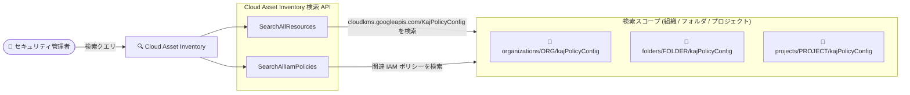

# Cloud Asset Inventory: Cloud KMS KajPolicyConfig リソースタイプの検索 API 対応

**リリース日**: 2026-11-06

**サービス**: Cloud Asset Inventory

**機能**: SearchAllResources / SearchAllIamPolicies API での `cloudkms.googleapis.com/KajPolicyConfig` リソースタイプ対応

**ステータス**: 一般提供 (Publicly Available)

📊 [このアップデートのインフォグラフィックを見る](https://takech9203.github.io/google-cloud-news-summary/20261106-cloud-asset-inventory-kms-kajpolicyconfig.html)

## 概要

Cloud Asset Inventory の検索 API である `SearchAllResources` および `SearchAllIamPolicies` で、Cloud Key Management Service (Cloud KMS) の新しいリソースタイプ `cloudkms.googleapis.com/KajPolicyConfig` が利用可能になりました。

`KajPolicyConfig` は、Key Access Justifications (KAJ) のデフォルトポリシー設定を表すリソースです。KAJ は、Cloud KMS キーに対するすべての暗号操作について Google システムがアクセス理由 (justification code) を生成し、その理由に基づいてキーアクセスを承認・拒否するポリシーを設定できる機能で、Access Approval や Access Transparency とともに顧客データへのアクセス管理を実現します。`KajPolicyConfig` は組織・フォルダ・プロジェクトの各階層に設定でき (例: `organizations/ORG_NUMBER/kajPolicyConfig`)、新規作成される Cloud KMS キーに適用されるデフォルトの KAJ ポリシー (許可するアクセス理由のリスト) を定義します。

今回のアップデートにより、組織全体のセキュリティガバナンスを担当する管理者やセキュリティチームは、Cloud Asset Inventory の検索 API を使って、組織・フォルダ・プロジェクトに散在する KAJ ポリシー設定を横断的に検索・棚卸しできるようになります。

**アップデート前の課題**

- `KajPolicyConfig` リソースは Cloud Asset Inventory の検索 API の対象外であり、他のリソースと同じ方法で横断検索できなかった
- 組織内のどの組織・フォルダ・プロジェクトに KAJ デフォルトポリシーが設定されているかを把握するには、Cloud KMS API (`getKajPolicyConfig`) や `gcloud beta kms kaj-config describe` を階層ごとに個別に呼び出す必要があった

**アップデート後の改善**

- `SearchAllResources` API で、指定したスコープ (組織・フォルダ・プロジェクト) 配下の `cloudkms.googleapis.com/KajPolicyConfig` リソースを一括検索できるようになった
- `SearchAllIamPolicies` API で、`KajPolicyConfig` リソースに関連する IAM ポリシーを検索できるようになった
- 組織スコープでの KAJ ポリシー設定の棚卸し・ガバナンス確認が、他の Google Cloud リソースと同じ Cloud Asset Inventory の仕組みで行えるようになった

## アーキテクチャ図



Cloud Asset Inventory の 2 つの検索 API が、組織・フォルダ・プロジェクトの各階層に設定された Cloud KMS の Key Access Justifications ポリシー設定 (`KajPolicyConfig`) を横断的に検索できるようになった構成を示しています。

## サービスアップデートの詳細

### 主要機能

1. **SearchAllResources での KajPolicyConfig 検索**
   - 指定したスコープ (プロジェクト、フォルダ、組織) 内の `cloudkms.googleapis.com/KajPolicyConfig` リソースのメタデータを検索可能
   - `assetTypes` パラメータでリソースタイプを絞り込み、クエリ構文によるフィルタリングや並べ替えに対応

2. **SearchAllIamPolicies での検索**
   - `KajPolicyConfig` リソースに関連する IAM ポリシーを検索対象として利用可能
   - 誰がどのリソースに対して権限を持つかの調査に活用できる

3. **KajPolicyConfig リソースについて**
   - Key Access Justifications のデフォルトポリシー (許可するアクセス理由 `allowedAccessReasons` のリスト) を保持するリソース
   - 組織・フォルダ・プロジェクトの各階層に設定でき、プロジェクトは最も近い親階層からデフォルトポリシーを継承する
   - 設定されたデフォルトポリシーは、そのスコープで新規作成される Cloud KMS キーに適用される

## 技術仕様

### 対象リソースタイプ

| 項目 | 詳細 |
|------|------|
| リソースタイプ | `cloudkms.googleapis.com/KajPolicyConfig` |
| 対応 API | `SearchAllResources`, `SearchAllIamPolicies` |
| リソース名の例 | `organizations/ORG_NUMBER/kajPolicyConfig`, `folders/FOLDER_ID/kajPolicyConfig`, `projects/PROJECT_ID/kajPolicyConfig` |
| 主な内容 | `defaultKeyAccessJustificationPolicy` (許可するアクセス理由 `allowedAccessReasons` のリスト) |

### 必要な権限

| API | 必要な権限 |
|-----|-----------|
| `SearchAllResources` | `cloudasset.assets.searchAllResources` (リソースオーナー情報の付加検索には `cloudasset.assets.searchEnrichmentResourceOwners` も必要) |
| `SearchAllIamPolicies` | `cloudasset.assets.searchAllIamPolicies` |

### KajPolicyConfig のレスポンス例 (Cloud KMS API)

```json
{
  "name": "organizations/ORGANIZATION_ID/kajPolicyConfig",
  "defaultKeyAccessJustificationPolicy": {
    "defaultPolicyAvailable": true,
    "allowedAccessReasons": [
      "CUSTOMER_INITIATED_ACCESS",
      "GOOGLE_INITIATED_SYSTEM_OPERATION"
    ]
  }
}
```

## 設定方法

### 前提条件

1. Cloud Asset Inventory API が有効化されていること
2. 検索スコープに対して `cloudasset.assets.searchAllResources` (または `cloudasset.assets.searchAllIamPolicies`) 権限を持っていること

### 手順

#### ステップ 1: 組織スコープで KajPolicyConfig リソースを検索

```bash
gcloud asset search-all-resources \
  --scope=organizations/ORGANIZATION_ID \
  --asset-types=cloudkms.googleapis.com/KajPolicyConfig
```

組織配下に存在する Key Access Justifications のデフォルトポリシー設定リソースを一括で検索します。

#### ステップ 2: REST API での検索

```bash
curl -X POST \
  -H "X-HTTP-Method-Override: GET" \
  -H "Authorization: Bearer $(gcloud auth print-access-token)" \
  -H "Content-Type: application/json; charset=utf-8" \
  -d '{
    "assetTypes": ["cloudkms.googleapis.com/KajPolicyConfig"]
  }' \
  https://cloudasset.googleapis.com/v1/organizations/ORGANIZATION_ID:searchAllResources
```

`SearchAllResources` API を直接呼び出して、プログラムから KAJ ポリシー設定の棚卸しを自動化できます。

## メリット

### ビジネス面

- **ガバナンスの可視化**: 組織全体で KAJ デフォルトポリシーがどの階層に設定されているかを一括で把握でき、コンプライアンス監査やセキュリティレビューの効率が向上する
- **設定漏れの検出**: KAJ ポリシーが設定されていない、または意図しない設定になっている箇所を組織スコープの検索で発見しやすくなる

### 技術面

- **統一されたインベントリ管理**: 他の Google Cloud リソースと同じ Cloud Asset Inventory の検索 API・クエリ構文で KAJ ポリシー設定を扱える
- **自動化との親和性**: gcloud / REST / クライアントライブラリから検索できるため、定期的な棚卸しスクリプトやガバナンスツールへの組み込みが容易

## デメリット・制約事項

### 考慮すべき点

- Key Access Justifications 自体は Assured Workloads と組み合わせて使用する機能であり、利用できる機能は選択した Assured Workloads のコントロールパッケージに依存する
- Cloud Asset Inventory の検索は同期オペレーションであり、大規模なインベントリに対する検索はクォータに影響する可能性がある (大規模な照会には非同期のクエリ手法の検討が推奨される)

## ユースケース

### ユースケース 1: 組織全体の KAJ ポリシー設定の棚卸し

**シナリオ**: 規制対応 (Assured Workloads) を導入している企業のセキュリティチームが、組織・フォルダ・プロジェクトの各階層に設定された KAJ デフォルトポリシーを定期的に棚卸ししたい。

**実装例**:
```bash
gcloud asset search-all-resources \
  --scope=organizations/ORGANIZATION_ID \
  --asset-types=cloudkms.googleapis.com/KajPolicyConfig \
  --format="table(name, assetType, location)"
```

**効果**: 階層ごとに Cloud KMS API を個別に呼び出すことなく、1 回の検索で組織全体の KAJ ポリシー設定リソースを一覧化できる。

### ユースケース 2: セキュリティ監査でのアクセス権限確認

**シナリオ**: 監査担当者が、KAJ ポリシー設定リソースに対して誰がアクセス権限を持っているかを確認したい。

**効果**: `SearchAllIamPolicies` API を使って `KajPolicyConfig` に関連する IAM ポリシーを検索し、権限の付与状況を監査レポートに反映できる。

## 料金

Cloud Asset Inventory の料金については公式料金情報を参照してください。Key Access Justifications は Assured Workloads の一部として提供されます。

- [Assured Workloads の料金](https://cloud.google.com/assured-workloads/pricing)

## 関連サービス・機能

- **Cloud Key Management Service (Cloud KMS)**: `KajPolicyConfig` リソースを提供するサービス。暗号鍵の管理と KAJ ポリシーの適用を行う
- **Key Access Justifications (Assured Workloads)**: Cloud KMS キーへのアクセスごとに理由コードを生成し、ポリシーに基づいてアクセスを承認・拒否する機能
- **Access Approval / Access Transparency**: KAJ と連携して、Google 担当者による顧客データアクセスの承認・可視化を行うサービス
- **VPC Service Controls**: Cloud Asset Inventory と組み合わせてアセットへのアクセスをさらに保護できる

## 参考リンク

- 📊 [インフォグラフィック](https://takech9203.github.io/google-cloud-news-summary/20261106-cloud-asset-inventory-kms-kajpolicyconfig.html)
- [公式リリースノート](https://docs.cloud.google.com/release-notes#November_06_2026)
- [Cloud Asset Inventory: サポートされるアセットタイプ](https://docs.cloud.google.com/asset-inventory/docs/asset-types)
- [Cloud Asset Inventory: リソースの検索 (SearchAllResources)](https://docs.cloud.google.com/asset-inventory/docs/search-resources)
- [Cloud Asset Inventory: IAM 許可ポリシーの検索 (SearchAllIamPolicies)](https://docs.cloud.google.com/asset-inventory/docs/search-allow-policies)
- [Key Access Justifications の概要](https://docs.cloud.google.com/assured-workloads/key-access-justifications/docs/overview)
- [デフォルトの Key Access Justifications ポリシーの設定](https://docs.cloud.google.com/assured-workloads/key-access-justifications/docs/set-default-policy)

## まとめ

Cloud KMS の Key Access Justifications デフォルトポリシー設定 (`KajPolicyConfig`) が Cloud Asset Inventory の検索 API で扱えるようになり、組織スコープでの KAJ ポリシーの棚卸しと監査が大幅に容易になりました。Assured Workloads / KAJ を利用している組織は、既存のガバナンスワークフローに `cloudkms.googleapis.com/KajPolicyConfig` の定期検索を組み込むことを推奨します。

---

**タグ**: #CloudAssetInventory #CloudKMS #KeyAccessJustifications #AssuredWorkloads #セキュリティ #ガバナンス
