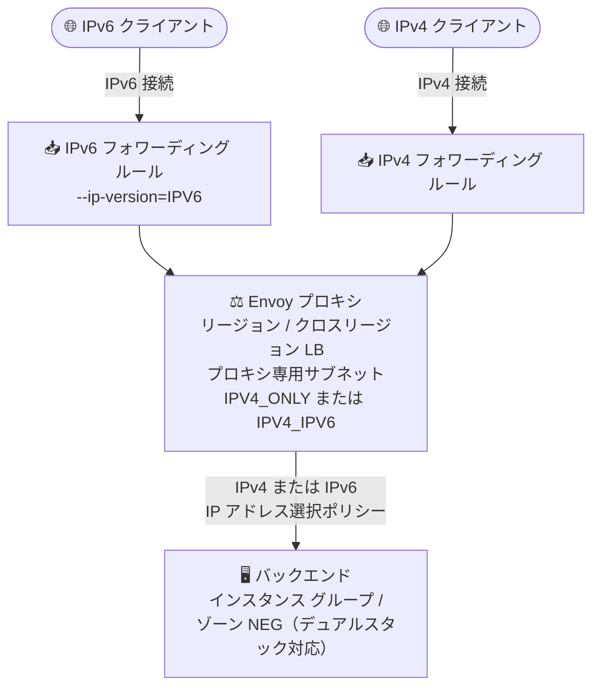

# Cloud Load Balancing: リージョン / クロスリージョンのロードバランサで IPv6 フロントエンド構成が GA

**リリース日**: 2026-11-06

**サービス**: Cloud Load Balancing

**機能**: リージョン外部 / 内部およびクロスリージョン内部ロードバランサにおける IPv6 トラフィックのフロントエンド構成

**ステータス**: 一般提供 (GA)

📊 [このアップデートのインフォグラフィックを見る](https://takech9203.github.io/google-cloud-news-summary/20261106-cloud-load-balancing-ipv6-frontend-ga.html)

## 概要

Google Cloud は、受信 IPv6 トラフィックをロードバランシングするためのフロントエンド構成を、以下の 6 種類のロードバランサで一般提供 (GA) にしました。

- リージョン外部アプリケーション ロードバランサ
- リージョン外部プロキシ ネットワーク ロードバランサ
- リージョン内部アプリケーション ロードバランサ
- リージョン内部プロキシ ネットワーク ロードバランサ
- クロスリージョン内部アプリケーション ロードバランサ
- クロスリージョン内部プロキシ ネットワーク ロードバランサ

これらはいずれも Envoy ベースのプロキシ型ロードバランサであり、クライアントからの接続をロードバランサで終端 (ターミネーション) し、バックエンドへは新しい接続を確立します。今回の GA により、IPv6 クライアントからの接続をフォワーディング ルールで受け付け、バックエンドには IPv4 または IPv6 (デュアルスタック バックエンドの場合) で転送する構成を本番環境で利用できるようになりました。クライアントの IPv6 トラフィックをサポートするために、プロキシ専用サブネットは `IPV4_ONLY` と `IPV4_IPV6` (デュアルスタック) のどちらのスタックタイプでも構成できます。

IPv6 対応が政府調達要件や通信事業者のネットワーク要件となるケースが増えるなか、グローバル外部ロードバランサだけでなく、リージョン単位・内部向けのロードバランサでも IPv6 フロントエンドを GA 品質で利用できることは、エンタープライズのデュアルスタック移行を後押しするアップデートです。

**アップデート前の課題**

- リージョン外部 / 内部およびクロスリージョン内部のアプリケーション ロードバランサとプロキシ ネットワーク ロードバランサでは、IPv6 接続の終端が Preview (Pre-GA) 扱いであり、Pre-GA Offerings Terms の下で「現状有姿」での提供・限定的なサポートに留まっていた
- そのため、これらのロードバランサを使う本番ワークロードで IPv6 クライアントを受け付ける構成を正式サポートの下で採用しにくかった
- GA で IPv6 終端をサポートしていたのはグローバル外部アプリケーション ロードバランサ / グローバル外部プロキシ ネットワーク ロードバランサなどに限られていた

**アップデート後の改善**

- リージョン / クロスリージョンの 6 種類のプロキシ型ロードバランサで、IPv6 フォワーディング ルールによるフロントエンド構成が GA となり、本番環境で正式サポートの下で利用できるようになった
- クライアント向けは IPv6、バックエンド向けは IPv4 のままという段階的なデュアルスタック移行が可能 (バックエンド接続は IP アドレス選択ポリシーで IPv6 も選択可能)
- プロキシ専用サブネットのスタックタイプは `IPV4_ONLY` / `IPV4_IPV6` のいずれでもクライアント IPv6 トラフィックをサポートできる

## アーキテクチャ図



IPv6 クライアントからの接続はロードバランサで終端され、バックエンドへは IPv4 (デフォルト) または IP アドレス選択ポリシーに応じて IPv6 で転送されます。クライアント側とバックエンド側の接続は独立して構成できます。

## サービスアップデートの詳細

### 主要機能

1. **IPv6 フロントエンド (IPv6 終端) の GA**
   - リージョン外部 / 内部、クロスリージョン内部のアプリケーション ロードバランサおよびプロキシ ネットワーク ロードバランサで、IPv6 クライアント接続の終端が GA
   - ロードバランサがリバース プロキシとして IPv6 接続を終端し、バックエンドの IP アドレス選択ポリシーに基づいて IPv4 または IPv6 接続でリクエストを転送

2. **プロキシ専用サブネットのスタックタイプの柔軟性**
   - クライアント IPv6 トラフィックをサポートするために、プロキシ専用サブネットのスタックタイプは `IPV4_ONLY` または `IPV4_IPV6` (デュアルスタック) のいずれかで構成可能
   - デュアルスタックのプロキシ専用サブネットの IPv6 範囲は、ネットワークの ULA (Unique Local Address) 範囲から自動割り当て

3. **フロントエンドとバックエンドの独立した IP バージョン構成**
   - クライアント→ロードバランサ間と、ロードバランサ→バックエンド間の接続は独立して構成可能
   - バックエンドへの IPv6 接続は、バックエンド サービスの IP アドレス選択ポリシー (例: `PREFER_IPV6`) とデュアルスタック バックエンドの組み合わせでサポート

4. **X-Forwarded-For によるクライアント IPv6 アドレスの伝搬 (アプリケーション ロードバランサ)**
   - IPv6 接続を IPv4 でバックエンドに転送する場合でも、`X-Forwarded-For` ヘッダーで元のクライアント IPv6 アドレスをバックエンドに伝搬

## 技術仕様

### プロキシ型ロードバランサの IPv6 サポート

| ロードバランサ | クライアント→LB | LB→バックエンド |
|------|------|------|
| グローバル外部 ALB / グローバル外部プロキシ NLB | IPv4 / IPv6 両方を終端可能 | IPv4、または IPv6 (デュアルスタック バックエンドのみ) |
| クラシック ALB / クラシック プロキシ NLB | IPv4 / IPv6 両方を終端可能 | IPv4 のみ |
| リージョン外部 / 内部 ALB、リージョン外部 / 内部プロキシ NLB、クロスリージョン内部 ALB / プロキシ NLB | IPv4 / IPv6 両方を終端可能 (**今回 GA**) | IPv4、または IPv6 (デュアルスタック バックエンドのみ) |

### IPv6 フォワーディング ルールのアドレス割り当て

| 項目 | 詳細 |
|------|------|
| リージョン外部 ALB / プロキシ NLB | `--ip-version=IPV6` 指定時、`ipv6-access-type=EXTERNAL`・スタックタイプ `IPV4_IPV6` または `IPV6_ONLY` のカスタムモード サブネットの /64 から、ランダムな /96 プレフィックスの範囲を割り当て |
| 内部 ALB / 内部プロキシ NLB | `--ip-version=IPV6` 指定時、`--ipv6-access-type=INTERNAL` のデュアルスタックまたは IPv6 専用サブネットの /64 から /96 範囲を割り当て |
| 到達可能アドレス | 割り当てられた /96 範囲のうちクライアントから到達可能なのは先頭アドレス (例: `:0:0` で終わるアドレス) のみ。DNS レコードにはこの先頭アドレスを設定する |
| デュアルスタック対応バックエンド | VM インスタンス グループ、またはゾーン NEG (`GCE_VM_IP_PORT` エンドポイント) のみ |

## 設定方法

### 前提条件

1. 対象のロードバランサ (リージョン外部 / 内部 ALB、プロキシ NLB、クロスリージョン内部 ALB / プロキシ NLB) を使用していること
2. カスタムモードの VPC ネットワークであること (デュアルスタック サブネットは自動モード VPC では非サポート)
3. 内部 IPv6 を使う場合、VPC ネットワークで ULA 内部 IPv6 範囲を有効化 (`--enable-ula-internal-ipv6`) していること

### 手順

#### ステップ 1: デュアルスタックのプロキシ専用サブネットを作成する

```bash
gcloud compute networks subnets create PROXY_ONLY_SUBNET \
    --purpose=REGIONAL_MANAGED_PROXY \
    --role=ACTIVE \
    --region=REGION \
    --network=VPC_NETWORK_NAME \
    --range=PROXY_ONLY_SUBNET_RANGE \
    --stack-type=IPV4_IPV6
```

IPv6 範囲はネットワークの ULA 範囲から自動的に割り当てられます (明示指定は不可)。クロスリージョン ロードバランサの場合は `--purpose=GLOBAL_MANAGED_PROXY` を使用します。

#### ステップ 2: IP アドレス選択ポリシー付きのバックエンド サービスを作成する (バックエンドも IPv6 にする場合)

```bash
gcloud compute backend-services create BACKEND_SERVICE_IPV6 \
    --load-balancing-scheme=EXTERNAL_MANAGED \
    --protocol=HTTP \
    --ip-address-selection-policy=PREFER_IPV6 \
    --health-checks=HEALTH_CHECK \
    --region=REGION
```

バックエンドを IPv4 のまま運用する場合、このステップは不要です (デフォルトではロードバランサ→バックエンドは IPv4)。

#### ステップ 3: IPv6 フォワーディング ルールを作成する (リージョン外部 ALB の例)

```bash
gcloud compute forwarding-rules create FORWARDING_RULE_IPV6 \
    --load-balancing-scheme=EXTERNAL_MANAGED \
    --network-tier=PREMIUM \
    --network=NETWORK \
    --subnet-region=REGION \
    --subnet=SUBNET \
    --target-http-proxy=TARGET_PROXY \
    --ports=443 \
    --ip-version=IPV6
```

IPv4 用と IPv6 用の 2 つのフォワーディング ルールを同じロードバランサに関連付けることで、デュアルスタック構成を実現できます。

## メリット

### ビジネス面

- **IPv6 要件への正式対応**: 政府・公共調達や通信事業者ネットワークなどで求められる IPv6 対応を、リージョン / 内部ロードバランサでも GA サポートの下で満たせる
- **段階的な移行**: クライアント側だけ先に IPv6 化し、バックエンドは IPv4 のまま運用できるため、移行リスクとコストを抑えられる

### 技術面

- **フロントエンドとバックエンドの独立構成**: 終端後のバックエンド接続は IPv4 / IPv6 を IP アドレス選択ポリシーで制御でき、既存バックエンドをそのまま活用可能
- **クライアント IP の可視性維持**: アプリケーション ロードバランサでは `X-Forwarded-For` ヘッダーで元の IPv6 クライアント アドレスをバックエンドに伝搬
- **内部通信の IPv6 化**: 内部 / クロスリージョン内部ロードバランサで ULA ベースの内部 IPv6 終端が可能になり、VPC 内のデュアルスタック化を進められる

## デメリット・制約事項

### 制限事項

- IPv6 フォワーディング ルール作成時に自動割り当てされる /96 範囲のうち、クライアントから到達可能なのは先頭アドレスのみ。クライアントと DNS レコードはこの先頭アドレスを使うように構成する必要がある
- デュアルスタック バックエンドとして構成できるのは、VM インスタンス グループとゾーン NEG (`GCE_VM_IP_PORT` エンドポイント) のみ
- デュアルスタック サブネットはカスタムモード VPC のみサポート (自動モード VPC・レガシー ネットワークは非対応)。サブネットを一度デュアルスタックに変更すると IPv4 のみへ戻せない

### 考慮すべき点

- 内部 IPv6 を使用するには VPC ネットワークで ULA 内部 IPv6 範囲の有効化が必要
- リージョン外部 / 内部 ALB を使う場合、プロキシ専用サブネット (の IPv6 範囲を含む) からバックエンドへのトラフィックを許可するファイアウォール ルールの更新が必要
- 既存のプロキシ専用サブネットの `--purpose` は変更できないため、構成によってはサブネットの再作成・移行計画が必要

## ユースケース

### ユースケース 1: リージョン外部 ALB を使う公開 Web サービスのデュアルスタック化

**シナリオ**: 単一リージョンで運用する Web サービスが、モバイル キャリア網などからの IPv6 クライアントに直接応答する必要がある。

**実装例**:
```bash
# 既存の IPv4 フォワーディング ルールに加えて IPv6 フォワーディング ルールを追加し、
# DNS に AAAA レコード (割り当てられた /96 範囲の先頭アドレス) を登録する
gcloud compute forwarding-rules create fr-ipv6 \
    --load-balancing-scheme=EXTERNAL_MANAGED \
    --network=NETWORK --subnet=SUBNET --subnet-region=REGION \
    --target-http-proxy=TARGET_PROXY --ports=443 \
    --ip-version=IPV6
```

**効果**: バックエンドを変更せずに IPv6 クライアントを受け付けられ、IPv4 / IPv6 両対応の公開エンドポイントを GA サポートの下で提供できる。

### ユースケース 2: クロスリージョン内部 ALB による社内サービスの IPv6 対応

**シナリオ**: 複数リージョンに展開した社内 API を、デュアルスタック化が進む社内ネットワーク (ULA 内部 IPv6) から IPv6 でアクセスさせたい。

**効果**: クロスリージョン内部アプリケーション ロードバランサの IPv6 フロントエンドにより、内部 IPv6 クライアントからのアクセスを終端し、リージョン間のフェイルオーバーを維持しつつ VPC 内部のデュアルスタック移行を進められる。

## 料金

IPv6 フロントエンド構成自体に固有の追加料金に関する記載はリリースノートにありません。IP アドレスの料金とロードバランシングの料金は、通常の Cloud Load Balancing / VPC のネットワーク料金体系に従います。

- [ネットワーク料金: Cloud Load Balancing](https://cloud.google.com/vpc/network-pricing#cloud-load-balancing)
- [ネットワーク料金: Virtual Private Cloud (IP アドレス)](https://cloud.google.com/vpc/network-pricing#virtual-private-cloud)

## 関連サービス・機能

- **Virtual Private Cloud (VPC)**: デュアルスタック サブネット、ULA 内部 IPv6 範囲、プロキシ専用サブネットなど、IPv6 フロントエンドの前提となるネットワーク構成を提供
- **Cloud DNS**: IPv6 フォワーディング ルールのアドレスを AAAA レコードとして公開するために使用
- **Cloud Firewall (VPC ファイアウォール ルール)**: プロキシ専用サブネットの IPv6 範囲からバックエンドへのトラフィック許可に必要
- **Network Service Tiers**: リージョン外部ロードバランサのフォワーディング ルールはネットワーク ティアの設定と関連

## 参考リンク

- 📊 [インフォグラフィック](https://takech9203.github.io/google-cloud-news-summary/20261106-cloud-load-balancing-ipv6-frontend-ga.html)
- [公式リリースノート](https://docs.cloud.google.com/release-notes#November_06_2026)
- [IPv6 for Application Load Balancers and proxy Network Load Balancers](https://docs.cloud.google.com/load-balancing/docs/ipv6)
- [Forwarding rules overview](https://docs.cloud.google.com/load-balancing/docs/forwarding-rule-concepts)
- [Convert Application Load Balancer to IPv6](https://docs.cloud.google.com/load-balancing/docs/https/convert-applb-dualstack)
- [Convert proxy Network Load Balancer to IPv6](https://docs.cloud.google.com/load-balancing/docs/tcp/convert-global-ext-proxy-dualstack)
- [Proxy-only subnets for Envoy-based load balancers](https://docs.cloud.google.com/load-balancing/docs/proxy-only-subnets)
- [料金ページ](https://cloud.google.com/vpc/network-pricing#cloud-load-balancing)

## まとめ

リージョン / クロスリージョンのプロキシ型ロードバランサ 6 種で IPv6 フロントエンド構成が GA となり、グローバル外部ロードバランサに限られていた GA 品質の IPv6 終端が、リージョン単位・内部向けの構成にも広がりました。IPv6 対応が求められるワークロードでは、プロキシ専用サブネットのスタックタイプと IPv6 フォワーディング ルールの構成を確認し、バックエンドは IPv4 のままの段階的なデュアルスタック移行から検討することを推奨します。

---

**タグ**: Cloud Load Balancing, IPv6, デュアルスタック, Application Load Balancer, proxy Network Load Balancer, GA, ネットワーキング
