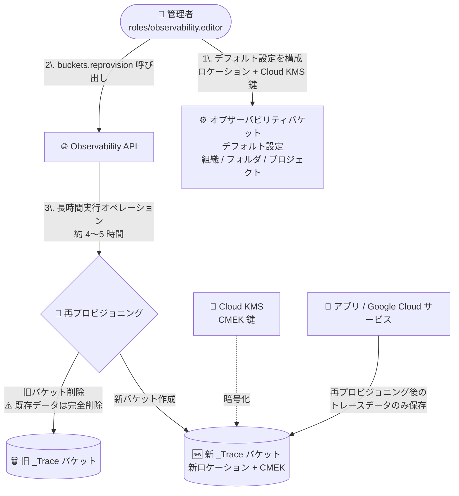

# Cloud Trace: _Trace バケットの再プロビジョニング機能が GA

**リリース日**: 2026-11-06

**サービス**: Cloud Trace (Google Cloud Observability)

**機能**: 既存 _Trace オブザーバビリティバケットの再プロビジョニング (データレジデンシー / CMEK 要件への対応)

**ステータス**: 一般提供 (GA)

📊 [このアップデートのインフォグラフィックを見る](https://takech9203.github.io/google-cloud-news-summary/20261106-cloud-trace-bucket-reprovisioning.html)

## 概要

Cloud Trace のトレースデータを保存する `_Trace` オブザーバビリティバケットについて、既存バケットを「再プロビジョニング (reprovision)」する機能が一般提供 (GA) になりました。再プロビジョニングを実行すると、`_Trace` バケットの保存ロケーションと暗号化設定が、組織・フォルダ・プロジェクトに設定した「オブザーバビリティバケットのデフォルト設定」と一致するように作り直されます。

この機能は、データレジデンシー (データ保存場所) や顧客管理の暗号鍵 (CMEK) に関する規制・コンプライアンス要件を、すでにトレースデータの取り込みが始まってしまった既存プロジェクトでも事後的に満たすためのものです。CMEK の遡及適用、ロケーションの移動、またはその両方を 1 回のオペレーションで実施できます。

**重要**: 再プロビジョニングは破壊的 (destructive) なオペレーションです。実行前に保存されていたトレースデータは完全に削除され、復元できません。再プロビジョニング後のデータセットには、オペレーション開始以降に送信されたデータのみが含まれます。

**アップデート前の課題**

- `_Trace` バケットはロケーションと暗号化設定を指定して作成できるものの、作成後にバケット自体を変更・削除することはできず、要件に合わないロケーションや Google デフォルト暗号化で自動作成されたバケットを是正する手段がなかった
- トレースデータの取り込み開始前にデフォルト設定や手動作成で構成しなかった場合、後からデータレジデンシーや CMEK の規制要件を満たすことが困難だった
- 2026 年 8 月のアップデートで Cloud KMS 鍵の更新 (update) は可能になったが、ロケーションの変更や「Google デフォルト暗号化 → CMEK」への切り替えには対応していなかった

**アップデート後の改善**

- 既存の `_Trace` バケットに対して、デフォルト設定に基づく再プロビジョニングを API で実行し、保存ロケーションの変更や CMEK の遡及適用が可能になった
- バケットを移動せずに CMEK を適用する、Google デフォルト暗号化のまま新ロケーションへ移動する、移動と CMEK 適用を同時に行う、の 3 パターンに対応
- 監査ログ (Admin Activity) に再プロビジョニングの実行者・対象バケットが記録され、コンプライアンス対応の証跡を残せる

## アーキテクチャ図



再プロビジョニングはデフォルト設定を参照して新しい `_Trace` バケットを作成し、旧バケットを削除する長時間実行オペレーションです。旧バケット内の既存トレースデータは復元不可能な形で削除されます。

## サービスアップデートの詳細

### 主要機能

1. **CMEK の遡及適用**
   - バケットのロケーションを変えずに、デフォルト設定で指定した Cloud KMS 鍵 (CMEK) による暗号化へ切り替え可能
   - 従来はバケット作成時にしか CMEK 構成を決められず、Google デフォルト暗号化から CMEK への変更手段がなかった

2. **保存ロケーションの変更**
   - `_Trace` バケットをデフォルト設定で指定した新しいロケーションに移動 (Google デフォルト暗号化のまま、または CMEK 適用と同時に)
   - データレジデンシー規制で特定リージョンへの保存が求められる場合に利用

3. **長時間実行オペレーションとしての実行・監視**
   - `projects.locations.buckets.reprovision` API を呼び出すと長時間実行オペレーション (Operation) が返る
   - `operations.get` で `done: true` になるまでポーリングして完了を確認 (完了まで約 4〜5 時間を想定)
   - `HTTP 503 / UNAVAILABLE` の場合は指数バックオフでリトライ

4. **監査ログによる証跡**
   - Admin Activity 監査ログにメソッド `google.cloud.observability.v1.Observability.ReprovisionBucket` として記録され、実行者と対象バケットを追跡可能

## 技術仕様

### 再プロビジョニングの実行条件

| 項目 | 詳細 |
|------|------|
| 対象バケット | `_Trace` という名前のオブザーバビリティバケットのみ |
| 実行回数 | バケットにつき 1 回のみ (再実行は `FAILED_PRECONDITION` で失敗) |
| 前提設定 | オブザーバビリティバケットのデフォルト設定が存在すること |
| 変更の必要性 | ロケーション変更、または Google デフォルト暗号化 → CMEK の変更が発生すること (現状と同一なら `INVALID_ARGUMENT`) |
| 非対応の変更 | CMEK → Google 管理の暗号化への戻しは不可。表示名・説明・KMS 鍵の差し替えのみなら update オペレーションを使用 |
| 必要な IAM ロール | `roles/observability.editor` (Observability 編集者)。作成と削除の両方の権限が必要なため |
| API メソッド | `projects.locations.buckets.reprovision` / 監視は `operations.get` (`operations/UNIQUE_ID`) |
| 所要時間の目安 | 約 4〜5 時間 |
| キャンセル | 不可 (キャンセル要求は無視される)。元に戻すことも不可 |

### バケット名の形式

```
projects/PROJECT_ID/locations/LOCATION/buckets/_Trace
```

## 設定方法

### 前提条件

1. 対象プロジェクトで `roles/observability.editor` (または同等の権限を持つロール) が付与されていること
2. 組織・フォルダ・プロジェクトのいずれかに、オブザーバビリティバケットのデフォルト設定 (デフォルト保存ロケーションと、CMEK を使う場合はロケーションごとの Cloud KMS 鍵) が構成されていること
3. 既存データが削除されても問題ないことを確認済みであること (必要に応じて事前にエクスポートや分析を完了させる)

### 手順

#### ステップ 1: デフォルト設定の構成

組織・フォルダ・プロジェクトレベルで、デフォルト保存ロケーションと (CMEK を使う場合は) Cloud KMS 鍵を設定します。詳細は [Set defaults for observability buckets](https://docs.cloud.google.com/stackdriver/docs/observability/set-defaults-for-observability-buckets) を参照してください。

#### ステップ 2: 再プロビジョニングの実行

Observability API の `projects.locations.buckets.reprovision` メソッドを呼び出します。レスポンスとして長時間実行オペレーション (Operation) が返ります。

#### ステップ 3: オペレーションの監視

`operations.get` で `Operation.done` が `true` になるまでポーリングします。成功時は `response` にバケットの新しい状態が、失敗時は `error` に gRPC ステータスが含まれます。オペレーション中は 2 つの `_Trace` バケットが一時的に表示されることがありますが、対応は不要です (成功時は旧バケット、失敗時は新バケットが削除されます)。

#### ステップ 4: 移行後の後処理

ロケーションを変更した場合、BigQuery へのリンク (リンク済みデータセット) は削除されるため再作成が必要です。また、分析ビューのパスも更新します。完了直後は旧バケットのキャッシュにより Trace エクスプローラにデータが表示されないことがありますが、約 10 分で自動的に解消します。

## メリット

### ビジネス面

- **規制要件への事後対応**: すでに稼働中のプロジェクトでも、データレジデンシーや CMEK の規制・コンプライアンス要件を満たせる
- **監査証跡**: Admin Activity 監査ログに実行記録が残り、監査対応で「いつ・誰が・どのバケットを」是正したかを証明できる

### 技術面

- **プロジェクト再作成が不要**: バケットの構成を是正するためにプロジェクトを作り直したり、トレース収集の仕組みを再構築したりする必要がない
- **1 オペレーションで完結**: ロケーション移動と CMEK 適用を 1 回の API 呼び出しで同時に実施できる

## デメリット・制約事項

### 制限事項

- **既存データの完全削除**: 再プロビジョニング開始前に保存されたトレースデータは完全に削除され、復元できない
- バケットにつき 1 回しか実行できない (2 回目以降は `FAILED_PRECONDITION`)
- 対象は `_Trace` バケットのみ
- CMEK から Google 管理の暗号化へ戻すことはできない
- オペレーションのキャンセル・取り消しは不可

### 考慮すべき点

- 完了まで約 4〜5 時間かかる。オペレーション中の Trace エクスプローラや Observability Analytics でのクエリ動作は未定義のため、完了まで利用を避ける
- ロケーション変更時は BigQuery リンク済みデータセットが削除されるため、リンクの再作成と分析ビューのパス更新が必要
- 実行前にデフォルト設定が意図したロケーション・鍵になっているか必ず確認する (現状と同じ設定の場合は `INVALID_ARGUMENT` で失敗)

## ユースケース

### ユースケース 1: 既存プロジェクトへの CMEK の遡及適用

**シナリオ**: 金融機関で、全テレメトリーデータに CMEK 適用を義務付ける社内セキュリティポリシーが制定された。しかし既存プロジェクトの `_Trace` バケットは、トレース取り込み開始時に Google デフォルト暗号化で自動作成されていた。

**実装例**:
```
1. プロジェクト (またはフォルダ/組織) のデフォルト設定に、バケットのロケーションに
   対応する Cloud KMS 鍵を設定
2. projects/PROJECT_ID/locations/LOCATION/buckets/_Trace に対して reprovision を実行
3. operations.get で完了を監視 (約 4〜5 時間)
```

**効果**: バケットのロケーションを変えずに CMEK が適用され、以降のトレースデータが顧客管理鍵で暗号化される。

### ユースケース 2: データレジデンシー規制への対応

**シナリオ**: 欧州の規制により、オブザーバビリティデータを特定リージョン内に保存する必要が生じたが、既存の `_Trace` バケットは別のロケーションに自動作成されていた。

**効果**: デフォルト設定で対象リージョンを指定して再プロビジョニングすることで、バケットが規制に適合したロケーションに移動し、組織ポリシー (ロケーション制限) と組み合わせて以降の逸脱も防止できる。

## 料金

再プロビジョニング機能自体の追加料金に関する記載はリリースノートにありません。Cloud Trace の料金 (スパン取り込み課金) と、CMEK を使用する場合の Cloud KMS の鍵管理料金が通常どおり適用されます。詳細は料金ページを参照してください。

- [Google Cloud Observability の料金](https://cloud.google.com/stackdriver/pricing)
- [Cloud KMS の料金](https://cloud.google.com/kms/pricing)

## 利用可能リージョン

オブザーバビリティバケットはリージョンリソースです。サポートされるロケーションの一覧は [Locations for observability buckets](https://docs.cloud.google.com/stackdriver/docs/observability/observability-bucket-locations) を参照してください。

## 関連サービス・機能

- **Cloud KMS**: CMEK による暗号化に使用。鍵のロケーションはバケットのロケーションと一致している必要がある
- **組織ポリシー (Organization Policy)**: ロケーション制限や CMEK 必須化のポリシーと組み合わせることで、新規バケットの逸脱を防止できる (2026 年 6 月 1 日以降、バケット作成フローで強制される)
- **BigQuery**: `_Trace` バケットのデータセットをリンクして分析可能。ロケーション変更時はリンクの再作成が必要
- **Cloud Audit Logs**: 再プロビジョニングの実行記録が Admin Activity 監査ログに記録される
- **Cloud Logging**: ログバケットにも同様のデフォルト設定・CMEK の概念があり、オブザーバビリティ全体のデータガバナンスとして併せて設計することが多い

## 参考リンク

- 📊 [インフォグラフィック](https://takech9203.github.io/google-cloud-news-summary/20261106-cloud-trace-bucket-reprovisioning.html)
- [公式リリースノート](https://docs.cloud.google.com/release-notes#November_06_2026)
- [Remediate data residency and CMEK requirements (再プロビジョニング手順)](https://docs.cloud.google.com/stackdriver/docs/observability/reprovision-observability-bucket)
- [Set defaults for observability buckets](https://docs.cloud.google.com/stackdriver/docs/observability/set-defaults-for-observability-buckets)
- [Storage overview (Cloud Trace)](https://docs.cloud.google.com/trace/docs/storage-overview)
- [Create observability buckets](https://docs.cloud.google.com/trace/docs/create-observability-buckets)
- [料金ページ](https://cloud.google.com/stackdriver/pricing)

## まとめ

既存の `_Trace` バケットを再プロビジョニングして、データレジデンシーと CMEK の規制要件を事後的に満たせるようになりました。ただし既存トレースデータは完全に削除される破壊的オペレーションであり、実行は 1 回限りのため、デフォルト設定の内容とデータ削除の影響を十分に確認したうえで計画的に実施してください。コンプライアンス要件があるプロジェクトでは、組織ポリシーとデフォルト設定を併用して新規バケットの逸脱防止も合わせて構成することを推奨します。

---

**タグ**: Cloud Trace, Google Cloud Observability, CMEK, データレジデンシー, Cloud KMS, コンプライアンス, GA
