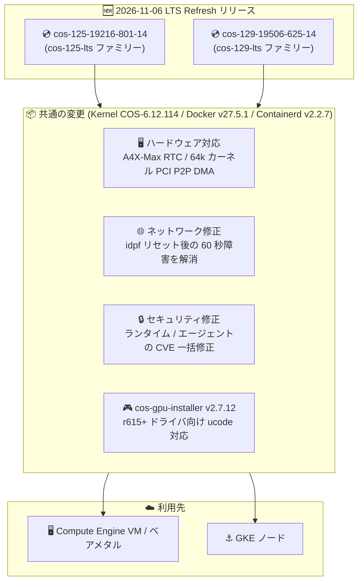

# Container-Optimized OS: COS 125 / COS 129 LTS Refresh リリース (cos-125-19216-801-14, cos-129-19506-625-14)

**リリース日**: 2026-11-06

**サービス**: Container-Optimized OS

**機能**: LTS Refresh リリース (A4X-Max 向け RTC サポート、idpf 障害修正、広範な CVE 修正)

**ステータス**: GA (リリース済み)

📊 [このアップデートのインフォグラフィックを見る](https://takech9203.github.io/google-cloud-news-summary/20261106-container-optimized-os-lts-refresh.html)

## 概要

Container-Optimized OS (COS) の 2 つのアクティブな LTS マイルストーンに対して、新しいイメージ `cos-125-19216-801-14` (COS 125 LTS) と `cos-129-19506-625-14` (COS 129 LTS) がリリースされた。両リリースはいずれも **LTS Refresh リリース** であり、3 ヶ月ごとに中・低優先度のバグ修正とセキュリティ修正をまとめて提供する定期リリースにあたる。両イメージともカーネル COS-6.12.114、Docker v27.5.1、Containerd v2.2.7 を搭載する。

機能面では、両マイルストーン共通で A4X-Max イメージにおける RTC (リアルタイムクロック) サポートの追加と、64k ページサイズカーネルでの PCI peer-to-peer 直接メモリアクセス (DMA) の有効化が含まれる。A4X-Max は NVIDIA GB300 Grace Blackwell Ultra Superchip を搭載したベアメタルの AI 基盤向けマシンシリーズであり、COS のハードウェア対応が強化された形になる。また、IPU E2100 上で idpf ファンクションリセット後に PFGEN_RSTAT レジスタの誤読により 60 秒の障害が発生する問題が修正された (A4X-Max などのベアメタルインスタンスは IDPF ネットワークドライバを使用する)。

セキュリティ面では、docker / containerd / cri-tools / cni-plugins / kubernetes といったコンテナランタイムスタック、guest-agent / google-guest-agent / google-osconfig-agent などの Google Cloud ゲストエージェント群、node-problem-detector / cos-extensions などのノード運用コンポーネントにまたがる多数の CVE が修正された。さらに curl v8.22.0、libpcre2 v10.49、pyjwt v2.14.0 への更新により、各ライブラリの既知脆弱性も解消されている。

**アップデート前の課題**

- 従来の COS 125 / COS 129 イメージには、コンテナランタイムスタック (docker、containerd、cri-tools、cni-plugins など) やゲストエージェント群に複数の未修正 CVE が含まれていた (CVE-2025-31133、CVE-2025-52565、CVE-2025-52881、CVE-2026-84304、CVE-2026-84445 など)
- IPU E2100 上で idpf ファンクションリセットが発生すると、PFGEN_RSTAT レジスタの誤読により 60 秒間のネットワーク障害が発生していた
- A4X-Max イメージで RTC がサポートされていなかった
- 64k ページサイズカーネルで PCI peer-to-peer DMA が有効化されていなかった
- cos-gpu-installer が r615 以降の GPU ドライババージョン向け ucode ファームウェアのインストールに対応していなかった

**アップデート後の改善**

- コンテナランタイム、ゲストエージェント、ノード監視コンポーネントの CVE が LTS Refresh として一括修正された
- idpf ファンクションリセット後の 60 秒障害が解消され、IPU E2100 を使用する環境のネットワーク可用性が向上した
- A4X-Max イメージで RTC がサポートされ、64k カーネルで PCI peer-to-peer DMA が有効化された
- cos-gpu-installer v2.7.12 により、r615 以降の GPU ドライバ向け ucode ファームウェアが自動的にインストールされるようになった
- curl、libpcre2、pyjwt などの基盤ライブラリが最新化され、関連 CVE が解消された

## アーキテクチャ図



COS 125 / COS 129 の各 LTS ファミリーに 3 ヶ月ごとの LTS Refresh イメージが公開され、ハードウェア対応強化・ネットワーク修正・セキュリティ修正が Compute Engine と GKE ノードに提供される。

## サービスアップデートの詳細

### リリースされたイメージとコンポーネントバージョン

| 項目 | cos-125-19216-801-14 (COS 125 LTS) | cos-129-19506-625-14 (COS 129 LTS) |
|------|-------------------------------------|-------------------------------------|
| リリース種別 | LTS Refresh | LTS Refresh |
| カーネル | COS-6.12.114 | COS-6.12.114 |
| Docker | v27.5.1 | v27.5.1 |
| Containerd | v2.2.7 | v2.2.7 |
| イメージファミリー | cos-125-lts / cos-arm64-125-lts | cos-129-lts / cos-arm64-129-lts |
| サポート終了 | 2028 年 2 月 | 2028 年 7 月 |

### 主要な変更点

1. **ハードウェア対応の強化 (両マイルストーン共通)**
   - A4X-Max イメージに RTC (リアルタイムクロック) サポートを追加。A4X-Max は NVIDIA GB300 Grace Blackwell Ultra Superchip を搭載したベアメタルマシンシリーズ
   - 64k ページサイズカーネルで PCI peer-to-peer 直接メモリアクセス (DMA) を有効化

2. **ネットワーク障害の修正 (両マイルストーン共通)**
   - IPU E2100 上で idpf ファンクションリセット後に発生していた 60 秒間の障害を修正。原因は PFGEN_RSTAT レジスタの誤読

3. **GPU サポートの改善 (両マイルストーン共通)**
   - cos-gpu-installer を v2.7.12 に更新。r615 以降の GPU ドライババージョン向けに ucode ファームウェアをインストールするようになった

4. **セキュリティ修正 (CVE)**
   - **コンテナランタイムスタック**: docker (CVE-2025-52565、CVE-2026-84304、CVE-2026-84445、CVE-2026-63209、CVE-2026-29181、CVE-2025-31133、CVE-2026-39883、CVE-2024-25621)、containerd (CVE-2026-63209、CVE-2026-84304)、cri-tools (CVE-2025-31133、CVE-2025-52881、CVE-2026-32285、CVE-2026-84304、CVE-2024-41110、CVE-2026-35469)、cni-plugins (CVE-2026-32285、CVE-2026-84304)、kubernetes (CVE-2026-84304、COS 129)
   - **Google Cloud ゲストエージェント群**: google-guest-agent (CVE-2026-84304、CVE-2026-84445)、guest-agent (CVE-2026-116587、CVE-2026-34986、CVE-2026-84445)、google-osconfig-agent (CVE-2026-116587、CVE-2026-63209、CVE-2026-39883、CVE-2024-25621、CVE-2026-45022、CVE-2026-24051、CVE-2026-53488、CVE-2025-65637、CVE-2026-84445)
   - **ノード運用コンポーネント**: node-problem-detector (CVE-2026-63209、CVE-2026-84304、CVE-2026-29181)、cos-extensions (CVE-2026-84445、CVE-2026-116587、CVE-2026-39883)
   - **基盤ライブラリ**: curl v8.22.0 (CVE-2026-18924、CVE-2026-13608、CVE-2026-80229、CVE-2026-80255、CVE-2026-19931 を解消)、libpcre2 v10.49 (CVE-2026-86145、CVE-2026-103111 を解消)、pyjwt v2.14.0 (CVE-2026-102266、CVE-2026-102267、CVE-2026-102268、CVE-2026-102271 を解消)

5. **パッケージ更新**
   - COS 125: gzip v1.15、docker-credential-helpers v0.9.12、ca-certificates v20260816.3.131.1、sqlite v3.54.1、nss v3.132、less v710、timezone-data v2026f
   - COS 129: sys-apps/casfs v0.1.24

## 技術仕様

### LTS Refresh リリースとは

| 項目 | 詳細 |
|------|------|
| リリース頻度 | 3 ヶ月ごと |
| 含まれる内容 | 中・低優先度のバグ修正とセキュリティ修正をまとめて提供 |
| 高優先度の修正 | LTS Refresh を待たずオンデマンドでリリース |
| 目的 | リリース頻度を抑えることで、ユーザーの更新リスク管理を容易にする |
| 注意点 | 中・低優先度の修正がリグレッションを引き起こす可能性があるため、ロールアウト時は通常以上の検証が推奨される |

### COS LTS マイルストーンのライフサイクル

| 項目 | 詳細 |
|------|------|
| LTS サポート期間 | 26 ヶ月 (セキュリティ修正と重大バグ修正を継続提供) |
| COS 125 LTS サポート終了 | 2028 年 2 月 |
| COS 129 LTS サポート終了 | 2028 年 7 月 |
| イメージプロジェクト | cos-cloud |
| アーキテクチャ | x86 (cos-{MILESTONE}-lts) / Arm (cos-arm64-{MILESTONE}-lts) |

## 設定方法

### 手順

#### ステップ 1: 最新イメージの確認

```bash
gcloud compute images list \
  --project=cos-cloud \
  --filter="family:(cos-125-lts OR cos-129-lts)" \
  --sort-by=~creationTimestamp
```

cos-cloud プロジェクトで公開されている最新の LTS イメージ (`cos-125-19216-801-14`、`cos-129-19506-625-14`) を確認する。

#### ステップ 2: イメージファミリーを指定して VM を作成

```bash
gcloud compute instances create my-cos-vm \
  --image-family=cos-129-lts \
  --image-project=cos-cloud \
  --zone=us-central1-a
```

イメージファミリーを指定すると、ファミリー内の最新イメージが自動的に使用される。LTS Refresh リリースはリグレッションの可能性があるため、本番環境へのロールアウト前に検証環境での動作確認を推奨する。

## メリット

### ビジネス面

- **セキュリティコンプライアンスの維持**: コンテナランタイムからゲストエージェントまで多数の CVE が一括修正され、脆弱性スキャンでの指摘事項を減らせる
- **更新リスク管理の容易さ**: LTS Refresh は 3 ヶ月ごとの定期リリースであるため、計画的な検証・展開サイクルを組みやすい

### 技術面

- **AI インフラへの追従**: A4X-Max (NVIDIA GB300 ベアメタル) 向けの RTC サポートが追加され、最新の AI Hypercomputer 基盤での COS 利用が強化された
- **ネットワーク可用性の向上**: IPU E2100 での idpf ファンクションリセット後の 60 秒障害が解消された
- **GPU ファームウェア管理の自動化**: cos-gpu-installer v2.7.12 が r615 以降のドライバ向け ucode ファームウェアを自動インストールする
- **基盤ライブラリの最新化**: curl、libpcre2、pyjwt の更新により、HTTP クライアント・正規表現・JWT 処理の既知脆弱性が解消された

## デメリット・制約事項

### 考慮すべき点

- LTS Refresh リリースには中・低優先度の修正が多数含まれるため、公式ドキュメントでもリグレッションの可能性に注意してロールアウトすることが推奨されている
- イメージファミリー参照で VM を作成している場合、新規インスタンスは自動的に新イメージを使用するため、検証環境での事前確認を推奨
- 既存の実行中インスタンスには自動適用されない。セキュリティ修正を反映するにはノード・VM の再作成 (GKE ではノードのアップグレード) が必要
- COS 125 と COS 129 で修正された CVE の対象コンポーネントが一部異なる (例: kubernetes の CVE-2026-84304 修正は COS 129 のみに記載) ため、利用中のマイルストーンのリリースノートを個別に確認すること

## ユースケース

### ユースケース 1: 脆弱性対応としての定期的なイメージ更新

**シナリオ**: セキュリティポリシーにより、コンテナ基盤の既知 CVE を一定期間内に解消する必要がある。

**実装例**:
```bash
# 現在使用中のイメージと最新イメージの差分を確認し、
# インスタンステンプレートを最新ファミリーイメージで更新
gcloud compute instance-templates create my-template-v2 \
  --image-family=cos-125-lts \
  --image-project=cos-cloud \
  --machine-type=e2-standard-4
```

**効果**: LTS ファミリーの最新イメージへローリング更新するだけで、docker / containerd / ゲストエージェントの CVE 修正をまとめて適用できる。

### ユースケース 2: IPU E2100 を使用する環境でのネットワーク安定性向上

**シナリオ**: IDPF ネットワークドライバを使用するベアメタルインスタンス (A4X-Max など) で、idpf ファンクションリセット発生時のネットワーク断を回避したい。

**効果**: 新イメージでは PFGEN_RSTAT の誤読が修正され、リセット後の 60 秒障害が発生しなくなるため、大規模 ML トレーニングなど長時間ワークロードの安定性が向上する。

## 関連サービス・機能

- **Compute Engine**: COS イメージ (cos-cloud プロジェクト) を使用して VM・ベアメタルインスタンスを作成する実行基盤
- **Google Kubernetes Engine (GKE)**: ノードイメージとして COS (containerd) を使用。ノード自動アップグレードで新イメージが順次展開される
- **A4X-Max (AI Hypercomputer)**: NVIDIA GB300 搭載のベアメタルマシンシリーズ。IDPF ネットワークドライバを使用し、今回の RTC サポート・idpf 修正の恩恵を受ける
- **cos-extensions / cos-gpu-installer**: COS 上で NVIDIA GPU ドライバとファームウェアを管理するツール

## 参考リンク

- 📊 [インフォグラフィック](https://takech9203.github.io/google-cloud-news-summary/20261106-container-optimized-os-lts-refresh.html)
- [公式リリースノート](https://docs.cloud.google.com/release-notes#November_06_2026)
- [COS 125 リリースノート](https://docs.cloud.google.com/container-optimized-os/docs/release-notes/m125)
- [COS 129 リリースノート](https://docs.cloud.google.com/container-optimized-os/docs/release-notes/m129)
- [COS バージョニングと LTS Refresh リリース](https://docs.cloud.google.com/container-optimized-os/docs/concepts/versioning)
- [COS サポートポリシー](https://docs.cloud.google.com/container-optimized-os/docs/resources/support-policy)
- [A4X Max マシンシリーズ (アクセラレータ最適化マシン)](https://docs.cloud.google.com/compute/docs/accelerator-optimized-machines)
- [COS で GPU を実行する](https://cloud.google.com/container-optimized-os/docs/how-to/run-gpus)

## まとめ

COS 125 / COS 129 の両 LTS マイルストーンに、3 ヶ月ごとの定期リリースである LTS Refresh イメージが公開され、A4X-Max 向け RTC サポートや idpf 障害修正といったハードウェア関連の改善と、コンテナランタイム・ゲストエージェントにまたがる広範な CVE 修正が提供された。COS を利用する Compute Engine VM や GKE ノードでは、LTS Refresh 特有のリグレッションリスクを考慮して検証環境で動作確認のうえ、最新イメージへのローリング更新を計画的に実施することを推奨する。

---

**タグ**: Container-Optimized OS, COS, LTS Refresh, セキュリティ, CVE, A4X-Max, idpf, IPU E2100, containerd, Docker, GKE, Compute Engine
