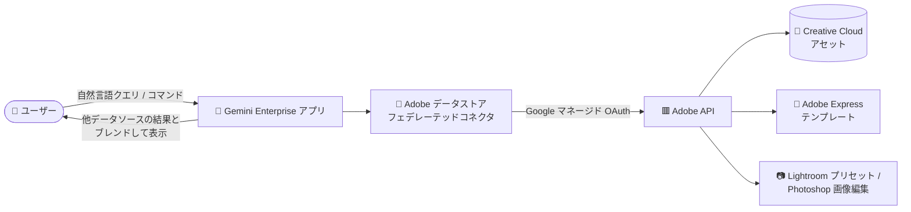

# Gemini Enterprise: Adobe データストア (Public Preview)

**リリース日**: 2026-11-06

**サービス**: Gemini Enterprise

**機能**: Adobe データストア (サードパーティコネクタ)

**ステータス**: Public Preview

📊 [このアップデートのインフォグラフィックを見る](https://takech9203.github.io/google-cloud-news-summary/20261106-gemini-enterprise-adobe-data-store-preview.html)

## 概要

Gemini Enterprise で Adobe データストアが Public Preview として利用可能になりました。このコネクタを有効化すると、Gemini Enterprise のチャットインターフェースから自然言語を使って Adobe Creative Cloud のアセットを検索・共有・管理できるほか、Adobe Express テンプレートのカスタマイズ、Lightroom プリセットの適用、Photoshop スタイルの画像編集まで実行できます。

このデータストアはフェデレーテッドサーチ型のコネクタで、検索クエリは Gemini Enterprise から Adobe API に直接送信され、他の接続済みデータソースの結果とブレンドされて統合的な検索結果として表示されます。認証には Google マネージドの OAuth が使われるため、独自の OAuth アプリケーションやクライアント ID / シークレットの用意は不要です。

デザイナーやマーケティング担当者など Adobe Creative Cloud を日常的に使うユーザーが、Gemini Enterprise を起点に社内データと Adobe アセットを横断して活用できるようになる点が主な価値です。なお、フェデレーテッドサーチとアクション機能は Public Preview であり、Pre-GA Offerings Terms が適用されます。

**アップデート前の課題**

- Gemini Enterprise から Adobe Creative Cloud のアセットを検索・管理する手段がなく、Adobe 側のツールに切り替えて作業する必要があった
- Adobe Express テンプレートの編集や Lightroom プリセットの適用などの操作は、各 Adobe アプリケーションの UI で個別に行う必要があった
- 社内データと Creative Cloud アセットを横断した検索ができなかった

**アップデート後の改善**

- Gemini Enterprise 上で自然言語により Creative Cloud アセットの検索・共有・管理 (フォルダ作成、ファイルアップロード、コラボレーター招待など) が可能になった
- 背景削除、生成 AI による画像生成・編集・拡張、Lightroom プリセット適用、Adobe Express テンプレートのテキスト差し替えなど、20 種類以上のアクションを自然言語コマンドで実行できるようになった
- Adobe の検索結果が他の接続済みデータソースの結果とブレンドされ、統合された検索体験が得られるようになった

## アーキテクチャ図



ユーザーのクエリは Gemini Enterprise から Adobe API に直接送信され (フェデレーテッドサーチ)、アセット検索結果の取得や Express / Lightroom / Photoshop 系のアクション実行が行われます。

## サービスアップデートの詳細

### 主要機能

1. **Creative Cloud アセットのフェデレーテッドサーチ**
   - 自然言語で Adobe Creative Cloud のアセット (エンティティ: Assets) を検索
   - 検索結果は他の接続済みデータソースの結果とブレンドされ、統合された結果として表示

2. **アセット管理アクション**
   - フォルダ作成、ファイルアップロード (ブロックアップロードの開始・完了)、ファイルピッカーの起動
   - アセットやプロジェクトへのコラボレーター招待 (Viewer / Commenter / Editor / Consumer のロール指定)

3. **Adobe Express テンプレートのカスタマイズ**
   - テンプレートのプレースホルダーテキストへの文言差し込み (Fill text)
   - デザインの背景色変更、画像要素の差し替え

4. **画像編集・生成アクション (Photoshop / Lightroom / 生成 AI)**
   - Lightroom プリセットの適用、自動トーン補正、プロ仕様の画像調整、フィルタ・スタイル効果
   - 被写体検出による背景削除、プロンプトによるオブジェクト選択、選択範囲の反転
   - 生成 AI によるテキストからの画像生成、プレーンテキスト指示による生成編集 (instruct edit)、画像の外側への生成拡張 (generative expand)、AI ヒーリングによる肌の欠点除去
   - スマートクロップ・リサイズ、正規化座標 (0-1) での厳密なクロップ

## 技術仕様

| 項目 | 詳細 |
|------|------|
| ステータス | Public Preview (Pre-GA Offerings Terms 適用) |
| コネクタ種別 | サードパーティ・フェデレーテッドコネクタ (検索 + アクション) |
| 検索対象エンティティ | Assets |
| 認証 | Google マネージド OAuth (独自の OAuth アプリ / クライアント ID・シークレット不要。アプリ内でコネクタ有効化時に Adobe アカウントで認可) |
| 必要な IAM ロール | Discovery Engine Editor (`roles/discoveryengine.editor`) — データストア作成に必要 |
| 対応ロケーション | `global`、`us`、`eu` のみ |
| 暗号化 | Google 管理の暗号鍵、または Cloud KMS 鍵 (CMEK。`us` / `eu` 選択時はシングルリージョン鍵の登録が必要) |
| 組織ポリシー | `discoveryengine.managed.allowedDataSources` の値は `adobe` |

### データの取り扱いに関する注意

フェデレーテッドサーチでは、クエリ文字列が Adobe API に直接送信されます。以下の点に留意が必要です。

- サードパーティはクエリをユーザーの ID と関連付ける可能性がある
- 複数のフェデレーテッドサーチ対応データソースが有効な場合、クエリがそれらすべてに送信される可能性がある
- データがサードパーティシステムに到達した後は、そのシステムの利用規約とプライバシーポリシーが適用される (Google Cloud の利用規約ではない)
- 精度向上のため LLM がクエリを書き換えることがあり、セッションのクエリ履歴の一部が Adobe API への送信クエリに含まれる可能性がある

## 設定方法

### 前提条件

1. データストアを作成するユーザーに Discovery Engine Editor ロール (`roles/discoveryengine.editor`) を付与する
2. Adobe アカウントを用意する (コネクタ有効化時に Adobe アカウントで認可する)

### 手順

#### ステップ 1: Adobe データストアの作成

1. Google Cloud コンソールで Gemini Enterprise ページに移動し、プロジェクトを選択
2. ナビゲーションメニューの **Data stores** から **Create data store** をクリック
3. ソースで **Adobe** を検索して選択
4. **Entities to search** で **Assets** を選択し、**Continue** をクリック
5. (任意) Advanced options で **Enable Static IP Addresses** を選択し、送信元 IP を固定 (ソースシステム側での許可リスト登録向け)
6. Configuration セクションでマルチリージョン (ロケーション) とコネクタ名を設定し、`us` / `eu` の場合は暗号化設定 (Google 管理鍵 or Cloud KMS 鍵) を構成
7. Billing セクションで **General pricing** または **Configurable pricing** を選択して **Create** をクリック

#### ステップ 2: アプリへの接続と認可

1. データストアのステータスが **Creating** から **Active** に変わったことを確認
2. 作成したデータストアを既存のアプリに接続するか、新しいアプリを作成して接続
3. クエリを実行する前に、Gemini Enterprise が Adobe にアクセスできるようユーザー認可を行う

## メリット

### ビジネス面

- **クリエイティブワークフローの効率化**: デザイナーやマーケターが Gemini Enterprise を離れずにアセット検索から画像編集・テンプレート作成までを完結できる
- **コラボレーションの促進**: 自然言語でアセットへのコラボレーター招待 (ロール指定付き) が可能になり、チーム間の共有が容易になる

### 技術面

- **OAuth 構成不要**: Google マネージド OAuth により、独自 OAuth アプリの登録やシークレット管理が不要
- **統合検索**: Adobe の検索結果が他の接続済みデータソースとブレンドされ、単一の検索体験を提供
- **CMEK・静的 IP 対応**: Cloud KMS 鍵による暗号化や静的 IP エグレスなど、エンタープライズ要件に対応した構成オプションを利用可能

## デメリット・制約事項

### 制限事項

- 対応ロケーションは `global`、`us`、`eu` のみ
- 既存の Adobe データストアに対する VPC Service Controls 境界の適用はサポートされない (適用するにはデータストアの削除・再作成が必要)
- アプリの新規作成や既存アプリへのデータストア追加時は、アクションを持つデータストアは単一コネクタタイプのものだけを関連付けることが推奨される

### 考慮すべき点

- Public Preview のため Pre-GA Offerings Terms が適用され、サポートが限定される可能性がある
- クエリ文字列 (および LLM によるクエリ書き換えで含まれ得るセッション履歴の一部) が Adobe API に送信され、Adobe 側の利用規約・プライバシーポリシーの適用対象となる
- 複数のフェデレーテッドサーチを有効化している場合、クエリが有効なすべてのバックエンドに送信され得る

## ユースケース

### ユースケース 1: マーケティング素材の迅速な作成

**シナリオ**: マーケティングチームがキャンペーン用バナーを作成する際、Adobe Express テンプレートを探してテキストを差し替え、ブランドカラーに背景を変更したい。

**実装例**:
```
(Gemini Enterprise のチャットで)
「キャンペーン用の Express テンプレートを開いて、見出しを『年末セール 50% OFF』に差し替え、
背景色をブランドカラーに変更して」
```

**効果**: Adobe Express の UI を開かずに、自然言語でテンプレートのカスタマイズ (Fill text、背景色変更、画像差し替え) が完了する。

### ユースケース 2: 製品写真の一括レタッチ

**シナリオ**: EC サイト担当者が Creative Cloud 上の製品写真に対し、背景削除と自動トーン補正、Lightroom プリセットの適用を行いたい。

**効果**: 「背景を削除して」「Lightroom のプリセット〇〇を適用して」といった自然言語コマンドで、被写体検出・背景削除・トーン補正・プリセット適用までを Gemini Enterprise 上で実行できる。

## 料金

Adobe データストアの利用には Gemini Enterprise のライセンスが必要です。データストア作成時の Billing セクションで **General pricing** または **Configurable pricing** を選択します。エディションごとの機能差 (Business / Standard / Plus / Pay-as-you-go / Frontline) やライセンスの詳細は以下を参照してください。

- [Gemini Enterprise のエディション](https://docs.cloud.google.com/gemini/enterprise/docs/editions)
- [Gemini Enterprise のライセンス](https://docs.cloud.google.com/gemini/enterprise/docs/licenses)

## 利用可能リージョン

Adobe データストアは `global`、`us`、`eu` のロケーションでのみサポートされます。

## 関連サービス・機能

- **Adobe Workfront コネクタ**: 同じ Adobe 製品群のプロジェクト管理ツール Workfront 向けのサードパーティコネクタ (エンティティ: Projects)
- **Cloud KMS (CMEK)**: `us` / `eu` ロケーション選択時に、サードパーティコネクタ用のシングルリージョン鍵を登録して顧客管理暗号鍵を利用可能
- **VPC Service Controls**: アプリをセキュリティ境界で保護可能 (ただし既存の Adobe データストアへの事後適用は不可)
- **Sensitive Data Protection**: サードパーティデータストア経由で取得したデータの検査・匿名化ポリシーを適用可能
- **静的 IP エグレス**: データストアからの送信トラフィックを固定 IP セットから発信し、ソースシステム側で許可リスト登録が可能

## 参考リンク

- 📊 [インフォグラフィック](https://takech9203.github.io/google-cloud-news-summary/20261106-gemini-enterprise-adobe-data-store-preview.html)
- [公式リリースノート](https://docs.cloud.google.com/release-notes#November_06_2026)
- [Adobe コネクタの概要 (対応アクション一覧・制限事項)](https://docs.cloud.google.com/gemini/enterprise/docs/connectors/adobe)
- [Adobe データストアのセットアップ](https://docs.cloud.google.com/gemini/enterprise/docs/connectors/adobe/set-up-data-store)
- [サードパーティデータソースの接続](https://docs.cloud.google.com/gemini/enterprise/docs/connectors/connect-third-party-data-source)
- [Gemini Enterprise のエディション](https://docs.cloud.google.com/gemini/enterprise/docs/editions)

## まとめ

Gemini Enterprise に Adobe データストアが Public Preview で追加され、Creative Cloud アセットの検索・管理から Express テンプレート編集、Lightroom / Photoshop 系の画像編集・生成 AI 編集までを自然言語で実行できるようになりました。クリエイティブ業務と社内検索を統合したいチームは、`roles/discoveryengine.editor` の付与とデータストア作成から試用を開始できます。Pre-GA 機能であるため、フェデレーテッドサーチにおけるクエリの Adobe への送信とデータ取り扱いポリシーを確認した上で導入を検討してください。

---

**タグ**: Gemini Enterprise, Adobe, Creative Cloud, Adobe Express, Lightroom, コネクタ, データストア, フェデレーテッドサーチ, Public Preview, 生成 AI
