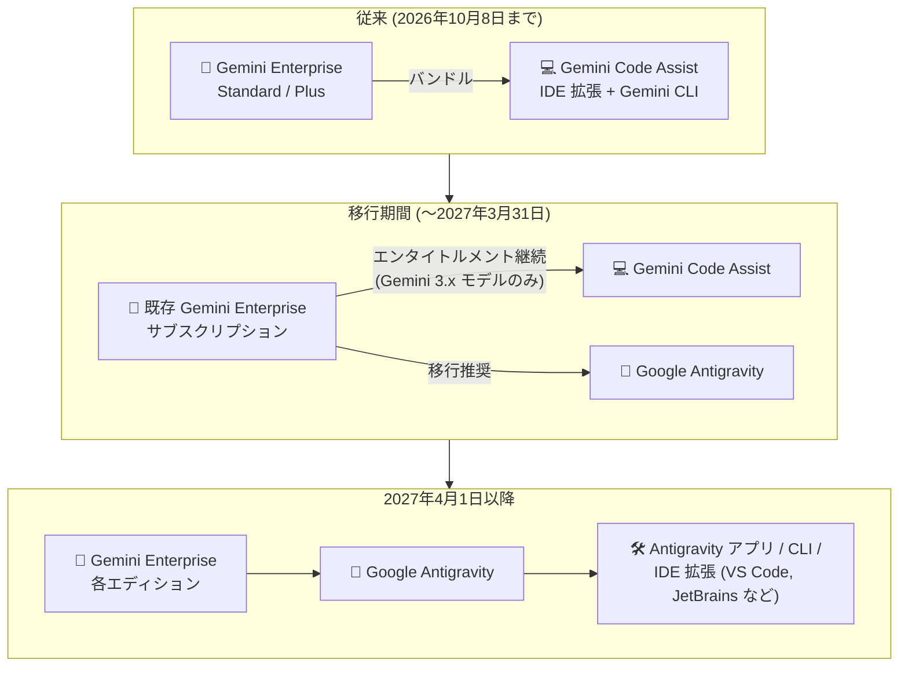

# Gemini Enterprise: 既存サブスクリプションの Gemini Code Assist エンタイトルメント終了

**リリース日**: 2026-11-06

**サービス**: Gemini Enterprise

**機能**: 既存サブスクリプションにおける Gemini Code Assist エンタイトルメントの終了

**ステータス**: Announcement (提供終了の発表)

📊 [このアップデートのインフォグラフィックを見る](https://takech9203.github.io/google-cloud-news-summary/20261106-gemini-enterprise-code-assist-entitlement-end.html)

## 概要

Google Cloud は、既存の Gemini Enterprise Standard および Gemini Enterprise Plus サブスクリプションにバンドルされている Gemini Code Assist のエンタイトルメント (利用権) を **2027 年 3 月 31 日** で終了すると発表しました。この日以降、既存サブスクリプションからエンタイトルメントが削除されます。また、終了日までの Gemini Code Assist のサポートは **Gemini 3.x モデルファミリーのみ** に限定されます。

これに先立ち、**2026 年 10 月 9 日** 以降に購入された新規の Gemini Enterprise サブスクリプションには、すでに Gemini Code Assist のエンタイトルメントが含まれていません。同日より Gemini Code Assist Standard / Enterprise の新規サブスクリプション自体の販売も終了しており、今回の発表は Gemini Code Assist 全体のサンセット (段階的終了) 計画の一環です。

開発者ワークフローの移行先として、エージェント型コーディング支援は **Google Antigravity** で提供されます。Antigravity は Gemini Enterprise の各エディションに含まれており、Gemini Enterprise ユーザーは追加のサブスクリプションなしで利用できます。

**アップデート前の課題 (従来の状態)**

- Gemini Enterprise Standard / Plus サブスクリプションには Gemini Code Assist のエンタイトルメントがバンドルされており、開発者向け AI 支援は Gemini Code Assist (IDE 拡張機能・Gemini CLI) を通じて提供されていた
- Gemini Code Assist とその後継である Antigravity という 2 系統の開発者向け AI ツールが併存し、移行時期が明確でなかった

**アップデート後の変更**

- 既存の Gemini Enterprise Standard / Plus サブスクリプションの Gemini Code Assist エンタイトルメントは 2027 年 3 月 31 日で終了し、以降サブスクリプションから削除される
- 2027 年 3 月 31 日までの Gemini Code Assist サポートは Gemini 3.x モデルファミリーのみに限定される
- 2026 年 10 月 9 日以降の新規 Gemini Enterprise サブスクリプションには Gemini Code Assist エンタイトルメントが含まれない
- エージェント型コーディング支援は Gemini Enterprise エディションに含まれる Google Antigravity (Antigravity アプリ、Antigravity CLI、IDE 拡張機能) に一本化される

## アーキテクチャ図

既存の Gemini Enterprise サブスクリプションは 2027 年 3 月 31 日まで Gemini Code Assist を利用できますが (Gemini 3.x モデルのみ)、それ以降は Gemini Enterprise に含まれる Google Antigravity がエージェント型コーディング支援の提供手段となります。

## サービスアップデートの詳細

### サンセットのタイムライン

Gemini Code Assist 全体の終了スケジュールは以下のとおりです。

| 日付 | 内容 |
|------|------|
| 2026 年 10 月 9 日 (発効済み) | Gemini Code Assist Standard / Enterprise の新規サブスクリプション購入終了。新規 Gemini Enterprise サブスクリプションに Gemini Code Assist エンタイトルメントが含まれなくなる |
| 2027 年 1 月 31 日 | Gemini Code Assist の年間サブスクリプションの自動更新終了。既存サブスクリプションへの追加ライセンス購入も終了 |
| **2027 年 3 月 31 日** | **既存の Gemini Enterprise Standard / Plus サブスクリプションの Gemini Code Assist エンタイトルメント終了 (今回の発表)** |
| 2027 年 12 月 31 日 | Gemini Code Assist の月間サブスクリプションの自動更新終了 |

### 主要なポイント

1. **既存 Gemini Enterprise サブスクリプションへの影響**
   - Gemini Enterprise Standard / Plus にバンドルされた Gemini Code Assist エンタイトルメントは 2027 年 3 月 31 日まで維持される
   - この日以降、エンタイトルメントは既存サブスクリプションから削除される

2. **モデルサポートの限定**
   - 2027 年 3 月 31 日までの Gemini Code Assist のサポートは Gemini 3.x モデルファミリーのみに限定される

3. **移行先は Google Antigravity**
   - エージェント型コーディング支援は Google Antigravity で提供され、Gemini Enterprise エディションに含まれる
   - Antigravity アプリ (デスクトップ)、Antigravity CLI、IDE 拡張機能 (VS Code、Visual Studio、JetBrains 系 IDE、Zed、Xcode など) が利用可能
   - Gemini CLI から Antigravity CLI への移行ガイドが提供されている

4. **単体の Gemini Code Assist サブスクリプションへの影響**
   - 既存の Gemini Code Assist サブスクリプションは契約期間の終了まで利用可能
   - 年間サブスクリプションは 2027 年 1 月 31 日、月間サブスクリプションは 2027 年 12 月 31 日まで自動更新可能

## 技術仕様

### 移行先: Gemini Enterprise の AI developer tools

Gemini Enterprise では、以下の AI developer tools が提供されています (Standard、Plus、Standard Emerging Market、Pay-as-you-go の各エディションの有効な非トライアルサブスクリプションで利用可能)。

| ツール | 説明 |
|------|------|
| Google Antigravity | 自律型 AI エージェントを使用してアプリケーションを構築する AI 開発環境。Antigravity アプリと Antigravity CLI をサポート |
| Antigravity for IDEs | IDE に自律型 AI エージェント機能を組み込む拡張機能。VS Code、Visual Studio、JetBrains 系 IDE (IntelliJ IDEA、PyCharm、WebStorm、GoLand など)、Zed、Xcode をサポート |
| Android Studio | Android 開発向けの推奨 IDE。Gemini Enterprise と連携した AI 機能を提供 |

### 利用に必要なロール

| ロール | 用途 |
|------|------|
| Gemini Enterprise Admin (`roles/discoveryengine.agentspaceAdmin`) | AI developer tools の設定とメトリクス閲覧 |
| Gemini Enterprise User (`roles/discoveryengine.agentspaceUser`) | AI developer tools へのアクセスと利用 (Admin ロールだけではアクセス不可。明示的な付与が必要) |

## 移行の進め方

### 前提条件

1. Gemini Enterprise Standard、Plus、Standard Emerging Market、または Pay-as-you-go エディションの有効な非トライアルサブスクリプション
2. プロジェクトで Cloud Billing が有効化されていること
3. 利用ユーザーへの Gemini Enterprise User ロールの付与

### 手順

#### ステップ 1: サブスクリプションの移行計画を立てる

Gemini Code Assist を単体サブスクリプションで利用している場合は、最終更新日または契約終了日より前に Gemini Enterprise への移行を計画します。Gemini Enterprise バンドルで利用している場合は、2027 年 3 月 31 日のエンタイトルメント終了までに Antigravity への移行を完了させます。

#### ステップ 2: Antigravity のセットアップ

開発者のワークフローに応じて、Antigravity アプリ、Antigravity CLI、または各 IDE 向けの Antigravity 拡張機能を導入します。エンタープライズ利用では IDE 拡張機能から「Sign in with Gemini Enterprise」を選択し、企業 ID (BYOID、Workforce Identity Federation を含む) で認証後、対象の Google Cloud プロジェクトとリージョンを選択します。

#### ステップ 3: Gemini CLI からの移行

Gemini CLI を利用している場合は、公式の移行ガイド ([Antigravity CLI migration guide](https://antigravity.google/docs/gcli-migration)) に従って Antigravity CLI へ移行します。

## デメリット・制約事項

### 制限事項

- 2027 年 3 月 31 日以降、既存の Gemini Enterprise Standard / Plus サブスクリプションから Gemini Code Assist エンタイトルメントが削除され、利用できなくなる
- 終了日までの Gemini Code Assist のモデルサポートは Gemini 3.x モデルファミリーのみ
- 2027 年 1 月 31 日以降、Gemini Code Assist の追加ライセンス購入は不可
- Antigravity in Gemini Enterprise は現時点で以下のコンプライアンス認証・セキュリティ管理をサポートしていない: Access Transparency (AXT)、FedRAMP (Moderate / High)、IL4 / IL5、ISO 認証 (ISO 27001、ISO 42001 を含む)、ITAR、SOC 1 / 2 / 3

### 考慮すべき点

- Gemini Code Assist を前提とした開発者ワークフロー (IDE 拡張機能、Gemini CLI) は、エンタイトルメント終了前に Antigravity への移行テストを行うことが推奨される
- コンプライアンス要件 (FedRAMP、ISO、SOC など) がある組織は、Antigravity の現時点でのコンプライアンス制限を確認したうえで移行計画を立てる必要がある
- Android Studio はサードパーティ ID プロバイダをサポートしていないため、該当構成のユーザーは Android Studio での AI developer tools 機能を利用できない
- Antigravity の一部マルチエージェント機能 (`/boost`、`/teamwork-preview`) はトークン使用量とコストが増加する可能性があり、管理者が組織単位で有効/無効を制御できる

## 関連サービス・機能

- **Google Antigravity**: Gemini Code Assist の後継となるエージェント型開発プラットフォーム。Gemini Enterprise エディションに含まれ、アプリ・CLI・IDE 拡張機能を提供
- **Antigravity for IDEs**: VS Code、Visual Studio、JetBrains 系 IDE、Zed、Xcode に対応した IDE 拡張機能
- **Gemini CLI / Antigravity CLI**: ターミナルベースのエージェント型コーディングツール。Gemini CLI から Antigravity CLI への移行ガイドが提供されている
- **Android Studio**: Gemini Enterprise サブスクリプションで AI 機能を利用できる Android 開発向け IDE
- **Gemini Enterprise Agent Platform**: Antigravity をエンタープライズ向けに提供する基盤。組織の IAM ポリシー、VPC Service Controls を尊重して動作する

## 参考リンク

- 📊 [インフォグラフィック](https://takech9203.github.io/google-cloud-news-summary/20261106-gemini-enterprise-code-assist-entitlement-end.html)
- [公式リリースノート (2026 年 11 月 6 日)](https://docs.cloud.google.com/release-notes#November_06_2026)
- [Gemini Code Assist sunset ページ](https://docs.cloud.google.com/gemini/docs/codeassist/sunset)
- [Gemini Code Assist deprecations 一覧](https://developers.google.com/gemini-code-assist/docs/deprecations)
- [Gemini Enterprise の AI developer tools 概要](https://docs.cloud.google.com/gemini/enterprise/docs/ai-developer-tools-overview)
- [Google Antigravity ドキュメント](https://antigravity.google/docs/home/)
- [Antigravity IDE 拡張機能](https://antigravity.google/docs/ide/extensions)
- [Gemini CLI から Antigravity CLI への移行ガイド](https://antigravity.google/docs/gcli-migration)

## まとめ

Gemini Enterprise Standard / Plus にバンドルされていた Gemini Code Assist エンタイトルメントは 2027 年 3 月 31 日で終了し、開発者向けエージェント型コーディング支援は Gemini Enterprise に含まれる Google Antigravity に一本化されます。Gemini Code Assist を利用中の組織は、終了日までのモデルサポートが Gemini 3.x ファミリーに限定される点にも留意しつつ、Antigravity (アプリ / CLI / IDE 拡張機能) への移行検証とコンプライアンス要件の確認を早期に開始することを推奨します。

---

**タグ**: Gemini Enterprise, Gemini Code Assist, Google Antigravity, Deprecation, Sunset, AI Developer Tools, Agentic Coding
