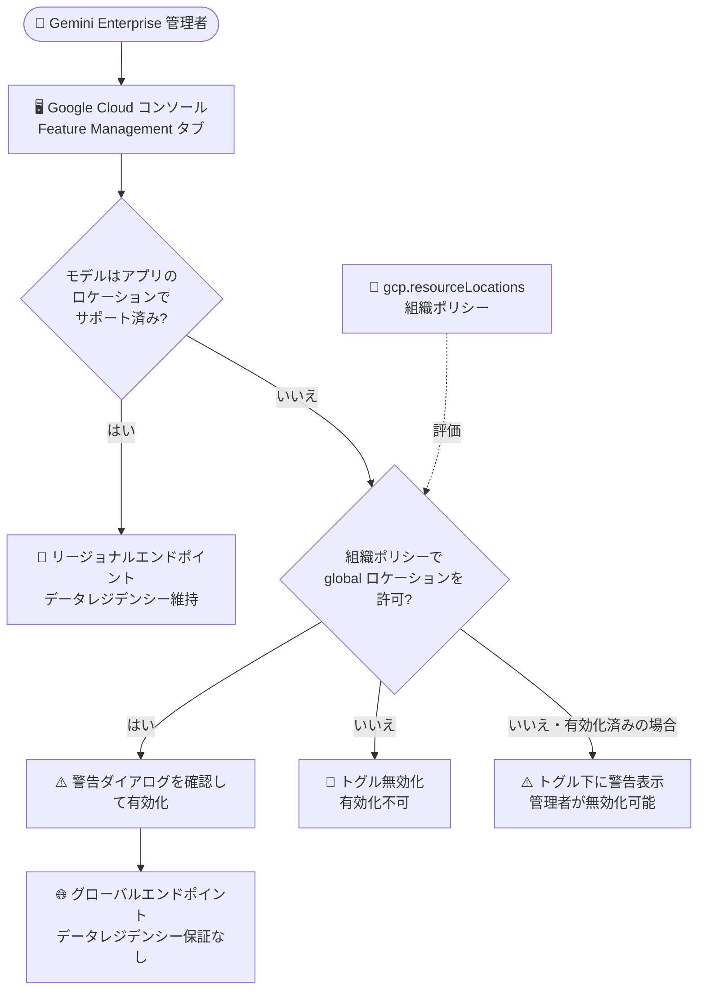

# Gemini Enterprise: モデルの利用可否がリソースロケーションポリシーに準拠

**リリース日**: 2026-11-06

**サービス**: Gemini Enterprise

**機能**: Gemini モデルの利用可否がリソースロケーション組織ポリシーを尊重

**ステータス**: Feature (提供開始)

📊 [このアップデートのインフォグラフィックを見る](https://takech9203.github.io/google-cloud-news-summary/20261106-gemini-enterprise-model-resource-location-policies.html)

## 概要

Gemini Enterprise において、Gemini モデルの有効化が **リソースロケーション組織ポリシー** (`constraints/gcp.resourceLocations`) に準拠するようになりました。プロジェクトの組織ポリシーで `global` ロケーションが許可されていない場合、アプリのロケーションでサポートされていない Gemini モデル (トラフィックがグローバルエンドポイントにルーティングされるモデル) を管理者が有効化できなくなります。

具体的には、Google Cloud コンソール上で該当モデルのトグルが無効化 (操作不可) になります。また、該当するモデルがすでに有効化されている場合は、トグルの下に警告が表示され、管理者はそのモデルを無効化してアプリのリージョン内にトラフィックを留めることができます。

このアップデートは、データレジデンシー (データ所在地) 要件を持つ組織、特に EU やカナダ・インド・日本・シンガポール・英国などの国内リージョンで Gemini Enterprise を運用する企業の管理者・ガバナンス担当者にとって重要な改善です。組織ポリシーによるロケーション制御の意図が、Gemini Enterprise のモデル管理 UI にも一貫して反映されるようになります。

**アップデート前の課題**

- アプリのロケーションでサポートされていないモデルを有効化すると、そのモデルのトラフィックはグローバルエンドポイントにルーティングされるが、グローバルエンドポイントはリージョナルなデータレジデンシーをサポートしていない
- 組織ポリシーで `global` ロケーションを制限していても、Gemini Enterprise のモデルトグル操作にはそのポリシーが反映されず、管理者が警告ダイアログを確認するだけでグローバルエンドポイント経由のモデルを有効化できた
- すでに有効化済みのリージョン非対応モデルについて、組織のロケーションポリシーと矛盾していることをコンソール上で検知する手段がなかった

**アップデート後の改善**

- 組織ポリシーで `global` が許可されていない場合、アプリのロケーションで非対応のモデルは有効化できなくなり、コンソール上のトグルが無効化される
- 該当モデルがすでに有効化されている場合は、トグルの下に警告が表示され、管理者が無効化の判断を行える
- 組織ポリシーによるロケーションガバナンスが Gemini Enterprise のモデル管理にまで一貫して適用され、意図しないグローバルエンドポイントへのトラフィック流出を防止できる

## アーキテクチャ図



リソースロケーション組織ポリシーが Gemini モデルのトグル操作時に評価され、`global` が許可されていない場合はグローバルエンドポイント経由のモデル有効化がブロックされるフローを示しています。

## サービスアップデートの詳細

### 主要機能

1. **組織ポリシーに基づくモデルトグルの無効化**
   - プロジェクトのリソースロケーション組織ポリシーで `global` ロケーションが許可されていない場合、アプリのリージョンでサポートされていないモデルは有効化できない
   - Google Cloud コンソール上で該当モデルのトグルが無効 (操作不可) になる

2. **有効化済みモデルへの警告表示**
   - ポリシーに抵触するモデルがすでに有効化されている場合、トグルの下に警告が表示される
   - 管理者はトラフィックをアプリのリージョン内に留めるために、該当モデルを無効化できる

3. **グローバルエンドポイントへのルーティング制御**
   - アプリのロケーションで非対応のモデルは、トラフィックがグローバルエンドポイントにルーティングされる
   - グローバルエンドポイントへのリクエストは世界中の任意の Google Cloud ロケーションで処理される可能性があり、データレジデンシー保証がないため、組織ポリシーでこれを抑止できることが重要

## 技術仕様

### モデルトグルの動作 (リージョンとポリシーによる制約)

| 条件 | コンソールでの動作 |
|------|-------------------|
| モデルがアプリのリージョンでサポートされている | 通常どおりトグルで有効化/無効化が可能 |
| モデルがアプリのリージョンで非サポート、組織ポリシーで `global` 許可 | 警告ダイアログを確認するとグローバルエンドポイントへルーティングして有効化可能 |
| モデルがアプリのリージョンで非サポート、組織ポリシーで `global` 不許可 | トグルが無効化され、有効化できない |
| 上記条件で該当モデルがすでに有効化済み | トグルの下に警告が表示され、無効化を推奨 |

### リソースロケーション組織ポリシー

| 項目 | 詳細 |
|------|------|
| 制約名 | `constraints/gcp.resourceLocations` |
| 制約タイプ | リスト型制約 (`allowedValues` / `deniedValues`) |
| 値の指定方法 | バリューグループ (例: `in:us-locations`)、リージョン、マルチリージョン (`us`、`eu`、`global` など)、ゾーン |
| 適用範囲 | 組織、フォルダ、プロジェクトの各階層で設定可能 (継承あり) |

## 設定方法

### 前提条件

1. Gemini Enterprise アプリが作成済みであること
2. 組織ポリシーを設定する場合は、組織ポリシー管理者のロール (`roles/orgpolicy.policyAdmin`) が必要

### 手順

#### ステップ 1: リソースロケーション組織ポリシーの確認・設定

```bash
# ポリシー YAML を作成 (例: 米国内ロケーションのみ許可 = global は不許可)
cat > policy.yaml <<EOF
name: organizations/ORGANIZATION_ID/policies/gcp.resourceLocations
spec:
  rules:
  - values:
      allowedValues:
      - in:us-locations
EOF

# ポリシーを適用
gcloud org-policies set-policy policy.yaml
```

`allowedValues` に `global` が含まれない場合、アプリのリージョンで非対応の Gemini モデルは有効化できなくなります。

#### ステップ 2: Gemini モデルの有効化/無効化

1. Google Cloud コンソールで **Gemini Enterprise** ページに移動する
2. 構成するアプリの名前をクリックする
3. **Configurations** をクリックし、**Feature Management** タブをクリックする
4. **Gemini model availability** セクションに移動する
5. 有効化/無効化するモデルのトグルをクリックする
   - リージョン非対応モデルで組織ポリシーが `global` を制限している場合、トグルは無効化されている
   - すでに有効化済みのモデルに警告が表示されている場合は、トグルをオフにしてリージョン内にトラフィックを留める
6. **Save** をクリックする (変更は数分で反映される)

## メリット

### ビジネス面

- **コンプライアンスの強化**: データレジデンシー要件 (EU や国内リージョンでのデータ処理義務など) を持つ組織が、ポリシーと実際のモデル利用の整合性を担保できる
- **ガバナンスの一元化**: 組織ポリシーという既存のガバナンス機構が Gemini Enterprise のモデル管理にも自動的に波及し、個別の運用ルール策定・周知の負担が減る

### 技術面

- **ヒューマンエラーの防止**: 管理者が警告ダイアログを誤って確認し、グローバルエンドポイントへトラフィックを流してしまう事故をシステム側で防げる
- **既存設定の可視化**: ポリシーに抵触する有効化済みモデルがコンソール上の警告で可視化され、是正アクションにつなげられる

## デメリット・制約事項

### 制限事項

- 組織ポリシーで `global` を制限すると、アプリのリージョンで非対応のモデル (例: 国内リージョンにおける一部の最新モデル) は利用できなくなる
- すでに有効化済みの抵触モデルは自動では無効化されず、警告表示に基づいて管理者が手動で無効化する必要がある

### 考慮すべき点

- リソースロケーション制約は新規リソース作成時に適用されるものであり、組織ポリシー自体はデータ保存のコミットメントではない点に注意 (データレジデンシーの正式なコミットメントはサービス規約を参照)
- モデルごとにサポートされるロケーションが異なるため、アプリのリージョンと利用したいモデルの対応状況を「Data residency for Gemini Enterprise」ドキュメントで事前に確認することが推奨される

## ユースケース

### ユースケース 1: EU データレジデンシー要件下でのモデル統制

**シナリオ**: EU 域内でのデータ処理が求められる金融機関が、`eu` ロケーションに Gemini Enterprise アプリを構築している。組織ポリシーで `in:eu-locations` のみを許可し、`global` を不許可にしている。

**効果**: EU 非対応のモデルはコンソール上でトグルが無効化され、管理者が誤ってグローバルエンドポイント経由のモデルを有効化することがなくなる。データが EU 域外で処理されるリスクをポリシーレベルで遮断できる。

### ユースケース 2: 有効化済みモデルの棚卸しと是正

**シナリオ**: 国内リージョン (例: 日本) で Gemini Enterprise を運用している企業が、後からリソースロケーション組織ポリシーを導入した。導入前にリージョン非対応のモデルがいくつか有効化されていた。

**効果**: ポリシー導入後、該当モデルのトグル下に警告が表示されるため、管理者は抵触しているモデルを特定し、無効化してトラフィックをアプリのリージョン内に留めることができる。

## 関連サービス・機能

- **Organization Policy Service**: 本アップデートの中核。`constraints/gcp.resourceLocations` 制約により、組織・フォルダ・プロジェクト単位でリソースのロケーションを制御する
- **Gemini Enterprise Agent Platform**: グローバルエンドポイントへのリクエストはデータレジデンシー保証がない点が共通しており、同様のロケーション設計上の考慮が必要
- **Security Command Center (Security Health Analytics)**: リソースロケーション制約の既存違反を検出する手段として利用できる

## 参考リンク

- 📊 [インフォグラフィック](https://takech9203.github.io/google-cloud-news-summary/20261106-gemini-enterprise-model-resource-location-policies.html)
- [公式リリースノート](https://docs.cloud.google.com/release-notes#November_06_2026)
- [Turn on or turn off a Gemini model](https://docs.cloud.google.com/gemini/enterprise/docs/manage-web-app-features#turn-on-gemini-model)
- [Data residency for Gemini Enterprise](https://docs.cloud.google.com/gemini/enterprise/docs/locations)
- [Restrict resource locations (組織ポリシー)](https://docs.cloud.google.com/organization-policy/restrict-locations)

## まとめ

Gemini Enterprise のモデル有効化がリソースロケーション組織ポリシーに準拠するようになり、データレジデンシー要件を持つ組織がグローバルエンドポイントへの意図しないトラフィック流出をポリシーレベルで防止できるようになりました。`global` を制限する組織ポリシーを運用している場合は、Gemini Enterprise アプリの Feature Management タブを確認し、警告が表示されている有効化済みモデルがないか棚卸しすることを推奨します。

---

**タグ**: #GeminiEnterprise #OrganizationPolicy #DataResidency #ResourceLocations #ガバナンス #コンプライアンス
