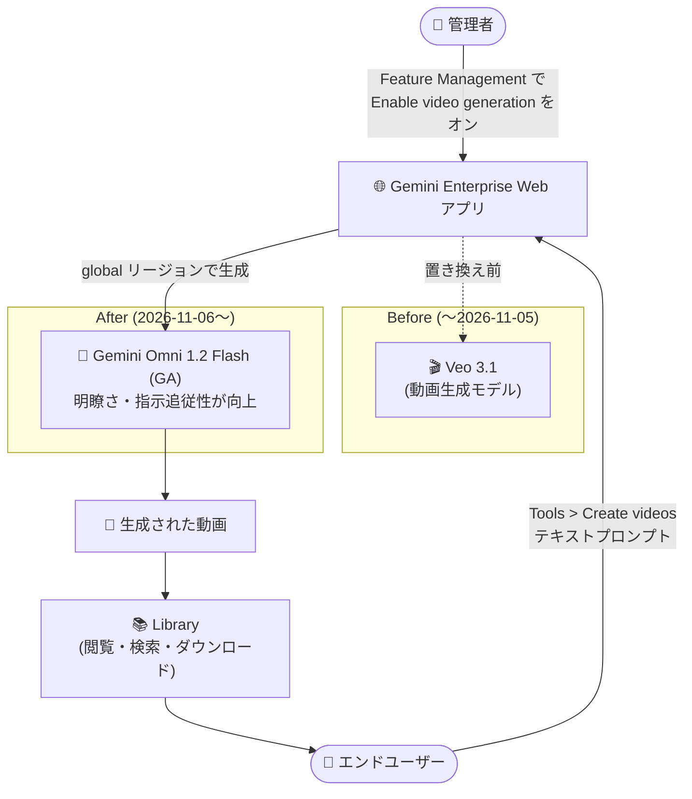

# Gemini Enterprise: 動画生成が Omni 1.2 Flash にアップグレード (Veo 3.1 を置き換え)

**リリース日**: 2026-11-06

**サービス**: Gemini Enterprise

**機能**: Web アプリの動画生成モデルを Gemini Omni 1.2 Flash (GA) にアップグレード

**ステータス**: GA (一般提供)

📊 [このアップデートのインフォグラフィックを見る](https://takech9203.github.io/google-cloud-news-summary/20261106-gemini-enterprise-video-generation-omni-1-2-flash.html)

## 概要

Gemini Enterprise の Web アプリにおける動画生成機能のバックエンドモデルが **Gemini Omni 1.2 Flash** にアップグレードされました。Gemini Omni 1.2 Flash は一般提供 (GA) となり、`global` リージョンでの動画生成において **Veo 3.1 を置き換え** ます。Omni 1.2 Flash は映像の明瞭さ (clarity) と指示追従性 (instruction following) が向上しています。

動画生成機能を利用するには、管理者が Web アプリの機能管理設定で **「Enable video generation」** をオンにする必要があります。設定が有効になると、エンドユーザーはチャットボックスの「Tools > Create videos」から自然言語プロンプトで短い動画を生成し、フォローアッププロンプトで結果を改善できます。

本アップデートは、Gemini Enterprise を全社導入している企業の管理者 (機能の有効化判断) と、プレゼン資料・社内コミュニケーション・マーケティング素材などで動画生成を活用するエンドユーザーが対象です。なお、Gemini Omni 1.2 Flash モデル自体の GA (Agent Platform の Interactions API 経由での利用) については、[2026-11-05 のレポート](2026-11-05-gemini-omni-1-2-flash-ga.md) を参照してください。本レポートは Gemini Enterprise Web アプリの機能アップグレードに焦点を当てます。

**アップデート前の課題**

- Gemini Enterprise Web アプリの動画生成は Veo 3.1 をバックエンドモデルとして使用していた
- 動画生成専用モデルである Veo 3.1 は、Omni 1.2 Flash と比較して映像の明瞭さと複雑な指示への追従に改善の余地があった

**アップデート後の改善**

- `global` リージョンの動画生成バックエンドが GA モデルの Gemini Omni 1.2 Flash に置き換わった
- 映像の明瞭さ (clarity) が向上した
- プロンプトの指示追従性 (instruction following) が向上し、意図した動画を得やすくなった
- エンドユーザーの操作手順 (Tools > Create videos) は変わらず、管理者が「Enable video generation」を有効にしていればそのまま新モデルの恩恵を受けられる

## アーキテクチャ図



Gemini Enterprise Web アプリの動画生成バックエンドが Veo 3.1 から Gemini Omni 1.2 Flash に置き換わりました。管理者が機能を有効化すると、ユーザーはチャットから動画を生成し、Library で閲覧・検索・ダウンロードできます。

## サービスアップデートの詳細

### 主要機能

1. **動画生成モデルの Omni 1.2 Flash への置き換え**
   - `global` リージョンの動画生成において、Gemini Omni 1.2 Flash (GA) が Veo 3.1 を置き換える
   - 映像の明瞭さ (clarity) と指示追従性 (instruction following) が向上

2. **チャットからの動画生成 (Tools > Create videos)**
   - チャットボックスの「Tools > Create videos」を選択し、生成したい動画を自然言語で記述してプロンプトを送信
   - アシスタントの応答後、フォローアッププロンプトで結果を改善 (refine) できる

3. **Library での生成コンテンツ管理**
   - 過去のチャットで生成した画像・動画を Library で一覧表示し、「Images」「Videos」でフィルタリング可能
   - 生成元のチャットを開く、ダウンロードするなどの操作が可能
   - 自然言語で生成済みコンテンツを検索できる (検索結果は最大 10 件の画像・動画を表示)

4. **管理者による機能制御 (Enable video generation)**
   - 動画生成の利用には、管理者が Web アプリの Feature Management で「Enable video generation」をオンにする必要がある
   - 有効化すると、ユーザーは Web アプリで動画を生成できるようになる

## 技術仕様

### Gemini Enterprise Web アプリの動画生成

| 項目 | 詳細 |
|------|------|
| バックエンドモデル | Gemini Omni 1.2 Flash (GA、Veo 3.1 を置き換え) |
| 提供リージョン | `global` リージョンのみ (US/EU マルチリージョン、国内リージョンでは利用不可) |
| 利用前提 | 管理者が「Enable video generation」設定をオン |
| ユーザー操作 | チャットボックスの Tools > Create videos |
| 生成後の管理 | Library で閲覧・フィルタ・自然言語検索・ダウンロード |
| 必要な管理者ロール | Gemini Enterprise Admin (`roles/discoveryengine.agentspaceAdmin`) |

### Gemini Omni 1.2 Flash モデルの特性 (参考: Agent Platform ドキュメント)

バックエンドとなる Gemini Omni 1.2 Flash は、動画・画像・テキストタスク向けに設計されたマルチモーダルモデルで、動画の生成・編集・拡張・アップスケーリングに最適化されています。最大 15 秒の同期音声付き動画を 360p / 720p / 1080p / 4K で生成でき、提供リージョンは `global` です。

## 設定方法

### 前提条件

1. Gemini Enterprise Admin IAM ロール (`roles/discoveryengine.agentspaceAdmin`)
2. 既存の Gemini Enterprise Web アプリ

### 手順

#### ステップ 1: 管理者が動画生成を有効化する

1. Google Cloud コンソールで **Gemini Enterprise** ページに移動
2. 設定するアプリの名前をクリック
3. **Configurations** > **Feature Management** タブをクリック
4. **Enable video generation** をオンにする

#### ステップ 2: ユーザーが動画を生成する

1. Gemini Enterprise Web アプリのチャットボックスで **Tools > Create videos** をクリック
2. 作成したい動画の内容を記述してプロンプトを送信
3. 応答を受け取った後、フォローアッププロンプトで結果を改善
4. 生成した動画は **Library** から閲覧・検索・ダウンロード

## メリット

### ビジネス面

- **生成品質の向上**: 映像の明瞭さと指示追従性が向上し、業務で使える動画素材を少ない試行回数で得やすくなる
- **追加作業なしでアップグレード**: モデル置き換えはバックエンド側で行われるため、既に動画生成を有効化している組織はユーザー教育や設定変更なしで新モデルを利用できる
- **ガバナンスの維持**: 動画生成の利用可否は引き続き管理者の「Enable video generation」設定で制御でき、組織のポリシーに沿った展開が可能

### 技術面

- **GA モデルへの移行**: バックエンドが GA の Gemini Omni 1.2 Flash となり、Google の最新オムニモーダルモデルの改善 (明瞭さ・指示追従性) を Web アプリから利用できる
- **会話的な動画生成ワークフロー**: フォローアッププロンプトによる改善と Library での自然言語検索により、生成から管理までが Web アプリ内で完結する

## デメリット・制約事項

### 制限事項

- 動画生成は `global` リージョンでのみ利用可能 (US/EU マルチリージョンおよび CA, IN, JP, SG, UK の国内リージョンでは利用不可)
- 管理者が「Enable video generation」をオンにしない限り、ユーザーは動画生成を利用できない
- Library の自然言語検索の結果に表示されるのは最大 10 件の画像・動画

### 考慮すべき点

- プロジェクトが月間の支出上限 (monthly spend cap) に達した場合、またはプールされたクォータ上限を超過し管理者が超過利用 (overages) を有効にしていない場合、「Usage limit reached」エラーが表示され動画生成が制限される (他の機能は残りのクォータの範囲で利用可能)
- データレジデンシー (DRZ) 要件が厳しい組織では、動画生成が `global` リージョン限定である点を確認した上で有効化を判断する必要がある
- Veo 3.1 の出力に合わせてプロンプトをチューニングしていた場合、モデル置き換えにより生成結果の傾向が変わる可能性があるため、主要なユースケースでの再検証を推奨

## ユースケース

### ユースケース 1: マーケティングチームによる動画素材のドラフト作成

**シナリオ**: マーケティング担当者がキャンペーン企画の初期段階で、コンセプトを伝える短い動画イメージを素早く作成したい。

**実装例**:
```
1. 管理者が Feature Management で Enable video generation をオン
2. 担当者が Tools > Create videos で「新製品のコンセプトを伝える、
   明るいトーンのオフィスシーンの短い動画」といったプロンプトを送信
3. フォローアッププロンプトでトーンや被写体を調整
4. Library から動画をダウンロードして企画資料に添付
```

**効果**: 指示追従性が向上した Omni 1.2 Flash により、意図に沿った動画ドラフトを少ない反復で取得でき、外部制作への依頼前のコンセプト検証を高速化できる。

### ユースケース 2: 生成済み動画資産の再利用

**シナリオ**: 過去のチャットで生成した動画を、別のプロジェクトで再利用したい。

**効果**: Library の自然言語検索で「過去に作ったオフィスシーンの動画」のように検索し、該当動画をダウンロードまたは生成元チャットから再編集できるため、同じ素材を一から作り直す手間を削減できる。

## 利用可能リージョン

動画生成は **`global` リージョンのみ** で利用可能です。US/EU マルチリージョンおよび国内リージョン (CA, IN, JP, SG, UK) では利用できません。詳細は [Gemini Enterprise locations (Product limitations)](https://docs.cloud.google.com/gemini/enterprise/docs/locations#product-limitations) を参照してください。

## 関連サービス・機能

- **Gemini Enterprise Agent Platform**: Gemini Omni 1.2 Flash を Interactions API 経由で直接利用し、動画の生成・編集・拡張・アップスケーリングを開発者がアプリケーションに組み込める ([2026-11-05 のレポート](2026-11-05-gemini-omni-1-2-flash-ga.md) 参照)
- **画像生成 (Enable image generation)**: 同じ Feature Management で制御される Web アプリの画像生成機能。Gemini 3 Pro image (Nano Banana Pro) や Gemini 3.1 Flash image (Nano Banana 2) などのモデルを選択できる
- **Library**: 生成した画像・動画を一元的に閲覧・検索・ダウンロードできる Web アプリの機能
- **Veo 3.1**: これまで Gemini Enterprise の動画生成を担っていたモデル。`global` リージョンでは Omni 1.2 Flash に置き換えられた

## 参考リンク

- 📊 [インフォグラフィック](https://takech9203.github.io/google-cloud-news-summary/20261106-gemini-enterprise-video-generation-omni-1-2-flash.html)
- [公式リリースノート](https://docs.cloud.google.com/release-notes#November_06_2026)
- [Generate a video (動画の生成)](https://docs.cloud.google.com/gemini/enterprise/docs/assistant-analyze#generate_a_video)
- [Manage web app features (Web アプリ機能の管理)](https://docs.cloud.google.com/gemini/enterprise/docs/manage-web-app-features)
- [Gemini Enterprise limitations (制限事項)](https://docs.cloud.google.com/gemini/enterprise/docs/locations#product-limitations)
- [Gemini Omni 1.2 Flash モデル](https://docs.cloud.google.com/gemini-enterprise-agent-platform/models/gemini/omni-1-2-flash)

## まとめ

Gemini Enterprise Web アプリの動画生成バックエンドが Veo 3.1 から GA の Gemini Omni 1.2 Flash に置き換わり、映像の明瞭さと指示追従性が向上しました。ユーザー側の操作は変わらないため、既に機能を有効化している組織は自動的に恩恵を受けられます。まだ有効化していない組織は、動画生成が `global` リージョン限定である点とクォータ・支出上限の挙動を確認した上で、「Enable video generation」設定の有効化を検討することを推奨します。

---

**タグ**: #GeminiEnterprise #VideoGeneration #GeminiOmni #Veo #GA #GenerativeAI
