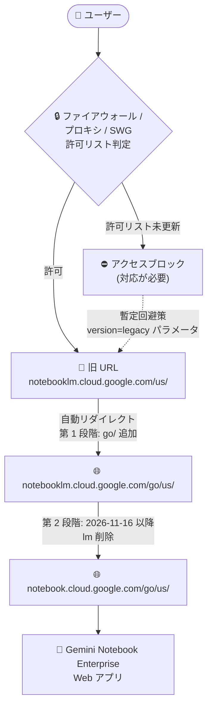

# Gemini Enterprise: Gemini Notebook Enterprise の Web アドレス変更 (Breaking Change)

**リリース日**: 2026-11-06

**サービス**: Gemini Enterprise (Gemini Notebook Enterprise)

**機能**: Web アプリ URL の変更 (パスへの `go/` 追加とホスト名からの `lm` 削除)

**ステータス**: Breaking Change (破壊的変更)

📊 [このアップデートのインフォグラフィックを見る](https://takech9203.github.io/google-cloud-news-summary/20261106-gemini-notebook-enterprise-url-change.html)

## 概要

Gemini Notebook Enterprise (旧 NotebookLM Enterprise) の Web アプリの URL が 2 段階で変更されます。第 1 段階として、URL パスに `go/` が追加されます (例: `notebooklm.cloud.google.com/us/` → `notebooklm.cloud.google.com/go/us/`)。この変更は `global` と `us` リージョンでは既に適用済み、`eu` はロールアウト中、その他すべてのロケーションは 2026 年 11 月 9 日から適用されます。第 2 段階として、2026 年 11 月 16 日からホスト名から `lm` が削除されます (例: `notebooklm.cloud.google.com` → `notebook.cloud.google.com`)。

いずれの変更でも既存のリンクは自動的にリダイレクトされるため、一般的な利用環境のユーザーへの直接的な影響はありません。ただし、**ファイアウォール、プロキシ、セキュア Web ゲートウェイで特定の URL パス単位の許可リスト (アローリスト) を運用している組織では対応が必須** です。許可リストを更新しないと、ロールアウト後にユーザーが Web アプリへアクセスできなくなる可能性があります。

本変更は、スタンドアロンの Gemini Notebook Enterprise と、Gemini Enterprise 内の Gemini Notebook (`vertexaisearch.cloud.google.com/notebooklm/...`) の両方に影響します。ネットワーク管理者・セキュリティ管理者が主な対応対象者です。

**アップデート前の課題**

- Web アプリの URL パスは `/{REGION}/` 形式 (例: `notebooklm.cloud.google.com/us/`) であり、組織の許可リストはこのパスを前提に構成されていた
- ホスト名には旧製品名に由来する `notebooklm` が含まれていた (Google Identity 用: `notebooklm.cloud.google.com`、Workforce Identity Federation 用: `notebooklm.cloud.google`)

**アップデート後の改善**

- 既存リンクは新 URL へ自動リダイレクトされるため、ブックマークや共有済みリンクはそのまま機能する
- Google はドメイン全体 (`/*`) の許可を推奨しており、これに従えば将来のパス変更時に追加の許可リスト更新が不要になる
- ホスト名が `notebook.cloud.google.com` / `notebook.cloud.google` に統一され、現在の製品名 (Gemini Notebook) に沿った体系になる

## アーキテクチャ図



旧 URL へのアクセスは新 URL へ自動リダイレクトされますが、許可リストがパス単位で構成されている場合、リダイレクト先の新 URL がブロックされるため許可リストの更新が必要です。

## サービスアップデートの詳細

### 主要機能

1. **第 1 段階: URL パスへの `go/` 追加 (即時開始)**
   - Gemini Notebook Enterprise: `notebooklm.cloud.google.com/us/` → `notebooklm.cloud.google.com/go/us/`
   - Gemini Enterprise 内の Gemini Notebook: `vertexaisearch.cloud.google.com/notebooklm/global/` → `vertexaisearch.cloud.google.com/notebooklm/go/global/`
   - 既存リンクは自動リダイレクト

2. **第 2 段階: ホスト名からの `lm` 削除 (2026 年 11 月 16 日開始)**
   - Google Identity で認証する場合: `notebooklm.cloud.google.com` → `notebook.cloud.google.com`
   - Workforce Identity Federation で認証する場合: `notebooklm.cloud.google` → `notebook.cloud.google`

3. **必要なアクション: 許可リストの更新**
   - ファイアウォール、プロキシ、セキュア Web ゲートウェイで URL パス単位の許可リストを使用している組織は更新が必要
   - `notebooklm.cloud.google.com/*` と `notebook.cloud.google.com/*` を許可リストに追加
   - Workforce Identity Federation 利用時は `notebooklm.cloud.google/*` と `notebook.cloud.google/*` も追加
   - Gemini Enterprise 内の Gemini Notebook 利用時は `vertexaisearch.cloud.google.com/notebooklm/*` も追加

## 技術仕様

### `go/` パス変更のロールアウトスケジュール

| リージョン | ロールアウト日 |
|------|------|
| global, us | 適用済み (Live) |
| eu | ロールアウト中 |
| その他すべてのロケーション | 2026 年 11 月 9 日開始 |

### URL 変更の対応表

| 対象 | 変更前 | 変更後 |
|------|------|------|
| Gemini Notebook Enterprise (パス) | `notebooklm.cloud.google.com/us/` | `notebooklm.cloud.google.com/go/us/` |
| Gemini Enterprise 内の Gemini Notebook (パス) | `vertexaisearch.cloud.google.com/notebooklm/global/` | `vertexaisearch.cloud.google.com/notebooklm/go/global/` |
| ホスト名 (Google Identity) | `notebooklm.cloud.google.com` | `notebook.cloud.google.com` (2026-11-16 以降) |
| ホスト名 (Workforce Identity Federation) | `notebooklm.cloud.google` | `notebook.cloud.google` (2026-11-16 以降) |

### パス単位で許可する場合のリージョン値

ドメイン全体 (`/*`) を許可しない場合は、`/{REGION}` と `/go/{REGION}` の両方を許可する必要があります。REGION に入る値は以下のとおりです。

`global`, `us`, `eu`, `asia-northeast1`, `au`, `ca`, `de`, `europe-west2`, `in`, `kr`, `sg`

例: `notebooklm.cloud.google.com/us/` と `notebooklm.cloud.google.com/go/us/` の両方を許可する。

## 設定方法

### 前提条件

1. 組織でファイアウォール、プロキシ、またはセキュア Web ゲートウェイを使用し、Gemini Notebook へのアクセスを特定の URL パスで許可していること (該当しない場合、対応は不要)
2. ネットワーク機器・ゲートウェイの許可リストを変更できる管理権限

### 手順

#### ステップ 1: 推奨される許可リストの追加 (ドメイン全体)

将来のパス変更時に追加更新が不要になるよう、Google はドメイン全体 (`/*`) の許可を推奨しています。

```text
# 全組織共通
notebooklm.cloud.google.com/*
notebook.cloud.google.com/*

# Workforce Identity Federation を使用している場合は追加
notebooklm.cloud.google/*
notebook.cloud.google/*

# Gemini Enterprise 内の Gemini Notebook を使用している場合は追加
vertexaisearch.cloud.google.com/notebooklm/*
```

#### ステップ 2: パス単位で許可する場合 (ドメイン全体を許可できない場合)

`/*` を許可できない場合は、利用するロケーションごとに `/{REGION}` と `/go/{REGION}` の両方を許可します。

```text
# 例: us リージョンを利用している場合
notebooklm.cloud.google.com/us/
notebooklm.cloud.google.com/go/us/
```

#### ステップ 3: 暫定回避策 (許可リスト更新前にブロックが発生した場合)

許可リストの更新が間に合わずユーザーがブロックされた場合、ユーザー自身が URL から `/go` を削除し、クエリパラメータ `version=legacy` を追加することで従来の URL にアクセスできます。

```text
# 例
https://notebooklm.cloud.google.com/eu/?project=1234567&version=legacy
```

**注意**: この回避策は Google がレガシーバージョンを廃止した時点で機能しなくなります。恒久対応として必ず許可リストを更新してください。

## メリット

### ビジネス面

- **ユーザー影響の最小化**: 既存リンクが自動リダイレクトされるため、エンドユーザーのブックマークや共有リンクの変更は不要
- **移行猶予の確保**: 段階的なロールアウト (リージョン別の日程、ホスト名変更は 11 月 16 日から) と `version=legacy` の暫定回避策により、管理者が計画的に対応できる

### 技術面

- **将来のパス変更への耐性**: 推奨どおりドメイン全体 (`/*`) を許可すれば、今後のパス変更時に許可リストの再更新が不要になる
- **製品名との整合性**: ホスト名が `notebook.cloud.google.com` となり、NotebookLM Enterprise から Gemini Notebook Enterprise への製品名変更に沿った体系になる

## デメリット・制約事項

### 制限事項

- パス単位の許可リストを使用している組織は、更新しない限りロールアウト後にアクセスがブロックされる可能性がある
- 暫定回避策 (`version=legacy`) は恒久的なものではなく、レガシーバージョンの廃止時点で機能しなくなる
- パス単位で許可を続ける場合、`/{REGION}` と `/go/{REGION}` の両方を 11 リージョン分管理する必要があり、運用負荷が増える

### 考慮すべき点

- ホスト名変更 (2026 年 11 月 16 日) までに、新ホスト名 `notebook.cloud.google.com` (および WIF 利用時は `notebook.cloud.google`) を許可リストへ追加しておく必要がある
- 社内ポータルやドキュメントに旧 URL を記載している場合、リダイレクトされるものの、新 URL への更新を検討するとよい
- Private Service Connect 経由で Gemini Enterprise へアクセスしている環境では、DNS 設定やプロキシ/ファイアウォール設定に `notebooklm.cloud.google.com` などのドメインが含まれているため、あわせて確認するとよい

## ユースケース

### ユースケース 1: セキュア Web ゲートウェイでパス単位の許可リストを運用している企業

**シナリオ**: 金融機関などセキュリティ要件の厳しい企業で、セキュア Web ゲートウェイにより `notebooklm.cloud.google.com/us/` のみを許可して Gemini Notebook Enterprise を利用している。

**実装例**:
```text
# 許可リストに以下を追加 (推奨: ドメイン全体)
notebooklm.cloud.google.com/*
notebook.cloud.google.com/*
```

**効果**: `go/` パス追加 (即時〜11 月 9 日) とホスト名変更 (11 月 16 日) の両方に事前対応でき、ユーザーのアクセス断を防止できる。

### ユースケース 2: Workforce Identity Federation で外部 IdP 認証を利用している組織

**シナリオ**: Workforce Identity Federation で外部 IdP と連携し、`notebooklm.cloud.google` ドメイン経由で Gemini Notebook Enterprise を利用している。

**効果**: `notebooklm.cloud.google/*` と `notebook.cloud.google/*` を許可リストに追加することで、2026 年 11 月 16 日のホスト名変更後も認証フローとアプリアクセスが継続する。

## 料金

本アップデートは URL の変更であり、料金への影響はありません。Gemini Notebook Enterprise / Gemini Enterprise の料金は以下を参照してください。

- [Gemini Enterprise](https://cloud.google.com/gemini-enterprise)

## 利用可能リージョン

Gemini Notebook Enterprise の URL パスで使用されるロケーション値は以下のとおりです (今回の許可リスト更新の対象)。

`global`, `us`, `eu`, `asia-northeast1`, `au`, `ca`, `de`, `europe-west2`, `in`, `kr`, `sg`

## 関連サービス・機能

- **Gemini Enterprise**: Gemini Notebook Enterprise を包含する親プロダクト。Gemini Enterprise 内の Gemini Notebook (`vertexaisearch.cloud.google.com/notebooklm/...`) も今回の `go/` パス変更の対象
- **Workforce Identity Federation**: 外部 IdP 認証を使用する場合、専用ホスト名 (`notebooklm.cloud.google` → `notebook.cloud.google`) が変更対象となる
- **Private Service Connect (PSC)**: Gemini Enterprise のプライベートアクセス構成では `notebooklm.cloud.google.com` / `notebooklm.cloud.google` を含むドメインの DNS・ファイアウォール設定が必要であり、本変更とあわせた確認が推奨される

## 参考リンク

- 📊 [インフォグラフィック](https://takech9203.github.io/google-cloud-news-summary/20261106-gemini-notebook-enterprise-url-change.html)
- [公式リリースノート](https://docs.cloud.google.com/release-notes#November_06_2026)
- [Gemini Enterprise リリースノート](https://docs.cloud.google.com/gemini/enterprise/docs/release-notes)
- [Gemini Notebook Enterprise 概要](https://docs.cloud.google.com/gemini/enterprise/notebooklm-enterprise/docs/overview)
- [Gemini Notebook Enterprise のセットアップ](https://docs.cloud.google.com/gemini/enterprise/notebooklm-enterprise/docs/set-up-notebooklm)
- [ID プロバイダの構成 (Google Identity / Workforce Identity Federation)](https://docs.cloud.google.com/gemini/enterprise/docs/configure-identity-provider#choose_your_identity_provider_type)
- [Gemini Enterprise のプライベート UI アクセス (プロキシ・ファイアウォール構成)](https://docs.cloud.google.com/gemini/enterprise/docs/private-ui-access)

## まとめ

Gemini Notebook Enterprise の Web アプリ URL が、パスへの `go/` 追加 (即時〜2026 年 11 月 9 日) とホスト名からの `lm` 削除 (2026 年 11 月 16 日〜) の 2 段階で変更されます。既存リンクは自動リダイレクトされますが、URL パス単位の許可リストを運用する組織はアクセス断を防ぐため、Google 推奨のドメイン全体許可 (`notebooklm.cloud.google.com/*`、`notebook.cloud.google.com/*` など) を 11 月 9 日および 11 月 16 日の期日前に適用することを強く推奨します。

---

**タグ**: #GeminiEnterprise #GeminiNotebookEnterprise #NotebookLM #BreakingChange #URL変更 #許可リスト #ファイアウォール #WorkforceIdentityFederation
