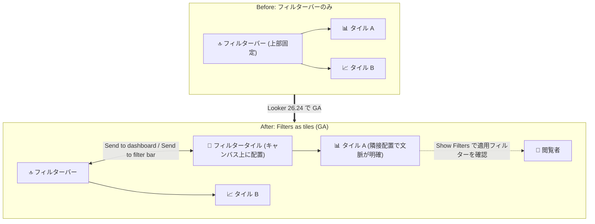

# Looker: 26.24 リリース (Filters as tiles の GA と多数の修正)

**リリース日**: 2026-11-06

**サービス**: Looker

**機能**: Looker 26.24 リリース (Filters as tiles の一般提供開始、多数のバグ修正)

**ステータス**: GA (Filters as tiles 機能)

📊 [このアップデートのインフォグラフィックを見る](https://takech9203.github.io/google-cloud-news-summary/20261106-looker-26-24-release.html)

## 概要

Looker 26.24 のリリースが発表された。Looker (original) インスタンスへのロールアウトは 2026 年 11 月 8 日 (日) に開始され、最終デプロイとダウンロード提供は 2026 年 12 月 8 日 (火) に完了する予定である。Looker (Google Cloud core) 向けの 26.24 ロールアウトは別途アナウンスされる。

本リリースの最大のトピックは、**Filters as tiles (タイルとしてのフィルター) 機能の一般提供 (GA) 開始**である。この機能により、ダッシュボードのフィルターを画面上部のフィルターバーだけでなく、ダッシュボードキャンバス上にタイルとして自由に配置できるようになる。フィルターを関連するビジュアライゼーションタイルの隣に置けるため、ダッシュボードの文脈に沿った直感的なフィルタリング体験を提供できる。

また、本リリースには 35 件以上の修正が含まれており、KPI ビジュアライゼーションのカスタムツールチップ、スケジュール配信、API のエラーハンドリング、アクセシビリティ、Conversational Analytics の System Activity ダッシュボードなど、幅広い領域の品質改善が行われている。

**アップデート前の課題**

- Filters as tiles は Preview 機能であり、本番ダッシュボードでの利用には Pre-GA 提供条件が適用されていた
- KPI ビジュアライゼーションのカスタムツールチップで、値フォーマット設定や配置設定が適用されず、comparison 系の Liquid 変数も保存できなかった
- スケジュール配信で、ファイル名にスペースが含まれると Google Sheets に重複スプレッドシートが作成される、PDF や HTML が破損して配信されるなどの問題があった
- 一部の API エンドポイントが、不正なリクエストに対して HTTP 422/400 ではなく HTTP 500 エラーを返していた
- モデルセットのマッチングでモデル名のアンダースコアがワイルドカード扱いされ、類似名のモデルに紐づく接続へのセルフサービスアクセスが意図せず許可され得た

**アップデート後の改善**

- Filters as tiles が GA となり、フィルターをダッシュボードキャンバス上のタイルとして正式に利用可能になった
- KPI ビジュアライゼーションのツールチップ関連の 4 件の問題が修正され、フォーマット・配置・Liquid 変数が期待通りに動作するようになった
- スケジュール配信の信頼性が向上し、ファイル名の扱い、権限チェック、配信ファイルの破損、DST (夏時間) 変更への追従が改善された
- API のエラーレスポンスが適切なステータスコード (422 / 400) を返すようになり、セキュリティ関連の修正 (モデルセットマッチング、非管理者による他ユーザーの開発プロジェクト削除) も適用された

## アーキテクチャ図

Filters as tiles の GA により、フィルターをフィルターバーとダッシュボードキャンバスの間で相互に移動でき、関連するビジュアライゼーションの隣にフィルターを配置できるようになる。

## サービスアップデートの詳細

### ロールアウトスケジュール

| 項目 | 日程 |
|------|------|
| デプロイ開始 (予定) | 2026 年 11 月 8 日 (日) |
| 最終デプロイ・ダウンロード提供 (予定) | 2026 年 12 月 8 日 (火) |
| Looker (Google Cloud core) | 別途アナウンス |

### 主要機能: Filters as tiles の GA

1. **フィルターのキャンバス配置**
   - ダッシュボードフィルターを上部フィルターバーからダッシュボードキャンバス上のタイルとして配置できる
   - フィルターバーからドラッグするか、フィルターメニューの「Send to dashboard」で移動し、「Send to filter bar」でバーに戻せる
   - フィルタータイルは他のダッシュボードタイルと同様にドラッグして配置を変更できる

2. **配置と適用範囲の独立性**
   - フィルターの配置場所 (フィルターバー / キャンバス) は、どのタイルに適用されるかには影響しない
   - 1 つのフィルターはダッシュボード上に 1 回だけ表示される (複製すると別のフィルター ID を持つ新しいフィルターが作成される)

3. **タイル単位のフィルターコンテキスト表示**
   - 閲覧者はビジュアライゼーションタイルの「Show Filters」アイコンから、そのタイルに適用されているフィルター (Vis Filters / Dashboard Filters / Query Filters) を一覧できる
   - ダッシュボード設定の「Tile filter information」で表示範囲 (Show all / Hide query filters / Do not show) を制御できる

4. **LookML ダッシュボード対応**
   - LookML ダッシュボードでも `elements` セクションでフィルター要素を設定してタイルとして配置できる
   - `filter context` 設定パラメータでタイル上の適用フィルター表示を制御できる

### 修正内容 (テーマ別)

本リリースには 35 件以上の修正が含まれる。主なテーマは以下の通り。

1. **KPI ビジュアライゼーションとツールチップ (4 件)**
   - カスタムツールチップが Value Format / Comparison Value Format 設定や左右中央の配置設定を適用しない問題を修正
   - comparison 系 Liquid 変数 (`comparison_value`、`comparison_rendered_value` など) がツールチップエディタで保存できない問題を修正
   - 長いタイルノートの展開時に KPI 値・比較値・スパークラインと重なる問題を修正 (タイルの半分の範囲内でスクロール表示)

2. **スケジュール配信 (4 件)**
   - ファイル名にスペースを含む場合に Google Sheets で重複スプレッドシートが作成される問題、Google Drive でスペースがアンダースコアに置換される問題を修正
   - スケジュール所有者が Development Mode 有効かつ develop 権限なしの場合に配信が失敗する問題を修正
   - Slack / Google Drive / Cloud Storage / Microsoft Azure / Dropbox への配信で、単一カラムのダッシュボード PDF が破損する問題や Workflow Agent の HTML が未整形で配信される問題を修正
   - スケジュールジョブのトリガーとテーブル計算のタイムゾーン評価が、最近の地域の夏時間 (DST) 変更を反映するように更新

3. **API とセキュリティ (6 件)**
   - `dashboard_filters` エンドポイントへの不正な属性で HTTP 500 ではなく HTTP 422 を返すように修正
   - `GET /auth` の不正な `redirect_uri` で HTTP 500 ではなく HTTP 400 を返すように修正
   - `POST /api/token` で Content-Type ヘッダーなしのリクエストが HTTP 500 になる問題を修正
   - モデルセットマッチングでモデル名のアンダースコアがワイルドカード扱いされ、類似名モデルの接続にセルフサービスアクセスが許可され得る問題を修正
   - 非管理者ユーザーが API 経由で他ユーザーの未デプロイ開発プロジェクトを削除できる問題を修正
   - API を使用する Admin ユーザーのロール更新がエラーで失敗することがある問題を修正

4. **データベース接続と認証 (3 件)**
   - デフォルト認証情報から OAuth 認証への切り替え時に古い設定フィールドが残り接続エラーになる問題を修正 (本アップデート前に OAuth へ切り替えた接続は、Admin > Connections ページで一度再保存して古い PDT オーバーライドをクリアする必要がある)
   - Databricks の OAuth リフレッシュトークンが、Databricks 側でより長い有効期間を設定していてもクライアント側で 7 日で期限切れ扱いされる問題を修正
   - プロジェクトスコープ接続でのビジュアルモデリングキャンバス作成が、高度な接続ガバナンス有効時以外に失敗する問題を修正

5. **チャートとダッシュボード UI (9 件)**
   - Show Percent of Previous の矢印とラベルがバーに重なる問題 (Modern テーマ、カスタム Group Spacing、不均等な日付間隔のカラムチャート) を修正
   - Chart Config Override で作成した Sankey チャートがエラーで失敗する問題を修正
   - Series Positioning を Stacked から Overlay / Grouped に切り替えてもチャート描画が更新されない問題を修正
   - マルチセレクトフィルターのドロップダウンが閉じた直後に再度開く問題、タグリストフィルターが複数選択時に横方向にリサイズされる問題を修正
   - `allowed_values` のない数値パラメータフィルターが tier フィルターと誤分類される問題、データアップロードで XLS ファイルを受け付けないことがある問題、タイルノート内のハイパーリンクツールチップがクリックできない問題などを修正
   - ダッシュボードや Look のお気に入り登録/解除で最終アクセス時刻が更新され Unused Content リストから誤って除外される問題を修正

6. **Conversational Analytics と System Activity (5 件)**
   - System Activity の Conversational Analytics ダッシュボードで、Workflow Agent の実行がダッシュボード会話として誤カウントされる問題、Engagement タブの Agent フィルターがユーザー定義ダッシュボード上のエージェントで結果を返さない問題を修正
   - Top Agents / Agents Not Used in Last 30 Days タイルで Agent ID と併せてエージェント名を表示するように改善
   - ダッシュボードの Agent ID リンクが存在しないページ (HTTP 404) に遷移する問題を修正
   - エージェント編集時に Code Interpreter 設定が上書きされる、アクティブな会話に即時反映されない、インスタンスレベルで無効化しても有効のままになる問題を修正

7. **アクセシビリティと管理機能 (4 件)**
   - スクリーンリーダーが Yes/No フィルターとグループフィルターコントロールのフィルター名/ラベルを読み上げない問題を修正
   - 1 系列あたり 200 以上のデータポイントを持つチャートで、スクリーンリーダーが個々のデータポイントを読み上げない問題を修正
   - SAML / OIDC 設定ページの IdP グループロールマッピングのドロップダウンで、ロールがアルファベット順にソートされ検索可能になった
   - 大規模な Git リポジトリを持つインスタンスでレガシー Marketplace プラグインの更新がタイムアウトする問題を修正

## メリット

### ビジネス面

- **ダッシュボードの UX 向上**: Filters as tiles の GA により、フィルターを関連ビジュアライゼーションの隣に配置した直感的なダッシュボードを、Pre-GA 条件なしで本番利用できる
- **配信の信頼性向上**: Google Sheets / Slack / Cloud Storage などへのスケジュール配信の不具合修正により、定期レポート運用の信頼性が高まる

### 技術面

- **セキュリティの強化**: モデルセットマッチングのワイルドカード問題や、非管理者による他ユーザーの開発プロジェクト削除の修正により、アクセス制御がより厳密になった
- **API の堅牢性向上**: 不正リクエストに対して適切な 4xx ステータスコードを返すようになり、クライアント側のエラーハンドリングが容易になった
- **アクセシビリティ改善**: スクリーンリーダー対応の修正により、支援技術を利用するユーザーのダッシュボード操作性が向上した

## デメリット・制約事項

### 考慮すべき点

- 本アップデート前にデフォルト認証情報から OAuth 認証へ切り替えたデータベース接続は、**Admin > Connections ページで一度再保存**して古い PDT オーバーライドをクリアする必要がある
- ロールアウトは 11 月 8 日から 12 月 8 日にかけて段階的に行われるため、インスタンスへの適用時期には幅がある
- Looker (Google Cloud core) への 26.24 ロールアウトは別途アナウンスされるため、本スケジュールは Looker (original) のみに適用される
- Filters as tiles では 1 つのフィルターはフィルターバーかキャンバスのどちらか一方にのみ存在でき、フィルタータイルを複製すると別 ID の新しいフィルターが作成される点に注意が必要

## ユースケース

### ユースケース 1: セクション別フィルターを持つ運用ダッシュボード

**シナリオ**: 売上セクションと在庫セクションを持つダッシュボードで、各セクションに関係するフィルターをそのセクションの先頭に配置したい。

**効果**: Filters as tiles により、フィルターを対象タイル群の直前に配置でき、閲覧者はどのフィルターがどのビジュアライゼーションに影響するかを直感的に理解できる。閲覧者は「Show Filters」でタイルごとの適用フィルターも確認できる。

### ユースケース 2: 定期レポートの配信運用の安定化

**シナリオ**: ファイル名にスペースを含むレポートを Google Sheets へ定期配信しており、毎回重複スプレッドシートが作成されて運用負荷になっていた。

**効果**: 26.24 への更新により、既存スプレッドシートが正しく上書きされるようになり、重複ファイルの手動削除が不要になる。

## 関連サービス・機能

- **LookML ダッシュボード**: Filters as tiles は LookML ダッシュボードでもサポートされ、`elements` セクションでフィルタータイルを定義できる
- **Conversational Analytics**: System Activity ダッシュボードでのエージェント利用状況の計測・表示が複数修正された
- **Google Sheets / Google Drive / Cloud Storage / Slack / Microsoft Azure / Dropbox**: スケジュール配信先としての連携の不具合が修正された
- **Databricks**: OAuth リフレッシュトークンの有効期間の扱いが修正された

## 参考リンク

- 📊 [インフォグラフィック](https://takech9203.github.io/google-cloud-news-summary/20261106-looker-26-24-release.html)
- [公式リリースノート](https://docs.cloud.google.com/release-notes#November_06_2026)
- [Filters as tiles ドキュメント (ユーザー定義ダッシュボードのフィルター)](https://docs.cloud.google.com/looker/docs/filters-user-defined-dashboards)

## まとめ

Looker 26.24 は、Filters as tiles の GA という UX 面の大きな前進と、配信・API・セキュリティ・アクセシビリティにわたる広範な品質改善を含むリリースである。Looker (original) の管理者は 11 月 8 日からのロールアウトスケジュールを確認し、特に OAuth 認証へ切り替え済みのデータベース接続がある場合は、アップデート後に Admin > Connections ページでの再保存を計画しておくことを推奨する。

---

**タグ**: #Looker #BI #Dashboard #FiltersAsTiles #GA #ReleaseNotes
