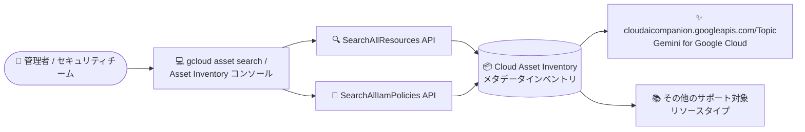

# Cloud Asset Inventory: Gemini for Google Cloud の Topic リソースタイプが検索 API で利用可能に

**リリース日**: 2026-11-08

**サービス**: Cloud Asset Inventory

**機能**: cloudaicompanion.googleapis.com/Topic リソースタイプの検索 API 対応

**ステータス**: Feature (新しい検索可能リソースタイプ)

📊 [このアップデートのインフォグラフィックを見る](https://takech9203.github.io/google-cloud-news-summary/20261108-cloud-asset-inventory-cloudaicompanion-topic.html)

## 概要

Cloud Asset Inventory の検索 API (`SearchAllResources` および `SearchAllIamPolicies`) で、Gemini for Google Cloud (Cloud AI Companion API: `cloudaicompanion.googleapis.com`) の **Topic** リソースタイプ `cloudaicompanion.googleapis.com/Topic` が一般公開 (publicly available) されました。

Cloud Asset Inventory は、Google Cloud のリソースと IAM ポリシーのメタデータを横断的に検索・分析できるインベントリサービスです。今回の対応により、組織・フォルダ・プロジェクトのスコープで Gemini for Google Cloud の Topic リソースを検索 API から発見できるようになり、Topic に付与された IAM 許可ポリシー (`cloudaicompanion.topicAdmin` や `cloudaicompanion.topicReader` などのロールバインディング) も `SearchAllIamPolicies` で棚卸しできるようになります。

Gemini for Google Cloud の利用が組織内で拡大する中、クラウド管理者やセキュリティチームが「どのプロジェクトにどんな Gemini 関連リソースが存在し、誰がアクセスできるのか」を統一的なインターフェースで可視化できる点が本アップデートの価値です。

**アップデート前の課題**

- `cloudaicompanion.googleapis.com/Topic` リソースは Cloud Asset Inventory の検索 API の対象外であり、組織横断でこのリソースの存在を把握するには個別のプロジェクト・API を直接確認する必要があった
- Topic リソースに付与された IAM ポリシーを組織全体で棚卸しする統一的な手段がなかった

**アップデート後の改善**

- `gcloud asset search-all-resources` や Asset Inventory コンソールから、組織・フォルダ・プロジェクトのスコープで Topic リソースを横断検索できるようになった
- `gcloud asset search-all-iam-policies` で、Topic リソースに付与された IAM 許可ポリシー (プリンシパル、ロール) を検索・監査できるようになった

## アーキテクチャ図



Cloud Asset Inventory の 2 つの検索 API から、新たに Gemini for Google Cloud の Topic リソースとその IAM ポリシーを横断検索できるようになった構成を示しています。

## サービスアップデートの詳細

### 主要機能

1. **SearchAllResources での Topic リソース検索**
   - `cloudaicompanion.googleapis.com/Topic` を指定スコープ (プロジェクト / フォルダ / 組織) 内で検索可能
   - `--asset-types` フラグでこのリソースタイプに絞り込んだ検索が可能

2. **SearchAllIamPolicies での IAM ポリシー検索**
   - Topic リソースに直接付与された IAM 許可ポリシーを検索可能
   - Gemini for Google Cloud には Topic 向けの IAM ロール (`roles/cloudaicompanion.topicAdmin`、`roles/cloudaicompanion.topicReader`) が定義されており、これらのバインディング状況を監査できる

## 技術仕様

### 検索 API の概要

| 項目 | 詳細 |
|------|------|
| 対象リソースタイプ | `cloudaicompanion.googleapis.com/Topic` |
| 対象 API | `SearchAllResources`、`SearchAllIamPolicies` |
| 検索スコープ | プロジェクト、フォルダ、組織 |
| 必要な権限 (リソース検索) | `cloudasset.assets.searchAllResources` |
| 必要な権限 (IAM ポリシー検索) | `cloudasset.assets.searchAllIamPolicies` |
| 前提条件 | 検索を実行するプロジェクトで Cloud Asset Inventory API (`cloudasset.googleapis.com`) を有効化 |

### 検索コマンド例

```bash
# 組織内の Gemini for Google Cloud Topic リソースを検索
gcloud asset search-all-resources \
  --scope=organizations/ORGANIZATION_ID \
  --asset-types=cloudaicompanion.googleapis.com/Topic

# Topic リソースに付与された IAM 許可ポリシーを検索
gcloud asset search-all-iam-policies \
  --scope=organizations/ORGANIZATION_ID \
  --asset-types=cloudaicompanion.googleapis.com/Topic
```

## メリット

### ビジネス面

- **ガバナンスの強化**: 組織内で利用が広がる Gemini for Google Cloud 関連リソースを一元的に把握でき、シャドー利用の発見やコンプライアンス対応に役立つ
- **監査の効率化**: Topic リソースへのアクセス権限 (誰がどのロールを持つか) を 1 つのクエリで棚卸しできる

### 技術面

- **統一インターフェース**: 他の Google Cloud リソースと同じ検索 API・クエリ構文・コンソール UI で扱える
- **自動化への組み込み**: 既存の Cloud Asset Inventory ベースの棚卸しスクリプトや監査パイプラインに、資産タイプを追加するだけで対応できる

## デメリット・制約事項

### 考慮すべき点

- 検索 API はメタデータのインデックスを対象とするため、リソースの変更が検索結果に反映されるまでにタイムラグが生じる場合がある
- 検索可能な属性はリソースタイプごとに異なるため、詳細は公式ドキュメントのサポート対象アセットタイプ一覧で確認が必要

## ユースケース

### ユースケース 1: 組織全体での Gemini 関連リソースの棚卸し

**シナリオ**: セキュリティチームが、組織内のどのプロジェクトで Gemini for Google Cloud の Topic リソースが作成されているかを定期的に把握したい。

**実装例**:
```bash
gcloud asset search-all-resources \
  --scope=organizations/ORGANIZATION_ID \
  --asset-types=cloudaicompanion.googleapis.com/Topic \
  --format="table(name, project, location)"
```

**効果**: プロジェクトを個別に調べることなく、組織全体の Topic リソースを一覧化できる。

### ユースケース 2: Topic リソースへのアクセス権限の監査

**シナリオ**: 監査担当者が、Topic リソースに対して管理者権限 (`roles/cloudaicompanion.topicAdmin`) を持つプリンシパルを確認したい。

**効果**: `SearchAllIamPolicies` にロールを条件として指定することで、過剰な権限付与を早期に検出できる。

## 料金

Cloud Asset Inventory の検索 API 利用に関する料金の詳細は、公式ドキュメントを参照してください。

- [Cloud Asset Inventory の概要](https://docs.cloud.google.com/asset-inventory/docs/overview)

## 関連サービス・機能

- **Gemini for Google Cloud (Cloud AI Companion API)**: 今回検索対象に追加された Topic リソースを提供するサービス。`cloudaicompanion.googleapis.com` エンドポイントで提供される
- **IAM**: Topic リソース向けのロール (`roles/cloudaicompanion.topicAdmin`、`roles/cloudaicompanion.topicReader`) のバインディングが `SearchAllIamPolicies` の検索対象となる
- **Security Command Center**: Cloud Asset Inventory のデータを活用した資産の可視化・セキュリティ監視と補完関係にある

## 参考リンク

- 📊 [インフォグラフィック](https://takech9203.github.io/google-cloud-news-summary/20261108-cloud-asset-inventory-cloudaicompanion-topic.html)
- [公式リリースノート](https://docs.cloud.google.com/release-notes#November_08_2026)
- [SearchAllResources API リファレンス](https://docs.cloud.google.com/asset-inventory/docs/reference/rest/v1/TopLevel/searchAllResources)
- [SearchAllIamPolicies API リファレンス](https://docs.cloud.google.com/asset-inventory/docs/reference/rest/v1/TopLevel/searchAllIamPolicies)
- [サポートされているアセットタイプ](https://docs.cloud.google.com/asset-inventory/docs/asset-types)
- [リソースの検索ガイド](https://docs.cloud.google.com/asset-inventory/docs/search-resources)
- [IAM 許可ポリシーの検索ガイド](https://docs.cloud.google.com/asset-inventory/docs/search-allow-policies)

## まとめ

Gemini for Google Cloud の Topic リソースが Cloud Asset Inventory の検索 API に対応したことで、組織横断でのリソース把握と IAM 権限監査が容易になりました。Gemini for Google Cloud を利用している組織では、既存の資産棚卸し・監査プロセスの対象アセットタイプに `cloudaicompanion.googleapis.com/Topic` を追加することを推奨します。

---

**タグ**: #CloudAssetInventory #GeminiForGoogleCloud #IAM #ガバナンス #セキュリティ監査
