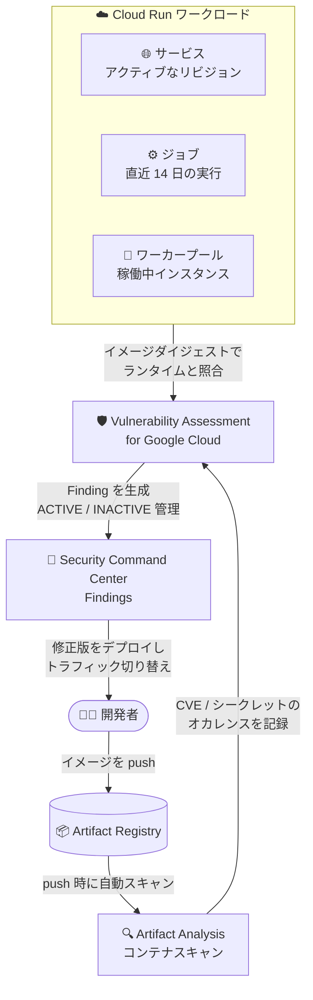

# Cloud Run: Vulnerability Assessment for Cloud Run (Preview)

**リリース日**: 2026-11-08

**サービス**: Cloud Run

**機能**: Vulnerability Assessment for Cloud Run による脆弱性・漏えいシークレット検出

**ステータス**: Feature, Preview

📊 [このアップデートのインフォグラフィックを見る](https://takech9203.github.io/google-cloud-news-summary/20261108-cloud-run-vulnerability-assessment-preview.html)

## 概要

Cloud Run のサービス、ジョブ、ワーカープールのコンテナイメージに含まれる脆弱性 (CVE) と漏えいシークレットを検出する「Vulnerability Assessment for Cloud Run」が Preview として発表されました。Security Command Center の Vulnerability Assessment for Google Cloud の一部として提供され、実行中の Cloud Run ワークロードに対して継続的にソフトウェア脆弱性と露出したシークレットを検出します。

この機能は、Artifact Registry に保存されたイメージをスキャンする Artifact Analysis のコンテナスキャンと、そのスキャン結果 (オカレンス) を実行中の Cloud Run リソースと関連付ける Vulnerability Assessment for Google Cloud の 2 つが連携して動作します。従来の静的なコンテナイメージスキャンが Artifact Registry 上のイメージに対して結果を報告するのに対し、本機能は検出結果 (Finding) を「実行中の Cloud Run ワークロード」に直接ひも付けて表示する点が特徴です。

対象ユーザーは、Cloud Run 上で本番ワークロードを運用し、Security Command Center でクラウド全体のセキュリティリスクを一元管理したい組織のセキュリティチームや SRE / プラットフォームチームです。

**アップデート前の課題**

- コンテナイメージの脆弱性スキャン結果は Artifact Registry 上のイメージ単位で報告され、どの実行中の Cloud Run サービス・リビジョンが脆弱なイメージを使っているかを運用者が手動で突き合わせる必要があった
- Cloud Run のジョブやワーカープールを含めたランタイムリソース単位での脆弱性の可視化が、Cloud Run 向け機能としては提供されていなかった
- 脆弱なリビジョンから修正済みリビジョンへトラフィックを切り替えた後も、検出結果のライフサイクル (クローズ判定) を手動で管理する必要があった

**アップデート後の改善**

- 検出結果が実行中の Cloud Run サービス (`run.googleapis.com/Service`)、ジョブ (`run.googleapis.com/Job`)、ワーカープール (`run.googleapis.com/WorkerPool`) に直接ひも付き、影響を受けるコンテナ名、イメージダイジェスト、アクティブなリビジョンの URI まで確認できるようになった
- CVE に加えて、コンテナイメージ内の漏えいシークレット (exposed secrets) も検出対象になった
- 修正済みリビジョンをデプロイしてトラフィック/インスタンスを切り替えると、脆弱なイメージを参照するアクティブなリビジョンがなくなった時点で検出結果が自動的に `INACTIVE` に遷移し、ライフサイクル管理が自動化された

## アーキテクチャ図



Artifact Analysis が Artifact Registry 内のイメージをスキャンし、Vulnerability Assessment for Google Cloud がその結果を実行中の Cloud Run リソースと照合して Security Command Center に Finding を生成する流れを示しています。

## サービスアップデートの詳細

### 主要機能

1. **ランタイムメタデータとの相関付け**
   - コンテナイメージのダイジェストを、アクティブな Cloud Run サービス・ジョブ・ワーカープールと照合
   - 静的スキャンと異なり、検出結果を「実行中のワークロード」に直接ひも付けて報告

2. **リビジョンとサイドカーの特定**
   - トラフィックを処理している、またはインスタンスを実行しているアクティブなリビジョンを特定
   - 脆弱性やシークレットを含むコンテナ (マルチコンテナ構成のサイドカーを含む) を識別

3. **Finding ライフサイクルの自動管理**
   - アクティブなリビジョンまたは実行されたジョブが脆弱なイメージを参照している間は Finding を `ACTIVE` に維持
   - 修正済みリビジョンをデプロイし、トラフィック/インスタンスを脆弱なリビジョンから移すと自動的に `INACTIVE` に遷移

4. **漏えいシークレットの検出**
   - CVE だけでなく、コンテナイメージのファイルシステムなどに含まれる露出したシークレットも検出対象

## 技術仕様

### 対象リソースと評価方法

| リソース | リソースタイプ | 評価方法 |
|------|------|------|
| Cloud Run サービス | `run.googleapis.com/Service` | トラフィックを処理するアクティブなリビジョンを監視。Finding には脆弱なイメージを実行中のアクティブリビジョンを最大 5 件表示 |
| Cloud Run ジョブ | `run.googleapis.com/Job` | 過去 14 日以内に正常に開始された最新の実行で使用されたイメージを評価。一度も実行されていない、または初期化に失敗したジョブは対象外 |
| Cloud Run ワーカープール | `run.googleapis.com/WorkerPool` | インスタンスを実行中のアクティブなリビジョンを監視。脆弱なイメージを実行するすべてのアクティブリビジョンを表示 |

### スキャン頻度と検出対象の重大度 (Security Command Center のサービスティア別)

| 項目 | Standard ティア | Premium / Enterprise ティア |
|------|------|------|
| スキャン頻度 | 週 1 回 | 約 12 時間ごと |
| 生成される Finding の重大度 | Critical | Critical および High |

## 設定方法

### 前提条件

1. Artifact Registry リポジトリをホストするプロジェクトで Container Scanning API (`containerscanning.googleapis.com`) を有効化する (同時に Artifact Analysis API `containeranalysis.googleapis.com` も有効になる)
2. 組織またはプロジェクトで Security Command Center を有効化する (Premium / Enterprise ティアでは Vulnerability Assessment for Google Cloud がデフォルトで有効。Standard ティアでは組織・フォルダ・プロジェクトレベルで手動有効化が必要)
3. コンテナイメージを、Cloud Run ワークロードと同じ Google Cloud 組織内の Artifact Registry リポジトリに保存する (外部組織のイメージはスキャン対象外。ただし検証済みの公開 Google コンテナミラーは例外)
4. API の有効化には `serviceusage.services.enable` 権限 (`roles/owner` または `roles/serviceusage.serviceUsageAdmin` など) が必要

### 手順

#### ステップ 1: Container Scanning API を有効化

```bash
gcloud services enable containerscanning.googleapis.com \
  --project=IMAGE_HOSTING_PROJECT_ID
```

Artifact Registry リポジトリをホストするプロジェクトで有効化します。これを有効にしないと、Vulnerability Assessment for Google Cloud は Cloud Run リソースに対する脆弱性・シークレットの Finding を生成できません。

#### ステップ 2: Finding の確認

1. Google Cloud コンソールで Security Command Center の「Findings」ページに移動
2. プロジェクトセレクタで組織・フォルダ・プロジェクトを選択
3. クイックフィルタの「Resource type」で `run.googleapis.com/Service`、`run.googleapis.com/Job`、`run.googleapis.com/WorkerPool` を選択
4. Finding をクリックして、影響を受けるコンテナ名、イメージダイジェスト、アクティブなリビジョンの URI などの詳細を確認

#### ステップ 3: 修復 (Remediation)

```bash
# 修正済みイメージをビルドして push
gcloud builds submit --tag REGION-docker.pkg.dev/PROJECT_ID/REPO/IMAGE:patched

# 新しいリビジョンをデプロイ
gcloud run deploy SERVICE_NAME \
  --image=REGION-docker.pkg.dev/PROJECT_ID/REPO/IMAGE:patched \
  --region=REGION
```

依存関係やベースイメージを修正版に更新 (またはシークレットをイメージのファイルシステム、Dockerfile、ソースコードから除去) し、新しいリビジョンをデプロイします。トラフィック分割を使用している場合は、すべてのトラフィック/インスタンスを修正済みリビジョンに割り当てると、Finding が自動的に `INACTIVE` になります。

## メリット

### ビジネス面

- **リスクの一元可視化**: Cloud Run の脆弱性を Security Command Center 上で他のクラウドリスクと並べて一元管理でき、セキュリティ態勢の把握が容易になる
- **対応の優先順位付け**: 「レジストリ内のイメージ」ではなく「実際に稼働中のワークロード」に対する Finding のため、本当に修正すべき対象から優先的に対応できる

### 技術面

- **手動の突き合わせが不要**: イメージダイジェストとランタイムリソースの相関付けが自動化され、どのサービス・リビジョン・サイドカーが影響を受けるかを即座に特定できる
- **修復完了の自動判定**: 修正済みリビジョンへの切り替えで Finding が自動的に `INACTIVE` へ遷移し、クローズ漏れや手動運用を削減できる
- **シークレット検出の追加**: CVE だけでなくイメージ内に混入したシークレットも検出でき、サプライチェーンリスクを低減できる

## デメリット・制約事項

### 制限事項

- Preview 段階であり、Pre-GA Offerings Terms の対象。サポートが限定される可能性がある
- サービスまたはワーカープールが、イメージの pull・新リビジョンのデプロイ・インスタンスのコールドスタートのいずれもなく 30 日以上稼働し続けると、Artifact Analysis は新しい CVE のスキャンを一時停止する (既存の `ACTIVE` な Finding は維持される)
- Finding は Artifact Analysis がイメージをスキャンまたは再分析したときにのみ生成される。過去に push 済みのイメージをデプロイしてもスキャンはトリガーされず、次回の再分析 (約 4 時間以内) 後に Finding が表示される
- Cloud Run ワークロードと同じ組織内の Artifact Registry に保存されたイメージのみが対象 (検証済み公開 Google コンテナミラーを除く)
- ジョブは過去 14 日以内に正常に開始された実行があるものだけが評価対象

### 考慮すべき点

- Security Command Center の有効化が前提であり、ティア (Standard / Premium / Enterprise) によってスキャン頻度と報告される重大度が異なる
- イメージをホストするプロジェクト側で Container Scanning API を有効化する必要があるため、イメージ管理プロジェクトとワークロードプロジェクトが分かれている組織では有効化対象の確認が必要

## ユースケース

### ユースケース 1: 本番 Cloud Run サービスの継続的な脆弱性監視

**シナリオ**: 複数チームが多数の Cloud Run サービスを運用しており、新しい CVE が公開された際に影響を受ける本番サービスを迅速に特定したい。

**効果**: Security Command Center の Findings をリソースタイプ `run.googleapis.com/Service` でフィルタするだけで、脆弱なイメージを実行中のサービスとアクティブリビジョンを即座に特定でき、修正版デプロイとトラフィック切り替えで Finding が自動クローズされる。

### ユースケース 2: バッチジョブ・ワーカープールを含めた全ワークロードのシークレット混入チェック

**シナリオ**: CI/CD パイプラインで誤って API キーなどのシークレットがコンテナイメージに焼き込まれるリスクを、サービスだけでなくジョブやワーカープールも含めて検出したい。

**効果**: Cloud Run の 3 種類のリソースすべてで漏えいシークレットの Finding が生成されるため、イメージからのシークレット除去と再デプロイという修復フローを全ワークロードに統一的に適用できる。

## 料金

本機能は Security Command Center の Vulnerability Assessment for Google Cloud として提供され、Security Command Center のサービスティア (Standard / Premium / Enterprise) に依存します。また、前提となる Artifact Analysis のコンテナスキャンには別途料金が発生します。詳細は以下の公式料金ページを参照してください。

- [Security Command Center の料金](https://cloud.google.com/security-command-center/pricing)
- [Artifact Analysis の料金](https://cloud.google.com/artifact-analysis/pricing)

## 関連サービス・機能

- **Security Command Center**: Finding の表示・管理基盤。Vulnerability Assessment for Google Cloud は SCC の検出サービスの 1 つ
- **Artifact Analysis / Artifact Registry**: イメージ push 時の自動スキャンで CVE・シークレットのオカレンスを生成する前提コンポーネント
- **Cloud Run Threat Detection**: 実行中の Cloud Run ワークロードに対するランタイム脅威検出。本機能 (イメージの脆弱性評価) と補完関係にある
- **Binary Authorization**: Artifact Analysis の脆弱性情報に基づき、既知の問題を持つイメージのデプロイを事前にブロックする仕組みとして組み合わせ可能

## 参考リンク

- 📊 [インフォグラフィック](https://takech9203.github.io/google-cloud-news-summary/20261108-cloud-run-vulnerability-assessment-preview.html)
- [公式リリースノート](https://docs.cloud.google.com/release-notes#November_08_2026)
- [ドキュメント: Assess vulnerabilities for Cloud Run](https://docs.cloud.google.com/run/docs/securing/cloud-run-vulnerability-scanning)
- [Vulnerability Assessment for Google Cloud](https://docs.cloud.google.com/security-command-center/docs/vulnerability-assessment-google-cloud)
- [Artifact Analysis コンテナスキャンの概要](https://docs.cloud.google.com/artifact-analysis/docs/container-scanning-overview)
- [Security Command Center の料金](https://cloud.google.com/security-command-center/pricing)

## まとめ

Vulnerability Assessment for Cloud Run (Preview) により、Cloud Run のサービス・ジョブ・ワーカープールという実行中のワークロード単位で脆弱性と漏えいシークレットを継続的に検出し、修復完了まで自動でライフサイクル管理できるようになりました。Cloud Run を本番運用している組織は、イメージホスティングプロジェクトでの Container Scanning API の有効化と Security Command Center のティア設定を確認し、まずは非本番環境で Finding の検出・修復フローを試すことを推奨します。

---

**タグ**: Cloud Run, Security Command Center, Artifact Analysis, Artifact Registry, 脆弱性スキャン, シークレット検出, セキュリティ, Preview
