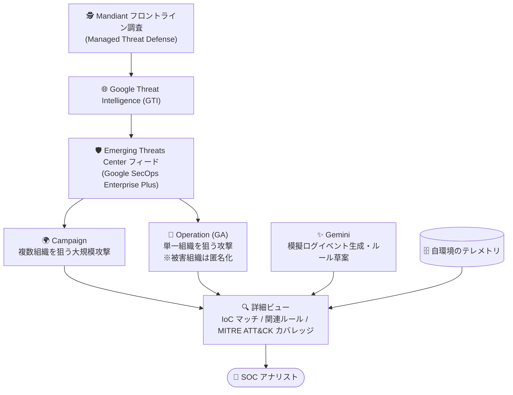

# Google SecOps: Emerging Threats Center の Operations 機能が GA

**リリース日**: 2026-11-08

**サービス**: Google SecOps (Google Security Operations)

**機能**: Emerging Threats Center の Operations 機能の一般提供 (GA)

**ステータス**: Feature, GA

📊 [このアップデートのインフォグラフィックを見る](https://takech9203.github.io/google-cloud-news-summary/20261108-google-secops-emerging-threats-center-operations-ga.html)

## 概要

Google SecOps の Emerging Threats Center フィードにおける **Operations 機能が一般提供 (GA)** となりました。Emerging Threats Center は、Google Threat Intelligence (GTI) と Gemini モデルを活用した AI 駆動の脅威インテリジェンス機能で、進行中・新興の脅威キャンペーンや Operations が自組織にどのような影響を与えるかを把握できます。Applied Threat Intelligence (ATI) を基盤として構築されており、IoC、検知マッチ、影響を受けるエンティティを含む、最も重要なグローバル脅威のキュレーションされたビューを提供します。

Operations は、グローバルな「Campaign (複数組織を標的とする大規模な協調攻撃)」を補完する概念で、**単一の組織を標的とした、より焦点を絞った攻撃**を追跡します。Mandiant Threat Defense チームによる調査など、最前線のインシデント対応 (フロントライン調査) から得られた知見に基づいており、実在の被害組織が関係するため、組織の身元を秘匿するプライバシー保護が組み込まれています。それでいて、パーソナライズされた脅威の手がかりと局所的な防御戦略を利用者に提供します。

本機能は 2026 年 8 月 24 日にスポットライト機能として発表され、今回 GA に昇格しました。SOC アナリスト、脅威ハンター、Detection Engineer が、グローバルなキャンペーン情報だけでは見えにくい「単一組織を狙う標的型の脅威活動」を迅速に可視化し、自環境の検知カバレッジ検証に活用できます。なお、Emerging Threats Center は **Google SecOps Enterprise Plus ライセンス**でのみ利用可能です。

**アップデート前の課題**

- Operations 機能は GA 前の段階 (2026 年 8 月 24 日発表) であり、本番運用での利用を前提とした一般提供ステータスではなかった
- Emerging Threats Center で追跡できる脅威コレクションはグローバルな Campaign が中心で、単一組織を標的とするミッション単位の脅威活動に対する粒度の細かいインテリジェンスの把握には、脅威レポートを手動で読み解く必要があった
- Mandiant のフロントライン調査 (Managed Threat Defense エンゲージメントなど) から得られる局所的な攻撃ベクトルの知見を、自環境の検知カバレッジと紐付けて確認する標準的な手段が限られていた

**アップデート後の改善**

- Operations 機能が GA となり、一般提供ステータスで本番の脅威調査ワークフローに組み込めるようになった
- **Focused threat insights**: 個別のミッションに固有の、局所的な攻撃者の活動やパーソナライズされた攻撃ベクトルに焦点を絞った分析が可能になった
- **Holistic threat mapping**: Operations をグローバルな Campaign と並べて表示し、攻撃者の TTP (戦術・技術・手順) の全体像を把握できるようになった
- フィードのフィルタ (Object types) で Campaign / Operation / Report を調査目的に応じて切り替えて表示できる

## アーキテクチャ図

GTI の脅威インテリジェンス (Mandiant のフロントライン調査由来の Operations を含む) が Emerging Threats Center フィードに反映され、自環境のテレメトリと突合した IoC マッチや検知ルールカバレッジを詳細ビューでアナリストに提示する流れを示しています。

## サービスアップデートの詳細

### 主要機能

1. **Operations の一般提供 (GA)**
   - 単一組織を標的とした脅威活動の詳細を迅速に可視化
   - Mandiant Threat Defense (MTD) エンゲージメントなどのフロントライン調査から導出された粒度の細かい脅威インテリジェンスを提供
   - 実在の被害組織が関係するため、組織の身元を秘匿するプライバシー保護が組み込まれている

2. **Focused threat insights (焦点を絞った脅威インサイト)**
   - 個別ミッションに固有の、局所的な攻撃者の活動とパーソナライズされた攻撃ベクトルにズームイン
   - 生の脅威レポートを手動で読み解く代わりに、エンリッチされたコンテキスト付きの結果を取得

3. **Holistic threat mapping (包括的な脅威マッピング)**
   - Operations をグローバルな Campaign と並べて表示し、攻撃者の TTP の全体像を把握
   - フィードのフィルタ「Object types」で Campaign / Operation / Report を調査目的に応じて切り替え可能

4. **自環境データとの自動相関**
   - IoC バッジ: Operation に含まれる IoC が自環境のデータとマッチするかをカード上に表示
   - Rules バッジ: Operation に関連付けられた検知ルールのうち、自環境で有効化されている数を表示 (例: 「1/2 rules」)
   - 詳細ビューでは Associated Rules / Disabled Rules / Recent Associated Entities / IOCs の各パネルを提供

## 技術仕様

### Emerging Threats Center の主要コンポーネント

| 項目 | 詳細 |
|------|------|
| 必要ライセンス | Google SecOps Enterprise Plus |
| 基盤技術 | Applied Threat Intelligence (ATI)、Google Threat Intelligence (GTI)、Gemini モデル |
| Campaign | 複数の組織・業界・地域を標的とする、脅威アクターによる大規模な協調攻撃 |
| Operation | 単一組織に対する焦点を絞った攻撃。フロントライン調査由来。被害組織の匿名化保護付き |
| フィード表示対象 | 過去 1 年以内に更新された脅威コレクションのみ (GTI 作成のレポートに限定、クラウドソースレポートは含まない) |
| フィルタ項目 | 関連マルウェア、関連ツール、ソースリージョン、標的業界、標的リージョン、関連脅威アクター、IoC マッチ有無、オブジェクトタイプ (Campaign / Operation / Report) |
| カバレッジ分析 | EDR (Endpoint Detection and Response) データソースのみに適用 |

### 検知カバレッジの自動分析フロー

Emerging Threats Center は、GTI からのインテリジェンス取り込みと自組織のテレメトリとの整合を自動化しています。

1. **インテリジェンスの取り込み**: グローバルリサーチ、Mandiant インシデント対応、Mandiant Managed Defense テレメトリを含む Campaign / Operation インテリジェンスを GTI から自動収集
2. **模擬ログイベントの生成**: Gemini がバックグラウンドで、実際の攻撃者の挙動を模した高精度かつ匿名化された模擬ログイベントを生成
3. **検知カバレッジの自動ハイライト**: 模擬ログイベントを Google Cloud Threat Intelligence (GCTI) のキュレーション済み検知ルールに対して実行し、検知が存在する箇所とギャップをレポート
4. **ルール作成の加速**: ギャップが特定されると、Gemini がテスト済みパターンに基づき新しい検知ルールの草案とロジックの要約を自動作成。本番反映前に人間によるレビューと承認が必須

## 設定方法

### 前提条件

1. Google SecOps Enterprise Plus ライセンス
2. Emerging Threats ページへのアクセスに必要な IAM 権限 (threatCollections、iocAssociations に関する権限。詳細は [Feature RBAC permissions](https://docs.cloud.google.com/chronicle/docs/reference/feature-rbac-permissions-roles#emergingThreatsPermissions) を参照)

### 手順

#### ステップ 1: Emerging Threats Center フィードで Operations を表示

1. Google SecOps で Emerging Threats Center フィードを開く
2. 「Filter」をクリックし、フィルタカテゴリで「Object types」を選択して Operations に絞り込む
3. 「Has IoC matches」フィルタを併用すると、自環境の IoC マッチがある Operations のみを表示できる

#### ステップ 2: Operation の詳細を分析

1. 脅威カードの IoC バッジと Rules バッジで、自環境への影響と検知ルールの有効化状況を確認する
2. カードを選択して詳細ビューを開き、Associated Rules / Disabled Rules / Recent Associated Entities / IOCs の各パネルを展開する
3. MITRE ATT&CK マトリクスで TTP ごとの検知カバレッジを確認し、ギャップがあれば Gemini が作成したルール草案をレビュー・承認する

## メリット

### ビジネス面

- **本番運用への適用**: GA への昇格により、一般提供ステータスの機能として本番の SOC 運用ワークフローに組み込める
- **運用負荷の削減**: 脅威レポートから検知機会を手動で読み解く作業が減り、すぐに使える検知生成により運用オーバーヘッドを削減
- **プライバシーへの配慮**: 実被害組織由来のインテリジェンスでありながら、組織の身元は匿名化されたうえで活用できる

### 技術面

- **局所的脅威の可視化**: グローバルな Campaign では捉えにくい、単一組織を狙うミッション単位の攻撃活動を把握できる
- **検知検証の高速化**: 自動化されたプロセスにより、Operations に対する検知カバレッジの検証とレビューを少ない手作業で実施できる
- **継続的な脅威可視性**: GTI の Campaign / Operation データがワークスペースに継続的に反映され、脅威の進展を常に把握できる

## デメリット・制約事項

### 制限事項

- Emerging Threats Center は Google SecOps Enterprise Plus ライセンスでのみ利用可能
- フィードに表示されるのは過去 1 年以内に更新された脅威コレクションのみ
- フィードに表示されるレポートは GTI が作成したものに限定され、GTI 本体で閲覧できるクラウドソースレポートは含まれない
- 検知カバレッジ分析 (MITRE ATT&CK マトリクス) は EDR データソースのみに適用される

### 考慮すべき点

- Gemini が草案した検知ルールは、本番反映前に人間によるレビューと承認が必須
- Emerging Threats ページへのアクセスには専用の IAM 権限 (threatCollections、iocAssociations) の構成が必要

## ユースケース

### ユースケース 1: 標的型攻撃の早期検知と影響評価

**シナリオ**: SOC チームが、自社と同業種の組織を狙った標的型攻撃の報告を受け、自環境への影響を迅速に評価したい。

**実装例**: Emerging Threats Center フィードで Object types フィルタを Operations に設定し、「Has IoC matches」「Targeted industries」フィルタを併用して自社業種に関連する Operations を抽出。IoC バッジで自環境とのマッチを確認し、詳細ビューの IOCs パネルと Recent Associated Entities パネルで影響範囲を特定する。

**効果**: 生の脅威レポートを手動調査することなく、自環境に関連する標的型脅威活動とその影響を迅速に把握できる。

### ユースケース 2: Operations を起点とした検知ギャップの解消

**シナリオ**: Detection Engineer が、フロントライン調査由来の最新の攻撃手法に対する自環境の検知カバレッジを検証し、ギャップを埋めたい。

**効果**: 詳細ビューの MITRE ATT&CK マトリクスで TTP ごとのカバレッジを確認し、Disabled Rules パネルで無効化されたルールを特定。ギャップに対しては Gemini が自動作成したルール草案をレビュー・承認することで、検知ルール整備のリードタイムを短縮できる。

## 料金

Emerging Threats Center は Google SecOps Enterprise Plus ライセンスに含まれる機能であり、個別の追加料金に関する公式情報は確認できませんでした。ライセンス体系の詳細は [Google SecOps の製品ページ](https://cloud.google.com/security/products/security-operations) を参照してください。

## 関連サービス・機能

- **Google Threat Intelligence (GTI)**: Emerging Threats Center の脅威インテリジェンス供給元。Campaign / Operation / Report データと脅威アクター・マルウェアファミリーの関連情報を提供
- **Mandiant Threat Defense / Managed Defense**: Operations の主要な情報源となるフロントライン調査・マネージド検知対応サービス
- **Applied Threat Intelligence (ATI)**: Emerging Threats Center の基盤となる、Google SecOps の脅威インテリジェンス適用機能
- **Gemini in Google SecOps**: 模擬ログイベントの生成、検知カバレッジ分析、検知ルール草案の自動作成を担う生成 AI 機能
- **GCTI キュレーション済み検知ルール**: 模擬ログイベントの実行対象となる、Google Cloud Threat Intelligence 提供の検知ルールセット

## 参考リンク

- 📊 [インフォグラフィック](https://takech9203.github.io/google-cloud-news-summary/20261108-google-secops-emerging-threats-center-operations-ga.html)
- [公式リリースノート (Google Cloud)](https://docs.cloud.google.com/release-notes#November_08_2026)
- [Google SecOps リリースノート (2026-08-24 の初回発表)](https://docs.cloud.google.com/chronicle/docs/secops/release-notes#August_24_2026)
- [ドキュメント: Emerging Threats Center overview](https://docs.cloud.google.com/chronicle/docs/detection/emerging-threats)
- [ドキュメント: Emerging Threats Center detail view](https://docs.cloud.google.com/chronicle/docs/detection/emerging-threats-detailed-view)
- [Google SecOps 製品ページ](https://cloud.google.com/security/products/security-operations)

## まとめ

Emerging Threats Center の Operations 機能が GA となり、単一組織を標的とするフロントライン調査由来の脅威インテリジェンスを、一般提供ステータスの機能として本番の SOC ワークフローで活用できるようになりました。Google SecOps Enterprise Plus を利用している組織は、Object types フィルタで Operations を表示し、IoC マッチと検知ルールカバレッジの確認から始めることを推奨します。検知ギャップが見つかった場合は、Gemini によるルール草案のレビュー・承認フローを整備するとよいでしょう。

---

**タグ**: Google SecOps, Google Security Operations, Emerging Threats Center, Operations, Google Threat Intelligence, Mandiant, 脅威インテリジェンス, GA, セキュリティ
