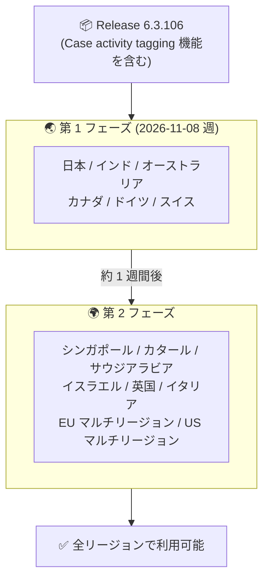

# Google SecOps SOAR: Release 6.3.106 第 1 フェーズリージョンへのロールアウト開始

**リリース日**: 2026-11-08

**サービス**: Google SecOps SOAR

**機能**: Release 6.3.106 (Case activity tagging 機能を含む)

**ステータス**: Announcement + Feature (段階的ロールアウト: 第 1 フェーズ)

📊 [このアップデートのインフォグラフィックを見る](https://takech9203.github.io/google-cloud-news-summary/20261108-google-secops-soar-6-3-106-rollout.html)

## 概要

Google SecOps SOAR の Release 6.3.106 が、段階的リリース (gradual release) の第 1 フェーズ対象リージョンへのロールアウトを開始しました。本リリースには、**Case Wall のアクティビティ単位のカスタムタグ付けとフィルタリング (Case activity tagging)** 機能が含まれます。

Google SecOps SOAR のリリースは 2 段階のロールアウトモデルに従って展開されます。アップデートは毎週日曜日のメンテナンスウィンドウ (13:00〜17:00 GMT+2) 中に適用され、第 2 段階のリージョンは第 1 段階のリージョンの 1 週間後にアップグレードされます。このモデルは、Google SecOps SOAR をスタンドアロンプラットフォームとして使用する顧客と、Google SecOps 内の SOAR コンポーネントを使用する顧客の両方に適用されます。

なお、前日の 2026-11-07 には前バージョンの Release 6.3.105 が全リージョンで利用可能になったことが発表されており、週次の段階的リリースサイクルが継続的に運用されていることが確認できます。

## アーキテクチャ図

Google SecOps SOAR の 2 段階ロールアウトモデルの流れを示しています。Release 6.3.106 は現在第 1 フェーズのリージョンに展開中で、第 2 フェーズのリージョンには約 1 週間後に展開されます。

## サービスアップデートの詳細

### 主要内容

1. **Case activity tagging (Case Wall アクティビティのタグ付け)**
   - Case Wall 上の個別のアクティビティ、コメント、タスク、アクションにカスタムタグを付与できる
   - 付与したタグで Case Wall の表示をフィルタリングし、調査やチームに関連するエントリだけを表示できる
   - タグは自由形式の文字列 (free-form string) で、ケース単位の Case tags やアラート単位の Alert tags (グローバルタグ) とは独立した仕組み
   - 本機能の詳細な解説 (Before/After、タグ種類の比較、設定手順、ユースケース) は、2026-11-05 の Spotlight Feature として紹介された際のレポート「[Google SecOps: Case Wall アクティビティタグ付け](2026-11-05-google-secops-case-activity-tagging.md)」を参照

2. **段階的リリースモデルによる展開**
   - アップデートは毎週日曜日のメンテナンスウィンドウ (13:00〜17:00 GMT+2) 中に適用される
   - 第 1 フェーズのリージョンから展開を開始し、約 1 週間後に第 2 フェーズのリージョンへ展開される

## 技術仕様

### 段階的リリースの対象リージョン

| フェーズ | 対象リージョン |
|------|------|
| 第 1 フェーズ | 日本、インド、オーストラリア、カナダ、ドイツ、スイス |
| 第 2 フェーズ (約 1 週間後) | シンガポール、カタール、サウジアラビア、イスラエル、英国 (ロンドン)、イタリア、EU (マルチリージョン)、US (マルチリージョン) |

自身のリージョンがどちらのフェーズに割り当てられているか不明な場合は、Google SecOps の担当者に問い合わせることが推奨されています。

## 考慮すべき点

- Case activity tagging 機能を利用できるのは、Release 6.3.106 が適用された環境からとなる。第 2 フェーズのリージョンを利用している場合、本リリースの適用は約 1 週間後になる
- アップデートは日曜日のメンテナンスウィンドウ (13:00〜17:00 GMT+2) 中に適用されるため、該当時間帯の運用への影響を考慮する
- Case activity tags は自由形式のタグであるため、チームで活用する場合は命名規則の整備を事前に検討しておくとよい (詳細は [2026-11-05 のレポート](2026-11-05-google-secops-case-activity-tagging.md)を参照)
- 現在のプラットフォームバージョンは SOAR の設定画面 (Settings > License Management) で確認できる

## 関連サービス・機能

- **Google SecOps (旧 Chronicle)**: 本リリースは Google SecOps 内の SOAR コンポーネントにも適用される。スタンドアロンの SOAR プラットフォーム利用者と統合プラットフォーム利用者の両方が対象
- **Case tags / Alert tags**: ケース単位・アラート単位の既存のタグ機能。今回の Case activity tags はこれらを補完する、より細かい粒度のタグ
- **Google Cloud Status Dashboard**: Google SecOps SOAR のステータスは [status.cloud.google.com/security](https://status.cloud.google.com/security/) で確認できる

## 参考リンク

- 📊 [インフォグラフィック](https://takech9203.github.io/google-cloud-news-summary/20261108-google-secops-soar-6-3-106-rollout.html)
- [公式リリースノート](https://docs.cloud.google.com/release-notes#November_08_2026)
- [Google SecOps SOAR リリースノート](https://docs.cloud.google.com/chronicle/docs/soar/release-notes)
- [段階的リリースプラン (Release plan for Google SecOps)](https://docs.cloud.google.com/chronicle/docs/soar/overview-and-introduction/soar-gradual-release)
- [ドキュメント: Add a tag to a Case Wall activity](https://docs.cloud.google.com/chronicle/docs/soar/investigate/working-with-cases/define-tags-in-cases-admin#add-activity-tag)
- [関連レポート: Google SecOps Case Wall アクティビティタグ付け (2026-11-05)](2026-11-05-google-secops-case-activity-tagging.md)

## まとめ

Release 6.3.106 は、2026-11-05 に Spotlight Feature として発表された Case Wall アクティビティタグ付け機能を含むリリースであり、第 1 フェーズのリージョン (日本を含む) から順次展開されます。SOAR 管理者は特別な対応は不要ですが、日曜日のメンテナンスウィンドウ後に動作を確認し、Case activity tagging の活用に向けてチーム内のタグ命名規則を検討しておくとよいでしょう。

---

**タグ**: Google SecOps, SOAR, セキュリティ, 段階的リリース, Case Wall, タグ付け, ケース管理
