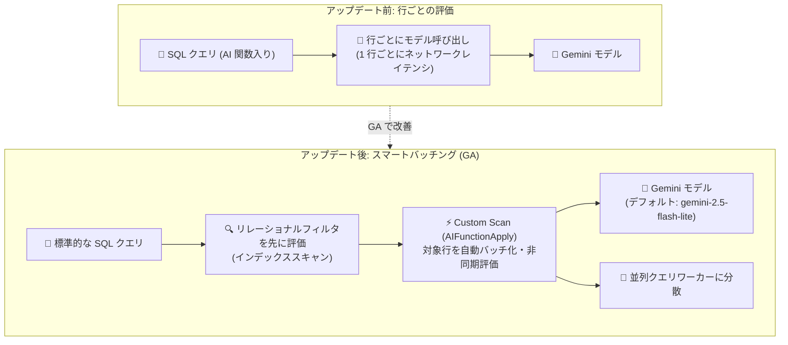

# AlloyDB for PostgreSQL: AlloyDB AI スマートバッチング & ai.analyze_sentiment が GA

**リリース日**: 2026-11-09

**サービス**: AlloyDB for PostgreSQL

**機能**: AI 関数のスマートバッチング (AI function acceleration) と ai.analyze_sentiment 関数の一般提供 (GA)

**ステータス**: GA (一般提供)

📊 [このアップデートのインフォグラフィックを見る](https://takech9203.github.io/google-cloud-news-summary/20261109-alloydb-ai-smart-batching-sentiment-ga.html)

## 概要

AlloyDB for PostgreSQL の AlloyDB AI において、2 つの重要な機能が一般提供 (GA) になりました。1 つ目は **AI 関数のスマートバッチング (AI function acceleration)** です。`ai.if`、`ai.rank`、`ai.analyze_sentiment`、`ai.summarize`、`ai.extract`、`ai.classify`、`ai.generate` の各 AI 関数を含むクエリで、対象となる AI 操作を自動的にバッチ化し、非同期評価にオフロードすることでクエリ実行速度を大幅に改善します。PostgreSQL 17 以降の AlloyDB クラスタで利用でき、PostgreSQL 18 以降ではデフォルトで有効です。

2 つ目は **`ai.analyze_sentiment` 関数の GA** です。SQL クエリ内でテキストのセンチメント (感情) を positive / negative / neutral にリアルタイムで分類できる組み込み関数で、PostgreSQL 17 以降の AlloyDB クラスタで一般提供されます。Gemini の言語理解を ETL パイプラインなしでデータベース内の非構造化データに直接適用できます。

このアップデートは、データベース内で LLM を活用したセマンティック検索・テキスト分析を行いたいデータエンジニア、アプリケーション開発者、そして大量データに対する AI クエリのパフォーマンスに課題を抱えていたユーザーに特に価値があります。

**アップデート前の課題**

- 標準の PostgreSQL 実行モデルでは AI 関数が行ごと (row-by-row) に評価され、1 行ごとにモデル呼び出しのネットワークレイテンシが発生していた
- パフォーマンスを改善するには、クエリを複雑な配列ベースの構造 (array-based functions) に書き換える必要があった
- センチメント分析を行うには、データをデータベース外に抽出して外部の ML サービスに渡す ETL パイプラインや外部サービス連携の構築が必要だった
- `ai.analyze_sentiment` などの AI 関数は GA 前のステータスであり、本番ワークロードへの採用にハードルがあった

**アップデート後の改善**

- 対象となる AI 操作が自動的にバッチ化・非同期評価され、標準的で読みやすい SQL のままで配列ベース関数と同等以上のパフォーマンスを実現
- 選択性の高いリレーショナルフィルタ (WHERE 句の通常の条件) を AI 関数より先に評価するため、モデル呼び出し対象の行が最小化され、性能とモデル利用効率が最適化された
- PostgreSQL の並列クエリと統合され、大規模テーブルのスキャン時にバッチ評価を並列ワーカーに分散できる
- `ai.analyze_sentiment` が GA となり、SQL だけでリアルタイムのセンチメント分類を本番環境で利用可能になった
- PostgreSQL 18 以降ではスマートバッチングがデフォルトで有効になり、追加設定なしで恩恵を受けられる

## アーキテクチャ図



スマートバッチング有効時は、通常の WHERE 条件が先にインデックス等で評価され、候補行のみが `AIFunctionApply` ノードでバッチ化されて Gemini モデルに非同期送信されます。

## サービスアップデートの詳細

### 主要機能

1. **AI 関数のスマートバッチング (GA)**
   - `ai.if`、`ai.rank`、`ai.analyze_sentiment`、`ai.summarize`、`ai.extract`、`ai.classify`、`ai.generate` が対象 (PostgreSQL 17 以降)
   - 対象の AI 操作を自動でバッチ化し、高スループットの非同期評価にオフロード。配列構造へのクエリ書き換えが不要
   - PostgreSQL 18 以降ではデフォルトで有効 (`google_ml_integration.enable_ai_function_acceleration`)

2. **主要 SQL 句を横断した高速化**
   - WHERE 句: 選択性の高い非 AI 述語を先に評価した後、`ai.if` などのブール AI 評価で行をフィルタ
   - ORDER BY 句: `ai.rank` の関連度スコアをバッチ計算してからソート・LIMIT を実行
   - SELECT 射影: スカラー AI 関数を結果行全体でバッチ化。`ai.agg_summarize` による行横断の要約集約にも対応
   - JOIN ... ON: INNER JOIN のクロステーブル AI 条件をスマートバッチングで評価
   - DML: `UPDATE`、`DELETE`、`INSERT ... SELECT` の WHERE 述語・ターゲットリスト・SET 式内の AI 関数も高速化

3. **PostgreSQL 並列クエリとの統合**
   - 大規模テーブルのスキャン時に、バッチ評価を複数の並列バックグラウンドワーカーに分散 (`Parallel Custom Scan (AIFunctionApply)`)

4. **ai.analyze_sentiment 関数 (GA)**
   - テキストのセンチメントを `'positive'` / `'negative'` / `'neutral'` に分類する組み込み関数 (PostgreSQL 17 以降)
   - 単一文字列の分析、スカラー関数のアクセラレーション、配列ベース・カーソルベースの数千行規模のバッチ処理に対応
   - SELECT 射影、WHERE フィルタ、JOIN 句で利用可能

5. **安全なフォールバック動作**
   - 高速化できないクエリパターンはエラーにならず、自動的に標準の行ごと実行にフォールバック
   - `client_min_messages = DEBUG2` と `EXPLAIN` で、フォールバック理由 (「AI function acceleration is not applied」) を診断可能

## 技術仕様

### 対応 AI 関数とスマートバッチング要件

| 関数 | 説明 | 必要な拡張バージョン |
|------|------|---------------------|
| `ai.if` / `google_ml.if` | 自然言語のブール判定 (true/false)。SELECT / WHERE / JOIN で利用可 | すべて |
| `ai.rank` / `google_ml.rank` | 条件への適合度を数値スコア (float) で返す。WHERE / ORDER BY / SELECT / JOIN で利用可 | すべて |
| `ai.generate` / `google_ml.generate` | 基盤モデルによる自然言語・構造化テキスト生成 | すべて |
| `ai.analyze_sentiment` / `google_ml.analyze_sentiment` | センチメントを positive / negative / neutral に分類 | 1.6.3 以降 |
| `ai.summarize` / `google_ml.summarize` | 入力テキストを要約 | 1.6.4 以降 |
| `ai.agg_summarize` / `google_ml.agg_summarize` | 複数行のテキストを 1 つの要約に集約 | 1.6.4 以降 |
| `ai.extract` / `google_ml.extract` (Preview) | テキストから構造化エンティティや key-value を抽出。`enable_preview_ai_functions=on` が必要 | 1.6.1 以降 |
| `ai.classify` / `google_ml.classify` (Preview) | テキストを指定カテゴリに分類。`enable_preview_ai_functions=on` が必要 | 1.6.1 以降 |

### スマートバッチングの設定パラメータ

| パラメータ | 型 | デフォルト | スコープ | 説明 |
|-----------|-----|-----------|---------|------|
| `google_ml_integration.enable_ai_function_acceleration` | Boolean | PG 18: on / PG 17: off | セッション・ユーザー・インスタンス | 対象 AI 操作のスマートバッチングへのオフロードを制御。off では標準の行ごと実行 |
| `google_ml_integration.enable_preview_ai_functions` | Boolean | off | セッションなど | Preview 関数 (`ai.extract`、`ai.classify`) のスマートバッチングを有効化 |
| `google_ml_integration.default_llm_model` | String | `gemini-2.5-flash-lite` | インスタンスなど | デフォルトモデルの変更。AI 関数の `model_id` パラメータでも指定可 |

## 設定方法

### 前提条件

1. PostgreSQL 17 以降の AlloyDB クラスタ (スマートバッチングのデフォルト有効化は PostgreSQL 18 以降)
2. Gemini Enterprise Agent Platform との統合設定が完了していること (AlloyDB インスタンスにモデルエンドポイントを呼び出す IAM 権限が必要)
3. `google_ml_integration` 拡張のインストール (ai.analyze_sentiment は 1.6.4 以降を推奨)
4. スマートバッチングはデフォルトモデル (`gemini-2.5-flash-lite`) または `google_ml_integration.default_llm_model` で設定したモデルをサポートするリージョンで利用可能

### 手順

#### ステップ 1: 拡張のインストールと AI クエリエンジンの有効化

```sql
-- 拡張のバージョン確認
SELECT extversion FROM pg_extension WHERE extname = 'google_ml_integration';

-- インストール / 更新
CREATE EXTENSION IF NOT EXISTS google_ml_integration;
ALTER EXTENSION google_ml_integration UPDATE;

-- AI クエリエンジンを有効化 (デフォルトは on、再起動不要)
SET google_ml_integration.enable_ai_query_engine = 'on';
```

#### ステップ 2: スマートバッチングの有効化 (インスタンスレベル)

```bash
gcloud alloydb instances update INSTANCE_ID \
  --database-flags google_ml_integration.enable_ai_function_acceleration=on \
  --region=REGION_ID \
  --cluster=CLUSTER_ID \
  --project=PROJECT_ID
```

PostgreSQL 17 ではデフォルト off のため明示的な有効化が必要です。セッション単位で切り替える場合は `SET google_ml_integration.enable_ai_function_acceleration = on;` を使用します。

#### ステップ 3: スマートバッチングの適用確認

```sql
EXPLAIN (COSTS OFF)
SELECT r.name, r.review
FROM restaurant_reviews r
WHERE ai.if('Is the following a positive review? Review: ' || r.review)
  AND r.city = 'Los Angeles';
```

実行計画に `Custom Scan (AIFunctionApply)` または `Parallel Custom Scan (AIFunctionApply)` ノードが表示されればスマートバッチングが適用されています。リレーショナルフィルタ (`city = 'Los Angeles'`) が先にインデックスで評価され、一致した行のみがモデルにバッチ送信されます。

#### ステップ 4: ai.analyze_sentiment の利用

```sql
SELECT id, review_content,
       ai.analyze_sentiment(review_content) AS sentiment
FROM reviews;
```

## メリット

### ビジネス面

- **AI 分析の民主化**: ETL パイプラインや外部サービス連携を構築せずに、SQL スキルだけでセンチメント分析や LLM ベースのフィルタリング・ランキングを実現できる
- **本番採用の安心感**: スマートバッチングと `ai.analyze_sentiment` が GA となり、SLA を前提とする本番ワークロードで利用できる
- **コスト効率**: リレーショナルフィルタが先に評価されるため、モデル呼び出し対象の行数が最小化され、モデル利用コストの無駄を削減できる

### 技術面

- **クエリ書き換え不要**: 配列ベース関数と同等以上の性能を、標準的で読みやすい SQL のままで得られる
- **行ごとのネットワークレイテンシを解消**: 自動バッチ化と非同期評価により、大量行に対する AI 関数評価のスループットが大幅に向上
- **並列クエリ統合**: 大規模テーブルではバッチ評価が並列ワーカーに分散され、スケールする
- **安全なフォールバック**: 高速化できないパターンでもクエリは失敗せず標準実行にフォールバックするため、既存クエリへの影響リスクが低い

## デメリット・制約事項

### 制限事項 (スマートバッチングにフォールバックが発生するパターン)

- ネストした AI 関数 (例: `ai.if(ai.if(...))`) は高速化不可
- LEFT / RIGHT / FULL OUTER JOIN の ON 句内の AI 関数は非対応 (WHERE 句やサブクエリへの移動で回避可能)
- AI 関数を直接ラップする集約 (例: `AVG(ai.rank(...))`) は非対応 (CTE やサブクエリで先に計算してから集約する)
- volatile 関数 (`random()`、`clock_timestamp()` など) を含む引数式は非対応
- 最初のテキスト入力以降の引数 (`output_schema`、`categories`、`model_id` など) は定数リテラルである必要がある
- 相関サブクエリや外側クエリの変数参照を含む AI 式は非対応
- 外部テーブル (`postgres_fdw`) やマテリアライズド CTE (`WITH ... AS MATERIALIZED`) のスキャンは非対応
- 1 つのテーブルスキャンでサポートされる AI 関数は最大 5 種類まで

### 考慮すべき点

- PostgreSQL 17 ではスマートバッチングがデフォルト off のため、明示的な有効化が必要 (PostgreSQL 18 以降はデフォルト on)
- `ai.extract` と `ai.classify` は依然として Preview であり、`google_ml_integration.enable_preview_ai_functions=on` の設定が必要
- スマートバッチングはデフォルトモデル (`gemini-2.5-flash-lite`) がサポートされるリージョンで利用可能なため、リージョンのモデル対応状況の確認が必要
- AI 関数呼び出し自体は AlloyDB では課金されないが、呼び出し先の Gemini モデルの利用料金は別途発生する

## ユースケース

### ユースケース 1: カスタマーレビューのリアルタイムセンチメント分類

**シナリオ**: EC サイトの商品レビューを、外部 ML パイプラインを構築せずに SQL だけでセンチメント分類し、ネガティブレビューを即座に検知したい。

**実装例**:
```sql
-- ネガティブレビューのみ抽出 (スマートバッチングで高速評価)
SELECT id, review_content
FROM reviews
WHERE ai.analyze_sentiment(review_content) = 'negative';
```

**効果**: 数千行規模のレビューでも自動バッチ化により高速に分類でき、ETL なしでカスタマーサポートの優先対応キューを SQL だけで構築できる。

### ユースケース 2: リレーショナルフィルタと AI フィルタを組み合わせた高効率検索

**シナリオ**: 特定都市のレストランレビューから「ポジティブな内容」のものだけを抽出したい。全行をモデルに送るとコストとレイテンシが問題になる。

**実装例**:
```sql
SELECT r.name, r.review
FROM restaurant_reviews r
WHERE ai.if('Is the following a positive review? Review: ' || r.review)
  AND r.city = 'Los Angeles';
```

**効果**: `city = 'Los Angeles'` がインデックスで先に評価され、候補行のみが Gemini にバッチ送信されるため、モデル呼び出しコストとクエリレイテンシの両方を最小化できる。

### ユースケース 3: AI 生成を含む DML のバッチ処理

**シナリオ**: 既存テーブルの各行に対して要約列を一括生成したい。

**実装例**:
```sql
UPDATE reviews
SET summary = ai.summarize(review_content);
```

**効果**: DML (`UPDATE` の SET 式) 内の AI 関数もスマートバッチングで高速化され、行ごとのモデル呼び出しによる長時間実行を回避できる。

## 料金

AlloyDB は AI 関数呼び出し自体には課金しません。ただし、データベースから Gemini Enterprise Agent Platform、サードパーティ、またはセルフホストのモデル / サービスを呼び出す場合、モデルまたはインフラの提供元から直接課金されます (スマートバッチングのデフォルトモデルは `gemini-2.5-flash-lite`)。

AlloyDB 本体の料金 (vCPU / メモリ / ストレージ) は通常どおり発生します。詳細は以下を参照してください。

- AlloyDB の料金: https://cloud.google.com/alloydb/pricing
- Gemini モデルの料金: https://cloud.google.com/products/gemini-enterprise-agent-platform/pricing

## 利用可能リージョン

スマートバッチングは、デフォルトモデル (`gemini-2.5-flash-lite`) または `google_ml_integration.default_llm_model` で設定したモデルをサポートするリージョンで利用できます。対応リージョンの詳細は[モデルのサポートリージョン](https://docs.cloud.google.com/vertex-ai/generative-ai/docs/models/gemini/2-5-flash-lite#supported-regions)を参照してください。

## 関連サービス・機能

- **Gemini Enterprise Agent Platform (Vertex AI)**: AI 関数のバックエンドとなる Gemini モデルを提供。AlloyDB との統合設定 (IAM 権限) が前提条件
- **モデルエンドポイント管理 (google_ml_integration)**: 事前登録済み Gemini モデル以外のモデルエンドポイントの登録・呼び出しを管理
- **AlloyDB AI クエリエンジン**: `ai.if` / `ai.rank` などのセマンティック演算子群の基盤。今回の GA はこのエンジンの実行性能を強化するもの
- **AlloyDB Omni**: セルフマネージド版 AlloyDB でも `ai.analyze_sentiment` などの AI 関数を利用可能

## 参考リンク

- 📊 [インフォグラフィック](https://takech9203.github.io/google-cloud-news-summary/20261109-alloydb-ai-smart-batching-sentiment-ga.html)
- [公式リリースノート](https://docs.cloud.google.com/release-notes#November_09_2026)
- [ドキュメント: AI 関数を使用するクエリのパフォーマンス高速化](https://docs.cloud.google.com/alloydb/docs/ai/accelerate-ai-queries)
- [ドキュメント: テキストのセンチメント分析 (ai.analyze_sentiment)](https://docs.cloud.google.com/alloydb/docs/ai/analyze-sentiment)
- [ドキュメント: AI 関数の概要 (AI query engine)](https://docs.cloud.google.com/alloydb/docs/ai/ai-query-engine-landing)
- [料金ページ (AlloyDB)](https://cloud.google.com/alloydb/pricing)

## まとめ

AlloyDB AI のスマートバッチング GA により、AI 関数を含む SQL クエリを書き換えなしで大幅に高速化でき、`ai.analyze_sentiment` の GA と合わせて「データベース内 AI」の本番採用ハードルが大きく下がりました。PostgreSQL 17 クラスタでは `google_ml_integration.enable_ai_function_acceleration=on` の明示的な有効化、PostgreSQL 18 以降への移行検討、および `EXPLAIN` での `AIFunctionApply` ノード確認から始めることを推奨します。

---

**タグ**: AlloyDB, AlloyDB AI, PostgreSQL, Gemini, AI Functions, Smart Batching, Sentiment Analysis, GA
