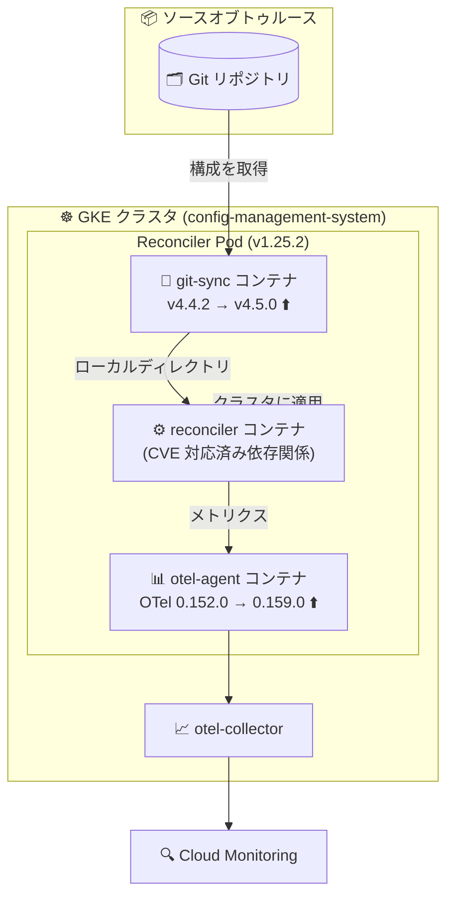

# Anthos Config Management (Config Sync): バージョン 1.25.2 セキュリティ・依存関係アップデート

**リリース日**: 2026-11-09

**サービス**: Anthos Config Management (Config Sync)

**機能**: セキュリティ強化 (CVE 対応、git-sync v4.5.0 / OpenTelemetry 0.159.0 へのアップグレード)

**ステータス**: Change (セキュリティ・依存関係更新)

📊 [このアップデートのインフォグラフィックを見る](https://takech9203.github.io/google-cloud-news-summary/20261109-anthos-config-management-security-updates.html)

## 概要

Anthos Config Management (Config Sync) のバージョン 1.25.2 がリリースされ、セキュリティに関する 3 つの関連アップデートが実施されました。Config Sync は GitOps スタイルで Kubernetes クラスタの構成を Git リポジトリ・OCI イメージ・Helm チャートなどのソースオブトゥルースと同期させるサービスであり、クラスタ運用の中核を担うコンポーネントです。

今回のアップデートでは、(1) 依存関係の更新による複数の CVE (Common Vulnerabilities and Exposures) への対応、(2) Git リポジトリからの構成取得を担う git-sync 依存関係の v4.4.2 から v4.5.0 へのアップグレード、(3) メトリクス収集を担う OpenTelemetry イメージの 0.152.0 から 0.159.0 へのアップグレードが行われました。いずれも脆弱性修正を目的としたものです。

新機能の追加はありませんが、Config Sync はクラスタ内で常時稼働し Git リポジトリや外部レジストリと通信するコンポーネントであるため、セキュリティ脆弱性の解消は運用上重要です。GKE クラスタで Config Sync を利用しているプラットフォーム管理者・セキュリティ担当者は、本バージョンへのアップグレードを検討することが推奨されます。

**アップデート前の課題**

- Config Sync 1.25.1 以前の依存関係には、複数の既知の CVE が含まれていた
- git-sync v4.4.2 はベースイメージに既知の脆弱性を含んでいた (v4.4.3 でベースイメージの CVE が修正され、v4.5.0 ではベースイメージが Debian trixie に更新され git 2.47.3 が同梱された)
- OpenTelemetry イメージ 0.152.0 には、その後のリリース (〜0.159.0) で修正された脆弱性が残存していた

**アップデート後の改善**

- 依存関係の更新により、複数の CVE が解消された
- git-sync が v4.5.0 になり、新しいベースイメージ (Debian trixie) と新しいバージョンの git (2.47.3) によって脆弱性修正が取り込まれた
- OpenTelemetry イメージが 0.159.0 になり、0.153.0〜0.159.0 で行われた脆弱性修正が取り込まれた

## アーキテクチャ図



Config Sync の Reconciler Pod を構成するコンテナのうち、Git リポジトリとの通信を担う git-sync コンテナと、メトリクス収集を担う otel-agent コンテナ (OpenTelemetry イメージ) がそれぞれ脆弱性修正版にアップグレードされました。

## サービスアップデートの詳細

### 主要な変更点

1. **複数の CVE への対応 (依存関係の更新)**
   - Config Sync 本体の依存関係を更新し、複数の既知の脆弱性 (CVE) を解消
   - Config Sync では定期的な CVE 対応が継続的に実施されており (1.25.1、1.25.0 などでも同様の対応あり)、今回もその一環

2. **git-sync 依存関係のアップグレード (v4.4.2 → v4.5.0)**
   - git-sync は Git リポジトリから構成ファイルをローカルディレクトリに取得するコンテナで、`spec.sourceType` が `git` の場合に Reconciler Pod 内で稼働する
   - v4.5.0 ではベースイメージが Debian trixie に更新され、git 2.47.3 が同梱された。途中の v4.4.3 ではベースイメージの CVE が解消されている
   - 詳細は [git-sync releases](https://github.com/kubernetes/git-sync/releases) を参照

3. **OpenTelemetry イメージのアップグレード (0.152.0 → 0.159.0)**
   - OpenTelemetry イメージは otel-agent コンテナおよび otel-collector として、Config Sync コンポーネントのメトリクスを収集し Cloud Monitoring / Prometheus にエクスポートする役割を担う
   - 脆弱性修正の取り込みを目的としたアップグレードで、各リリースの変更内容は [opentelemetry-collector-contrib の CHANGELOG](https://github.com/open-telemetry/opentelemetry-collector-contrib/blob/main/CHANGELOG.md) で確認できる

## 技術仕様

### 更新されたコンポーネント

| コンポーネント | 更新前 | 更新後 | 役割 |
|------|------|------|------|
| Config Sync | 1.25.1 | 1.25.2 | GitOps による構成同期 |
| git-sync | v4.4.2 | v4.5.0 | Git リポジトリからの構成取得 |
| OpenTelemetry イメージ | 0.152.0 | 0.159.0 | メトリクス収集・エクスポート (otel-agent / otel-collector) |

### 影響を受けるコンテナ (Reconciler Pod)

| コンテナ名 | 今回の更新との関係 |
|------|------|
| reconciler | 依存関係更新による CVE 対応 |
| git-sync | v4.5.0 へアップグレード (`spec.sourceType: git` の場合に稼働) |
| otel-agent | OpenTelemetry イメージ 0.159.0 へアップグレード (常時稼働) |

## 設定方法

### 前提条件

1. GKE クラスタで Config Sync を利用していること
2. フリート経由で Config Sync を管理している場合は `gcloud` CLI、手動インストールの場合は `kubectl` が利用可能であること

### 手順

#### ステップ 1: 現在のバージョンを確認

```bash
nomos status
```

`nomos status` コマンドで、各クラスタの Config Sync バージョンと同期状態を確認します。

#### ステップ 2: バージョン 1.25.2 へアップグレード

Config Sync の自動アップグレード (auto-upgrade) を有効にしている場合は、Google が管理するスケジュールで自動的に新バージョンが適用されます。手動管理の場合は、[Config Sync のアップグレード手順](https://docs.cloud.google.com/kubernetes-engine/config-sync/docs/how-to/upgrade-config-sync)に従ってバージョンを 1.25.2 に更新します。

#### ステップ 3: アップグレード後の動作確認

```bash
nomos status
kubectl get pods -n config-management-system
```

Reconciler Pod が正常に再作成され、同期ステータスが `SYNCED` であることを確認します。

## メリット

### ビジネス面

- **セキュリティコンプライアンスの維持**: 既知の CVE が解消されるため、脆弱性スキャンやコンプライアンス監査への対応が容易になる
- **運用リスクの低減**: クラスタ構成管理の中核コンポーネントの脆弱性を放置することによるリスクを低減できる

### 技術面

- **攻撃対象領域の縮小**: Git リポジトリや外部レジストリと通信する git-sync、メトリクスを扱う OpenTelemetry コンポーネントの既知の脆弱性が解消される
- **最新ベースイメージの採用**: git-sync v4.5.0 は Debian trixie ベースとなり、新しいバージョンの git (2.47.3) を利用できる
- **アプリケーションレベルの非互換なし**: git-sync v4.5.0 はベースイメージ更新が主体でアプリケーションコードの変更はなく、既存の同期動作への影響は最小限

## デメリット・制約事項

### 考慮すべき点

- アップグレード時に Reconciler Pod が再作成されるため、ごく短時間の同期の中断が発生しうる (同期対象リソース自体は削除されない)
- OpenTelemetry イメージのアップグレードでは、過去のバージョン (1.23.1 / 1.23.3 など) で Breaking Change が発生した例があるため、カスタムメトリクス構成を利用している場合は [opentelemetry-collector-contrib の CHANGELOG](https://github.com/open-telemetry/opentelemetry-collector-contrib/blob/main/CHANGELOG.md) で 0.153.0〜0.159.0 の変更内容を確認することが推奨される (今回のリリースノートでは Breaking とは明記されていない)

## ユースケース

### ユースケース 1: 脆弱性スキャン指摘への対応

**シナリオ**: コンテナイメージの脆弱性スキャンで、クラスタ内の Config Sync 関連イメージ (git-sync、OpenTelemetry) に既知の CVE が検出されている。

**効果**: Config Sync 1.25.2 へのアップグレードにより、依存関係・git-sync・OpenTelemetry イメージの既知の脆弱性が解消され、スキャン指摘をクローズできる。

### ユースケース 2: 自動アップグレードによる継続的なセキュリティ維持

**シナリオ**: 複数クラスタで Config Sync を運用しており、毎回の手動アップグレードの運用負荷が高い。

**効果**: Config Sync の自動アップグレードを有効にすることで、今回のようなセキュリティパッチリリースが自動的に適用され、継続的に安全なバージョンを維持できる。

## 関連サービス・機能

- **Google Kubernetes Engine (GKE)**: Config Sync は標準の GKE で利用可能であり、GKE クラスタの構成管理を GitOps で実現する
- **Cloud Monitoring**: otel-collector が Config Sync のメトリクスを Cloud Monitoring にエクスポートするため、今回の OpenTelemetry イメージ更新はこの監視パイプラインに関係する
- **Policy Controller**: Config Sync と組み合わせて利用されることが多いポリシー管理サービス (リリースは Config Sync とは独立)

## 参考リンク

- 📊 [インフォグラフィック](https://takech9203.github.io/google-cloud-news-summary/20261109-anthos-config-management-security-updates.html)
- [公式リリースノート (Google Cloud)](https://docs.cloud.google.com/release-notes#November_09_2026)
- [Config Sync リリースノート](https://docs.cloud.google.com/kubernetes-engine/config-sync/docs/release-notes)
- [Config Sync アーキテクチャ](https://docs.cloud.google.com/kubernetes-engine/config-sync/docs/concepts/architecture)
- [Config Sync のアップグレード](https://docs.cloud.google.com/kubernetes-engine/config-sync/docs/how-to/upgrade-config-sync)
- [git-sync releases (GitHub)](https://github.com/kubernetes/git-sync/releases)
- [opentelemetry-collector-contrib CHANGELOG (GitHub)](https://github.com/open-telemetry/opentelemetry-collector-contrib/blob/main/CHANGELOG.md)

## まとめ

Config Sync 1.25.2 は、CVE 対応・git-sync v4.5.0・OpenTelemetry 0.159.0 という 3 つの脆弱性修正を含むセキュリティリリースです。新機能はないものの、クラスタ構成管理の中核コンポーネントのセキュリティを維持するうえで重要な更新であり、Config Sync を利用中の環境では自動アップグレードの活用または計画的な手動アップグレードを推奨します。

---

**タグ**: #AnthosConfigManagement #ConfigSync #GKE #セキュリティ #CVE #GitOps #gitsync #OpenTelemetry
