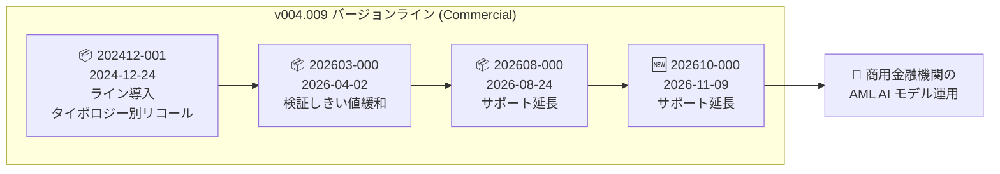

# Anti Money Laundering AI: 商用向け v004.009 系の新マイナーエンジンバージョン (202610-000) リリース

**リリース日**: 2026-11-09

**サービス**: Anti Money Laundering AI (AML AI)

**機能**: 商用 (Commercial) 向け新マイナーエンジンバージョン `aml-commercial.default.v004.009.202610-000`

**ステータス**: Announcement (メンテナンスリリース)

📊 [このアップデートのインフォグラフィックを見る](https://takech9203.github.io/google-cloud-news-summary/20261109-anti-money-laundering-ai-v004-009-202610.html)

## 概要

Anti Money Laundering AI (AML AI) において、商用 (Commercial) ライン・オブ・ビジネス向けの新しいマイナーエンジンバージョン `aml-commercial.default.v004.009.202610-000` が v004.009 バージョンラインでリリースされました。

本バージョンはメジャーエンジンバージョン v004.009 のサポート期間を延長するメンテナンスリリースであり、前のマイナーバージョン (`aml-commercial.default.v004.009.202608-000`、2026 年 8 月 24 日リリース) と比較して機能面での大きな変更は含まれていません。

v004.009 ラインは 2024 年 12 月 24 日に `202412-001` として導入されたバージョンで、バックテストへのタイポロジー別リコールメトリクスの追加、リスクケースイベントへのタイポロジーラベル対応 (入力スキーマ拡張)、v004.007 で導入された機能群の「Counterparty risk indicators」機能ファミリーへの分離を特長としています。その後も `202603-000` (パーティあたりアカウント数のデータ検証しきい値を 500,000 に緩和) などのマイナーバージョンが継続的にリリースされており、今回のリリースで同ラインのサポートがさらに延長されました。

**アップデート前の状況**

- 商用向け v004.009 ラインの最新マイナーバージョンは `202608-000` (2026 年 8 月 24 日リリース) だった
- マイナーバージョンにはサポート期限があり、継続利用にはサポートを延長する新しいマイナーバージョンの提供が必要だった

**アップデート後の改善**

- 新マイナーバージョン `202610-000` により、商用向け v004.009 メジャーバージョンのサポートが延長された
- 既存の v004.009 利用者は、機能面の差異を気にせず最新マイナーバージョンに移行できる (前バージョンからの重要な変更なし)

## アーキテクチャ図

商用向け v004.009 バージョンライン内の主要なマイナーバージョンの変遷と、今回リリースされた `202610-000` の位置付けを示しています。

## サービスアップデートの詳細

### 主要ポイント

1. **新マイナーエンジンバージョンのリリース**
   - バージョン ID: `aml-commercial.default.v004.009.202610-000`
   - 対象: 商用 (Commercial) ライン・オブ・ビジネス
   - v004 チューニングバージョン配下のメジャーバージョン 009 に属する

2. **メンテナンスリリースとしての性質**
   - メジャーエンジンバージョン v004.009 のサポートを延長
   - 前マイナーバージョン (`202608-000`) と比較して重要な変更は含まれない

3. **v004.009 ラインの特長 (参考)**
   - バックテストにタイポロジー別リコールメトリクスを追加
   - リスクケースイベントのタイポロジーラベルに対応した入力スキーマ拡張
   - v004.007 で導入された機能群を「Counterparty risk indicators」機能ファミリーとして分離し、調査担当者のユーザビリティを改善
   - `202603-000` 以降はパーティあたりアカウント数のデータ検証しきい値が 500,000 に緩和されている

## 技術仕様

### エンジンバージョンの命名規則

| 要素 | 値 | 説明 |
|------|-----|------|
| ライン・オブ・ビジネス | `aml-commercial` | 商用 (法人) 顧客向けモデル |
| チューニングバージョン | `v004` | チューニング方式の世代 |
| メジャーバージョン | `009` | 機能セット・モデル挙動の世代 |
| マイナーバージョン | `202610-000` | メンテナンス更新 (2026 年 10 月ビルド) |

### バージョン採用時のポイント

- 新しいエンジンバージョンの採用時は、既存のエンジン設定からハイパーパラメータを継承 (inherit) することで、再チューニングのコストと時間を削減可能
- エンジンバージョンにはライフサイクル (ACTIVE / DEPRECATED / DECOMMISSIONED) があり、最新のマイナーバージョンを利用することでサポートを維持できる

## メリット

### ビジネス面

- **サポート継続性の確保**: 商用向け v004.009 系を利用する金融機関は、サポートが延長された最新マイナーバージョンへ移行することで、安定した AML モデル運用を継続できる
- **移行リスクの低さ**: 前バージョンからの重要な変更がないため、モデル挙動の変化を懸念せずにバージョン更新が可能

### 技術面

- **再チューニング不要の移行**: ハイパーパラメータ継承機能により、既存エンジン設定を活用して低コストで新バージョンに移行できる

## 考慮すべき点

- 本リリースは機能追加ではなくメンテナンスリリースのため、新機能を期待したバージョン更新は不要
- 旧マイナーバージョンにはサポート期限があるため、v004.009 系を利用中の場合は計画的に最新マイナーバージョンへの更新を検討することが推奨される
- 商用向けには、バックテスト API 改善を含む v004.011 系や、チェック取引サポートの改善 (unusual_check_activity 機能ファミリー) を含むより新しいメジャーバージョン v004.012 (2026 年 7 月 16 日リリース) も利用可能であり、機能面の改善を求める場合はメジャーバージョンの更新も選択肢となる

## 料金

AML AI の料金は従来から変更ありません。詳細は[料金ページ](https://cloud.google.com/financial-services/anti-money-laundering/pricing)を参照してください。

## 関連サービス・機能

- **AML AI エンジンバージョン管理**: エンジンバージョンの一覧とライフサイクルは[エンジンバージョンのリファレンス](https://docs.cloud.google.com/financial-services/anti-money-laundering/docs/reference/engine-versions)で確認可能
- **エンジン設定 (Engine Config)**: 新バージョン採用時にハイパーパラメータの継承が可能で、再チューニングのコストを削減できる
- **リテール (Retail) 向けエンジンバージョン**: リテール向けにも同様のマイナーバージョン (直近では `aml-retail.default.v004.011.202610-000`、2026 年 10 月 29 日) が継続的にリリースされている

## 参考リンク

- 📊 [インフォグラフィック](https://takech9203.github.io/google-cloud-news-summary/20261109-anti-money-laundering-ai-v004-009-202610.html)
- [公式リリースノート](https://docs.cloud.google.com/release-notes#November_09_2026)
- [AML AI リリースノート](https://docs.cloud.google.com/financial-services/anti-money-laundering/docs/release-notes)
- [エンジンバージョン リファレンス](https://docs.cloud.google.com/financial-services/anti-money-laundering/docs/reference/engine-versions)
- [料金ページ](https://cloud.google.com/financial-services/anti-money-laundering/pricing)

## まとめ

今回のリリースは、商用向け v004.009 エンジンバージョンラインのサポートを延長するメンテナンスリリースです。v004.009 系を利用している商用金融機関は、重要な変更がないことを確認した上で、最新マイナーバージョン `202610-000` への計画的な更新を検討してください。

---

**タグ**: #AMLAI #AntiMoneyLaundering #FinancialServices #EngineVersion #MaintenanceRelease
