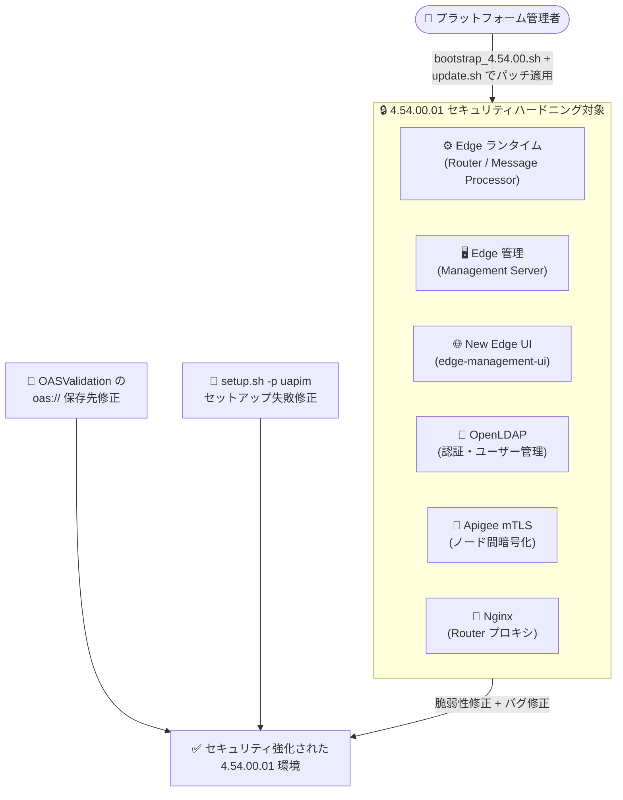

# Apigee Edge for Private Cloud: 4.54.00.01 パッチリリース (セキュリティ脆弱性修正とバグ修正)

**リリース日**: 2026-11-09

**サービス**: Apigee Edge for Private Cloud

**機能**: 4.54.00.01 パッチリリース (セキュリティ修正 + バグ修正)

**ステータス**: GA (パッチリリース)

📊 [このアップデートのインフォグラフィックを見る](https://takech9203.github.io/google-cloud-news-summary/20261109-apigee-edge-private-cloud-4-54-00-01.html)

## 概要

Apigee Edge for Private Cloud の最新パッチリリース **4.54.00.01** が公開されました。本リリースは 4.54.00 系の最初のパッチアップデートであり、複数のセキュリティ脆弱性の修正が中心となっています。セキュリティハードニングの対象は、Edge ランタイム、Edge 管理 (Management)、New Edge UI、OpenLDAP、Apigee mTLS、Nginx と、プラットフォームを構成する主要コンポーネント全般に及びます。

セキュリティ修正に加えて、New Edge UI の OASValidation ポリシーモーダルで OpenAPI Specification を作成した際にリソースが `oas://` ではなく `yaml://` や `json://` 配下に保存されてしまう問題と、`setup.sh -p uapim` 実行時に edge-uapim-connector のセットアップが失敗する問題の 2 件のバグ修正が含まれています。

オンプレミスや自社データセンターで Apigee Edge for Private Cloud 4.54.00 を運用しているプラットフォーム管理者は、セキュリティリスク低減のため、本パッチの適用を計画することが推奨されます。更新された RPM パッケージの一覧とパッチ適用手順は、公式ドキュメント「Install 4.54.00.x patch updates」で確認できます。

**アップデート前の課題**

- 4.54.00 の Edge ランタイム、管理サーバー、New Edge UI、OpenLDAP、Apigee mTLS、Nginx の各コンポーネントに複数のセキュリティ脆弱性が存在していた
- New Edge UI の OASValidation ポリシーモーダルで OpenAPI Specification を作成すると、仕様リソースが `oas://` ではなく `yaml://` または `json://` 配下に保存される問題があった
- `setup.sh -p uapim` の実行時に edge-uapim-connector のセットアップが失敗する問題があった

**アップデート後の改善**

- 主要コンポーネント全般にわたるセキュリティハードニングにより、既知の脆弱性が修正され、プラットフォームのセキュリティ姿勢が強化された
- OASValidation ポリシーの OpenAPI Specification リソースが正しく `oas://` 配下に保存されるようになった
- `setup.sh -p uapim` による edge-uapim-connector のセットアップが正常に完了するようになった
- サポート対象 OS として Red Hat Enterprise Linux / Oracle Linux / Rocky Linux の 8.10, 9.6, 9.7, 9.8 が明示された

## アーキテクチャ図



4.54.00.01 パッチは、API トラフィックを処理するランタイムから管理系・認証系・ネットワーク系まで、Edge for Private Cloud を構成する 6 種類のコンポーネントを横断的にセキュリティハードニングし、2 件のバグ修正と合わせて適用されます。

## サービスアップデートの詳細

### 主要機能

1. **コンポーネント横断のセキュリティ脆弱性修正**
   - Edge ランタイム (Router / Message Processor)、Edge 管理 (Management Server)、New Edge UI、OpenLDAP、Apigee mTLS、Nginx の各コンポーネントで複数のセキュリティ脆弱性を修正
   - API ゲートウェイのデータプレーンと管理プレーンの両方を対象としたセキュリティハードニング

2. **New Edge UI の OASValidation ポリシー修正**
   - OASValidation ポリシーモーダルで OpenAPI Specification を作成した際、仕様リソースが `yaml://` や `json://` 配下に保存されてしまう問題を修正
   - 正しく `oas://` 配下に保存されるようになり、OASValidation ポリシーからのリソース参照が意図どおり機能する

3. **edge-uapim-connector セットアップの修正**
   - `setup.sh -p uapim` の実行時に edge-uapim-connector のセットアップが失敗する問題を修正

4. **サポート OS の明確化**
   - 4.54.00 およびそのパッチリリースは Red Hat Enterprise Linux、Oracle Linux、Rocky Linux の 8.10, 9.6, 9.7, 9.8 をサポート

## 技術仕様

### 4.54.00 系のサポートソフトウェア

| 項目 | 詳細 |
|------|------|
| 対応 OS | RHEL / Oracle Linux / Rocky Linux 8.10, 9.6, 9.7, 9.8 (Intel 64-bit)、Amazon Linux 2023.x |
| JDK | Oracle JDK / OpenJDK 17 および 21 (デュアル Java ランタイム、Java 8 サポートは廃止) |
| TLS | TLS 1.2 / 1.3 (TLS 1.0 / 1.1 はデフォルト無効、CwC で有効化可能) |
| Nginx | 1.30.0 |
| OpenLDAP | 2.6.10 |
| Cassandra | 5.0.8 |
| Postgres | 18.6 |
| ZooKeeper / Qpid | ZooKeeper 3.8.5 / Qpid Broker-J 10.0.1 |

### パッチ更新コンポーネントの指定

`update.sh` の `-c` オプションで更新対象コンポーネントを指定します。

| コンポーネント指定 | 対象 |
|------|------|
| `edge` | Management Server、Message Processor、Router、Qpid Server、Postgres Server |
| `ldap` | OpenLDAP |
| `ue` | New Edge UI (edge-management-ui) |
| `qpid` / `ps` / `zk` / `cs` | Qpid / Postgresql / ZooKeeper / Cassandra |

## 設定方法

### 前提条件

1. Apigee Edge for Private Cloud 4.54.00 が稼働していること (以前のバージョンからの更新は、まず 4.54.00 へのアップグレードが必要)
2. Apigee から提供された認証情報 (apigeeuser / apigeepassword) を保有していること
3. RPM のインストールには root 権限が必要

### 手順

#### ステップ 1: 事前準備 (パッチ対象コンポーネントをホストする各ノードで実行)

```bash
# 現在のコンポーネントバージョンを確認
/opt/apigee/apigee-service/bin/apigee-all version

# apigee-monit が稼働している場合は停止 (更新中の自動再起動を防止)
/opt/apigee/apigee-service/bin/apigee-service apigee-monit unmonitor -c all
/opt/apigee/apigee-service/bin/apigee-service apigee-monit stop

# パッケージマネージャーのキャッシュをクリア
sudo dnf clean all
```

更新前にインストール済みバージョンを確認し、apigee-monit による更新中のコンポーネント再起動を防ぎます。

#### ステップ 2: bootstrap スクリプトと apigee-setup の更新

```bash
# 最新の 4.54.00 bootstrap スクリプトをダウンロード
curl https://software.apigee.com/bootstrap_4.54.00.sh -o /tmp/bootstrap_4.54.00.sh

# apigee-service ユーティリティとリポジトリ設定をインストール
sudo bash /tmp/bootstrap_4.54.00.sh apigeeuser=uName apigeepassword=pWord

# 環境プロファイルを読み込み、apigee-setup を更新
source /etc/profile.d/apigee-service.sh
/opt/apigee/apigee-service/bin/apigee-service apigee-setup update
```

`uName` / `pWord` は Apigee から提供された認証情報に置き換えます。

#### ステップ 3: パッチ対象コンポーネントの更新

```bash
# 例: Edge コンポーネント (Router / MP / Management Server など) の更新
/opt/apigee/apigee-setup/bin/update.sh -c edge -f configFile

# 例: OpenLDAP、New Edge UI の更新
/opt/apigee/apigee-setup/bin/update.sh -c ldap -f configFile
/opt/apigee/apigee-setup/bin/update.sh -c ue -f configFile
```

`configFile` はインストール時に使用したサイレント設定ファイルです。4.54.00.01 で更新された RPM パッケージの一覧と、コンポーネントごとの具体的な適用手順は公式ドキュメント「Install 4.54.00.x patch updates」を参照してください。

## メリット

### ビジネス面

- **セキュリティリスクの低減**: 既知の脆弱性を修正することで、API 基盤への攻撃リスクとコンプライアンス上の懸念を低減できる
- **運用の安定化**: UAPIM コネクタのセットアップ失敗や OASValidation の保存先不具合が解消され、構築・運用時の手戻りが減る

### 技術面

- **広範なコンポーネントカバレッジ**: ランタイム、管理、UI、認証 (OpenLDAP)、ノード間通信 (mTLS)、プロキシ (Nginx) までを一括でハードニングできる
- **パッチ適用の標準化**: bootstrap スクリプトと `update.sh` による確立された手順で、コンポーネント単位の段階的な適用が可能

## デメリット・制約事項

### 制限事項

- 4.54.00 系以外のバージョン (4.53.x 以前) には本パッチを直接適用できず、先に 4.54.00 へのアップグレードが必要
- サポート OS は RHEL / Oracle Linux / Rocky Linux 8.10, 9.6, 9.7, 9.8 に限定される

### 考慮すべき点

- 前のパッチリリースより古いバージョンから更新する場合は、複数パッチの適用手順 (Applying multiple patch versions) に従う必要がある
- パッチ適用中はコンポーネントの再起動が発生するため、ノードごとの適用順序とメンテナンスウィンドウの計画が必要
- apigee-monit を利用している場合は、更新前に監視を停止し、更新後に再開する運用手順を組み込む必要がある

## ユースケース

### ユースケース 1: オンプレミス API 基盤の定期セキュリティパッチ適用

**シナリオ**: 金融機関が自社データセンターで Apigee Edge for Private Cloud 4.54.00 を運用しており、社内セキュリティポリシーで既知脆弱性への速やかなパッチ適用が義務付けられている。

**実装例**:
```bash
# 各ノードで事前準備後、推奨順序でコンポーネントを更新
/opt/apigee/apigee-setup/bin/update.sh -c edge -f /opt/silent.conf
/opt/apigee/apigee-setup/bin/update.sh -c ldap -f /opt/silent.conf
/opt/apigee/apigee-setup/bin/update.sh -c ue -f /opt/silent.conf
```

**効果**: ランタイムから管理 UI、認証基盤までの脆弱性を一括修正し、監査要件を満たすセキュリティ姿勢を維持できる。

### ユースケース 2: OASValidation ポリシーを使った API 仕様検証の正常化

**シナリオ**: New Edge UI 上で OpenAPI Specification を登録し OASValidation ポリシーでリクエスト検証を行っているが、仕様リソースの保存先が `oas://` にならず参照が不安定だった。

**効果**: パッチ適用後は仕様リソースが正しく `oas://` 配下に保存され、OASValidation ポリシーによる API リクエスト/レスポンス検証が意図どおり動作する。

## 料金

Apigee Edge for Private Cloud はライセンスベースの製品であり、パッチリリースの適用には Apigee から提供される認証情報 (apigeeuser / apigeepassword) が必要です。料金の詳細は [Apigee 料金ページ](https://cloud.google.com/apigee/pricing) を参照してください。

## 利用可能リージョン

Apigee Edge for Private Cloud はオンプレミス (顧客管理環境) で稼働する製品のため、Google Cloud リージョンの概念は適用されません。サポート対象 OS (RHEL / Oracle Linux / Rocky Linux 8.10, 9.6, 9.7, 9.8) 上で稼働します。

## 関連サービス・機能

- **Apigee X / Apigee hybrid**: Google Cloud 上のマネージド API 管理プラットフォーム。Private Cloud の後継としてクラウド移行先の選択肢となる
- **Apigee mTLS**: Edge for Private Cloud のノード間通信を暗号化するコンポーネント。本パッチのハードニング対象に含まれる
- **OpenLDAP**: Edge のユーザー認証・管理を担うコンポーネント。本パッチで 2.6.10 ベースのハードニングが適用される
- **OASValidation ポリシー**: OpenAPI Specification に基づいて API リクエスト/レスポンスを検証するポリシー。本パッチで UI 起点の仕様リソース保存先が修正された

## 参考リンク

- 📊 [インフォグラフィック](https://takech9203.github.io/google-cloud-news-summary/20261109-apigee-edge-private-cloud-4-54-00-01.html)
- [公式リリースノート](https://docs.cloud.google.com/release-notes#November_09_2026)
- [Install 4.54.00.x patch updates](https://docs.apigee.com/private-cloud/v4.54.00/update-apigee-edge-45400-patch)
- [Supported software and supported versions](https://docs.apigee.com/release/supported-software)
- [Update Apigee Edge 4.53.0x to 4.54.00](https://docs.apigee.com/private-cloud/v4.54.00/update-apigee-edge-4530x-45400)
- [料金ページ](https://cloud.google.com/apigee/pricing)

## まとめ

Apigee Edge for Private Cloud 4.54.00.01 は、Edge ランタイム・管理・New Edge UI・OpenLDAP・Apigee mTLS・Nginx にまたがる複数のセキュリティ脆弱性を修正する重要なパッチリリースです。4.54.00 を運用中の環境では、公式のパッチ適用手順に従い、メンテナンスウィンドウを確保した上で速やかな適用を計画することを推奨します。4.53.x 以前の環境は、まず 4.54.00 へのアップグレードを検討してください。

---

**タグ**: #ApigeeEdge #PrivateCloud #セキュリティ #パッチリリース #APIManagement #脆弱性修正
