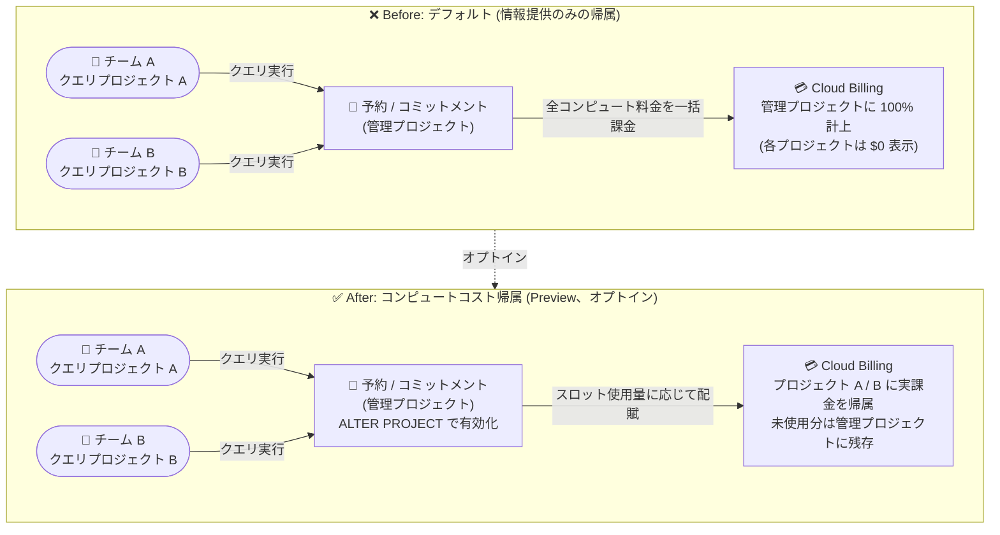

# BigQuery: BigQuery editions の課金コンピュートコスト帰属 (Compute Cost Attribution) (Preview)

**リリース日**: 2026-11-09

**サービス**: BigQuery

**機能**: BigQuery editions におけるコンピュートコスト帰属 (Compute Cost Attribution)

**ステータス**: Preview

📊 [このアップデートのインフォグラフィックを見る](https://takech9203.github.io/google-cloud-news-summary/20261109-bigquery-compute-cost-attribution-preview.html)

## 概要

BigQuery editions のキャパシティベース課金 (スロット予約) において、実際に課金されるコンピュート料金を、管理プロジェクト (administration project) の予約キャパシティを利用した各クエリプロジェクト (consumption project) に直接帰属させる「コンピュートコスト帰属 (billed compute cost attribution)」がオプトイン機能として Preview で利用可能になりました。

従来、BigQuery editions ではすべてのコンピュート料金が予約とキャパシティコミットメントを管理する中央の管理プロジェクトに一括で課金されていました。今回のアップデートにより、コミットメントスロットとオートスケーリングスロットの実際の使用量に基づいてコストが各クエリプロジェクトに配賦されるため、プロジェクト単位のコストを Cloud Billing 上で正確に追跡し、部門・チーム間の社内チャージバック (費用付け替え) を実現できます。

この機能は、複数のクエリプロジェクトでワークロードを分離しつつ中央集権的に予約を管理している組織の FinOps プラクティスを支援することを目的としています。カスタムのデータエンジニアリングパイプラインを構築することなく、Cloud Billing のレポートとデータエクスポートだけでプロジェクトレベルのコスト管理が可能になります。

**アップデート前の課題**

- BigQuery editions のキャパシティベース課金では、すべてのコンピュート料金が予約を管理する管理プロジェクトに課金され、クエリを実行したプロジェクト側のコンピュート費用は Cloud Billing 上で $0 と表示されていた
- デフォルトの「Analysis Slots Attribution」明細はプロジェクトごとのスロット時間を示す情報提供のみの項目であり、実際の請求額は移動しないため、チャージバックには独自の集計パイプラインの構築が必要だった
- オートスケーラーの料金をどのプロジェクトが発生させたかを請求データ上で直接把握できなかった

**アップデート後の改善**

- 実際の課金コンピュート料金が、クエリが消費したスロット時間に基づいて各クエリプロジェクトに直接付け替えられ、Cloud Billing のレポートとエクスポート (BigQuery service > All SKUs) でプロジェクトレベルのコストを確認できるようになった
- カスタムパイプラインを構築することなく、部門・チーム間の社内チャージバックを Cloud Billing データだけで処理できるようになった
- オートスケーラーの料金が、オートスケールされたキャパシティを実際にトリガー・消費したプロジェクトに使用量比例で帰属されるようになった

## アーキテクチャ図



管理プロジェクトに一括課金されていたコンピュート料金が、オプトイン後は各クエリプロジェクトのスロット使用量 (コミットメント + オートスケーリング) に基づいて実際の請求として配賦されます。未使用のベースラインや未割り当てコミットメントの料金は引き続き管理プロジェクトに残ります。

## サービスアップデートの詳細

### 主要機能

1. **プロジェクトレベルのコスト追跡**
   - Cloud Billing のレポートとデータエクスポート (BigQuery service > All SKUs) で、クエリプロジェクトごとのコンピュート消費コストを直接確認できる
   - クエリが消費したスロット時間に基づいて、実際の課金額が管理プロジェクトから各クエリプロジェクトに移動する

2. **社内チャージバックの実現**
   - 部門・チーム間のチャージバック処理を、カスタムのデータエンジニアリングパイプラインを構築せずに Cloud Billing データで実施できる
   - プロジェクト単位の予算見積もりにも活用できる

3. **オートスケーラー使用量の帰属**
   - オートスケーラーの料金は、オートスケールされたキャパシティをトリガーして消費したプロジェクトに、消費量に比例して帰属される
   - アイドルスロットやベースラインコミットメントスロットのみを消費するクエリを実行したプロジェクトのオートスケーラー料金は $0 になる

### 2 つの帰属方式

| 方式 | ステータス | 動作 |
|------|-----------|------|
| Informational slot attribution (デフォルト) | 既存 (GA) | 請求レポートに「Analysis Slots Attribution」という情報提供の明細としてプロジェクトごとのスロット時間を表示。実際の課金は管理プロジェクトのまま。請求総額には影響しない |
| Billed cost attribution (今回の新機能) | **Preview** | オプトインすると、実際の課金コンピュート料金がスロット使用量に基づいて管理プロジェクトから各クエリプロジェクトに移動する |

## 技術仕様

### コスト配賦ルール

| 項目 | 動作 |
|------|------|
| オートスケーラー料金 | オートスケールされたキャパシティをトリガー・消費したクエリプロジェクトにのみ帰属。アイドル/ベースラインスロットのみ使用するプロジェクトは $0 |
| 管理プロジェクトに残る料金 | 未使用のベースラインキャパシティ、未割り当てのキャパシティコミットメント、未使用のオートスケーラースロット (50 スロット単位のスケーリング増分や 1 分間のクールダウンウィンドウによるもの) |
| 請求アカウント要件 | 管理プロジェクトとクエリプロジェクトが同一の Cloud Billing アカウントに属する必要がある。別の請求アカウントに紐付くクエリプロジェクトのコストは移動されず、管理プロジェクトに残る |
| ストレージコスト | 従来どおり、データセットが存在する各プロジェクトに直接課金 (変更なし) |
| 反映タイミング | 有効化後、次の請求日 (America/Los_Angeles タイムゾーンの 00:00 開始) から配賦が開始。日次の Cloud Billing レポートには約 1 日以内に反映 |

### 必要な IAM 権限

| 項目 | 詳細 |
|------|------|
| 必要な権限 | `bigquery.reservations.update` (管理プロジェクトに対して) |
| 事前定義ロール | BigQuery 管理者 (`roles/bigquery.admin`) |

## 設定方法

### 前提条件

1. BigQuery editions (Standard / Enterprise / Enterprise Plus) のキャパシティベース課金 (予約) を使用していること
2. 管理プロジェクトに対して `bigquery.reservations.update` 権限 (例: `roles/bigquery.admin`) を持っていること
3. 管理プロジェクトとクエリプロジェクトが同一の Cloud Billing アカウントに属していること

### 手順

#### ステップ 1: 管理プロジェクトでコンピュートコスト帰属を有効化

BigQuery のクエリエディタで、`ALTER PROJECT SET OPTIONS` DDL ステートメントを `reservation_attribution_mode` オプション付きで実行します。

```sql
ALTER PROJECT `ADMIN_PROJECT_ID`
SET OPTIONS (
  `region-LOCATION.reservation_attribution_mode` = 'RESERVATION_ATTRIBUTION_MODE_PROJECT_LEVEL'
);
```

- `ADMIN_PROJECT_ID`: 管理プロジェクトのプロジェクト ID
- `LOCATION`: 予約のロケーション

#### ステップ 2: Cloud Billing でプロジェクトレベルのコストを確認

有効化後、次の請求日からコスト配賦の変化が各クエリプロジェクトに表示されます。Cloud Billing のレポートで「BigQuery service > All SKUs」をプロジェクト別にグループ化して確認するか、Cloud Billing データの BigQuery エクスポートで分析します。

## メリット

### ビジネス面

- **FinOps / チャージバックの効率化**: 部門・チーム単位の費用配賦を Cloud Billing の標準機能だけで実現でき、独自の集計パイプラインの構築・運用コストが不要になる
- **コストの可視性と説明責任**: 各チームが自分のプロジェクトの実際のコンピュートコストを請求データで直接確認できるため、コスト意識とコスト最適化のインセンティブが働く

### 技術面

- **実使用量ベースの正確な配賦**: コミットメントスロットとオートスケーリングスロットの実際の消費量に基づいて配賦されるため、按分ルールを独自に設計する必要がない
- **SQL 1 文で有効化**: `ALTER PROJECT SET OPTIONS` の DDL だけでオプトインでき、クエリ側のアプリケーション変更は不要
- **オートスケーラーコストの原因特定**: オートスケールを引き起こしたプロジェクトに料金が帰属するため、スケーリングコストの発生源を請求データから直接特定できる

## デメリット・制約事項

### 制限事項

- Preview 段階の機能であり、Pre-GA Offerings Terms が適用される (サポートが限定される可能性がある)
- 管理プロジェクトとクエリプロジェクトが同一の Cloud Billing アカウントに属している必要がある。異なる請求アカウントのプロジェクトのコストは移動されない
- 未使用のベースラインキャパシティ、未割り当てコミットメント、未使用オートスケーラースロット (50 スロット増分・1 分クールダウン起因) の料金は管理プロジェクトに残る
- ストレージコストは対象外 (従来どおりデータセットのあるプロジェクトに課金)

### 考慮すべき点

- 有効化の反映は次の請求日 (America/Los_Angeles の 00:00 起点) からであり、即時には切り替わらない
- 各クエリプロジェクトに実際の請求が計上されるようになるため、プロジェクト単位の予算アラートやレポートの設定を事前に見直す必要がある
- Preview 期間中のサポート窓口は `bigquery-wlm-feedback@google.com` (ドキュメント記載)

## ユースケース

### ユースケース 1: 全社共有予約のチーム別チャージバック

**シナリオ**: データプラットフォームチームが Enterprise edition のコミットメント付き予約を管理プロジェクトで一元管理し、分析チーム・マーケティングチーム・ML チームがそれぞれのクエリプロジェクトから予約を利用している。月次で各チームへ費用を付け替えたいが、これまでは INFORMATION_SCHEMA やラベルベースの独自集計パイプラインを運用していた。

**実装例**:
```sql
ALTER PROJECT `central-admin-project`
SET OPTIONS (
  `region-us.reservation_attribution_mode` = 'RESERVATION_ATTRIBUTION_MODE_PROJECT_LEVEL'
);
```

**効果**: 各チームのクエリプロジェクトに実際のコンピュート料金が直接計上され、Cloud Billing のレポートをプロジェクト別に集計するだけで月次チャージバックが完了する。独自パイプラインの保守が不要になる。

### ユースケース 2: オートスケーリングコストの発生源特定と最適化

**シナリオ**: 予約のオートスケーラー料金が月末に急増したが、どのワークロード (プロジェクト) が原因か請求データからは判別できなかった。

**効果**: オートスケーラー料金がそれをトリガーしたプロジェクトに比例配賦されるため、コスト急増の原因プロジェクトを Cloud Billing レポートで直接特定できる。該当チームと連携してクエリの最適化や予約の上限スロット調整といった対策を取りやすくなる。

## 料金

コンピュートコスト帰属の有効化自体に追加料金は発生しません。この機能は既存のコンピュート料金の「請求先プロジェクト」を変更するものであり、請求総額を変えるものではありません。

対象となる BigQuery editions のキャパシティベース料金はスロット時間単位の課金です。

| エディション | 課金モデル | コミットメント割引 |
|--------------|-----------|-------------------|
| Standard | スロット時間 (Pay-as-you-go、オートスケーリング) | なし |
| Enterprise | スロット時間 (Pay-as-you-go + ベースライン) | 1 年コミットメントで 20%、3 年で 40% 割引 |
| Enterprise Plus | スロット時間 (Pay-as-you-go + ベースライン) | 1 年コミットメントで 20%、3 年で 40% 割引 |

最新の単価は [BigQuery 料金ページ](https://cloud.google.com/bigquery/pricing#capacity_compute_analysis_pricing) を参照してください。

## 利用可能リージョン

公式ドキュメントに本機能のリージョン制限は明記されていません。`ALTER PROJECT` 実行時に予約のロケーション (`region-LOCATION`) を指定する形式のため、予約を配置しているロケーション単位で有効化します。詳細は [Monitor reservations](https://docs.cloud.google.com/bigquery/docs/reservations-monitoring#reservation_cost_attribution) を参照してください。

## 関連サービス・機能

- **BigQuery Reservations**: 本機能の前提となるスロット予約・キャパシティコミットメント・オートスケーリングの管理機能。予約は管理プロジェクトに集約される
- **Cloud Billing**: 配賦されたプロジェクトレベルのコストはCloud Billing のレポートおよび BigQuery への課金データエクスポートで確認する
- **INFORMATION_SCHEMA.JOBS**: ジョブ単位のスロット消費 (`total_slot_ms`) を確認でき、プロジェクトより細かい粒度 (クエリ・ユーザー単位) のコスト分析に併用できる
- **BigQuery editions (Standard / Enterprise / Enterprise Plus)**: 本機能が適用されるキャパシティベース課金モデル

## 参考リンク

- 📊 [インフォグラフィック](https://takech9203.github.io/google-cloud-news-summary/20261109-bigquery-compute-cost-attribution-preview.html)
- [公式リリースノート](https://docs.cloud.google.com/release-notes#November_09_2026)
- [ドキュメント: Monitor reservations - Attribute compute costs to individual projects](https://docs.cloud.google.com/bigquery/docs/reservations-monitoring#reservation_cost_attribution)
- [ドキュメント: Estimate and control costs](https://docs.cloud.google.com/bigquery/docs/best-practices-costs)
- [ドキュメント: Understand BigQuery editions](https://docs.cloud.google.com/bigquery/docs/editions-intro)
- [料金ページ: BigQuery pricing](https://cloud.google.com/bigquery/pricing#capacity_compute_analysis_pricing)

## まとめ

BigQuery editions を複数プロジェクトで共有利用する組織にとって、課金額そのものをクエリプロジェクトへ付け替えられる本機能は、FinOps とチャージバック運用を大幅に簡素化する重要なアップデートです。独自のコスト配賦パイプラインを運用しているチームは、Preview 段階で `ALTER PROJECT` による有効化を検証し、同一請求アカウント要件や管理プロジェクトに残存するコストの扱いを確認した上で、既存パイプラインからの移行を検討することを推奨します。

---

**タグ**: BigQuery, BigQuery editions, Reservations, FinOps, チャージバック, Cloud Billing, コスト管理, Preview
