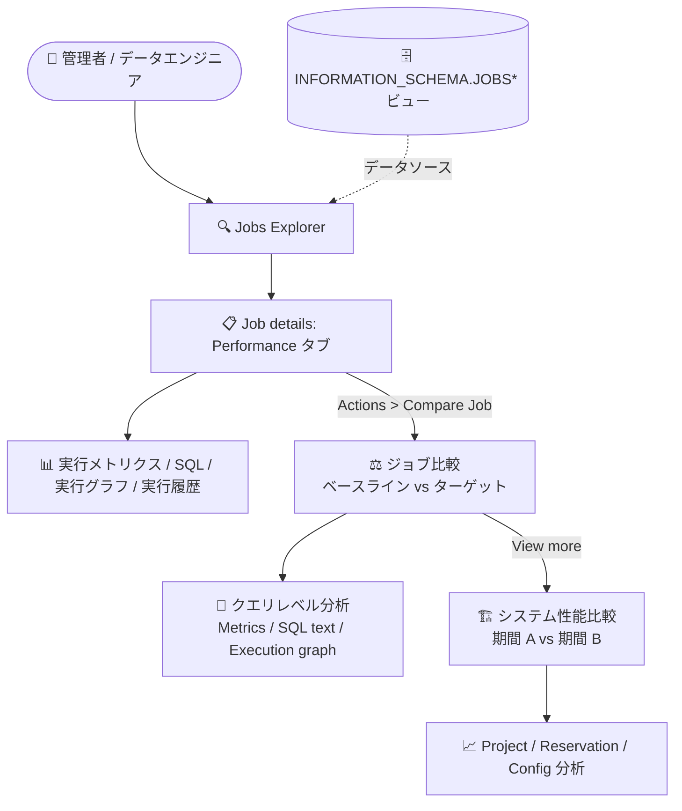

# BigQuery: Jobs Explorer のクエリパフォーマンストラブルシューティングとジョブ/システム性能比較が GA

**リリース日**: 2026-11-09

**サービス**: BigQuery

**機能**: Jobs Explorer におけるクエリパフォーマンストラブルシューティングおよびジョブ/システム性能比較

**ステータス**: GA (一般提供)

📊 [このアップデートのインフォグラフィックを見る](https://takech9203.github.io/google-cloud-news-summary/20261109-bigquery-jobs-explorer-performance-ga.html)

## 概要

BigQuery の管理者向け Jobs Explorer における「クエリパフォーマンストラブルシューティング」と「ジョブおよびシステムの性能比較」機能が一般提供 (GA) になりました。Jobs Explorer は Google Cloud コンソール上で組織全体のジョブをモニタリング・フィルタリング・トラブルシューティングできるツールで、今回 GA となった機能により、個々のジョブの実行メトリクス、SQL テキスト、実行グラフの詳細分析に加え、2 つのジョブ間または 2 つのシステム期間 (タイムインターバル) 間の性能差分を可視化できるようになりました。

性能比較ツールでは、ベースラインとターゲットの比較対象について、クエリレベルのメトリクス (ジョブ実行時間、スロット時間、処理バイト数など)、SQL テキストの差分、実行グラフのステージごとの比較を行えます。さらにシステムレベルでは、リザベーションやプロジェクトのスコープで 2 つの期間を比較し、スロット競合や設定変更が性能劣化の原因かどうかを切り分けられます。

対象ユーザーは、BigQuery の性能リグレッションを調査する管理者、FinOps/プラットフォームチーム、データエンジニアです。「昨日まで速かったクエリが今日遅い」といった典型的な調査を、INFORMATION_SCHEMA への手動クエリなしにコンソール上で完結できる点が主要な価値です。

**アップデート前の課題**

- ジョブの実行履歴や性能の経時変化を調べるには、`INFORMATION_SCHEMA.JOBS*` ビューに対して手動でクエリを書き、結果を自分で突き合わせる必要があった
- 2 つのジョブ実行間でどのメトリクスが有意に変化したか (実行時間、スロット時間、処理バイト数など) を比較する標準的な UI がなく、性能リグレッションの特定に時間がかかった
- 性能劣化の原因がクエリ自体にあるのか、リザベーションのスロット競合や設定変更などシステム側にあるのかを切り分けるには、複数のモニタリングツールを横断する必要があった

**アップデート後の改善**

- Job details ページの Performance タブで、実行メトリクス、SQL テキスト、クエリハッシュでグループ化された実行履歴、実行グラフ、実行中のシステム負荷をまとめて確認できるようになった
- ベースラインジョブとターゲットジョブをサイドバイサイドで比較し、変動幅 20% 超のメトリクスを色分け (緑: 改善、黄: 20% 未満の劣化、赤: 20% 超の劣化) して表示できるようになった
- システム性能比較により、リザベーション/プロジェクト単位で 2 つの期間 (ベースライン期間とターゲット期間) を比較し、同時実行数、キュー、スロット使用量、ワークロード管理設定の差分から劣化原因を切り分けられるようになった

## アーキテクチャ図



Jobs Explorer からジョブ詳細の Performance タブに入り、ジョブ間比較とシステム期間比較へドリルダウンする流れを示しています。裏側のデータは INFORMATION_SCHEMA のジョブビューから提供されます。

## サービスアップデートの詳細

### 主要機能

1. **ジョブパフォーマンストラブルシューティング (Job details の Performance タブ)**
   - ジョブ ID、作成時刻、処理バイト数、スロット使用量などのジョブ詳細を表示
   - クエリハッシュでグループ化された実行履歴から、過去の実行を選択して現在のジョブと直接比較可能
   - 実行グラフを展開して、スロット競合、シャッフル容量、入力データ規模を検査
   - ジョブ実行中に割り当てられたコンピュートリソースとリザベーション設定のサマリー (System load during execution) を表示

2. **ジョブ間の性能比較 (Compare two jobs)**
   - ベースラインジョブとターゲットジョブを選択し、「Similar comparable jobs」ペインから比較対象を参照
   - **Metrics タブ**: ジョブ実行時間、スロット時間、処理バイト数、未使用アクセラレータなどのコアメトリクスを比較
   - **SQL text タブ**: 両ジョブの SQL 文を表示し、テキスト差分をハイライト
   - **Execution graph タブ**: 両ジョブの実行グラフをステージごとに比較してボトルネック箇所を特定
   - 「Show only significant differences」トグルで変動幅 20% 超のメトリクスのみに絞り込み、色分け表示 (緑/黄/赤) で視覚的にスキャン可能

3. **システム期間の性能比較 (Compare two system intervals)**
   - リザベーションまたはプロジェクトのスコープを選択し、ターゲット期間 (問題発生時) とベースライン期間 (基準時) を指定して比較
   - **Project ブロック**: プロジェクトレベルのジョブ同時実行数、キュー済み同時実行数、合計スロット使用量を比較
   - **Reservation ブロック**: リザベーション使用率、アイドルスロット共有、共有リザベーション全体のプロジェクト同時実行数を比較
   - **Config analysis ブロック**: 最大リザベーションサイズ上限やアイドルスロット借用ルールなど、ワークロード管理設定の差分を比較
   - ジョブ比較の「System level outputs」セクションの「View more」から遷移可能

## 技術仕様

### 比較分析における色分けルール

| 色 | 意味 |
|------|------|
| 緑 | メトリクスが改善 (例: ターゲット実行でクエリ時間が短縮) |
| 黄 | メトリクスが 20% 未満の劣化 |
| 赤 | メトリクスが 20% 超の劣化 |

### 必要な IAM ロール

| 操作 | 必要なロール / 権限 |
|------|------|
| プロジェクトレベルでジョブを表示 | `roles/bigquery.resourceViewer` (プロジェクト) / `bigquery.jobs.listAll` |
| 組織レベルでジョブを表示 | `roles/bigquery.resourceViewer` (組織) / `bigquery.jobs.listAll` |
| ジョブ詳細の表示 | `roles/bigquery.resourceViewer` (クエリ実行元プロジェクト) |
| システムレベル詳細の表示 | `roles/bigquery.resourceViewer` (管理プロジェクト) |

### データソース

ジョブの詳細とインサイトは以下の INFORMATION_SCHEMA ビューから提供されます。

- `INFORMATION_SCHEMA.JOBS_BY_PROJECT`
- `INFORMATION_SCHEMA.JOBS_BY_ORGANIZATION`
- `INFORMATION_SCHEMA.JOBS_BY_USER`

## 設定方法

### 前提条件

1. 調査対象のプロジェクトまたは組織に対する `roles/bigquery.resourceViewer` ロールの付与
2. 組織レベルのビューを使用する場合は、Google Cloud 組織が定義されていること

### 手順

#### ステップ 1: ジョブのトラブルシューティング

1. Google Cloud コンソールで **Jobs explorer** ページに移動する
2. 必要に応じてフィルタ (ステータス、実行時間、オーナー、スロット使用量など) でジョブを絞り込む
3. 調査したいジョブのジョブ ID をクリックし、**Job details** ページの **Performance** タブを開く
4. 実行メトリクス、実行履歴、実行グラフ、実行中のシステム負荷を確認する

#### ステップ 2: ジョブ間の比較

1. ベースラインジョブの **Performance** タブで **Actions** メニューから **Compare Job** をクリックする
2. **Browse** をクリックして「Similar comparable jobs」ペインから比較対象のジョブを選択し、**Compare** をクリックする
3. 必要に応じて **Show only significant differences** をオンにし、変動幅 20% 超のメトリクスに絞り込む

#### ステップ 3: システム期間の比較

1. ジョブ比較結果の **System level outputs** セクションで **View more** をクリックする
2. **System** をクリックし、**Browse** からリザベーションまたはプロジェクトのスコープを選択する
3. **Target Interval** (問題発生期間) と **Baseline Interval** (基準期間) をそれぞれ指定して **Apply** をクリックする
4. Project / Reservation / Config analysis の各ブロックで差分を確認する

## メリット

### ビジネス面

- **調査時間の短縮**: 性能リグレッションの原因特定がコンソール内で完結し、SQL を書いてログを突き合わせる工数を削減できる
- **追加コストなし**: Jobs Explorer は追加料金なしで利用でき、チャート描画用のクエリは課金されずユーザー所有リザベーションのスロットも消費しない
- **GA による本番利用の安心感**: 一般提供となったことで、SLA の対象となり本番運用プロセスへの組み込みが可能になった

### 技術面

- **多層的な原因切り分け**: クエリレベル (SQL 差分、実行グラフ) とシステムレベル (スロット競合、同時実行数、設定変更) の両面から劣化原因を特定できる
- **有意差の自動ハイライト**: 変動幅 20% を閾値とした色分け表示により、多数のメトリクスから問題箇所を素早く発見できる
- **実行履歴ベースの比較**: クエリハッシュで同一クエリの過去実行がグループ化されるため、比較対象の選定が容易

## デメリット・制約事項

### 制限事項

- インサイトはアクセス制御の対象であり、権限が不足している場合は得られる情報が制限される
- チャート描画用のクエリは、処理データ量が多すぎる場合タイムアウトする
- 組織レベルのビューは Google Cloud 組織が定義されている場合のみ利用可能

### 考慮すべき点

- Gemini Code Assist / Gemini Cloud Assist を使ったエージェント型のパフォーマンストラブルシューティングインサイトは引き続き Preview であり、今回の GA 範囲には含まれない
- 組織制限 (organization restrictions) を使用している場合は、Google 所有リソースへのアクセス許可の追加設定が必要になることがある

## ユースケース

### ユースケース 1: 日次バッチクエリの突然の性能劣化調査

**シナリオ**: 毎朝実行している日次集計クエリの実行時間が、昨日まで 5 分だったのに今日は 20 分かかった。クエリの変更はしていないつもりだが、原因を特定したい。

**実装例**:
```
1. Jobs explorer で該当ジョブをフィルタして Job details を開く
2. Performance タブの実行履歴 (クエリハッシュでグループ化) から昨日の実行を選択
3. Compare Job で昨日 (ベースライン) と今日 (ターゲット) を比較
4. Show only significant differences をオンにし、赤色 (20% 超の劣化) の
   メトリクスと SQL text タブの差分、Execution graph のステージ比較を確認
```

**効果**: SQL の変更有無、処理バイト数の増加、特定ステージのボトルネックを数分で特定でき、INFORMATION_SCHEMA への手動クエリが不要になる。

### ユースケース 2: リザベーションのスロット競合による組織全体の性能劣化の切り分け

**シナリオ**: 複数チームが共有するリザベーションで、特定の時間帯だけクエリ全体が遅くなる。クエリ起因かシステム起因かを切り分けたい。

**効果**: システム性能比較で問題発生期間と正常期間を比較し、Project ブロックでキュー済み同時実行数の急増、Reservation ブロックでアイドルスロット共有の変化、Config analysis で最大リザベーションサイズ上限の設定変更などを確認して、スロット競合や設定リグレッションが原因かを特定できる。

## 料金

Jobs Explorer は追加料金なしで利用できます。チャートの描画に使われるクエリは課金対象外で、ユーザー所有リザベーションのスロットも消費しません (処理データ量が多すぎるクエリはタイムアウトします)。

- [BigQuery の料金ページ](https://cloud.google.com/bigquery/pricing)

## 関連サービス・機能

- **BigQuery Reservations / ワークロード管理**: システム比較の Config analysis で最大リザベーションサイズやアイドルスロット借用ルールの差分を分析できる
- **INFORMATION_SCHEMA.JOBS\* ビュー**: Jobs Explorer のデータソース。より詳細なカスタム分析が必要な場合は直接クエリ可能
- **BigQuery 管理リソースチャート (admin resource charts)**: 容量、スロットコミットメント、長期的なリザベーション使用率のモニタリングに使用
- **Gemini Cloud Assist / Gemini Code Assist (Preview)**: チャットペインでジョブ統計の分析や遅いクエリの説明、比較結果へのハンドオフリンク生成が可能なエージェント型トラブルシューティング

## 参考リンク

- 📊 [インフォグラフィック](https://takech9203.github.io/google-cloud-news-summary/20261109-bigquery-jobs-explorer-performance-ga.html)
- [公式リリースノート](https://docs.cloud.google.com/release-notes#November_09_2026)
- [ドキュメント: Monitor jobs (Jobs Explorer)](https://docs.cloud.google.com/bigquery/docs/admin-jobs-explorer)
- [ドキュメント: クエリパフォーマンスインサイトの取得](https://docs.cloud.google.com/bigquery/docs/query-insights)
- [料金ページ](https://cloud.google.com/bigquery/pricing)

## まとめ

BigQuery Jobs Explorer のパフォーマンストラブルシューティングとジョブ/システム性能比較の GA により、性能リグレッション調査が INFORMATION_SCHEMA への手動クエリなしにコンソール上で完結するようになりました。共有リザベーションを運用する組織では、クエリ起因かシステム起因かの切り分けが大幅に効率化されるため、まずは `roles/bigquery.resourceViewer` の付与状況を確認し、日常の性能調査フローに Jobs Explorer の比較機能を組み込むことを推奨します。

---

**タグ**: BigQuery, Jobs Explorer, パフォーマンス, トラブルシューティング, 性能比較, リザベーション, GA, オブザーバビリティ
