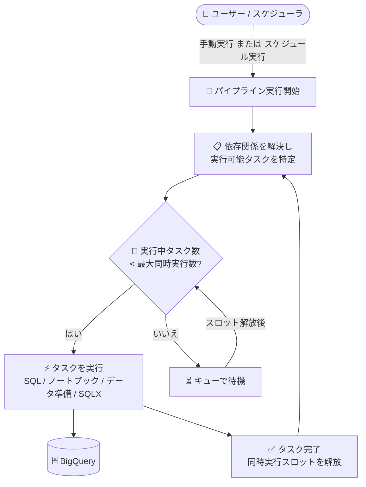

# BigQuery: パイプラインのタスク最大同時実行数の指定が GA

**リリース日**: 2026-11-09

**サービス**: BigQuery (パイプライン)

**機能**: パイプラインタスクの最大同時実行数の指定

**ステータス**: GA (一般提供)

📊 [このアップデートのインフォグラフィックを見る](https://takech9203.github.io/google-cloud-news-summary/20261109-bigquery-pipelines-concurrent-task-limit-ga.html)

## 概要

BigQuery パイプラインの作成時またはスケジュール設定時に、同時に実行されるパイプラインタスクの最大数を指定できる機能が一般提供 (GA) になりました。Google Cloud コンソールの実行・スケジュール設定画面で「Limit concurrent actions」オプションを有効にし、「Maximum concurrent actions」フィールドに 1〜5000 の整数を入力することで、同時実行タスク数を制御できます。

BigQuery パイプラインは Dataform を基盤とするオーケストレーション機能で、SQL クエリ、ノートブック、データ準備 (Data Preparation)、SQLX タスク (テーブル、ビュー、データ品質テストなど) といったコードアセットを依存関係に沿って順次・並列に実行します。多数のタスクを含むパイプラインでは、依存関係のないタスクが一斉に実行されるため、BigQuery のスロットやクォータへの負荷が集中する可能性がありました。本機能により、実行の同時実行度に上限を設け、リソース消費を平準化できます。

実行中のタスク数が指定した上限に達した場合、実行可能になった残りのタスクはキューに入り、同時実行スロットが空き次第、順次実行されます。同日に Dataform 側でも、単一のワークフロー実行またはワークフロー構成スケジュール内での同時実行アクション数を制限する機能が GA となっており、パイプラインと Dataform の両方で一貫した同時実行制御が可能になっています。

**アップデート前の課題**

- パイプライン実行時に、依存関係のないタスクの同時実行数をユーザー側で制御する GA の手段がなかった
- 多数のタスクが同時に実行されると、BigQuery のスロットや同時実行クォータ、参照先データソースへの負荷が一時的に集中する可能性があった

**アップデート後の改善**

- パイプラインの手動実行時およびスケジュール設定時に、最大同時実行タスク数 (1〜5000) を指定できるようになった
- 上限を超えた実行可能タスクは自動的にキューイングされ、スロットが空き次第実行されるため、追加の制御ロジックを実装する必要がない
- 本機能が GA となり、本番ワークロードでも安心して利用できるようになった

## アーキテクチャ図



パイプライン実行時、依存関係を満たして実行可能になったタスクは、設定した最大同時実行数の範囲内で実行されます。上限を超えたタスクはキューに入り、実行中のタスクが完了してスロットが空くと順次実行されます。

## サービスアップデートの詳細

### 主要機能

1. **最大同時実行タスク数の指定 (GA)**
   - パイプラインの実行・スケジュール設定画面で「Limit concurrent actions」を選択し、「Maximum concurrent actions」に 1〜5000 の整数を指定
   - 実行可能なタスク数が上限を超えた場合、残りのタスクはキューに入り、同時実行スロットが空き次第実行される

2. **手動実行とスケジュール実行の両方に対応**
   - スケジュール (時間ベースの定期実行) の設定時に指定可能
   - 手動実行時にも指定可能で、「タスクを選択して実行」や「タグによる実行」でも同じオプションを利用できる

3. **Dataform 側の対応機能も同日 GA**
   - BigQuery パイプラインは Dataform を基盤としており、Dataform でも単一のワークフロー実行・ワークフロー構成スケジュール内の同時実行アクション数の制限が同日に GA

## 技術仕様

### 同時実行制御の仕様

| 項目 | 詳細 |
|------|------|
| 設定箇所 | パイプラインの実行ペイン / スケジュール設定ペイン (Google Cloud コンソール) |
| オプション名 | Limit concurrent actions (同時実行アクションの制限) |
| 設定値 | Maximum concurrent actions: 1〜5000 の整数 |
| 上限超過時の動作 | 実行可能タスクはキューに入り、同時実行スロットが空き次第実行 |
| 対象タスク | SQL クエリ、ノートブック、データ準備、SQLX タスク (テーブル / ビュー / データ品質テストなど) |
| ステータス | GA (一般提供) |

## 設定方法

### 前提条件

1. BigQuery パイプラインが作成済みであること
2. スケジュール実行の場合、ユーザー認証情報またはサービスアカウントでの認証設定が必要

### 手順

#### スケジュール実行で同時実行数を制限する

1. Google Cloud コンソールで BigQuery ページに移動する
2. Explorer ペインでプロジェクトを展開し、**Pipelines** から対象のパイプラインを選択する
3. **Schedule** をクリックし、スケジュール名・認証方法・実行頻度などを設定する
4. **Limit concurrent actions** を選択し、**Maximum concurrent actions** フィールドに 1〜5000 の整数を入力する
5. **Create schedule** をクリックする

#### 手動実行で同時実行数を制限する

1. 対象のパイプラインを開き、**Run** > **Select tasks to run** (または **Run by tag**) を選択する
2. 認証方法と実行対象のタスク (またはタグ) を選択する
3. 実行オプションで **Limit concurrent actions** を選択し、**Maximum concurrent actions** に上限値を入力する
4. **Run** をクリックする

## メリット

### ビジネス面

- **リソース消費の平準化**: 大規模パイプラインの一斉実行による瞬間的なスロット消費の集中を抑え、他のワークロードへの影響を軽減できる
- **本番利用の安心感**: GA となったことで、SLA が適用される本番環境のパイプラインでも採用しやすくなった

### 技術面

- **自動キューイング**: 上限超過分のタスクは BigQuery が自動的にキュー管理するため、独自のスロットリング実装が不要
- **柔軟な粒度**: 1〜5000 の広い範囲で指定でき、小規模な逐次実行から大規模な並列実行まで調整可能
- **実行方法を問わない一貫性**: スケジュール実行・手動実行 (タスク選択・タグ実行) のいずれでも同じオプションで制御できる

## デメリット・制約事項

### 制限事項

- パイプラインは Google Cloud コンソールでのみ利用可能
- 作成後にパイプラインの保存リージョンを変更することはできない
- スケジュール実行では、前回の実行が次回の開始時刻までに完了しない場合、次回の実行はスキップされエラーとしてマークされる

### 考慮すべき点

- 同時実行数を小さくしすぎると、キュー待ちによりパイプライン全体の実行時間が長くなり、スケジュール実行のスキップにつながる可能性がある
- 同時実行の上限はタスクのキューイングで制御されるため、個々のクエリジョブの優先度 (インタラクティブ / バッチ) 設定とあわせて全体の負荷特性を設計する必要がある

## ユースケース

### ユースケース 1: 多数の変換タスクを持つ ELT パイプラインの負荷制御

**シナリオ**: 数十個の SQLX タスク (テーブル・ビュー) を含む日次 ELT パイプラインで、依存関係のないタスクが一斉に実行され、同一リザベーションを共有するダッシュボード系クエリのパフォーマンスが低下する。

**実装例**:
```text
スケジュール設定で以下を指定:
- Limit concurrent actions: 有効
- Maximum concurrent actions: 5
→ 同時に実行される変換タスクを最大 5 個に制限し、残りはキューで待機
```

**効果**: パイプラインによるスロット消費がピーク時でも一定範囲に収まり、同居するインタラクティブクエリへの影響を抑制できる。

### ユースケース 2: 外部データソースを参照するタスクのスロットリング

**シナリオ**: 外部システムやデータ準備タスクを多数含むパイプラインで、同時アクセス数を抑えたい。

**効果**: 最大同時実行数を指定することで、参照先への同時アクセスを一定数以下に保ち、接続エラーやクォータ超過のリスクを低減できる。

## 料金

本機能に固有の料金情報はリリースノートに記載されていません。パイプラインから実行される SQL クエリやノートブックには、通常の BigQuery の料金体系が適用されます。詳細は [BigQuery の料金ページ](https://cloud.google.com/bigquery/pricing) を参照してください。

## 関連サービス・機能

- **Dataform**: BigQuery パイプラインの実行基盤。同日に Dataform 側でも、単一のワークフロー実行・ワークフロー構成スケジュール内の同時実行アクション数の制限が GA になった
- **BigQuery クエリジョブ優先度 (インタラクティブ / バッチ)**: パイプライン実行時にクエリジョブの優先度を選択でき、同時実行数の制限と組み合わせて負荷を制御できる
- **Colab Enterprise (ノートブックランタイム)**: パイプライン内のノートブックタスクの実行環境。ランタイムテンプレートはパイプラインと同一リージョンである必要がある

## 参考リンク

- 📊 [インフォグラフィック](https://takech9203.github.io/google-cloud-news-summary/20261109-bigquery-pipelines-concurrent-task-limit-ga.html)
- [公式リリースノート](https://docs.cloud.google.com/release-notes#November_09_2026)
- [パイプラインの作成 (Create pipelines)](https://docs.cloud.google.com/bigquery/docs/create-pipelines)
- [パイプラインのスケジュール設定 (Schedule pipelines)](https://docs.cloud.google.com/bigquery/docs/schedule-pipelines)
- [BigQuery パイプラインの概要](https://docs.cloud.google.com/bigquery/docs/pipelines-introduction)
- [料金ページ](https://cloud.google.com/bigquery/pricing)

## まとめ

BigQuery パイプラインのタスク最大同時実行数の指定が GA となり、大規模パイプラインの実行負荷をコンソールの設定だけで制御できるようになりました。多数のタスクを含むパイプラインを運用しているチームは、スロット消費のピークや外部リソースへの同時アクセスを平準化するために、スケジュール設定で「Limit concurrent actions」の適用を検討することを推奨します。

---

**タグ**: BigQuery, パイプライン, Dataform, 同時実行制御, GA, データエンジニアリング
