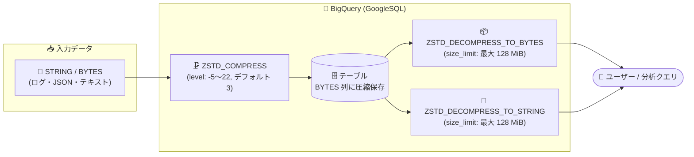

# BigQuery: GoogleSQL の Zstandard (Zstd) 圧縮関数 (Preview)

**リリース日**: 2026-11-09

**サービス**: BigQuery

**機能**: GoogleSQL 圧縮関数 (ZSTD_COMPRESS / ZSTD_DECOMPRESS_TO_BYTES / ZSTD_DECOMPRESS_TO_STRING)

**ステータス**: Preview

📊 [このアップデートのインフォグラフィックを見る](https://takech9203.github.io/google-cloud-news-summary/20261109-bigquery-zstd-compression-functions-preview.html)

## 概要

BigQuery の GoogleSQL に、Zstandard (Zstd) ロスレス圧縮アルゴリズムを使用してバイト列や文字列の値を圧縮・解凍できる圧縮関数が Preview として追加されました。サポートされる関数は `ZSTD_COMPRESS`、`ZSTD_DECOMPRESS_TO_BYTES`、`ZSTD_DECOMPRESS_TO_STRING` の 3 つです。

Zstd は高い圧縮率と高速な圧縮・解凍性能を両立するアルゴリズムとして広く採用されており、これらの関数により SQL クエリ内で直接データの圧縮・解凍を完結できるようになります。大きなテキストや JSON ペイロード、ログデータなどを BYTES 型として圧縮保存し、必要なときだけ SQL で解凍するといったワークフローが、外部処理なしで実現できます。

同等の圧縮関数は Spanner の GoogleSQL でも提供されており、GoogleSQL 方言を使うサービス間で一貫した圧縮処理が可能になります。対象ユーザーは、大容量のテキスト/バイナリデータをコスト効率よく保持したいデータエンジニアや、他システムで Zstd 圧縮されたデータを BigQuery 内で直接扱いたい開発者です。

**アップデート前の課題**

- BigQuery の SQL 内でデータを圧縮・解凍する組み込み関数がなく、圧縮処理はクライアントアプリケーションや ETL パイプライン側で実装する必要があった
- 他システムで Zstd 圧縮されて取り込まれた BYTES データを、BigQuery 上で解凍して参照するには一度データをエクスポートするか UDF などの回避策が必要だった
- 大きな文字列データをそのまま保持するとストレージ効率が悪く、圧縮したい場合は外部処理を挟むためパイプラインが複雑化していた

**アップデート後の改善**

- `ZSTD_COMPRESS` により、STRING / BYTES 値を SQL クエリ内で直接 Zstd 圧縮できるようになった (圧縮レベルは -5 〜 22 で指定可能、デフォルト 3)
- `ZSTD_DECOMPRESS_TO_BYTES` / `ZSTD_DECOMPRESS_TO_STRING` により、Zstd 圧縮済みの BYTES を SQL 内で BYTES または STRING に解凍できるようになった
- `size_limit` 引数 (デフォルトおよび最大 128 MiB) により、解凍結果のサイズを制限してメモリ問題のリスクを抑制できる

## アーキテクチャ図



元の STRING/BYTES 値を `ZSTD_COMPRESS` で圧縮して BYTES 列に保存し、参照時に `ZSTD_DECOMPRESS_TO_BYTES` / `ZSTD_DECOMPRESS_TO_STRING` で解凍するデータフローです。圧縮から解凍まで SQL 内で完結します。

## サービスアップデートの詳細

### 主要機能

1. **ZSTD_COMPRESS**
   - STRING または BYTES の入力を Zstd アルゴリズムで圧縮し、BYTES として返す
   - 圧縮レベル `level` は -5 〜 22 の整数で指定可能 (デフォルト 3)。値が大きいほど圧縮率が高くなるが、処理は遅くなる
   - 入力または `level` が NULL の場合は NULL を返す

2. **ZSTD_DECOMPRESS_TO_BYTES**
   - Zstd 圧縮された BYTES を解凍して BYTES として返す
   - 入力は、非圧縮コンテンツサイズをヘッダーに含む有効な Zstd フレームである必要がある (`ZSTD_COMPRESS` の出力は常にこの条件を満たす)
   - `size_limit` で解凍結果のサイズ上限を指定可能 (デフォルト・最大とも 128 MiB)。超過するとエラーを返す

3. **ZSTD_DECOMPRESS_TO_STRING**
   - Zstd 圧縮された BYTES を解凍して STRING として返す
   - `ZSTD_DECOMPRESS_TO_BYTES` と同様に `size_limit` (デフォルト・最大 128 MiB) をサポート
   - 入力が NULL の場合は NULL を返す

## 技術仕様

### 関数一覧

| 関数 | 入力 | 出力 | 主なオプション |
|------|------|------|----------------|
| `ZSTD_COMPRESS` | STRING / BYTES | BYTES | `level` (-5〜22、デフォルト 3) |
| `ZSTD_DECOMPRESS_TO_BYTES` | BYTES (Zstd フレーム) | BYTES | `size_limit` (デフォルト・最大 128 MiB) |
| `ZSTD_DECOMPRESS_TO_STRING` | BYTES (Zstd フレーム) | STRING | `size_limit` (デフォルト・最大 128 MiB) |

### 使用例

```sql
-- 文字列を圧縮 (デフォルトレベル 3)
SELECT ZSTD_COMPRESS('string_value') AS result;
-- 結果: KLUv/SAMYQAAc3RyaW5nX3ZhbHVl (Base64 表現)

-- 圧縮レベルを指定して圧縮
SELECT ZSTD_COMPRESS(b'bytes_value', level => 1);

-- 圧縮と解凍のラウンドトリップ
SELECT ZSTD_DECOMPRESS_TO_STRING(ZSTD_COMPRESS('zstd')) AS result;
-- 結果: "zstd"

-- size_limit を超えるとエラー
SELECT ZSTD_DECOMPRESS_TO_STRING(ZSTD_COMPRESS('zstd'), size_limit => 1) AS result;
-- Statement failed: ZSTD output is too large: (4 bytes) > limit (1 bytes)
```

## メリット

### ビジネス面

- **パイプラインの簡素化**: 外部ツールや ETL 処理を介さず SQL だけで圧縮・解凍が完結するため、開発・運用コストを削減できる
- **ストレージ効率の向上**: 大きなテキストや JSON などを圧縮して保存することで、物理ストレージ使用量を抑えられる可能性がある

### 技術面

- **圧縮レベルの柔軟な制御**: -5 〜 22 の圧縮レベルを指定でき、圧縮率と処理速度のトレードオフをユースケースに合わせて調整できる
- **安全な解凍処理**: `size_limit` によって解凍後サイズの上限を制御でき、巨大データの解凍によるサーバーメモリ問題のリスクを低減できる
- **GoogleSQL 間の一貫性**: Spanner の GoogleSQL にも同名の圧縮関数があり、サービス間で一貫した圧縮ロジックを利用できる

## デメリット・制約事項

### 制限事項

- Preview のため、Pre-GA Offerings Terms が適用され、サポートが限定される場合がある
- 解凍結果のサイズ上限は 128 MiB (BigQuery での `size_limit` のデフォルトかつ最大値) であり、それを超えるデータは解凍できない
- 解凍対象の BYTES は、非圧縮コンテンツサイズをヘッダーに含む有効な Zstd フレームである必要がある (外部ツールで生成したフレームは条件を満たさない場合がある)

### 考慮すべき点

- 圧縮レベルを高くするほど圧縮率は向上するが、クエリの処理時間 (スロット消費) が増加する点に留意する
- 圧縮した列は BigQuery のネイティブなカラムナ圧縮や関数 (文字列検索など) の対象として直接扱えなくなるため、頻繁に検索・フィルタする列への適用は慎重に判断する
- フィードバックや Preview 機能のサポート依頼は bigquery-sql-preview-support@googlegroups.com 宛てに送付する

## ユースケース

### ユースケース 1: 大きな JSON ペイロードの圧縮保存

**シナリオ**: アプリケーションログに含まれる大きな JSON ペイロードを BigQuery に長期保存したいが、参照頻度は低く、ストレージ効率を優先したい。

**実装例**:
```sql
-- 取り込み時に圧縮して保存
INSERT INTO logs.archived_payloads (log_id, payload_compressed)
SELECT log_id, ZSTD_COMPRESS(payload_json, level => 10)
FROM logs.raw_events;

-- 必要なときだけ解凍して参照
SELECT log_id, ZSTD_DECOMPRESS_TO_STRING(payload_compressed) AS payload_json
FROM logs.archived_payloads
WHERE log_id = 'abc-123';
```

**効果**: 参照頻度の低い大容量テキストを圧縮状態で保持し、必要時のみ SQL で解凍することでストレージ効率と運用のシンプルさを両立できる。

### ユースケース 2: 外部システムで Zstd 圧縮されたデータの直接解凍

**シナリオ**: 他システムから Zstd 圧縮済みの BYTES データが BigQuery に取り込まれており、分析時に解凍して内容を確認したい。

**効果**: データをエクスポートして外部で解凍する手間がなくなり、`ZSTD_DECOMPRESS_TO_STRING` / `ZSTD_DECOMPRESS_TO_BYTES` を使って BigQuery 内で直接分析できる (入力が有効な Zstd フレームである必要あり)。

## 料金

この機能自体に追加料金の記載はありません。関数の実行は通常の BigQuery クエリとして課金されます (オンデマンドまたは BigQuery Editions)。詳細は料金ページを参照してください。

- [BigQuery の料金](https://cloud.google.com/bigquery/pricing)

## 関連サービス・機能

- **Spanner (GoogleSQL 圧縮関数)**: Spanner の GoogleSQL にも同名の `ZSTD_COMPRESS` / `ZSTD_DECOMPRESS_TO_BYTES` / `ZSTD_DECOMPRESS_TO_STRING` が提供されており、GoogleSQL 方言間で一貫した圧縮処理が可能 (Spanner では `size_limit` のデフォルトは 1 GiB)
- **BigQuery GoogleSQL 関数リファレンス**: 圧縮関数は GoogleSQL の関数群の一部として提供され、他の文字列関数・バイト関数と組み合わせて利用できる

## 参考リンク

- 📊 [インフォグラフィック](https://takech9203.github.io/google-cloud-news-summary/20261109-bigquery-zstd-compression-functions-preview.html)
- [公式リリースノート](https://docs.cloud.google.com/release-notes#November_09_2026)
- [ドキュメント: Compression functions (BigQuery)](https://docs.cloud.google.com/bigquery/docs/reference/standard-sql/compression-functions)
- [ドキュメント: Compression functions (Spanner)](https://docs.cloud.google.com/spanner/docs/reference/standard-sql/compression-functions)
- [料金ページ](https://cloud.google.com/bigquery/pricing)

## まとめ

BigQuery の GoogleSQL に Zstd 圧縮・解凍関数が Preview 追加され、外部処理なしに SQL 内でデータの圧縮・解凍が完結できるようになりました。大容量テキストの圧縮保存や、Zstd 圧縮済みデータの直接解凍が必要な場合は、圧縮レベルと `size_limit` (最大 128 MiB) の制約を確認したうえで検証を始めることを推奨します。

---

**タグ**: BigQuery, GoogleSQL, Zstandard, Zstd, 圧縮関数, ZSTD_COMPRESS, Preview, データ圧縮
