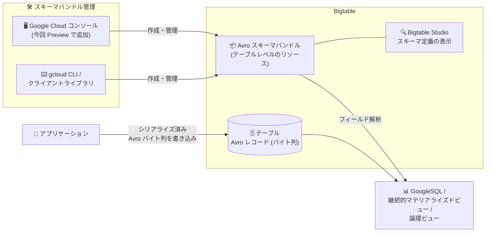

# Bigtable: Google Cloud コンソールでの Avro スキーマバンドル作成・管理 (Preview)

**リリース日**: 2026-11-09

**サービス**: Bigtable

**機能**: Google Cloud コンソールによる Apache Avro スキーマバンドルの作成・管理と Bigtable Studio でのスキーマ定義表示

**ステータス**: Feature, Preview

📊 [このアップデートのインフォグラフィックを見る](https://takech9203.github.io/google-cloud-news-summary/20261109-bigtable-avro-schema-bundles-console-preview.html)

## 概要

Google Cloud コンソールを使用して、Bigtable テーブルの Apache Avro スキーマバンドルを作成・管理できるようになりました。また、Bigtable Studio で Avro スキーマバンドルの定義を表示することもできます。本機能は Preview として提供されます。

Avro スキーマバンドルは、Bigtable のカラムにシリアライズされたバイト列として格納された Avro レコードの個々のフィールドを、GoogleSQL for Bigtable・継続的マテリアライズドビュー・論理ビューからクエリ可能にするテーブルレベルのリソースです。JSON 形式の Avro スキーマを 1 つ以上含むバンドルをテーブルにアップロードすることで、書き込み方法を変えることなく (Avro レコードは従来どおり生のバイト列として書き込む)、サーバーサイドで Avro のフィールドを解析してクエリできます。

今回のアップデートにより、スキーマバンドルの作成・管理が gcloud CLI やクライアントライブラリに加えて Google Cloud コンソールの GUI からも行えるようになり、Avro データを扱う開発者・データエンジニアの運用負荷が軽減されます。

**アップデート前の課題**

- Avro スキーマバンドルの作成・更新・削除は gcloud CLI (`gcloud bigtable schema-bundles` コマンド) やクライアントライブラリ経由で行う必要があった
- スキーマバンドルの定義を確認するには `gcloud bigtable schema-bundles describe` コマンドなどを実行する必要があり、コンソール上で視覚的に確認する手段がなかった

**アップデート後の改善**

- Google Cloud コンソールの GUI から Avro スキーマバンドルを作成・管理できるようになった
- Bigtable Studio の Explorer ペインから Avro スキーマバンドルの定義を直接表示できるようになり、テーブル・ビューと合わせてスキーマを一元的に確認できる

## アーキテクチャ図



アプリケーションは従来どおり Avro レコードをバイト列として Bigtable に書き込み、テーブルにアップロードしたスキーマバンドルを使って GoogleSQL などから個々のフィールドをクエリします。今回のアップデートで、このスキーマバンドルの作成・管理がコンソールから、定義の確認が Bigtable Studio から行えるようになりました。

## サービスアップデートの詳細

### 主要機能

1. **Google Cloud コンソールからの Avro スキーマバンドル作成・管理**
   - gcloud CLI に加えて、コンソールの GUI から Avro スキーマバンドルを作成・管理できる
   - JSON 形式 (AVSC または JSON ファイル) の Avro レコードスキーマをバンドルとしてテーブルに登録する

2. **Bigtable Studio でのスキーマバンドル定義の表示**
   - Bigtable Studio の Explorer ペインでテーブル配下の「Schema Bundles」を展開し、スキーマバンドルの定義をタブで表示できる
   - アクションメニューからスキーマバンドルを使用したサンプル SQL クエリを SQL クエリエディタで開くこともできる

3. **既存の Avro スキーマバンドル機能との統合**
   - アップロード後は GoogleSQL for Bigtable、継続的マテリアライズドビュー、論理ビューで Avro レコード内のフィールドをクエリできる
   - 書き込みパスは変更不要で、セルのペイロードはスキーマやスキーマフィンガープリントを埋め込まない生の Avro バイト列のまま

## 技術仕様

### スキーマバンドルの仕様と制限

| 項目 | 詳細 |
|------|------|
| リソースレベル | テーブルレベル (1 バンドルに 1 つ以上の Avro レコードスキーマを含む) |
| スキーマ形式 | JSON 形式の Avro スキーマ (AVSC / JSON ファイル)。トップレベルが自己完結したレコードスキーマで、依存関係はすべてインライン化が必要 |
| バンドル数上限 | テーブルあたり 10 バンドル (Avro と protobuf の合計) |
| サイズ上限 | バンドル内の JSON 形式 Avro スキーマ合計 4 MB (内部変換される protobuf ディスクリプタセットも 4 MB 以内) |
| バンドル ID | 1〜50 文字。英数字・アンダースコア・ハイフンのみ。ハイフン開始とピリオドは不可 |
| クエリ手段 | GoogleSQL for Bigtable、継続的マテリアライズドビュー、論理ビュー (ReadRows API と BigQuery 外部テーブルはサーバーサイド Avro 解析非対応) |
| 更新の制約 | 既存バンドルへはレコード/enum 定義の追加のみ可能。登録済み定義の変更・削除は不可。Avro と protobuf 間のタイプ変更は不可 |

### 非対応の Avro スキーマ型・構造 (抜粋)

- `fixed` 型および `date`、`duration`、`time-micros`、`uuid` などの論理型
- null 以外の型を複数含むマルチブランチ union (`["null", "string"]` のような nullable union のみ対応)
- 配列やマップを含むネストしたコレクション、nullable 要素を持つ配列
- 循環・再帰的なレコード定義、32 レベルを超える深いネスト
- Avro namespace 値のアンダースコア (`_`)

### 必要な IAM ロール・権限

| 操作 | ロール / 権限 |
|------|---------------|
| スキーマバンドルの作成・管理 | Bigtable 管理者 (`roles/bigtable.admin`)。権限: `bigtable.schemaBundles.create` / `update` / `delete` / `get` / `list` など |
| 読み取り専用アクセスと GoogleSQL でのクエリ | Bigtable 読み取り (`roles/bigtable.reader`) または Bigtable ユーザー (`roles/bigtable.user`)。権限: `bigtable.tables.readRows`、`bigtable.instances.executeQuery` |

## 設定方法

### 前提条件

1. Bigtable インスタンスとテーブルが存在すること
2. Cloud Bigtable API と Cloud Bigtable Admin API が有効化されていること (`gcloud services enable bigtable.googleapis.com bigtableadmin.googleapis.com`)
3. 依存関係をインライン化した自己完結の JSON 形式 Avro スキーマファイル (AVSC / JSON) を準備しておくこと

### 手順

#### ステップ 1: Avro スキーマバンドルを作成する (gcloud の例)

```bash
gcloud bigtable schema-bundles create SCHEMA_BUNDLE_ID \
  --instance=INSTANCE_ID \
  --table=TABLE_ID \
  --avro-schema-path=AVRO_SCHEMA_PATH
```

`AVRO_SCHEMA_PATH` には JSON 形式の Avro スキーマファイル、または複数のスキーマファイルを含むディレクトリのパスを指定します。今回のアップデートにより、同等の操作を Google Cloud コンソールからも実行できます。

#### ステップ 2: Bigtable Studio でスキーマバンドル定義を表示する

1. Google Cloud コンソールで Bigtable インスタンスの一覧を開き、インスタンスを選択する
2. ナビゲーションペインで「Bigtable Studio」をクリックする
3. Explorer ペインで対象テーブルを展開し、「Schema Bundles」を展開する
4. 表示したいスキーマバンドルをクリックすると、定義を表示するタブが開く (アクションメニューから「Sample query」を選ぶとサンプルクエリ付きの SQL エディタを開ける)

#### ステップ 3: Avro データをクエリする

スキーマバンドルの登録後、GoogleSQL for Bigtable、継続的マテリアライズドビュー、または論理ビューから Avro レコード内のフィールドをクエリできます。

## メリット

### ビジネス面

- **運用の民主化**: CLI に不慣れなメンバーでもコンソールからスキーマバンドルを作成・管理でき、Avro データ活用の導入障壁が下がる
- **確認作業の効率化**: Bigtable Studio 上でテーブル・ビューとスキーマ定義を一元的に確認でき、スキーマに関する調査・レビューが迅速になる

### 技術面

- **書き込みパスへの影響なし**: スキーマバンドルの導入・管理方法に関わらず、アプリケーションは従来どおり生の Avro バイト列を書き込むだけでよい
- **サンプルクエリの即時生成**: Bigtable Studio からスキーマバンドルを使用したサンプル SQL クエリをワンクリックで開けるため、GoogleSQL でのクエリ開発を素早く開始できる

## デメリット・制約事項

### 制限事項

- 本機能は Preview であり、Pre-GA Offerings Terms が適用される (サポートが限定される可能性がある)
- Avro スキーマバンドル自体も Preview 段階の機能である
- 登録済みの Avro レコード/enum 定義は変更・削除できない (更新はスキーマの追加のみ)
- 継続的マテリアライズドビューや論理ビューが参照しているスキーマバンドルは削除できない (先にビューの削除または参照の解除が必要)
- 削除したスキーマバンドルは復元できない

### 考慮すべき点

- 実行時のクエリ失敗やフィールドの誤マッピングを防ぐため、書き込み時に使用したスキーマと完全に同一のスキーマで読み取る必要がある
- クエリ時にはフィールドのデフォルト値 (`default`)、`aliases`、`doc`、ソート順 (`order`) などの属性は無視される
- `fixed` 型・論理型・マルチブランチ union など非対応のスキーマ構造が既存の Avro スキーマに含まれていないか事前に確認が必要

## ユースケース

### ユースケース 1: コンソール中心の運用チームによる Avro スキーマ管理

**シナリオ**: イベントストリームの Avro レコードを Bigtable に格納しているチームで、スキーマ管理を担当するメンバーが CLI 環境を持たず、コンソール中心で運用している。

**効果**: gcloud のセットアップなしにコンソールからスキーマバンドルを作成・管理でき、Bigtable Studio で定義を確認しながら GoogleSQL クエリを開発できる。

### ユースケース 2: Bigtable Studio でのスキーマ確認とクエリ開発

**シナリオ**: データアナリストが Bigtable 上の Avro データを GoogleSQL でクエリする際、どのレコードスキーマが登録されているかを確認したい。

**効果**: Bigtable Studio の Explorer ペインでスキーマバンドル定義をタブ表示し、サンプルクエリを起点にクエリを組み立てられるため、CLI での `describe` 実行が不要になる。

## 料金

Avro スキーマバンドルの作成・管理に追加料金はかかりません。リクエストとレスポンスには標準のネットワーク帯域幅料金が適用されます。Data Boost サーバーレスコンピュートを使用して Bigtable からデータを読み取る場合は、クエリが消費するコンピュートリソースに対して課金されます。

詳細は [Bigtable の料金ページ](https://docs.cloud.google.com/bigtable/pricing) を参照してください。

## 関連サービス・機能

- **GoogleSQL for Bigtable**: スキーマバンドルに登録した Avro レコードのフィールドを SQL でクエリする実行基盤
- **継続的マテリアライズドビュー / 論理ビュー**: スキーマバンドルを参照して Avro データを変換・公開するビュー機能
- **protobuf スキーマバンドル**: Avro と同様に Bigtable のバイト列を構造化してクエリするための protobuf 版スキーマバンドル (バンドル数上限は Avro と合算)
- **Data Boost**: Bigtable からの読み取りに使用できるサーバーレスコンピュート (使用時はクエリのコンピュートリソースに課金)

## 参考リンク

- 📊 [インフォグラフィック](https://takech9203.github.io/google-cloud-news-summary/20261109-bigtable-avro-schema-bundles-console-preview.html)
- [公式リリースノート](https://docs.cloud.google.com/release-notes#November_09_2026)
- [ドキュメント: Create and manage Avro schemas](https://docs.cloud.google.com/bigtable/docs/create-manage-avro-schemas)
- [ドキュメント: Query Avro data](https://docs.cloud.google.com/bigtable/docs/query-avro-data)
- [料金ページ](https://docs.cloud.google.com/bigtable/pricing)

## まとめ

Bigtable の Avro スキーマバンドルが Google Cloud コンソールから作成・管理できるようになり、Bigtable Studio でスキーマ定義も確認できるようになりました。CLI を使わずに Avro データのスキーマ管理とクエリ開発を始められるため、Bigtable に Avro レコードを格納しているチームは、まず Bigtable Studio で既存テーブルへのスキーマバンドル登録を試すことをお勧めします。Preview 機能のため、本番運用への適用は Pre-GA の提供条件を確認のうえ判断してください。

---

**タグ**: Bigtable, Avro, スキーマバンドル, Bigtable Studio, Google Cloud コンソール, GoogleSQL, Preview
