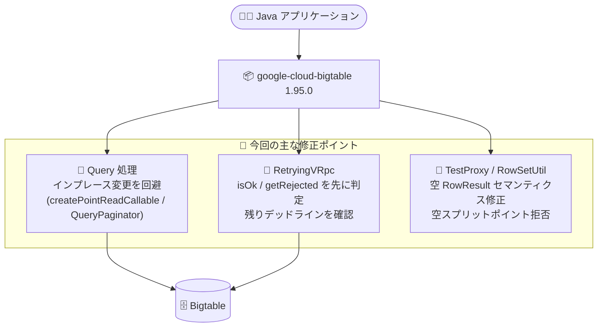

# Bigtable: Java クライアントライブラリ 1.95.0 リリース (バグ修正)

**リリース日**: 2026-11-09 (ライブラリリリース日: 2026-11-02)

**サービス**: Bigtable

**機能**: Java クライアントライブラリ 1.95.0 (Bug Fixes / Documentation)

**ステータス**: GA (ライブラリリリース)

📊 [このアップデートのインフォグラフィックを見る](https://takech9203.github.io/google-cloud-news-summary/20261109-bigtable-java-client-1-95-0.html)

## 概要

Bigtable の Java クライアントライブラリ (`google-cloud-bigtable`) のバージョン 1.95.0 が 2026 年 11 月 2 日にリリースされ、2026 年 11 月 9 日付の Google Cloud Release Notes に掲載されました。本リリースは新機能の追加ではなく、クエリ処理・リトライ処理・テスト用コンポーネントに関する 10 件のバグ修正と 1 件のドキュメント改善を含むメンテナンスリリースです。

修正の中心は 2 つの領域です。1 つ目は `Query` オブジェクトの不変性 (イミュータビリティ) に関する修正で、ポイントリード (`createPointReadCallable`) やページネーション (`QueryPaginator`) の内部処理で `Query` をインプレースで変更してしまう問題が解消されました。2 つ目はリトライ処理 (`RetryingVRpc`) の堅牢化で、リトライ判定時に `isOk` と `getRejected` を先に確認するようになったほか、クライアント起点のリトライで残りデッドラインを確認するようになり、デッドラインを超過した無駄なリトライ試行が行われにくくなりました。

Bigtable を Java アプリケーションから利用しているすべての開発者が対象です。特に `Query` オブジェクトを再利用するコードや、ページネーション・リトライ設定に依存するワークロードでは、本バージョンへのアップデートにより予期しない挙動が解消される可能性があります。

**アップデート前の課題**

- `createPointReadCallable` や `QueryPaginator` の内部で `Query` オブジェクトがインプレースで変更されるため、同じ `Query` インスタンスを再利用すると意図しない挙動になる可能性があった
- `RetryingVRpc.shouldRetry` のリトライ判定で `isOk` / `getRejected` の確認順序が適切でなく、またクライアント起点のリトライで残りデッドラインが確認されていなかった
- `Query` の `equals` / `hashCode` / `toString` に `reversed` (逆順スキャン) フラグが含まれておらず、逆順スキャンの有無だけが異なるクエリが等価と判定され得た
- `QueryPaginator` で `pageSize` より小さいクエリの `limit` が尊重されないケースがあった
- `RowSetUtil` が空のスプリットポイントを受け付けてしまっていた
- TestProxy における空の `RowResult` のセマンティクスが正しくなかった

**アップデート後の改善**

- `Query` の不変性が保たれるようになり、ポイントリードやページネーションで同一 `Query` インスタンスを安全に再利用できるようになった
- リトライ判定が堅牢化され、残りデッドラインを考慮したクライアント起点リトライにより、デッドライン超過後の無駄な試行が抑止されるようになった
- `reversed` フラグが `equals` / `hashCode` / `toString` に含まれ、逆順スキャンクエリの比較・デバッグが正確になった
- クエリの `limit` が `pageSize` より小さい場合も正しく尊重されるようになった
- `RowSetUtil` が空のスプリットポイントを拒否するようになり、`QueryPaginator` の Javadoc も明確化された
- スキップされた大きな行 (large rows) が行数制限 (row limit) にカウントされることがドキュメントに明記された

## アーキテクチャ図



Java アプリケーションと Bigtable の間に位置するクライアントライブラリ内部の、クエリ処理・リトライ処理・テスト用コンポーネントの 3 領域が今回のバグ修正の対象です。

## サービスアップデートの詳細

### 主要な修正内容 (Bug Fixes)

1. **Query オブジェクトの不変性に関する修正**
   - `createPointReadCallable` で `Query` をインプレースで変更しないよう修正 ([#14797](https://github.com/googleapis/java-bigtable/pull/14797))
   - `QueryPaginator` で `pageSize` より小さいクエリの `limit` を尊重し、`Query` のインプレース変更を回避 ([#14821](https://github.com/googleapis/java-bigtable/pull/14821))
   - `Query` の `equals` / `hashCode` / `toString` に `reversed` フラグを含めるよう修正 ([#14799](https://github.com/googleapis/java-bigtable/pull/14799))

2. **リトライ処理 (RetryingVRpc) の堅牢化**
   - `RetryingVRpc.shouldRetry` で `isOk` と `getRejected` を最初に確認するよう修正 ([#14795](https://github.com/googleapis/java-bigtable/pull/14795))
   - クライアント起点のリトライで残りデッドラインを確認するよう修正 ([#14796](https://github.com/googleapis/java-bigtable/pull/14796))
   - セッションダイバージョンを単一の共有ルールで解決するよう修正 ([#14738](https://github.com/googleapis/java-bigtable/pull/14738))

3. **その他の修正**
   - TestProxy における空の `RowResult` セマンティクスを修正 ([#14810](https://github.com/googleapis/java-bigtable/pull/14810))
   - `RowBuilderShim` で `RowBuilder.startCell` にセル値サイズを渡すよう修正 ([#14800](https://github.com/googleapis/java-bigtable/pull/14800))
   - `RowSetUtil` で空のスプリットポイントを拒否し、`QueryPaginator` の Javadoc を明確化 ([#14811](https://github.com/googleapis/java-bigtable/pull/14811))
   - `ClientConfigurationManager` からレガシーな `PollingConfiguration` 移行コードを削除 ([#14822](https://github.com/googleapis/java-bigtable/pull/14822))

4. **ドキュメント改善**
   - スキップされた大きな行が行数制限にカウントされることを明記 ([#14801](https://github.com/googleapis/java-bigtable/pull/14801))

**補足**: 同じ Release Notes エントリでは Java 1.96.0 (2026-11-05、session DirectAccess で非デフォルトサービスアカウントを許可する修正) も併記されています。アップデートの際は最新バージョンの利用を検討してください。

## 技術仕様

### リリース情報

| 項目 | 詳細 |
|------|------|
| ライブラリ | `com.google.cloud:google-cloud-bigtable` |
| バージョン | 1.95.0 (2026-11-02 リリース) |
| 変更の種類 | Bug Fixes (10 件) + Documentation (1 件) |
| 破壊的変更 | なし (パッチ相当のバグ修正リリース) |
| ソースコード | [googleapis/java-bigtable](https://github.com/googleapis/java-bigtable) |

### リトライ処理の背景

Cloud Client Libraries for Java のリトライは、RPC ごとに設定されたリトライ対象ステータスコードと `RetrySettings` (試行ごとのタイムアウト、全体のトータルタイムアウトなど) に基づいて動作します。今回の修正により、クライアント起点のリトライで残りデッドラインが考慮されるようになり、トータルタイムアウトを超過するリトライ試行が抑止される挙動が改善されています。詳細は [Java クライアントのリトライ設定ドキュメント](https://docs.cloud.google.com/java/docs/client-retries) を参照してください。

## 設定方法

### 前提条件

1. Java 開発環境と Maven または Gradle
2. Bigtable インスタンスへのアクセス権限

### 手順

#### ステップ 1: 依存関係の更新 (Maven)

```xml
<dependencyManagement>
  <dependencies>
    <dependency>
      <groupId>com.google.cloud</groupId>
      <artifactId>libraries-bom</artifactId>
      <version>26.90.0</version>
      <type>pom</type>
      <scope>import</scope>
    </dependency>
  </dependencies>
</dependencyManagement>

<dependencies>
  <dependency>
    <groupId>com.google.cloud</groupId>
    <artifactId>google-cloud-bigtable</artifactId>
  </dependency>
</dependencies>
```

Google Cloud Libraries BOM を利用している場合は、BOM を最新化することで対応バージョンのクライアントが取り込まれます。個別にバージョンを指定している場合は 1.95.0 以降 (可能であれば最新) を指定します。

#### ステップ 2: 依存関係の更新 (Gradle)

```groovy
implementation platform('com.google.cloud:libraries-bom:26.90.0')
implementation 'com.google.cloud:google-cloud-bigtable'
```

依存関係を更新した後、既存のテストスイートを実行し、クエリ再利用やリトライ周辺の挙動に問題がないことを確認します。

## メリット

### ビジネス面

- **信頼性の向上**: リトライ判定とデッドライン処理の修正により、障害時・高レイテンシ時のアプリケーション挙動がより予測可能になる
- **運用コストの低減**: デッドライン超過後の無駄なリトライ試行が抑止され、障害時の無駄なリソース消費を回避できる

### 技術面

- **Query の安全な再利用**: `Query` オブジェクトの不変性が保たれることで、同一クエリの使い回しやマルチスレッド環境での利用が安全になる
- **正確な等価判定とデバッグ**: `reversed` フラグが `equals` / `hashCode` / `toString` に含まれることで、逆順スキャンクエリの比較・ログ出力が正確になる
- **ページネーションの正確性**: `limit` が `pageSize` より小さい場合も正しく尊重され、取得行数が意図どおりになる

## デメリット・制約事項

### 考慮すべき点

- バグ修正リリースのため新機能はなく、アップデートの効果は既存バグの解消に限られる
- `Query` の `equals` / `hashCode` に `reversed` が含まれるようになったため、`Query` をハッシュキーや等価比較に利用しているコードでは挙動が変わる可能性がある
- `RowSetUtil` が空のスプリットポイントを拒否するようになったため、従来空のスプリットポイントを渡していたコードはエラーになる可能性がある
- 同じ Release Notes には 1.96.0 (2026-11-05) も掲載されており、アップデート時は最新バージョンの採用を検討するのが望ましい

## ユースケース

### ユースケース 1: Query オブジェクトを再利用するバッチ読み取り処理

**シナリオ**: 複数のワーカーが同一の `Query` テンプレートを共有してポイントリードやページネーション読み取りを行うバッチ処理。従来は内部でのインプレース変更により、再利用時に意図しない条件でクエリが実行されるリスクがあった。

**実装例**:
```java
Query baseQuery = Query.create(TableId.of("my-table")).limit(10);
// 1.95.0 以降、内部処理で baseQuery が変更されないため安全に再利用できる
ServerStream<Row> rows = dataClient.readRows(baseQuery);
```

**効果**: クエリテンプレートの再利用が安全になり、バッチ処理の正確性が向上する。

### ユースケース 2: 厳格なデッドラインを設定したオンラインサービス

**シナリオ**: レイテンシ SLO の厳しいオンラインサービスで、Bigtable 読み取りにトータルタイムアウトを設定している。従来はクライアント起点のリトライで残りデッドラインが確認されず、デッドライン超過後にも試行が行われる可能性があった。

**効果**: 残りデッドラインを考慮したリトライにより、タイムアウト時の挙動が予測可能になり、無駄なバックエンド負荷を回避できる。

## 料金

クライアントライブラリ自体は無料で利用できます。Bigtable の利用料金 (ノード、ストレージ、ネットワーク) は従来どおり適用されます。詳細は [Bigtable 料金ページ](https://cloud.google.com/bigtable/pricing) を参照してください。

## 関連サービス・機能

- **Bigtable**: 本ライブラリがアクセスする NoSQL ワイドカラムデータベース本体
- **Google Cloud Libraries BOM**: Java クライアントライブラリ群のバージョンを一元管理する BOM。`google-cloud-bigtable` のバージョン管理に利用
- **Bigtable HBase クライアント**: HBase API 互換のアクセスが必要な場合の代替クライアント (`bigtable-hbase-1.x` / `2.x`)
- **Cloud Monitoring / Cloud Logging**: リトライやレイテンシの挙動をモニタリングする際に組み合わせて利用

## 参考リンク

- 📊 [インフォグラフィック](https://takech9203.github.io/google-cloud-news-summary/20261109-bigtable-java-client-1-95-0.html)
- [公式リリースノート](https://docs.cloud.google.com/release-notes#November_09_2026)
- [java-bigtable GitHub リポジトリ](https://github.com/googleapis/java-bigtable)
- [Bigtable クライアントライブラリ ドキュメント](https://docs.cloud.google.com/bigtable/docs/reference/libraries)
- [Java クライアントのリトライ設定](https://docs.cloud.google.com/java/docs/client-retries)
- [Bigtable 料金ページ](https://cloud.google.com/bigtable/pricing)

## まとめ

Bigtable Java クライアントライブラリ 1.95.0 は、`Query` の不変性保証とリトライ処理のデッドライン考慮を中心とした重要なバグ修正リリースです。Bigtable を Java から利用しているチームは、特にクエリ再利用・ページネーション・厳格なタイムアウト設定を行っている場合、本バージョン (または後続の 1.96.0 以降) へのアップデートを推奨します。

---

**タグ**: Bigtable, Java, クライアントライブラリ, バグ修正, リトライ, Query, ライブラリリリース
