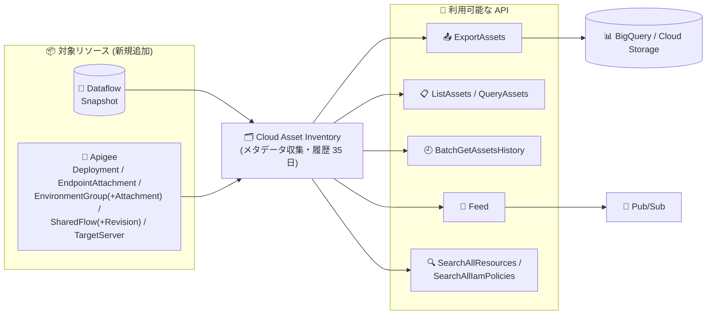

# Cloud Asset Inventory: Dataflow / Apigee リソースタイプのサポート追加

**リリース日**: 2026-11-09

**サービス**: Cloud Asset Inventory

**機能**: Dataflow (Snapshot) および Apigee (7 種類) の新規リソースタイプ対応

**ステータス**: 一般公開 (Publicly Available)

📊 [このアップデートのインフォグラフィックを見る](https://takech9203.github.io/google-cloud-news-summary/20261109-cloud-asset-inventory-dataflow-apigee-resource-types.html)

## 概要

Cloud Asset Inventory で新たに Dataflow と Apigee のリソースタイプが一般公開されました。Dataflow では `dataflow.googleapis.com/Snapshot` が、Apigee では `Deployment`、`EndpointAttachment`、`EnvironmentGroup`、`EnvironmentGroupAttachment`、`SharedFlow`、`SharedFlowRevision`、`TargetServer` の 7 種類が、`ExportAssets`、`ListAssets`、`BatchGetAssetsHistory`、`QueryAssets`、`Feed`、Search (`SearchAllResources`、`SearchAllIamPolicies`) の各 API から利用可能になりました。

Cloud Asset Inventory は、Google Cloud のアセットメタデータを一元的に表示・検索・エクスポート・監視・分析できるグローバルなメタデータインベントリサービスです。今回の追加により、Dataflow のスナップショットや Apigee の API 管理基盤を構成する主要コンポーネントが、組織・フォルダ・プロジェクト横断の棚卸し、変更履歴の追跡 (最大 35 日間)、BigQuery へのエクスポート、Pub/Sub フィードによる変更監視の対象となります。

コンプライアンス監査やガバナンスを担当するクラウド管理者、Apigee を利用した API 基盤の運用チーム、Dataflow パイプラインを運用するデータエンジニアリングチームにとって、構成管理と監査の自動化を進めやすくなるアップデートです。

**アップデート前の課題**

- Dataflow の Snapshot や Apigee の Deployment、SharedFlow、TargetServer などのリソースは Cloud Asset Inventory の対象外であり、棚卸しには各サービスの API を個別に呼び出して独自に集計する必要があった
- Apigee の環境グループやエンドポイントアタッチメントなどの構成変更を、Cloud Asset Inventory のフィード機能で横断的に監視できなかった
- 組織全体のアセットを BigQuery にエクスポートして分析する際、これらのリソースが欠落し、API 基盤やデータパイプラインの全体像を把握しきれなかった

**アップデート後の改善**

- Dataflow Snapshot と Apigee の 7 種類のリソースタイプを、他の Google Cloud リソースと同じ API (エクスポート、一覧、履歴、SQL クエリ、フィード、検索) で扱えるようになった
- `BatchGetAssetsHistory` により、これらのリソースの作成・更新・削除履歴 (最大 35 日間) を追跡でき、監査証跡やコンプライアンスドリフトの管理が可能になった
- `SearchAllResources` / `SearchAllIamPolicies` により、組織・フォルダ・プロジェクトを横断してこれらのリソースと IAM ポリシーを検索できるようになった

## アーキテクチャ図



Dataflow Snapshot と Apigee の 7 種類のリソースのメタデータが Cloud Asset Inventory に収集され、エクスポート・一覧・履歴・フィード・検索の各 API から利用できるようになった構成を示しています。

## サービスアップデートの詳細

### 主要機能

1. **Dataflow リソースタイプの追加**
   - `dataflow.googleapis.com/Snapshot` が一般公開され、Dataflow ジョブのスナップショットをアセットとして管理可能に
   - `ExportAssets`、`ListAssets`、`BatchGetAssetsHistory`、`QueryAssets`、`Feed`、`SearchAllResources`、`SearchAllIamPolicies` の各 API で利用可能
   - 既存の `dataflow.googleapis.com/Job` と合わせて、Dataflow のアセット管理のカバレッジが拡大

2. **Apigee リソースタイプの追加 (7 種類)**
   - `apigee.googleapis.com/Deployment`: API プロキシのデプロイメント状態
   - `apigee.googleapis.com/EndpointAttachment`: Private Service Connect 経由のエンドポイントアタッチメント
   - `apigee.googleapis.com/EnvironmentGroup` / `EnvironmentGroupAttachment`: 環境グループとその環境アタッチメント
   - `apigee.googleapis.com/SharedFlow` / `SharedFlowRevision`: 共有フローとそのリビジョン
   - `apigee.googleapis.com/TargetServer`: バックエンドのターゲットサーバー構成
   - 既存の `Organization`、`Environment`、`ApiProxy`、`Instance` などと合わせて、Apigee の構成要素の大半をアセットとして俯瞰可能に

3. **全主要 API での利用**
   - エクスポート (BigQuery / Cloud Storage)、一覧、履歴取得、SQL クエリ、Pub/Sub フィードによる変更監視、横断検索に対応
   - 作成・更新・削除の履歴は最大 35 日間保持される

## 技術仕様

### 追加されたリソースタイプと利用可能 API

| リソースタイプ | 利用可能 API |
|------|------|
| `dataflow.googleapis.com/Snapshot` | ExportAssets, ListAssets, BatchGetAssetsHistory, QueryAssets, Feed, SearchAllResources, SearchAllIamPolicies |
| `apigee.googleapis.com/Deployment` | 同上 (Export / List / History / Query / Feed / Search) |
| `apigee.googleapis.com/EndpointAttachment` | 同上 |
| `apigee.googleapis.com/EnvironmentGroup` | 同上 |
| `apigee.googleapis.com/EnvironmentGroupAttachment` | 同上 |
| `apigee.googleapis.com/SharedFlow` | 同上 |
| `apigee.googleapis.com/SharedFlowRevision` | 同上 |
| `apigee.googleapis.com/TargetServer` | 同上 |

### 制約 (公式ドキュメントより)

| 項目 | 詳細 |
|------|------|
| 分析 API (Policy Analyzer 等) | 今回追加されたリソースタイプはいずれも分析 API では利用不可 |
| Effective Tags | Apigee の各リソースタイプでは実効タグ非対応 |
| Dataflow のデータ鮮度 | 約 7 時間ごとに同期。変更履歴は不完全な場合がある |
| 履歴保持期間 | 作成・更新・削除履歴は最大 35 日間 |

### 必要な IAM 権限 (代表例)

| 操作 | 必要な権限 |
|------|------|
| すべての呼び出し | `serviceusage.services.use` |
| ExportAssets / BatchGetAssetsHistory (RESOURCE) | `cloudasset.assets.exportResource` |
| ListAssets (RESOURCE) | `cloudasset.assets.listResource` |
| SearchAllResources | `cloudasset.assets.searchAllResources` |
| SearchAllIamPolicies | `cloudasset.assets.searchAllIamPolicies` |
| Feed 作成 | `cloudasset.feeds.create` + `cloudasset.assets.exportResource` |

## 設定方法

### 前提条件

1. Cloud Asset API (`cloudasset.googleapis.com`) が有効化されていること
2. 上記の IAM 権限 (例: `roles/cloudasset.viewer`) が付与されていること

### 手順

#### ステップ 1: 追加されたリソースタイプを一覧する

```bash
# Apigee の TargetServer を組織全体で一覧
gcloud asset list \
  --organization=ORGANIZATION_ID \
  --asset-types="apigee.googleapis.com/TargetServer" \
  --content-type=resource

# Dataflow Snapshot をプロジェクト単位で一覧
gcloud asset list \
  --project=PROJECT_ID \
  --asset-types="dataflow.googleapis.com/Snapshot" \
  --content-type=resource
```

`--asset-types` に新しいリソースタイプを指定することで、組織・フォルダ・プロジェクト単位で棚卸しできます。

#### ステップ 2: 変更監視フィードを作成する

```bash
# Apigee Deployment の変更を Pub/Sub に通知するフィードを作成
gcloud asset feeds create apigee-deployment-feed \
  --organization=ORGANIZATION_ID \
  --asset-types="apigee.googleapis.com/Deployment,apigee.googleapis.com/SharedFlow" \
  --content-type=resource \
  --pubsub-topic="projects/PROJECT_ID/topics/asset-changes"
```

API プロキシのデプロイや共有フローの変更が発生すると Pub/Sub トピックに通知され、監査やアラートの自動化に利用できます。

#### ステップ 3: BigQuery にエクスポートして分析する

```bash
gcloud asset export \
  --organization=ORGANIZATION_ID \
  --asset-types="apigee.googleapis.com/EnvironmentGroup,apigee.googleapis.com/TargetServer" \
  --content-type=resource \
  --bigquery-table="projects/PROJECT_ID/datasets/asset_inventory/tables/apigee_assets" \
  --output-bigquery-force
```

エクスポートしたデータを SQL で分析し、環境グループの構成やターゲットサーバーの設定を組織横断でレビューできます。

## メリット

### ビジネス面

- **監査・コンプライアンス対応の効率化**: Apigee の API 基盤構成や Dataflow スナップショットの変更履歴を最大 35 日間追跡でき、監査証跡の収集を自動化できる
- **ガバナンスの一元化**: 各サービスの API を個別に叩く独自スクリプトが不要になり、Cloud Asset Inventory に一本化することで運用コストを削減できる

### 技術面

- **横断検索**: `SearchAllResources` で組織・フォルダ・プロジェクトをまたいで Apigee / Dataflow リソースを検索でき、リソースの発見が容易になる
- **変更監視の自動化**: Feed + Pub/Sub により、デプロイメントやターゲットサーバーの構成変更をほぼリアルタイムに検知し、下流の自動化 (Cloud Functions 等) に連携できる
- **SQL ベースの分析**: `QueryAssets` や BigQuery エクスポートにより、使い慣れた SQL で構成分析が可能

## デメリット・制約事項

### 制限事項

- 今回追加されたリソースタイプは、いずれも分析 API (Policy Analyzer など) では利用できない
- Apigee の各リソースタイプでは実効タグ (Effective Tags) がサポートされない
- Dataflow アセットの変更履歴は不完全な場合があり、データ鮮度は約 7 時間ごとの同期に依存する

### 考慮すべき点

- Cloud Asset Inventory は結果整合性のサービスであり、リアルタイムのクエリ用途 (本番の可用性やセキュリティ制御が欠落・陳腐化データで破綻する用途) には設計されていない。ライブなデータが必要な場合は各サービスの API を直接呼び出す
- 履歴の保持期間は 35 日のため、長期の監査証跡が必要な場合は BigQuery / Cloud Storage への定期エクスポートを構成する

## ユースケース

### ユースケース 1: Apigee API 基盤の構成監査の自動化

**シナリオ**: 複数プロジェクトで Apigee を運用する企業が、環境グループ・共有フロー・ターゲットサーバーの構成変更を監査要件として記録したい。

**実装例**:
```bash
gcloud asset feeds create apigee-audit-feed \
  --organization=ORGANIZATION_ID \
  --asset-types="apigee.googleapis.com/EnvironmentGroup,apigee.googleapis.com/EnvironmentGroupAttachment,apigee.googleapis.com/TargetServer" \
  --content-type=resource \
  --pubsub-topic="projects/PROJECT_ID/topics/apigee-audit"
```

**効果**: 構成変更が Pub/Sub 経由で自動記録され、独自の収集スクリプトなしで監査証跡を構築できる。

### ユースケース 2: Dataflow スナップショットの棚卸しとコスト最適化

**シナリオ**: データエンジニアリングチームが、組織内に残存する Dataflow スナップショットを定期的に棚卸しし、不要なスナップショットを特定したい。

**効果**: `gcloud asset list` や BigQuery エクスポートで全プロジェクトのスナップショットを一括把握でき、未使用リソースの削除判断とコスト最適化につながる。

## 料金

Cloud Asset Inventory 自体は追加料金なしで利用できます。ただし、BigQuery や Cloud Storage へのエクスポート、Pub/Sub フィードを利用する場合は、それぞれのサービスの料金が発生します。

詳細は各サービスの料金ページを参照してください。

- [BigQuery 料金](https://cloud.google.com/bigquery/pricing)
- [Pub/Sub 料金](https://cloud.google.com/pubsub/pricing)

## 利用可能リージョン

Cloud Asset Inventory はグローバルなメタデータインベントリサービスであり、特定リージョンの制約はありません。

## 関連サービス・機能

- **Apigee**: 今回アセット対象となった Deployment、SharedFlow、TargetServer などは Apigee の API 管理を構成する主要コンポーネント
- **Dataflow**: Snapshot はストリーミングパイプラインの状態を保存する機能で、既存の Job アセットと合わせて管理可能に
- **BigQuery**: `ExportAssets` / `QueryAssets` によるアセットメタデータの SQL 分析基盤
- **Pub/Sub**: Feed によるアセット変更通知の配信先
- **Security Command Center**: Cloud Asset Inventory のデータを活用したセキュリティポスチャ管理

## 参考リンク

- 📊 [インフォグラフィック](https://takech9203.github.io/google-cloud-news-summary/20261109-cloud-asset-inventory-dataflow-apigee-resource-types.html)
- [公式リリースノート](https://docs.cloud.google.com/release-notes#November_09_2026)
- [サポートされているアセットタイプ](https://docs.cloud.google.com/asset-inventory/docs/asset-types)
- [Cloud Asset Inventory の概要](https://docs.cloud.google.com/asset-inventory/docs/asset-inventory-overview)
- [IAM ロールと権限](https://docs.cloud.google.com/asset-inventory/docs/roles-permissions)
- [アセット変更の監視 (Feed)](https://docs.cloud.google.com/asset-inventory/docs/monitor-asset-changes)

## まとめ

Cloud Asset Inventory のカバレッジが Dataflow Snapshot と Apigee の主要構成要素 7 種類に拡大し、API 基盤やデータパイプラインの棚卸し・変更監視・監査を標準機能で実現できるようになりました。Apigee や Dataflow を運用しているチームは、独自の収集スクリプトを Cloud Asset Inventory のエクスポートやフィードに置き換えることを検討してください。分析 API 非対応や実効タグ非対応などの制約には留意が必要です。

---

**タグ**: #CloudAssetInventory #Apigee #Dataflow #ガバナンス #監査 #アセット管理
