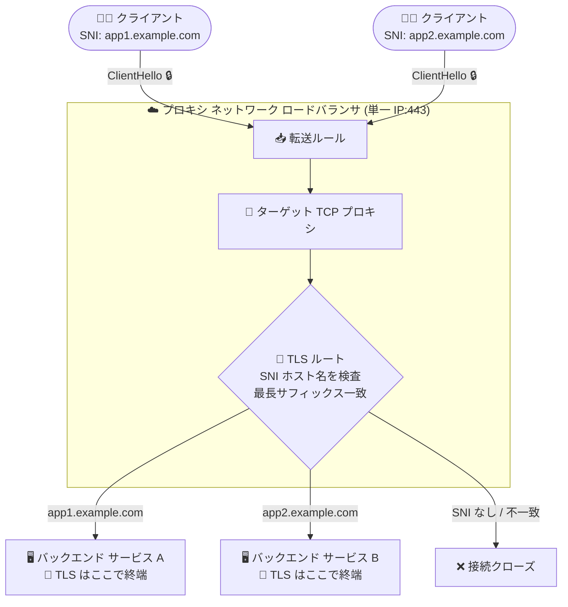

# Cloud Load Balancing: プロキシ ネットワーク ロードバランサ向け TLS ルート (TLSRoute) による SNI ベースルーティングが GA

**リリース日**: 2026-11-09

**サービス**: Cloud Load Balancing

**機能**: SNI-based routing with TLS routes (TLSRoute API) for Proxy Network Load Balancers

**ステータス**: GA (一般提供)

📊 [このアップデートのインフォグラフィックを見る](https://takech9203.github.io/google-cloud-news-summary/20261109-cloud-load-balancing-sni-tls-routes-ga.html)

## 概要

プロキシ ネットワーク ロードバランサ (Proxy Network Load Balancer) における、TLS ルート (TLSRoute API リソース) を使った Server Name Indication (SNI) ベースのルーティングが一般提供 (GA) になりました。クライアントが TLS ハンドシェイクの ClientHello メッセージで送信する SNI ホスト名をロードバランサが検査し、ホスト名に応じて異なるバックエンド サービスへ TLS トラフィックを振り分けられます。

最大の特徴は **TLS パススルー** である点です。ロードバランサは TLS 接続を終端 (復号) せず、暗号化されたバイトストリームをそのままバックエンドへプロキシします。証明書と秘密鍵はバックエンド側に保持したまま、クライアントからバックエンドまでエンドツーエンドの暗号化を維持できます。これにより、単一の IP アドレスとポートで複数の TLS アプリケーションを収容しつつ、ゼロトラスト要件や mTLS (バックエンドでのクライアント証明書検証) にも対応可能になります。

対象ユーザーは、L4 ロードバランサで複数ドメインのサービスを集約したいネットワーク管理者、エンドツーエンド暗号化が必須の規制業界のアーキテクト、MongoDB などの非 HTTP ステートフル プロトコルを SNI でシャードごとに振り分けたい開発者です。

**アップデート前の課題**

- プロキシ ネットワーク ロードバランサ (ターゲット TCP プロキシ) は単一のデフォルト バックエンド サービスにしか転送できず、ホスト名ベースの振り分けには Application Load Balancer (L7、TLS 終端が必要) か、サービスごとに個別の IP アドレス/転送ルールを用意する必要があった
- L7 ロードバランサでホスト名ルーティングを行う場合、ロードバランサで TLS を終端するため、証明書・秘密鍵をロードバランサ側 (Certificate Manager など) に配置する必要があり、エンドツーエンド暗号化やバックエンドでの mTLS 検証と両立しにくかった
- 複数の TLS アプリケーションを公開するにはアプリケーションごとに外部 IPv4 アドレスを消費していた

**アップデート後の改善**

- TLSRoute API リソースで SNI ホスト名とバックエンド サービスのマッピングを宣言的に定義し、L4 のまま TLS トラフィックをホスト名ベースで振り分けられるようになった
- TLS パススルーにより、ロードバランサが秘密鍵や平文データに一切アクセスせず、証明書をバックエンドに置いたままエンドツーエンド暗号化を維持できるようになった
- 単一のアドレスとポートで複数アプリケーションを収容でき、IPv4 アドレスの消費を削減できるようになった
- プラットフォーム管理者がコア インフラ (転送ルール、ターゲット プロキシ) を管理し、各サービスのオーナーが自分のルートとバックエンドを独立して管理する運用分担が可能になった

## アーキテクチャ図



ロードバランサは ClientHello 内の非暗号化 SNI ホスト名のみを検査し、TLS セッションを復号せずに暗号化ストリームを一致したバックエンド サービスへパススルーします。TLS の終端と証明書管理はバックエンド側で行われます。

## サービスアップデートの詳細

### 主要機能

1. **SNI ホスト名ベースのルーティング**
   - クライアントが TLS ハンドシェイク時に送信する SNI ホスト名 (ClientHello 内では非暗号化) をロードバランサが検査し、TLS ルートに定義されたホスト名と照合してバックエンド サービスを選択
   - 完全一致ホスト名とワイルドカード (例: `*.example.com`) の両方をサポート
   - マッチングは「最長サフィックス一致」(サブドメイン数が最も多いものを優先)。例: `baz.bar.foo.com` へのアクセスは `*.foo.com` より `*.bar.foo.com`、さらに `baz.bar.foo.com` の完全一致が優先される

2. **TLS パススルー**
   - 一致するバックエンド サービスが見つかると、暗号化されたバイトストリームを TLS 接続を終端せずにそのままプロキシ
   - ロードバランサは秘密鍵を保持せず、平文データにアクセスしない。TLS 終端・証明書検証・復号はバックエンド アプリケーションが担当
   - mTLS (相互 TLS) をバックエンドで直接実施可能

3. **厳格なフェイルクローズ動作**
   - クライアントが TLS を使用しない、SNI ホスト名を送信しない、SNI が有効な DNS 名でない、またはどの TLS ルートにも一致しない場合、ロードバランサは接続をクローズする

4. **TLSRoute API リソースによる宣言的管理**
   - `gcloud network-services tls-routes` コマンド群で TLS ルートを作成し、ロードバランサのターゲット TCP プロキシにアタッチ
   - 1 つの TLS ルートから 1 つ以上のバックエンド サービスを参照可能
   - ルーティング構成サイズは専用のクォータ単位で管理され、`describe` コマンドで使用量を確認可能

## 技術仕様

### 対応と制限

| 項目 | 詳細 |
|------|------|
| 対応ロードバランサ | リージョン外部プロキシ ネットワーク ロードバランサ (TLS ルートのドキュメントに明記)。クラシックおよびグローバル外部プロキシ ネットワーク ロードバランサは非対応 |
| GKE Gateway 対応クラス | `gke-l7-regional-external-managed`、`gke-l7-regional-external-managed-mc`、`gke-l7-rilb`、`gke-l7-rilb-mc`、`gke-l7-cross-regional-internal-managed-mc` (TLS パススルー リスナー + TLSRoute) |
| ターゲット プロキシの参照 | ターゲット TCP プロキシは「単一のバックエンド サービス」または「1 つ以上の TLS ルート」のどちらか一方のみ参照可能 (併用不可) |
| SNI ホスト名数 | 1 TLS ルートあたり最大 16 個 (引き上げ不可) |
| 同一ターゲット プロキシを参照する SNI ホスト名の総数 | 全 TLS ルート合計で最大 1,000 個 (引き上げ不可) |
| クォータ | グローバル TLS ルート: `TLSROUTES` (プロジェクト単位)、リージョン TLS ルート: `REGIONAL_TLSROUTES` (プロジェクト × リージョン単位) |
| ルーティング構成サイズ | リージョン外部プロキシ NLB は `REGIONAL_EXTERNAL_PROXY_LB_CONFIG_PER_REGION_PER_VPC_NETWORK` クォータの対象。クォータ使用量 = TLS ルートのクォータ単位 × そのルートを (ターゲット プロキシ経由で) 参照する転送ルール数 |

### TLSRoute リソースの定義例 (Compute Engine バックエンドの場合)

```yaml
# tls_route.yaml
name: helloworld-tls-route
gateways:
  - projects/PROJECT_NUMBER/locations/global/gateways/gateway443
rules:
  - matches:
      - sniHost:
          - example.com
        alpn:
          - h2
    action:
      destinations:
        - serviceName: projects/PROJECT_NUMBER/locations/global/backendServices/https-helloworld-service
```

## 設定方法

### 前提条件

1. リージョン外部プロキシ ネットワーク ロードバランサの基本構成 (VPC ネットワーク、プロキシ専用サブネット、転送ルール、ターゲット TCP プロキシ) が作成済みであること
2. バックエンド (MIG など) が TLS を終端する HTTPS/TLS サービスを公開しており、ヘルスチェック (`35.191.0.0/16`) とプロキシからの通信を許可するファイアウォール ルールが設定済みであること

### 手順

#### ステップ 1: TLS ルートの定義ファイルを作成

```bash
cat > tls_route.yaml <<EOF
name: my-tls-route
rules:
  - matches:
      - sniHost:
          - app1.example.com
    action:
      destinations:
        - serviceName: projects/PROJECT_NUMBER/locations/REGION/backendServices/app1-backend-service
EOF
```

SNI ホスト名 (完全一致またはワイルドカード) とバックエンド サービスのマッピングを定義します。

#### ステップ 2: TLS ルートをインポートしてターゲット プロキシに関連付け

```bash
gcloud network-services tls-routes import my-tls-route \
    --source=tls_route.yaml \
    --location=REGION
```

作成した TLS ルートをロードバランサのターゲット TCP プロキシにアタッチします。ターゲット プロキシが TLS ルートを参照している場合、デフォルト バックエンド サービスは併用できない点に注意してください。

#### ステップ 3: ルーティングの検証

```bash
# SNI が一致する場合: バックエンドから応答が返る
curl https://app1.example.com --resolve app1.example.com:443:LB_IP_ADDRESS -k

# SNI が一致しない場合: 接続がリセットされる (フェイルクローズ)
curl https://unknown.example.com --resolve unknown.example.com:443:LB_IP_ADDRESS -k
```

`openssl s_client -servername` でサーバー証明書を確認すると、SNI だけでバックエンドが切り替わる (= ロードバランサが TLS を終端していない) ことを検証できます。

## メリット

### ビジネス面

- **IPv4 アドレスコストの削減**: 単一の IP アドレスとポートで複数の TLS アプリケーションを収容でき、希少な外部 IPv4 アドレスの消費を削減できる
- **コンプライアンス対応**: トラフィックがクライアントからバックエンドまで暗号化されたまま転送されるため、ゼロトラストや規制業界のエンドツーエンド暗号化要件を満たしやすい
- **運用の分業**: プラットフォーム管理者がコア インフラを、各サービス オーナーが自サービスのルートとバックエンドを独立管理できる

### 技術面

- **秘密鍵の集中管理が不要**: 証明書と秘密鍵をバックエンドに保持したまま運用でき、ロードバランサに鍵を渡す必要がない。バックエンドでの mTLS 検証も可能
- **非 HTTP プロトコル対応**: MongoDB のようなステートフルな非 HTTP アプリケーションでも、クライアントの SNI に基づく特定シャードへのルーティングが可能
- **宣言的な構成管理**: TLSRoute API リソースとして gcloud / GKE Gateway API (TLSRoute) で管理でき、IaC に組み込みやすい

## デメリット・制約事項

### 制限事項

- TLS ルートはリージョン外部プロキシ ネットワーク ロードバランサで利用可能。クラシック プロキシ NLB とグローバル外部プロキシ NLB では非対応
- ターゲット TCP プロキシは「単一バックエンド サービス」と「TLS ルート」を同時に構成できない
- 1 TLS ルートあたり SNI ホスト名は最大 16 個、同一ターゲット プロキシを参照する SNI ホスト名は全体で最大 1,000 個 (いずれも引き上げ不可)
- 非 TLS トラフィック、SNI なし、無効な DNS 名、不一致の SNI はすべて接続クローズとなる (フォールバック先を設定できない)

### 考慮すべき点

- **HTTP コネクション コアレッシング**: ブラウザは RFC 7540 に従い、ワイルドカード証明書 (`*.example.com`) を提示したサーバーへの接続を同一 IP の他ホスト名にも再利用する。SNI ベースルーティングでは接続確立後に宛先バックエンドが固定されるため、`*.example.com` と `my.example.com` を別バックエンドで提供する構成では HTTP リクエストが意図しないバックエンドに流れる可能性がある
- L4 パススルーのため、URL パスルーティング、ヘッダー操作、Cloud CDN、URL リライトなどの L7 機能は利用できない (必要な場合は Application Load Balancer + HTTPRoute を選択)
- GKE Gateway で使用する場合、TLSRoute のルールは 1 つまで、backendRef も 1 つのみで、重み付きトラフィック分割は非対応。BackendTLSPolicy、IAP、Google Cloud Armor セキュリティ ポリシーは TLSRoute バックエンドにアタッチ不可
- TLS ルートの複雑さ (ルール数、SNI ホスト名数) と参照する転送ルール数に応じてルーティング構成サイズのクォータ単位を消費する

## ユースケース

### ユースケース 1: 単一 IP での複数 SaaS テナント/アプリケーションの集約

**シナリオ**: 複数の社内アプリケーション (`app1.example.com`、`app2.example.com`、`*.api.example.com`) を 1 つの外部 IP アドレスとポート 443 で公開したい。ただしセキュリティポリシー上、TLS 終端は各アプリケーションのバックエンドで行う必要がある。

**実装例**:
```yaml
# アプリごとに TLS ルートを作成し、同一ターゲット TCP プロキシにアタッチ
rules:
  - matches:
      - sniHost:
          - app1.example.com
    action:
      destinations:
        - serviceName: .../backendServices/app1-backend
```

**効果**: IPv4 アドレス 1 つで複数アプリを収容しつつ、証明書は各バックエンドで管理。アドレスコストと証明書配布リスクを同時に削減できる。

### ユースケース 2: 非 HTTP ステートフル データベースのシャード ルーティング

**シナリオ**: MongoDB などの TLS 上で動作する非 HTTP プロトコルのクラスタで、クライアントが接続時に指定するホスト名 (例: `shard1.db.example.com`) に応じて特定のシャードへ接続を振り分けたい。

**効果**: L7 プロキシを介せない独自プロトコルでも、SNI だけでシャード単位のルーティングを実現。接続は暗号化されたままシャードに到達する。

### ユースケース 3: GKE での TLS パススルー Gateway

**シナリオ**: GKE 上のマイクロサービスで、Pod 内で mTLS を終端するゼロトラスト構成を採りつつ、複数ホスト名を 1 つの Gateway IP で公開したい。

**効果**: Gateway API の TLSRoute リソース (`tls.mode: Passthrough`) を使い、`gke-l7-regional-external-managed` や `gke-l7-rilb` クラスの Gateway で SNI ベースルーティングを宣言的に構成できる。ロードバランサに証明書を渡さずエンドツーエンド暗号化を維持できる。

## 料金

TLS ルートの利用自体に対する追加料金はリリースノートおよびドキュメントに記載されていません。プロキシ ネットワーク ロードバランサの標準料金 (転送ルール、処理データ量 (アウトバウンド データ処理) など) が適用されます。TLS ルートはルーティング構成サイズのクォータ単位を消費しますが、これはクォータであり課金項目ではありません。

詳細は料金ページを参照してください: https://cloud.google.com/vpc/network-pricing#lb

## 利用可能リージョン

リージョン外部プロキシ ネットワーク ロードバランサが利用可能なリージョンで使用できます。リージョンごとの詳細は公式ドキュメントを参照してください。

## 関連サービス・機能

- **GKE Gateway API (TLSRoute)**: TLS パススルー Gateway として同機能を Kubernetes ネイティブに利用可能。`gke-l7-regional-external-managed` などのGatewayClass が TLSRoute をサポート
- **Cloud Service Mesh**: TLSRoute リソースを使った SNI/ALPN ベースのサービス ルーティングに対応しており、同じ API リソース体系を共有
- **Application Load Balancer**: L7 機能 (パスルーティング、ヘッダー操作、Cloud CDN) が必要な場合の選択肢。TLS をロードバランサで終端する点が異なる
- **Certificate Manager**: TLS をロードバランサで終端する構成で証明書を管理するサービス。TLS パススルーでは不要になる点が対照的
- **Cloud Monitoring / Cloud Logging**: ロードバランサのトラフィックと接続クローズ イベントの監視に利用

## 参考リンク

- 📊 [インフォグラフィック](https://takech9203.github.io/google-cloud-news-summary/20261109-cloud-load-balancing-sni-tls-routes-ga.html)
- [公式リリースノート](https://docs.cloud.google.com/release-notes#November_09_2026)
- [SNI-based routing with TLS routes (プロキシ ネットワーク ロードバランサの概要)](https://docs.cloud.google.com/load-balancing/docs/tcp#sni-based-routing)
- [Routing configuration size and quota units](https://docs.cloud.google.com/load-balancing/docs/routing-config-size-quota)
- [Quotas and limits (TLS routes)](https://docs.cloud.google.com/load-balancing/docs/quotas)
- [GKE: Deploy a TLS passthrough Gateway](https://docs.cloud.google.com/kubernetes-engine/docs/how-to/deploy-tls-passthrough-gateway)
- [料金ページ](https://cloud.google.com/vpc/network-pricing#lb)

## まとめ

プロキシ ネットワーク ロードバランサの TLS ルートが GA となり、TLS を終端せずに SNI ホスト名ベースで複数バックエンドへ振り分ける構成を本番環境で採用できるようになりました。エンドツーエンド暗号化・mTLS・IPv4 アドレス節約・非 HTTP プロトコル対応が要件となるワークロードでは、Application Load Balancer に代わる有力な選択肢です。まずは SNI ホスト名の設計 (最長サフィックス一致とホスト名数の上限) と HTTP コネクション コアレッシングの影響を確認した上で、リージョン外部プロキシ NLB または GKE TLS パススルー Gateway での検証を推奨します。

---

**タグ**: Cloud Load Balancing, TLSRoute, SNI, TLS パススルー, プロキシ ネットワーク ロードバランサ, ネットワーキング, セキュリティ, GA
