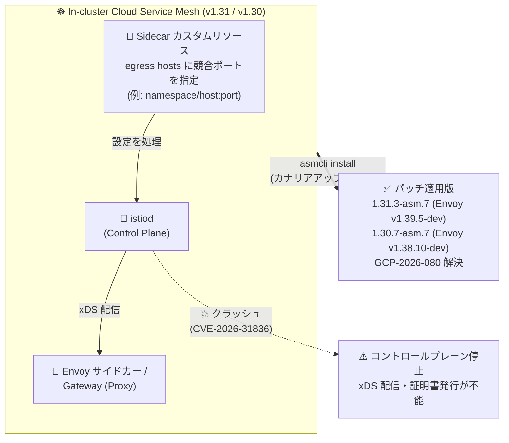

# Cloud Service Mesh: セキュリティパッチ 1.31.3-asm.7 / 1.30.7-asm.7 リリース (GCP-2026-080 対応)

**リリース日**: 2026-11-09

**サービス**: Cloud Service Mesh

**機能**: セキュリティパッチバージョン 1.31.3-asm.7 / 1.30.7-asm.7 (Security Bulletin GCP-2026-080 対応)

**ステータス**: セキュリティアップデート (パッチリリース)

📊 [このアップデートのインフォグラフィックを見る](https://takech9203.github.io/google-cloud-news-summary/20261109-cloud-service-mesh-security-patches-gcp-2026-080.html)

## 概要

In-cluster (クラスタ内コントロールプレーン) の Cloud Service Mesh に対して、セキュリティパッチ **1.31.3-asm.7** (Envoy v1.39.5-dev) と **1.30.7-asm.7** (Envoy v1.38.10-dev) がリリースされました。これらのパッチは、Security Bulletin **GCP-2026-080** (上流の [ISTIO-SECURITY-2026-009](https://istio.io/latest/news/security/istio-security-2026-009/)) に記載された脆弱性を解決します。Google Cloud のセキュリティ ブリテンにおける Severity は **High** です。

GCP-2026-080 は、`Sidecar` カスタムリソースの egress host フィールドに競合するポートを指定する (例: `namespace/host:port`) ことで、コントロールプレーンの **istiod がクラッシュする脆弱性** ([CVE-2026-31836](https://cve.mitre.org/cgi-bin/cvename.cgi?name=CVE-2026-31836) / [GHSA-635j-qv98-9275](https://github.com/istio/istio/security/advisories/GHSA-635j-qv98-9275)) を修正するものです。istiod がクラッシュすると、メッシュ全体への xDS 設定配信や証明書の発行・更新が停止し、サービスメッシュの運用に広範な影響 (サービス拒否) が及ぶ可能性があります。なお、上流 Istio のバルテン ISTIO-SECURITY-2026-009 (2026-11-06 公開、全体の CVSS スコア 8.2) は Istio 1.31.0〜1.31.3 および 1.30.0〜1.30.7 を対象とし、本件を含む複数のセキュリティ修正をまとめたものです。

影響対象は In-cluster Cloud Service Mesh **v1.31 / v1.30** を運用しているクラスタで、該当するクラスタ管理者は速やかなアップグレードが推奨されます。v1.28 以前はサポート終了 (EOL) のため、サポート対象バージョンへのアップグレードが必要です。Managed Cloud Service Mesh は自動的に更新されるため、顧客側の対応は不要です。

**アップデート前の課題**

- `Sidecar` カスタムリソースの egress host フィールドに競合するポートを指定する設定 (例: `namespace/host:port`) により、コントロールプレーンの istiod がクラッシュする可能性があった
- istiod のクラッシュはメッシュ全体の設定配信 (xDS) に影響するため、1 つの名前空間の設定ミスや悪意ある設定投入がメッシュ全体のサービス拒否につながるリスクがあった
- Istio リソースの作成・編集権限を持つテナントが複数いるマルチテナント クラスタでは、権限分離をしていてもコントロールプレーンを巻き込む障害を誘発し得た

**アップデート後の改善**

- 1.31.3-asm.7 / 1.30.7-asm.7 へのアップグレードにより、競合ポートを含む `Sidecar` egress host 設定を与えられても istiod がクラッシュしなくなった
- サポート対象の 2 つのマイナーバージョン系列 (1.31 / 1.30) の両方にパッチが同時提供され、どちらの系列からでもパッチアップグレードのみで対応できる
- Managed Cloud Service Mesh は自動更新されるため、対応の要否を In-cluster か Managed かで明確に切り分けられる

## アーキテクチャ図



`Sidecar` カスタムリソースの egress host に競合するポートを指定すると istiod がクラッシュし、メッシュ全体への設定配信が停止するリスクがありました。パッチ適用版 (1.31.3-asm.7 / 1.30.7-asm.7) へアップグレードすることで、この脆弱性が解消されます。

## サービスアップデートの詳細

### 主要機能

1. **GCP-2026-080 (ISTIO-SECURITY-2026-009 / CVE-2026-31836) の解決**
   - `Sidecar` カスタムリソースの egress host フィールドに競合するポートを指定する (例: `namespace/host:port`) ことで発生する istiod のクラッシュを修正
   - Google Cloud のセキュリティ ブリテンにおける Severity は High。上流バルテン ISTIO-SECURITY-2026-009 の全体 CVSS スコアは 8.2 (High)
   - 関連識別子: CVE-2026-31836 / GHSA-635j-qv98-9275

2. **2 つのパッチバージョンの同時提供**
   - 1.31.3-asm.7 (Envoy v1.39.5-dev)、1.30.7-asm.7 (Envoy v1.38.10-dev)
   - In-cluster Cloud Service Mesh v1.31 / v1.30 が影響対象。v1.28 以前はサポート終了 (EOL) のため、サポート対象バージョンへのアップグレードが必要

3. **Managed Cloud Service Mesh は自動更新**
   - Google がコントロールプレーンを管理する Managed Cloud Service Mesh では顧客側の対応は不要で、システムが自動的に更新される

## 技術仕様

### パッチバージョンと対象

| 項目 | 詳細 |
|------|------|
| 1.31.3-asm.7 | Envoy v1.39.5-dev を同梱。GCP-2026-080 を解決 |
| 1.30.7-asm.7 | Envoy v1.38.10-dev を同梱。GCP-2026-080 を解決 |
| 影響対象 | In-cluster Cloud Service Mesh v1.31 / v1.30 |
| Managed Cloud Service Mesh | 自動更新されるため顧客対応不要 |
| v1.28 以前 | EOL のためサポート対象バージョンへの移行が必要 |
| Severity (GCP-2026-080) | High |
| 関連識別子 | CVE-2026-31836 / GHSA-635j-qv98-9275 / ISTIO-SECURITY-2026-009 |

### 脆弱性の性質

| 観点 | 内容 |
|------|------|
| 影響コンポーネント | istiod (コントロールプレーン) |
| トリガー | `Sidecar` カスタムリソースの egress host フィールドへの競合ポート指定 (例: `namespace/host:port`) |
| 影響 | istiod のクラッシュによるコントロールプレーンの停止 (xDS 配信・証明書発行の停止) |
| 上流の修正 | Istio 1.31.4 / 1.30.8 で修正 (Cloud Service Mesh では 1.31.3-asm.7 / 1.30.7-asm.7 にバックポート) |

## 設定方法

### 前提条件

1. In-cluster Cloud Service Mesh v1.31 または v1.30 を運用していること
2. v1.28 以前の場合は EOL のため、まずサポート対象バージョンへの移行を計画すること
3. Managed Cloud Service Mesh の場合は自動更新のため対応不要

### 手順

#### ステップ 1: パッチ適用版の asmcli でコントロールプレーンをアップグレード

```bash
./asmcli install \
  --project_id PROJECT_ID \
  --cluster_name CLUSTER_NAME \
  --cluster_location CLUSTER_LOCATION \
  --fleet_id FLEET_PROJECT_ID \
  --output_dir DIR_PATH \
  --enable_all \
  --ca mesh_ca
```

`asmcli install` は既存のコントロールプレーンと並行して新しいリビジョンのコントロールプレーンをインストールします (カナリアアップグレード)。アップグレード中の CA 変更はダウンタイムの原因となるため、既存と同じ CA を指定します。

#### ステップ 2: ワークロードを新リビジョンへ移行して再起動

```bash
# 名前空間に新しいリビジョンラベルを付与
kubectl label namespace NAMESPACE istio-injection- istio.io/rev=REVISION --overwrite

# サイドカーを新バージョンで再注入するためワークロードを再起動
kubectl rollout restart deployment -n NAMESPACE
```

名前空間を新リビジョンに関連付けて Pod を再起動すると、新しいバージョンのサイドカーが注入されます。問題が発生した場合は、ラベルを旧リビジョンに戻すことでロールバックできます。

#### ステップ 3 (推奨): Sidecar リソースの変更権限の棚卸し

```bash
# Sidecar リソースを変更できる RoleBinding / ClusterRoleBinding を確認
kubectl get clusterrole,role -A -o json | \
  jq -r '.items[] | select(.rules[]? | (.resources // []) | index("sidecars")) | .metadata.name'
```

アップグレード完了までの間は、`Sidecar` カスタムリソースの作成・編集権限を信頼できる管理者に限定し、意図しない設定投入によるコントロールプレーン障害のリスクを下げることを検討してください。

## メリット

### ビジネス面

- **メッシュ全体の可用性リスクの低減**: コントロールプレーン停止というメッシュ全体に波及する障害要因を、パッチアップグレードのみで解消できる
- **Severity High への迅速な対応**: 脆弱性対応 SLA やコンプライアンス要件に対し、サポート対象 2 系列 (1.31 / 1.30) への同時パッチ提供により最小の変更で対応できる

### 技術面

- **コントロールプレーンの堅牢性向上**: 設定ミスや悪意ある `Sidecar` リソース投入に対して istiod がクラッシュしなくなり、マルチテナント環境での爆発半径が縮小する
- **カナリアアップグレード対応**: リビジョンベースのアップグレードにより、ワークロード単位で段階的に移行・ロールバックが可能
- **データプレーンへの影響が限定的**: 1.31 系の同梱 Envoy は前パッチ (1.31.3-asm.3) と同じ v1.39.5-dev であり、修正の中心はコントロールプレーン側にある

## デメリット・制約事項

### 制限事項

- v1.28 以前はサポート終了 (EOL) のためパッチは提供されず、サポート対象バージョンへのアップグレードが必須
- 前回の GCP-2026-076 では 1.29 系にもパッチが提供されたが、今回の GCP-2026-080 のパッチ対象は 1.31 / 1.30 の 2 系列である (影響対象も v1.31 / v1.30)

### 考慮すべき点

- コントロールプレーンのアップグレード後、サイドカーへの反映には名前空間のリビジョン切り替えとワークロードの再起動 (再注入) が必要
- GKE 上の ISTIOD コントロールプレーンを使う In-cluster Cloud Service Mesh は非推奨 (deprecated) となっており、セキュリティパッチを自動適用できる Managed Cloud Service Mesh への移行も中長期的に検討に値する
- 上流バルテン ISTIO-SECURITY-2026-009 には本件以外にも複数の修正が含まれるため、Istio を直接運用する環境 (OSS Istio) では上流の 1.31.4 / 1.30.8 の内容も併せて確認するとよい

## ユースケース

### ユースケース 1: マルチテナント クラスタの緊急パッチ適用

**シナリオ**: In-cluster Cloud Service Mesh 1.31 を複数チームで共有するマルチテナント クラスタを運用しており、各チームが自分の名前空間で `Sidecar` リソースを管理している。設定ミスや悪意ある設定投入によるコントロールプレーン停止のリスクを排除したい。

**実装例**:
```bash
./asmcli install --project_id my-project --cluster_name prod-cluster \
  --cluster_location asia-northeast1 --fleet_id my-fleet \
  --output_dir ./asm-1313-asm7 --enable_all --ca mesh_ca
# → 1.31.3-asm.7 を新リビジョンとして導入し、名前空間を段階的に切り替え
```

**効果**: 競合ポートを含む `Sidecar` egress host 設定が投入されても istiod がクラッシュしなくなり、1 テナントの設定がメッシュ全体の可用性を脅かすリスクが解消される。

### ユースケース 2: 変更凍結期間中のリスク評価と暫定統制

**シナリオ**: 変更凍結期間中でコントロールプレーンのアップグレードをすぐに実施できないが、GCP-2026-080 (Severity High) のリスクを評価し、暫定的に統制したい。

**効果**: `Sidecar` カスタムリソースの作成・編集権限を持つ主体を RBAC で棚卸しし、信頼できる管理者に限定することで、脆弱性のトリガーとなる設定投入の経路を縮小できる。凍結解除後に 1.31.3-asm.7 / 1.30.7-asm.7 へ正式にアップグレードする。

## 関連サービス・機能

- **Managed Cloud Service Mesh**: Google がコントロールプレーンを管理する形態。本脆弱性は自動更新で解決されるため顧客対応不要。In-cluster (ISTIOD on GKE) は非推奨のため移行先の候補
- **GKE (Google Kubernetes Engine)**: In-cluster Cloud Service Mesh の主要な実行基盤。クラスタ側の Security Bulletin も併せて確認が必要
- **Kubernetes RBAC**: `Sidecar` カスタムリソースの変更権限を統制し、脆弱性トリガーの経路を限定するための仕組み
- **Cloud Monitoring / Cloud Logging**: istiod の再起動やクラッシュループを検知するためのコントロールプレーン監視に活用

## 参考リンク

- 📊 [インフォグラフィック](https://takech9203.github.io/google-cloud-news-summary/20261109-cloud-service-mesh-security-patches-gcp-2026-080.html)
- [公式リリースノート](https://docs.cloud.google.com/release-notes#November_09_2026)
- [Security Bulletin GCP-2026-080](https://cloud.google.com/service-mesh/docs/security-bulletins#gcp-2026-080)
- [ISTIO-SECURITY-2026-009 (Istio 公式)](https://istio.io/latest/news/security/istio-security-2026-009/)
- [GHSA-635j-qv98-9275 (GitHub Advisory)](https://github.com/istio/istio/security/advisories/GHSA-635j-qv98-9275)
- [Cloud Service Mesh のアップグレード](https://cloud.google.com/service-mesh/docs/upgrade/upgrade)
- [Cloud Service Mesh リリースノート](https://cloud.google.com/service-mesh/docs/release-notes)

## まとめ

In-cluster Cloud Service Mesh v1.30 / v1.31 を運用している場合は、`Sidecar` カスタムリソースの競合ポート指定で istiod がクラッシュする Severity High の脆弱性 (GCP-2026-080 / CVE-2026-31836) に対応するため、1.31.3-asm.7 / 1.30.7-asm.7 への速やかなアップグレードを推奨します。コントロールプレーンの停止はメッシュ全体に波及するため、特にマルチテナント クラスタでは優先度が高く、すぐにアップグレードできない場合は `Sidecar` リソースの変更権限を RBAC で限定する暫定統制を検討してください。Managed Cloud Service Mesh は自動更新のため対応不要です。

---

**タグ**: #CloudServiceMesh #セキュリティ #Istio #CVE #GCP-2026-080 #istiod #GKE #サービスメッシュ
