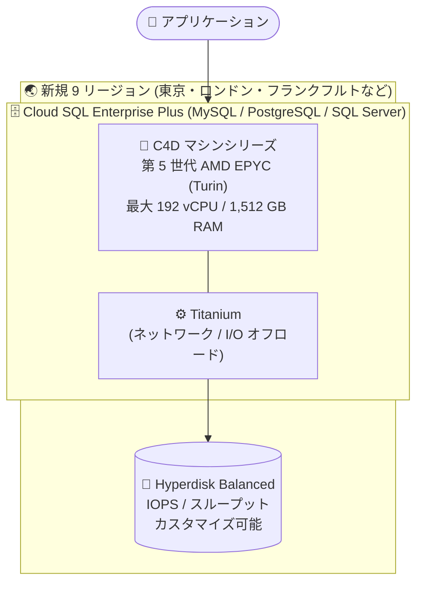

# Cloud SQL: C4D マシンシリーズが Enterprise Plus インスタンスで 9 リージョンに拡大

**リリース日**: 2026-11-09

**サービス**: Cloud SQL (MySQL / PostgreSQL / SQL Server)

**機能**: C4D マシンシリーズの提供リージョン拡大 (Enterprise Plus エディション)

**ステータス**: 一般提供 (GA)

📊 [このアップデートのインフォグラフィックを見る](https://takech9203.github.io/google-cloud-news-summary/20261109-cloud-sql-c4d-machine-series-expansion.html)

## 概要

Cloud SQL for MySQL、Cloud SQL for PostgreSQL、Cloud SQL for SQL Server の 3 つのデータベースエンジンすべてで、Enterprise Plus エディションのインスタンス向けに **C4D マシンシリーズ** が新たに 9 リージョン (ヨハネスブルグ、東京、ベルギー、ロンドン、フランクフルト、オランダ、パリ、サウスカロライナ、北バージニア) で利用可能になりました。

C4D マシンシリーズは、第 5 世代 AMD EPYC プロセッサ (Turin) と Google 独自のオフロード基盤である Titanium を搭載した x86 ベースのマシンシリーズです。ストレージには最新世代のネットワークブロックストレージである Google Cloud Hyperdisk Balanced を使用し、IOPS とスループットをワークロードに合わせてカスタマイズできます。最大 192 vCPU / 1,512 GB RAM までスケールでき、要求の厳しいデータベースワークロードに対して一貫性のある予測可能な高パフォーマンスを提供します。

今回のアップデートは、東京 (asia-northeast1) を含む主要リージョンで高性能な AMD ベースのマシンシリーズを選択できるようになる点で、日本のユーザーにとっても重要な拡大です。

**アップデート前の課題**

- 今回追加された 9 リージョン (東京を含む) では C4D マシンシリーズを選択できず、Enterprise Plus インスタンスでは N2 / C4 / C4A など他のマシンシリーズを使う必要があった
- 第 5 世代 AMD EPYC (Turin) ベースの高パフォーマンスなマシンシリーズを利用するには、C4D が提供されている別リージョンを選択する必要があり、データ所在地 (データレジデンシー) やレイテンシ要件と両立できなかった
- C4D は最大 192 vCPU / 1,512 GB RAM まで対応するが、これらのリージョンでは N2 (最大 128 vCPU / 864 GB) などの上限に制約されていた

**アップデート後の改善**

- 東京 (asia-northeast1) を含む 9 リージョンで、MySQL / PostgreSQL / SQL Server の Enterprise Plus インスタンスに C4D マシンタイプ (db-perf-optimized-C4D-2 〜 192) を選択できるようになった
- Hyperdisk Balanced ストレージにより、ストレージ容量・プロビジョンド IOPS・スループットを個別にカスタマイズし、予測可能なストレージ性能を確保できるようになった
- 既存の N2 / 汎用マシンシリーズのインスタンスから、インプレースでのマシンシリーズ変更により C4D へ移行できる (ストレージは SSD から Hyperdisk Balanced へ最小限のダウンタイムで移行)

## アーキテクチャ図



C4D マシンシリーズは AMD EPYC Turin プロセッサと Titanium オフロード基盤の組み合わせで動作し、ストレージには IOPS とスループットを個別に設定できる Hyperdisk Balanced を使用します。

## サービスアップデートの詳細

### 主要機能

1. **第 5 世代 AMD EPYC プロセッサ (Turin) + Titanium**
   - x86 ベースの最新世代 AMD プロセッサにより、要求の厳しいデータベースワークロードに一貫性のある予測可能な高パフォーマンスを提供
   - Google 独自の Titanium がネットワークとストレージ I/O の処理をオフロードし、CPU リソースをデータベース処理に集中させる

2. **Hyperdisk Balanced ストレージ**
   - Google Cloud の最新世代ネットワークブロックストレージを使用
   - ストレージ容量、プロビジョンド IOPS、スループットをそれぞれカスタマイズ可能
   - デフォルトの IOPS / スループット値と上限は、マシンタイプとストレージ容量に基づいて設定される

3. **3 つのデータベースエンジンで同時提供**
   - Cloud SQL for MySQL、Cloud SQL for PostgreSQL、Cloud SQL for SQL Server の Enterprise Plus エディションすべてで利用可能
   - 2 vCPU から 192 vCPU まで 9 種類の事前定義マシンタイプを提供

## 技術仕様

### C4D マシンタイプ一覧

| マシンタイプ | vCPU | メモリ (GB) |
|------|------|------|
| db-perf-optimized-C4D-2 | 2 | 15 |
| db-perf-optimized-C4D-4 | 4 | 31 |
| db-perf-optimized-C4D-8 | 8 | 63 |
| db-perf-optimized-C4D-16 | 16 | 126 |
| db-perf-optimized-C4D-32 | 32 | 252 |
| db-perf-optimized-C4D-48 | 48 | 378 |
| db-perf-optimized-C4D-64 | 64 | 504 |
| db-perf-optimized-C4D-96 | 96 | 756 |
| db-perf-optimized-C4D-192 | 192 | 1,512 |

### Enterprise Plus エディションのマシンシリーズ比較

| 項目 | C4D | C4 | C4A | N2 |
|------|------|------|------|------|
| プロセッサ | 第 5 世代 AMD EPYC (Turin) | Intel (x86) | Google Axion (Arm) | Intel (x86) |
| 最大構成 | 192 vCPU / 1,512 GB | 8 vCPU / 62 GB | 72 vCPU / 576 GB | 128 vCPU / 864 GB |
| vCPU:メモリ比 | 1:7.5 〜 1:7.875 | 1:7.5 〜 1:7.75 | 1:8 | 1:8 |
| ストレージ | Hyperdisk Balanced | Hyperdisk Balanced | Hyperdisk Balanced | PD-SSD |
| データキャッシュ | 非対応 | 対応 | 対応 | 対応 |

※ C4A は MySQL / PostgreSQL のみ (SQL Server は N2 / Memory-optimized-N2 / C4 / C4D)

## 設定方法

### 前提条件

1. Cloud SQL Enterprise Plus エディションを選択すること (C4D は Enterprise Plus 専用)
2. C4D がサポートされるリージョンを選択すること
3. データキャッシュは C4D では非対応のため、8 vCPU 以上のマシンタイプでは明示的に無効化すること (Enterprise Plus ではデータキャッシュがデフォルトで有効になるため)

### 手順

#### ステップ 1: C4D マシンタイプで Enterprise Plus インスタンスを作成

```bash
# 例: 東京リージョンに PostgreSQL の C4D (8 vCPU) インスタンスを作成
gcloud sql instances create my-c4d-instance \
  --database-version=POSTGRES_17 \
  --region=asia-northeast1 \
  --tier=db-perf-optimized-C4D-8 \
  --edition=ENTERPRISE_PLUS \
  --no-enable-data-cache
```

C4D ではデータキャッシュがサポートされないため、8 vCPU 以上のマシンタイプでは `--no-enable-data-cache` フラグを追加します。MySQL の場合は `--database-version=MYSQL_8_4` など、SQL Server の場合は対応するバージョンを指定します。

#### ステップ 2: 既存インスタンスを C4D に変更 (インプレース変更)

```bash
# 既存の Enterprise Plus インスタンスのマシンタイプを C4D に変更
gcloud sql instances patch my-instance \
  --tier=db-perf-optimized-C4D-16 \
  --no-enable-data-cache
```

汎用マシンシリーズや N2 から C4D へ変更する場合、ストレージは SSD から Hyperdisk Balanced へ移行されます。この移行は通常、最小限のダウンタイムで完了します。

## メリット

### ビジネス面

- **データレジデンシー要件との両立**: 東京やヨーロッパ各リージョンなどデータ所在地の制約があるワークロードでも、最新の AMD ベース高性能マシンシリーズを選択できる
- **コミットメント割引によるコスト最適化**: 1 年 / 3 年の確約利用割引 (CUD) を適用することで、オンデマンド比で大幅なコスト削減が可能

### 技術面

- **大規模スケールアップ**: 最大 192 vCPU / 1,512 GB RAM まで単一インスタンスでスケールでき、N2 (最大 128 vCPU / 864 GB) を超える構成が可能
- **予測可能なストレージ性能**: Hyperdisk Balanced によりプロビジョンド IOPS / スループットをワークロードに合わせて個別に設定できる
- **マシンシリーズの選択肢拡大**: ワークロードの特性に応じて N2 / C4 / C4A / C4D から最適な価格性能比のシリーズを選択できる

## デメリット・制約事項

### 制限事項

- C4D は Cloud SQL Enterprise Plus エディション専用であり、Enterprise エディションでは利用できない
- C4D ではデータキャッシュ (ローカル SSD による読み取り高速化) がサポートされない。Enterprise Plus ではデータキャッシュがデフォルト有効のため、8 vCPU 以上の C4D マシンタイプを選択する場合は明示的な無効化 (`--no-enable-data-cache`) が必要
- 提供マシンタイプは事前定義タイプのみで、カスタム vCPU / メモリ構成は選択できない

### 考慮すべき点

- データキャッシュによる読み取り性能向上 (最大 4 倍) に依存しているワークロードでは、C4 / C4A / N2 の方が適する場合がある
- C4D から汎用 / N2 マシンシリーズへ戻す場合、Hyperdisk Balanced から SSD へのストレージ移行で大きなダウンタイムが発生する可能性がある
- Hyperdisk Balanced の IOPS / スループットはマシンタイプとストレージ容量によりデフォルト値と上限が決まるため、必要性能に応じた設計が必要

## ユースケース

### ユースケース 1: 東京リージョンでの大規模基幹データベースのスケールアップ

**シナリオ**: 日本国内にデータを保持する要件がある EC サイトの基幹データベース (PostgreSQL) が、N2 の最大構成 (128 vCPU) に近づいており、さらなるスケールアップ余地が必要。

**実装例**:
```bash
gcloud sql instances patch ec-main-db \
  --tier=db-perf-optimized-C4D-192 \
  --no-enable-data-cache
```

**効果**: 東京リージョンのまま最大 192 vCPU / 1,512 GB RAM までスケールアップでき、シャーディングなどのアプリケーション側の分割対応を先送りできる。

### ユースケース 2: SQL Server の高負荷ワークロードの性能安定化

**シナリオ**: フランクフルトリージョンで稼働する SQL Server Enterprise インスタンスで、バッチ処理時の I/O 性能のばらつきが課題となっている。

**効果**: C4D + Hyperdisk Balanced へ移行し、プロビジョンド IOPS / スループットを明示的に設定することで、ピーク時にも予測可能なストレージ性能を確保できる。

## 料金

C4D マシンタイプの料金は、vCPU 数とメモリ容量に基づく時間課金です。Hyperdisk Balanced のストレージ容量・プロビジョンド IOPS・スループットは別途課金されます。1 年 / 3 年の確約利用割引 (CUD) が適用可能です。

### 料金例 (Enterprise Plus / C4D、us-central1 の例、非 HA 構成)

| 項目 | オンデマンド | 1 年 CUD | 3 年 CUD |
|--------|--------|--------|--------|
| vCPU (1 vCPU あたり) | $0.0609 / 時 | $0.045675 / 時 | $0.029232 / 時 |
| メモリ (1 GiB あたり) | $0.0102 / 時 | $0.00765 / 時 | $0.004896 / 時 |

### 月額概算 (us-central1、オンデマンド、730 時間、コンピュート部分のみ)

| マシンタイプ | 月額料金 (概算) |
|--------|-----------------|
| db-perf-optimized-C4D-2 (2 vCPU / 15 GB) | 約 $201 |
| db-perf-optimized-C4D-8 (8 vCPU / 63 GB) | 約 $825 |
| db-perf-optimized-C4D-16 (16 vCPU / 126 GB) | 約 $1,650 |

※ 参考: 同リージョンの他シリーズの vCPU 単価は N2 / C4A が $0.0537 / 時、C4 が $0.054 / 時 (オンデマンド) で、C4D はやや高めの単価設定です。HA 構成では vCPU / メモリ単価が約 2 倍になります。今回追加されたリージョンの料金は [料金ページ](https://cloud.google.com/sql/pricing) でリージョンを選択して確認してください。

## 利用可能リージョン

今回のアップデートで、以下の 9 リージョンで C4D マシンシリーズが利用可能になりました (MySQL / PostgreSQL / SQL Server 共通)。

| リージョン | ロケーション |
|------|------|
| africa-south1 | ヨハネスブルグ |
| asia-northeast1 | 東京 |
| europe-west1 | ベルギー |
| europe-west2 | ロンドン |
| europe-west3 | フランクフルト |
| europe-west4 | オランダ |
| europe-west9 | パリ |
| us-east1 | サウスカロライナ |
| us-east4 | 北バージニア |

最新のリージョン別提供状況は [リージョン提供状況の概要](https://docs.cloud.google.com/sql/docs/postgres/region-availability-overview) を参照してください。

## 関連サービス・機能

- **Google Cloud Hyperdisk**: C4D のストレージとして使用される最新世代のネットワークブロックストレージ。容量・IOPS・スループットを個別にプロビジョニング可能
- **Compute Engine C4D マシンシリーズ**: Cloud SQL の C4D は Compute Engine の C4D シリーズ (AMD EPYC Turin + Titanium) を基盤としている
- **Cloud SQL Enterprise Plus エディション**: 99.99% の可用性 SLA、1 秒未満の計画メンテナンスダウンタイム、高度な DR などを提供する上位エディション。C4D は本エディション専用
- **AlloyDB for PostgreSQL**: さらに高い PostgreSQL 性能が必要な場合の選択肢となる Google Cloud のマネージドデータベース

## 参考リンク

- 📊 [インフォグラフィック](https://takech9203.github.io/google-cloud-news-summary/20261109-cloud-sql-c4d-machine-series-expansion.html)
- [公式リリースノート](https://docs.cloud.google.com/release-notes#November_09_2026)
- [マシンシリーズの概要 (PostgreSQL)](https://docs.cloud.google.com/sql/docs/postgres/machine-series-overview)
- [マシンシリーズの概要 (MySQL)](https://docs.cloud.google.com/sql/docs/mysql/machine-series-overview)
- [マシンシリーズの概要 (SQL Server)](https://docs.cloud.google.com/sql/docs/sqlserver/machine-series-overview)
- [Cloud SQL エディションの概要](https://docs.cloud.google.com/sql/docs/mysql/editions-intro)
- [料金ページ](https://cloud.google.com/sql/pricing)

## まとめ

C4D マシンシリーズの提供リージョンが東京を含む 9 リージョンに拡大し、MySQL / PostgreSQL / SQL Server の Enterprise Plus インスタンスで第 5 世代 AMD EPYC (Turin) + Titanium + Hyperdisk Balanced による高性能構成を選択できるようになりました。データレジデンシー要件のあるワークロードや、N2 の構成上限 (128 vCPU) を超えるスケールアップが必要なデータベースでは、C4D への移行を検討する価値があります。ただしデータキャッシュが非対応のため、読み取りキャッシュに依存するワークロードでは既存シリーズとの性能比較を事前に行うことを推奨します。

---

**タグ**: Cloud SQL, MySQL, PostgreSQL, SQL Server, C4D, AMD EPYC, Titanium, Hyperdisk, Enterprise Plus, マシンシリーズ, リージョン拡大
