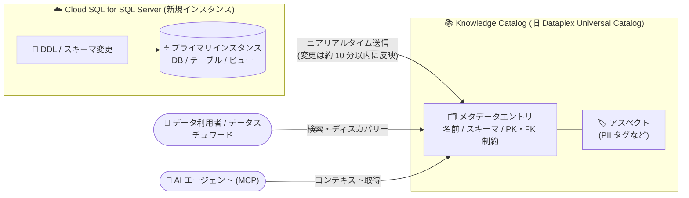

# Cloud SQL for SQL Server: Knowledge Catalog とのニアリアルタイム統合がデフォルトで有効化

**リリース日**: 2026-11-09

**サービス**: Cloud SQL for SQL Server

**機能**: Knowledge Catalog (旧 Dataplex Universal Catalog) へのメタデータ・スキーマ更新のニアリアルタイム送信

**ステータス**: GA (新規インスタンスでデフォルト有効)

📊 [このアップデートのインフォグラフィックを見る](https://takech9203.github.io/google-cloud-news-summary/20261109-cloud-sql-sql-server-knowledge-catalog-integration.html)

## 概要

2026 年 11 月 9 日以降に新規作成される Cloud SQL for SQL Server インスタンスは、メタデータとスキーマの更新を Knowledge Catalog (旧 Dataplex Universal Catalog) に **ニアリアルタイム** で送信するようになりました。この統合は新規作成インスタンスでデフォルトで有効化されており、必要に応じていつでも設定の確認・変更が可能です。

Knowledge Catalog は、メタデータの保存・管理・アクセスを一元化するプラットフォームであり、データガバナンスと生成 AI の機能を統合した AI 駆動のコンテキストグラフを提供します。本統合により、Cloud SQL for SQL Server のインスタンス、データベース、テーブル、カラム、ビューのメタデータが自動的にカタログへ取り込まれ、組織全体のデータディスカバリー、分類、変更管理、スキーマ進化の追跡に活用できます。

データ基盤のガバナンスを担うデータエンジニア、データスチュワード、および SQL Server のメタデータを AI エージェントのグラウンディングに利用したいチームにとって、カタログ鮮度の課題を解消する重要なアップデートです。

**アップデート前の課題**

- 従来の Knowledge Catalog 統合では、メタデータの更新頻度が約 1 日 1 回 (once a day) であり、DDL 変更やスキーマ変更がカタログに反映されるまで最大 1 日程度のラグが発生していた
- カタログ上のメタデータが古い状態になり得るため、データディスカバリーや AI エージェントのグラウンディングで最新のスキーマ情報を参照できない場合があった
- 新規インスタンスでも統合設定を意識する必要があり、カタログ連携の有効化状況がインスタンスごとにばらつく可能性があった

**アップデート後の改善**

- 2026 年 11 月 9 日以降に作成された新規インスタンスでは、メタデータ・スキーマ更新がニアリアルタイムで Knowledge Catalog に送信されるようになった (新しい DDL / スキーマ変更は約 10 分以内に反映)
- 新規インスタンスで統合がデフォルトで有効になり、追加設定なしでカタログ連携が開始される
- 統合状態はいつでも確認・変更 (有効化 / 無効化) でき、運用ポリシーに応じた柔軟な制御が可能

## アーキテクチャ図



新規作成された Cloud SQL for SQL Server インスタンスのメタデータ・スキーマ変更がニアリアルタイムで Knowledge Catalog に送信され、データ利用者や AI エージェントが常に最新のメタデータを検索・参照できる構成です。

## サービスアップデートの詳細

### 主要機能

1. **ニアリアルタイムのメタデータ同期**
   - 2026 年 11 月 9 日以降に作成された新規インスタンスで、メタデータ・スキーマ更新を Knowledge Catalog にニアリアルタイムで送信
   - 新しい DDL やスキーマ変更は約 10 分以内にカタログへ反映され、インスタンス上の既存リソースは 24 時間以内に取り込まれる

2. **新規インスタンスでのデフォルト有効化**
   - Knowledge Catalog 統合は新規作成インスタンスでデフォルトで有効
   - 統合状態はいつでも確認・変更可能で、`gcloud sql instances patch` や Google Cloud コンソール、REST API から制御できる

3. **自動収集されるメタデータ**
   - インスタンス、データベース、テーブル、カラム、ビューから以下を自動収集: 名前、ロケーション (リージョン)、作成日・最終更新日、スキーマ (テーブル・ビュー)、説明、主キー・外部キー制約
   - 収集対象はプライマリインスタンスのみ (リードレプリカ・外部サーバーレプリカは対象外)

## 技術仕様

### 更新頻度の条件 (Cloud SQL for SQL Server)

| 更新頻度 | 条件 |
|------|------|
| ニアリアルタイム | 新しいネットワークアーキテクチャのインスタンス (SQL Server は全バージョン対象)。2026 年 11 月 9 日以降の新規インスタンスはデフォルトで有効 |
| 1 日 1 回 (once a day) | 旧ネットワークアーキテクチャのインスタンス、または 2026 年 4 月 18 日より前に作成された既存インスタンスで統合を有効化した場合 |
| 反映時間 | 新しい DDL / スキーマ変更: 約 10 分以内。既存リソースの初回取り込み: 24 時間以内 |
| 無効化の所要時間 | ニアリアルタイム統合の無効化には最大 10 分 |

### 必要な権限・前提条件

| 項目 | 詳細 |
|------|------|
| API | プロジェクトで Dataplex API を有効化 |
| IAM 権限 | メタデータ閲覧に `cloudsql.schemas.view` 権限が必要 (プロジェクトレベルで付与) |
| 注意点 | `cloudsql.schemas.view` を持つユーザーはプロジェクト内のすべての Cloud SQL インスタンスのメタデータを閲覧可能 |

## 設定方法

### 前提条件

1. プロジェクトで Dataplex API を有効化していること
2. `cloudsql.schemas.view` 権限を含む IAM ロール (カスタムロールまたは事前定義ロール) が付与されていること

### 手順

#### ステップ 1: 統合状態の確認・有効化

```bash
# 既存インスタンスで Knowledge Catalog 統合を有効化する
gcloud sql instances patch INSTANCE_NAME \
  --enable-dataplex-integration
```

2026 年 11 月 9 日以降の新規インスタンスではデフォルトで有効のため、追加操作は不要です。プロジェクト内の全インスタンスを一括で有効化するスクリプトも公式ドキュメントで案内されています。

#### ステップ 2: 統合の無効化 (必要な場合)

```bash
# Knowledge Catalog 統合を無効化する
gcloud sql instances patch INSTANCE_NAME \
  --no-enable-dataplex-integration
```

ニアリアルタイム統合の無効化には最大 10 分かかります。REST API の場合は `settings.enableDataplexIntegration` を `false` に設定します。

## メリット

### ビジネス面

- **データガバナンスの強化**: 組織内の SQL Server データ資産が常に最新の状態でカタログ化され、データディスカバリー、分類、変更管理が容易になる
- **AI 活用の基盤整備**: Knowledge Catalog のコンテキストグラフを通じて、AI エージェントが最新のスキーマ情報に基づいた正確な応答 (グラウンディング) を返せるようになる

### 技術面

- **カタログ鮮度の大幅な向上**: 従来の 1 日 1 回の更新から、DDL / スキーマ変更が約 10 分以内に反映されるニアリアルタイム更新へ改善
- **運用負荷ゼロの自動連携**: 新規インスタンスではデフォルト有効のため、個別の有効化作業が不要
- **アスペクトによるメタデータキュレーション**: カタログ上のエントリに PII タグなどのアスペクトを付与し、機密データの分類・管理に活用できる

## デメリット・制約事項

### 制限事項

- メタデータの収集対象はプライマリインスタンスのみで、リードレプリカや外部サーバーレプリカは対象外
- ニアリアルタイム更新は新しいネットワークアーキテクチャのインスタンスが対象。旧ネットワークアーキテクチャのインスタンスは 1 日 1 回の更新となる
- 既存リソースの初回カタログ取り込みには最大 24 時間かかる

### 考慮すべき点

- `cloudsql.schemas.view` 権限はプロジェクトレベルで付与されるため、付与されたユーザーはプロジェクト内のすべての Cloud SQL インスタンスのメタデータを閲覧できる。権限設計に注意が必要
- 新規インスタンスでデフォルト有効となるため、メタデータをカタログに送信したくない場合は明示的に無効化する必要がある
- ニアリアルタイム統合の無効化には最大 10 分かかる

## ユースケース

### ユースケース 1: スキーマ変更のニアリアルタイム追跡によるデータガバナンス

**シナリオ**: 複数チームが共有する SQL Server データベースで頻繁にテーブル追加・カラム変更が行われており、データスチュワードが変更を迅速に把握してガバナンスポリシー (PII 分類など) を適用したい。

**実装例**:
```bash
# Knowledge Catalog でメタデータエントリを検索
gcloud dataplex entries search "system=cloudsql" --project=PROJECT_ID
```

**効果**: DDL 変更が約 10 分以内にカタログへ反映されるため、新規テーブルの検出とアスペクト (例: `pii:true`) の付与をタイムリーに実施でき、ガバナンスの抜け漏れを防止できる。

### ユースケース 2: AI エージェントのグラウンディングに最新スキーマを提供

**シナリオ**: text-to-SQL などの AI エージェントが Knowledge Catalog の MCP 統合経由でスキーマコンテキストを取得しており、古いスキーマ情報による SQL 生成エラーを防ぎたい。

**効果**: SQL Server のスキーマ変更がニアリアルタイムでカタログに反映されるため、AI エージェントは常に最新のテーブル定義・制約情報に基づいて正確なクエリを生成できる。

## 料金

本アップデート (Cloud SQL 側のメタデータ送信) に関する追加料金はリリースノートに記載されていません。Knowledge Catalog (Dataplex) 側のメタデータ管理の料金は、公式の料金ページを参照してください。

- [Dataplex の料金](https://cloud.google.com/dataplex/pricing)
- [Cloud SQL for SQL Server の料金](https://cloud.google.com/sql/pricing)

## 利用可能リージョン

リリースノートにリージョン制限の記載はありません。2026 年 11 月 9 日以降に新規作成される Cloud SQL for SQL Server インスタンスに適用されます。詳細は公式ドキュメントを参照してください。

## 関連サービス・機能

- **Knowledge Catalog (旧 Dataplex Universal Catalog)**: メタデータの保存・管理・検索を担うプラットフォーム。本統合のメタデータ送信先であり、データディスカバリーやアスペクトによるキュレーション、AI エージェント向けコンテキスト提供 (MCP 統合) を実現
- **Cloud SQL for MySQL / PostgreSQL**: 同様の Knowledge Catalog 統合が提供されており、エンジンごとにニアリアルタイム更新の条件 (バージョン・ネットワークアーキテクチャ) が異なる
- **IAM (Identity and Access Management)**: メタデータ閲覧には `cloudsql.schemas.view` 権限が必要。カスタムロールまたは事前定義ロールで付与する

## 参考リンク

- 📊 [インフォグラフィック](https://takech9203.github.io/google-cloud-news-summary/20261109-cloud-sql-sql-server-knowledge-catalog-integration.html)
- [公式リリースノート](https://docs.cloud.google.com/release-notes#November_09_2026)
- [Cloud SQL for SQL Server と Knowledge Catalog の統合](https://docs.cloud.google.com/sql/docs/sqlserver/dataplex-catalog-integration)
- [Knowledge Catalog の概要](https://docs.cloud.google.com/knowledge-catalog/docs/introduction)
- [Dataplex Universal Catalog から Knowledge Catalog への移行](https://docs.cloud.google.com/knowledge-catalog/docs/upgrade-dataplex-universal-catalog)
- [Dataplex の料金](https://cloud.google.com/dataplex/pricing)

## まとめ

Cloud SQL for SQL Server の新規インスタンスで Knowledge Catalog とのニアリアルタイム統合がデフォルト有効になり、DDL / スキーマ変更が約 10 分以内にカタログへ反映されるようになりました。データガバナンスの強化と AI エージェントのグラウンディング精度向上に直結するアップデートです。既存インスタンスを運用しているチームは、新しいネットワークアーキテクチャへの移行と統合の有効化を検討し、メタデータ送信を望まない場合はデフォルト有効化の方針を踏まえて明示的な無効化ポリシーを整備することを推奨します。

---

**タグ**: Cloud SQL, SQL Server, Knowledge Catalog, Dataplex, メタデータ管理, データガバナンス, データカタログ, GA
