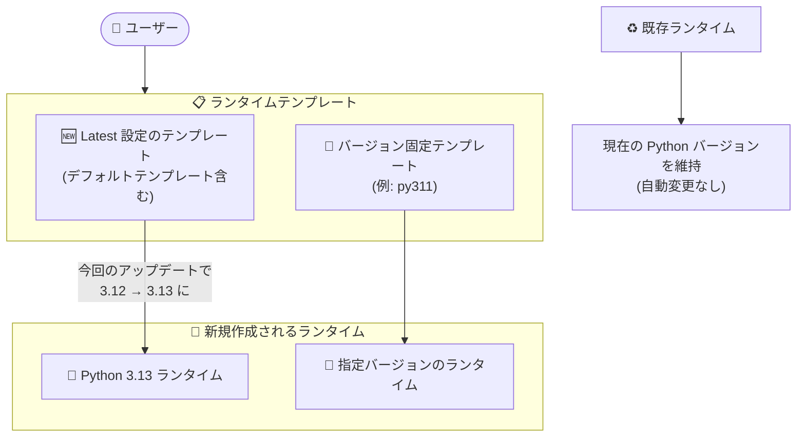

# Colab Enterprise: Python 3.13 サポート開始

**リリース日**: 2026-11-09

**サービス**: Colab Enterprise

**機能**: Python 3.13 サポート

**ステータス**: Feature (GA)

📊 [このアップデートのインフォグラフィックを見る](https://takech9203.github.io/google-cloud-news-summary/20261109-colab-enterprise-python-3-13.html)

## 概要

Colab Enterprise で Python 3.13 が利用可能になり、最新の Python バージョンとして位置づけられました。「最新 (Latest)」の Python バージョンを使用するように構成されたランタイムテンプレート (デフォルトランタイムテンプレートを含む) から作成されるランタイムは、今後 Python 3.13 を使用します。

このアップデートにより、データサイエンティストや ML エンジニアは、パフォーマンス改善や最新の言語機能を含む Python 3.13 をマネージドなノートブック環境でそのまま利用できるようになります。既存のランタイムは現在の Python バージョンを維持するため、稼働中のワークロードへの影響はありません。

なお、Python 3.10 は 2026 年 2 月 23 日にパッチ・サポート終了、2026 年 8 月 17 日に提供終了が予定されており、古いバージョンを使用しているユーザーは移行計画の検討が推奨されます。

**アップデート前の課題**

- Colab Enterprise で利用できる最新の Python バージョンは 3.12 までで、Python 3.13 の新機能やパフォーマンス改善をマネージド環境で利用できなかった
- Python 3.13 を前提とするライブラリやコードを検証するには、Colab Enterprise 以外の環境を用意する必要があった

**アップデート後の改善**

- 「Latest」設定のランタイムテンプレート (デフォルトランタイムテンプレートを含む) から作成されるランタイムが自動的に Python 3.13 を使用するようになった
- テンプレートの設定変更なしで、新規ランタイムが最新の Python バージョンを利用できる
- 既存ランタイムは現在の Python バージョンを維持するため、既存ワークロードの互換性は保たれる

## アーキテクチャ図



「Latest」設定のランタイムテンプレートから作成される新規ランタイムは Python 3.13 を使用し、既存ランタイムは現在のバージョンを維持します。

## サービスアップデートの詳細

### 主要機能

1. **Python 3.13 の提供開始**
   - Colab Enterprise で利用可能な最新の Python バージョンが 3.13 になった
   - 「Latest」設定のランタイムテンプレートから作成される新規ランタイムは Python 3.13 を使用する

2. **デフォルトランタイムテンプレートへの自動適用**
   - デフォルトランタイムテンプレートは最新の Python バージョンを使用するよう構成されているため、新規に作成されるデフォルトランタイムは Python 3.13 を使用する
   - 注意: 2025 年 5 月以前に作成されたデフォルトランタイムテンプレートは Python 3.10 に固定されている場合がある。最新バージョンを使うにはテンプレートを削除して再作成する

3. **既存ランタイムの互換性維持**
   - 既存ランタイムの Python バージョンは自動的に変更されない
   - 既存ランタイムの Python バージョン変更はサポートされておらず、必要な場合は目的のバージョンを使用するテンプレートから新しいランタイムを作成する

## 技術仕様

### サポートされる Python バージョン

| Python バージョン | パッチ・サポート終了日 | 提供終了日 |
|------|------|------|
| Python 3.13 | 未定 | 未定 |
| Python 3.12 | 未定 | 未定 |
| Python 3.11 | 未定 | 未定 |
| Python 3.10 | 2026 年 2 月 23 日 | 2026 年 8 月 17 日 |

**サポート終了後の挙動**:
- パッチ・サポート終了後: そのバージョンでの新規テンプレート作成が不可になり、既存テンプレートは最新バージョンへ自動アップグレードされる。ランタイムは最終アップグレード (またはアップグレードがない場合は作成) から 6 か月後に停止する
- 提供終了後: そのバージョンは Colab Enterprise で利用できなくなり、残存するテンプレートは最新バージョンへ自動アップグレードされる

### デフォルトランタイムの主な仕様

| 項目 | 詳細 |
|------|------|
| Python バージョン | 利用可能な最新バージョン (現在は Python 3.13) |
| マシンタイプ | e2-standard-4 (GPU なしの場合) |
| ブートディスク | 100 GiB SSD 永続ディスク (pd-ssd) |
| アイドルシャットダウン | 有効 (180 分) |
| 自動削除 | 作成から 18 時間後 |

### REST API によるテンプレートの Python バージョン変更

```json
PATCH https://REGION-aiplatform.googleapis.com/v1/projects/PROJECT_ID/locations/REGION/notebookRuntimeTemplates/TEMPLATE_ID?updateMask=software_config.colab_image.release_name

{
  "softwareConfig": {
    "colabImage": {
      "releaseName": "RELEASE_NAME"
    }
  }
}
```

- `RELEASE_NAME` にはイメージのリリース名 (例: Python 3.11 の場合 `py311`) を指定する
- 「Latest」に設定するには `RELEASE_NAME` を空にする

## 設定方法

### 前提条件

1. Google Cloud プロジェクトで Colab Enterprise (Vertex AI API) が有効化されていること
2. ランタイムテンプレートの編集には適切な IAM 権限 (例: `aiplatform.notebookRuntimeTemplates` 関連の権限) が必要

### 手順

#### ステップ 1: ランタイムテンプレートの Python バージョンを確認・変更 (コンソール)

1. Google Cloud コンソールで Colab Enterprise の「ランタイムテンプレート」ページに移動する
2. リージョンを選択し、対象テンプレートの ID をクリックする
3. 「編集」をクリックし、テンプレートの設定 (Python バージョンなど) を変更して「更新」をクリックする

#### ステップ 2: Python 3.13 のランタイムを作成

```bash
# 「Latest」設定のテンプレートから新規ランタイムを作成すると Python 3.13 が使用される
# 既存ランタイムのバージョンを確認する場合はノートブック内で以下を実行
python --version
```

既存ランタイムで Python 3.13 を使いたい場合は、Latest 設定 (または Python 3.13 指定) のテンプレートから新しいランタイムを作成し、ノートブックの接続先を切り替えます。

#### ステップ 3 (必要な場合): 古いデフォルトランタイムテンプレートの再作成

2025 年 5 月以前に作成されたデフォルトランタイムテンプレート (Python 3.10 固定の可能性あり) を最新バージョンに更新するには、デフォルトランタイムテンプレートを削除します。次回デフォルトランタイム作成時に、最新 Python バージョンを使用するテンプレートが自動で再作成されます。

## メリット

### ビジネス面

- **移行作業の最小化**: 「Latest」設定のテンプレートを使っていれば、設定変更なしで新規ランタイムが自動的に Python 3.13 を使用する
- **既存ワークロードの安全性**: 既存ランタイムはバージョンを維持するため、稼働中の分析・ML ワークロードが突然壊れるリスクがない

### 技術面

- **最新の言語機能の利用**: Python 3.13 の新機能やパフォーマンス改善をマネージドノートブック環境で利用できる
- **ライブラリ互換性の検証環境**: Python 3.13 対応ライブラリの動作検証を Colab Enterprise 上で実施できる

## デメリット・制約事項

### 制限事項

- 既存ランタイムの Python バージョン変更はサポートされていない (新規ランタイムの作成が必要)
- 2025 年 5 月以前に作成されたデフォルトランタイムテンプレートは Python 3.10 に固定されている場合があり、最新化にはテンプレートの削除・再作成が必要

### 考慮すべき点

- 「Latest」設定のテンプレートを使用している場合、新規ランタイムの Python バージョンが予告なく上がるため、依存ライブラリの Python 3.13 対応状況を確認しておく必要がある
- 再現性が重要なワークロードでは、Latest ではなく特定の Python バージョン (リリース名) を固定したテンプレートの利用を検討する
- Python 3.10 は 2026 年 2 月 23 日にパッチ・サポート終了、2026 年 8 月 17 日に提供終了となるため、該当テンプレート・ランタイムの移行計画が必要

## ユースケース

### ユースケース 1: 最新 Python への段階的な移行検証

**シナリオ**: データサイエンスチームが Python 3.11 ベースのノートブックを運用しており、Python 3.13 への移行前に依存ライブラリの互換性を検証したい。

**実装例**:
```text
1. Latest 設定 (Python 3.13) のランタイムテンプレートを新規作成
2. そのテンプレートから検証用ランタイムを作成
3. 既存ノートブックを検証用ランタイムに接続し、依存ライブラリのインストールとテストを実行
4. 問題がなければ本番用テンプレートを Python 3.13 (または Latest) に更新
```

**効果**: 既存の Python 3.11 ランタイムを維持したまま、同一ノートブックで安全に新バージョンの互換性を検証できる。

### ユースケース 2: Python 3.10 テンプレートのサポート終了対応

**シナリオ**: 2025 年 5 月以前から Colab Enterprise を利用しており、Python 3.10 固定のデフォルトランタイムテンプレートが残っている。2026 年 2 月のサポート終了前に最新化したい。

**効果**: デフォルトランタイムテンプレートを削除して再作成することで、以降のデフォルトランタイムが Python 3.13 を使用するようになり、サポート終了に伴う自動アップグレードやランタイム停止のリスクを回避できる。

## 料金

Python 3.13 サポート自体に追加料金はありません。Colab Enterprise の料金は従来どおり、ランタイムが使用するコンピューティングリソース (Compute Engine 料金) と Colab Enterprise の管理手数料に基づいて課金されます。

詳細は [Colab Enterprise の料金ページ](https://cloud.google.com/colab/pricing) を参照してください。

## 利用可能リージョン

Colab Enterprise が利用可能なすべてのリージョンで Python 3.13 を利用できます。対応リージョンの一覧は [Colab Enterprise のロケーション](https://docs.cloud.google.com/colab/docs/locations) を参照してください。

## 関連サービス・機能

- **Vertex AI (Agent Platform)**: Colab Enterprise の API は Vertex AI / Agent Platform API のサブセットであり、ランタイムテンプレートは `notebookRuntimeTemplates` リソースとして管理される
- **BigQuery**: BigQuery エディタからノートブックを作成して Colab Enterprise ランタイム上で実行でき、新規ランタイムは Python 3.13 を使用する
- **Compute Engine**: ランタイムの基盤となる VM リソース。予約 (Reservations) を利用してランタイム用リソースを確保することも可能
- **Terraform**: ランタイムおよびランタイムテンプレートの管理を Terraform リソースで自動化できる

## 参考リンク

- 📊 [インフォグラフィック](https://takech9203.github.io/google-cloud-news-summary/20261109-colab-enterprise-python-3-13.html)
- [公式リリースノート](https://docs.cloud.google.com/release-notes#November_09_2026)
- [ドキュメント: ランタイムとランタイムテンプレート (Python バージョン)](https://docs.cloud.google.com/colab/docs/runtimes)
- [ドキュメント: ランタイムテンプレートの管理](https://docs.cloud.google.com/colab/docs/manage-runtime-templates)
- [料金ページ](https://cloud.google.com/colab/pricing)

## まとめ

Colab Enterprise で Python 3.13 が最新バージョンとして利用可能になり、「Latest」設定のテンプレート (デフォルトテンプレート含む) から作成される新規ランタイムは自動的に Python 3.13 を使用します。既存ランタイムへの影響はありませんが、依存ライブラリの Python 3.13 対応確認と、サポート終了が近い Python 3.10 テンプレートの移行計画を進めることを推奨します。

---

**タグ**: #ColabEnterprise #Python313 #VertexAI #Notebook #ランタイムテンプレート
