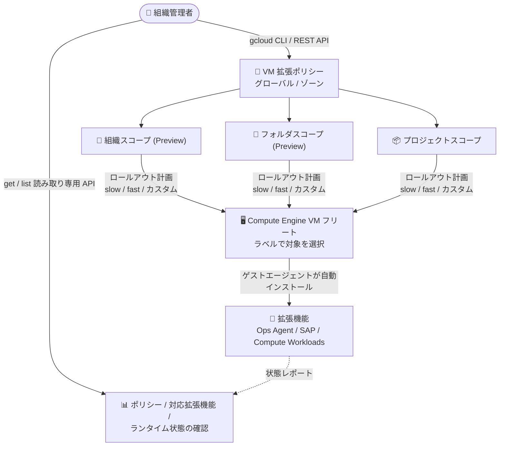

# Compute Engine: VM Extension Manager 組織・フォルダレベルのポリシーと読み取り専用 API (Preview)

**リリース日**: 2026-11-09

**サービス**: Compute Engine

**機能**: VM Extension Manager — 組織・フォルダレベルのグローバル / ゾーン VM 拡張ポリシーと読み取り専用 get / list メソッド

**ステータス**: Preview

📊 [このアップデートのインフォグラフィックを見る](https://takech9203.github.io/google-cloud-news-summary/20261109-compute-engine-vm-extension-manager-preview.html)

## 概要

Compute Engine の VM Extension Manager で、Google Cloud の **組織 (Organization) およびフォルダ (Folder) レベル** でグローバルおよびゾーンの VM 拡張ポリシーを作成・管理できるようになりました (Preview)。VM Extension Manager は、Compute Engine ゲストエージェントのプラグインである「VM 拡張機能」(Ops Agent、Extension for SAP、Extension for Compute Workloads) のインストール・更新・ヘルスモニタリングを、個々の VM に接続することなくフリート全体で自動化するサービスです。今回のアップデートにより、複数プロジェクトにまたがる VM 拡張機能の構成を、リソース階層の上位レベルから一元的に強制 (enforce) できるようになります。

あわせて、**読み取り専用の get / list メソッド** が追加され、組織・フォルダ・プロジェクトの各階層で、(1) 拡張ポリシーの詳細とロールアウト状態、(2) サポートされている VM 拡張機能とそのバージョン・サポートレベル、(3) 各 Compute Engine インスタンスにインストール済みの拡張機能のランタイム状態を、VM に接続せずに確認できるようになりました。複数のポリシーが同一 VM に適用されている場合に、最終的に有効な構成と適用元ポリシー (policyId) を特定することも可能です。

このアップデートは、多数のプロジェクト・VM を運用する組織の管理者、ガバナンス・コンプライアンス担当者、SRE / 運用チームを主な対象としています。組織全体での監視エージェントの標準化やセキュリティベースラインの強制に有効です。

**アップデート前の課題**

- VM 拡張ポリシーはプロジェクトレベルでのみ作成でき、組織全体で拡張機能の構成を統一するには、プロジェクトごとに個別にポリシーを作成・管理する必要があった
- 全社共通の監視エージェント (Ops Agent など) の導入を強制する仕組みがなく、プロジェクト管理者ごとの対応に依存していた
- 各 VM にインストールされた拡張機能のバージョンやランタイム状態を確認するには、個々のインスタンスに接続して調査する必要があった

**アップデート後の改善**

- 組織・フォルダレベルでグローバル / ゾーンの VM 拡張ポリシーを定義でき、配下のすべてのプロジェクトと VM にポリシーが評価・適用されるようになった
- グローバルポリシーはロールアウト計画 (slow / fast / カスタム) に従って全ゾーンに段階的に展開され、広範囲な障害リスクを抑えながらフリート全体を更新できるようになった
- 読み取り専用の get / list メソッドにより、ポリシー・対応拡張機能・各インスタンスのランタイム状態を VM に接続せずに一覧・確認できるようになり、トラブルシューティングが容易になった

## アーキテクチャ図



組織・フォルダ・プロジェクトの各階層で定義した VM 拡張ポリシーが、ロールアウト計画に従って対象 VM に拡張機能を自動配布し、読み取り専用 API でポリシーとランタイム状態を一元的に確認できる構成を示しています。

## サービスアップデートの詳細

### 主要機能

1. **組織・フォルダスコープの拡張ポリシー (Preview)**
   - 組織レベルで定義したポリシーは組織配下のすべてのプロジェクトと VM に対して評価され、フォルダレベルのポリシーはそのフォルダ配下に対して評価される
   - 全社必須のベースライン構成 (Ops Agent の導入など)、セキュリティベースラインの強制、本番環境の標準化といったフリート全体のガバナンスを一元化できる
   - 組織・フォルダスコープのポリシーは gcloud CLI または Compute Engine REST API でのみ作成・管理可能 (Google Cloud コンソールは未対応)

2. **グローバルポリシーとロールアウト計画**
   - グローバルポリシーは 1 回定義すると、ロールアウト計画に従って全対象ゾーンに対応するゾーンポリシーとして自動複製される
   - **Slow rollout**: デフォルト約 5 日間かけて段階的にゾーンへ展開し、初期ウェーブで問題を検出可能。**Fast rollout**: 全ゾーンへ即時展開 (非本番環境向け)。**カスタム計画**: ゾーン / リージョン単位のウェーブと待機時間を独自定義可能
   - 既存のゾーンポリシーと競合した場合の動作を `conflictBehavior` で制御 (デフォルトは上書きしない / `overwrite` 指定でグローバルポリシーが優先)

3. **読み取り専用 get / list メソッド**
   - 組織・フォルダ・プロジェクトの各階層で、グローバル / ゾーンの拡張ポリシーの詳細とロールアウト状態を一覧表示
   - サポートされている VM 拡張機能のバージョン番号・サポートレベルを全ゾーンまたは特定ゾーンで確認可能
   - `getVmExtensionState` / `listVmExtensionStates` により、各インスタンスにインストール済みの拡張機能のランタイム状態、インストール進捗、診断メッセージ、有効な構成と適用元ポリシー (policyId) を確認可能

## 技術仕様

### リソース階層スコープ

| スコープ | 定義レベル | ポリシー評価 | ステータス |
|------|------|------|------|
| 組織スコープ | Google Cloud 組織レベル | 組織配下のすべてのプロジェクトと VM | Preview |
| フォルダスコープ | Google Cloud フォルダレベル | フォルダ配下のすべてのプロジェクトと VM | Preview |
| プロジェクトスコープ | Google Cloud プロジェクトレベル | 単一プロジェクト内の VM | GA |

### 主な仕様

| 項目 | 詳細 |
|------|------|
| サポート対象拡張機能 | Ops Agent (`ops-agent`)、Extension for SAP (`google-cloud-sap-extension`)、Extension for Compute Workloads (`google-cloud-workload-extension`) |
| ポリシー優先度 | 0〜65535 (小さいほど高優先、デフォルト 1000)。同一 VM に複数ポリシーが適用される場合は優先度で解決 |
| 対象 VM の選択 | inclusion labels (ラベルセレクタ)。未指定の場合はスコープ内の全 VM が対象 |
| クォータ | 1 プロジェクトあたりゾーンごとに最大 100 ポリシー (対象 VM 数は無制限) |
| ゲストエージェント要件 | バージョン 20241209.01 以降 |
| ポリシーチェック間隔 | 拡張機能未インストールの VM: 8 分ごと / インストール済みの VM: 1 分ごと |

### 必要な IAM ロール

| 操作 | ロール |
|------|------|
| プロジェクトレベルのポリシー作成 | `roles/compute.vmExtensionPolicyAdmin` |
| フォルダスコープのポリシー管理 | `roles/compute.folderVmExtensionPolicyAdmin` |

## 設定方法

### 前提条件

1. Compute Engine API を有効化する
2. 対象 VM のゲストエージェントがバージョン 20241209.01 以降であることを確認する
3. 拡張機能が必要とする API (Ops Agent の場合は Cloud Monitoring API / Cloud Logging API、SAP / Compute Workloads の場合は Workload Manager API) を VM が存在するプロジェクトで有効化する
4. 適切な IAM ロール (上記表を参照) の付与を受ける

### 手順

#### ステップ 1: 組織スコープのグローバル拡張ポリシーを作成する

```bash
gcloud preview compute global-vm-extension-policies create ops-agent-baseline \
    --organization=organizations/ORGANIZATION_ID \
    --description="Org-wide Ops Agent baseline" \
    --extensions=ops-agent \
    --inclusion-labels=env=prod \
    --rollout-predefined-plan=slow_rollout \
    --priority=1000
```

組織配下の `env=prod` ラベルを持つすべての VM に Ops Agent をインストールするポリシーを作成し、slow rollout で段階的に展開します。フォルダスコープの場合は `--organization` の代わりに `--folder=folders/FOLDER_ID` を指定します。

#### ステップ 2: ポリシーとランタイム状態を読み取り専用 API で確認する

```bash
# グローバル拡張ポリシーの一覧を確認
gcloud preview compute global-vm-extension-policies list \
    --organization=organizations/ORGANIZATION_ID

# 特定インスタンスにインストールされた拡張機能のランタイム状態を確認
# (REST API: instances.listVmExtensionStates / getVmExtensionState)
```

ポリシーのロールアウト状態、サポートされている拡張機能、各 VM のランタイム状態 (インストール進捗、ヘルス、診断メッセージ、適用元ポリシー) を VM に接続せずに確認できます。

## メリット

### ビジネス面

- **ガバナンスの一元化**: 組織・フォルダレベルでポリシーを定義することで、個別プロジェクトへの介入なしに全社標準のエージェント構成を強制でき、コンプライアンス維持が容易になる
- **運用コストの削減**: プロジェクトごとのポリシー作成・管理が不要になり、監視エージェント導入の抜け漏れによるインシデント対応コストを低減できる

### 技術面

- **段階的ロールアウトによるリスク低減**: slow rollout やカスタムロールアウト計画により、初期ウェーブで問題を検出してからフリート全体に展開できる
- **可観測性の向上**: 読み取り専用 get / list API により、ポリシーの適用状況と各 VM の拡張機能ランタイム状態を API 経由で網羅的に把握でき、トラブルシューティングが効率化される

## デメリット・制約事項

### 制限事項

- 組織・フォルダスコープのポリシーは Preview であり、Pre-GA 利用規約が適用される (限定的なサポート)
- 組織・フォルダスコープのポリシーの作成・管理、および拡張機能の詳細・インスタンス状態の取得は gcloud CLI または REST API のみ対応 (Google Cloud コンソールは未対応)
- SUSE Linux Enterprise Server (SLES) および Ubuntu はサポート対象外
- バージョン固定 (version pinning) は Ops Agent (`ops-agent`) のみサポート
- `getVmExtensionState` / `listVmExtensionStates` は VM Extension Manager のポリシーでインストールした拡張機能のみ対象で、手動インストールしたスタンドアロンエージェントの状態は報告されない

### 考慮すべき点

- 同一 VM に複数ポリシーが適用される場合、優先度 (小さいほど高優先) で競合解決されるため、組織・フォルダ・プロジェクトの各レベルで優先度設計が必要
- グローバルポリシーと既存ゾーンポリシーの競合時はデフォルトでゾーンポリシーが優先される。グローバルポリシーを優先させるには `--rollout-conflict-behavior=overwrite` の明示が必要
- slow rollout は全ゾーン展開に数日 (デフォルト約 5 日) を要するため、緊急パッチには fast rollout やカスタム計画の利用を検討する

## ユースケース

### ユースケース 1: 組織全体での Ops Agent 標準化

**シナリオ**: 数十のプロジェクトを運用する企業で、すべての本番 VM に Ops Agent を導入し、ログ・メトリクスの収集を標準化したい。従来はプロジェクトごとにポリシーを作成する必要があり、新規プロジェクトでの導入漏れが発生していた。

**実装例**:
```bash
gcloud preview compute global-vm-extension-policies create org-ops-agent-policy \
    --organization=organizations/123456789 \
    --extensions=ops-agent \
    --inclusion-labels=env=prod \
    --rollout-predefined-plan=slow_rollout
```

**効果**: 組織配下の既存および新規作成される `env=prod` の VM に Ops Agent が自動インストールされ、導入漏れがなくなる。段階的ロールアウトにより問題の早期検出も可能。

### ユースケース 2: フリート全体の拡張機能ランタイム状態の監査

**シナリオ**: コンプライアンス監査のために、各 VM にどの拡張機能がどのバージョンでインストールされ、正常に動作しているかを定期的に確認したい。従来は各 VM に SSH 接続して確認する必要があった。

**効果**: 読み取り専用の get / list メソッドにより、ポリシーのロールアウト状態と各インスタンスの拡張機能のランタイム状態・診断メッセージを API 経由で一括取得でき、監査レポートの作成を自動化できる。

## 料金

VM Extension Manager 自体は **追加料金なし** で利用できます。ただし、ポリシーによってインストールされる拡張機能の利用に伴う料金 (例: Ops Agent が送信するログ・メトリクスに対する Cloud Logging / Cloud Monitoring の料金) が発生する場合があります。

- [Ops Agent の料金](https://docs.cloud.google.com/stackdriver/docs/solutions/agents/ops-agent#pricing)
- [Extension for SAP の料金](https://docs.cloud.google.com/sap/docs/agent-for-sap/latest/planning#pricing)
- [Extension for Compute Workloads の料金](https://docs.cloud.google.com/compute/docs/instances/agent-for-compute-workloads#pricing)

## 利用可能リージョン

グローバルポリシーは、対象スコープ内のすべてのゾーン・リージョンにロールアウト計画に従って適用されます。詳細は [About VM Extension Manager](https://docs.cloud.google.com/compute/docs/vm-extensions/about-vm-extension-manager) を参照してください。

## 関連サービス・機能

- **Cloud Monitoring / Cloud Logging**: Ops Agent がインストールされた VM からメトリクス・ログを収集し、ダッシュボードやアラートで拡張機能のヘルス・CPU・メモリ使用量を監視できる
- **Workload Manager**: Extension for SAP / Extension for Compute Workloads が収集するワークロード評価メトリクスの送信先として必要
- **Resource Manager (組織・フォルダ)**: ポリシーの定義レベルとなるリソース階層。IAM ロールもこの階層単位で付与する
- **Compute Engine ゲストエージェント**: VM 拡張機能の実行基盤。ポリシーの適用チェックと拡張機能のインストールを担う

## 参考リンク

- 📊 [インフォグラフィック](https://takech9203.github.io/google-cloud-news-summary/20261109-compute-engine-vm-extension-manager-preview.html)
- [公式リリースノート](https://docs.cloud.google.com/release-notes#November_09_2026)
- [About VM Extension Manager](https://docs.cloud.google.com/compute/docs/vm-extensions/about-vm-extension-manager)
- [グローバル VM 拡張ポリシーについて](https://docs.cloud.google.com/compute/docs/vm-extensions/about-global-policies)
- [ゾーン VM 拡張ポリシーについて](https://docs.cloud.google.com/compute/docs/vm-extensions/about-zonal-policies)
- [拡張ポリシーの作成](https://docs.cloud.google.com/compute/docs/vm-extensions/create-extension-policy)
- [拡張ポリシーによる VM 拡張機能の管理](https://docs.cloud.google.com/compute/docs/vm-extensions/manage-vm-extensions)
- [VM 拡張機能の詳細とステータスの表示](https://docs.cloud.google.com/compute/docs/vm-extensions/view-vm-extension-details)

## まとめ

VM Extension Manager の組織・フォルダレベルポリシー対応 (Preview) により、複数プロジェクトにまたがる VM 拡張機能のガバナンスを一元化できるようになりました。読み取り専用 API の追加とあわせて、大規模フリートにおけるエージェント導入の標準化と運用監査の自動化が大きく前進します。多数のプロジェクトを運用する組織は、まず非本番環境のフォルダスコープで slow rollout を試し、ポリシー優先度と競合動作の設計を検証したうえで組織全体への展開を検討することを推奨します。

---

**タグ**: Compute Engine, VM Extension Manager, Ops Agent, Preview, ガバナンス, 組織ポリシー, フリート管理
