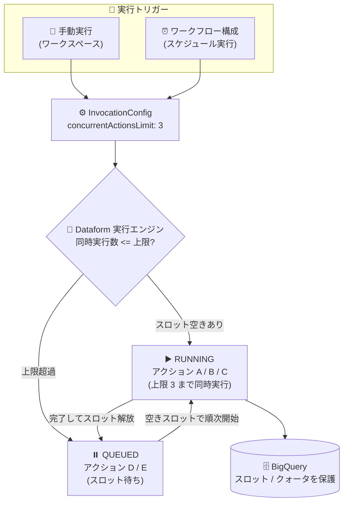

# Dataform: 同時実行アクション数の制限が一般提供 (GA) に

**リリース日**: 2026-11-09

**サービス**: Dataform

**機能**: ワークフロー実行における同時実行アクション数の制限 (Limit concurrent actions)

**ステータス**: GA (一般提供)

📊 [このアップデートのインフォグラフィックを見る](https://takech9203.github.io/google-cloud-news-summary/20261109-dataform-concurrent-actions-limit-ga.html)

## 概要

Dataform で、単一のワークフロー実行 (手動実行) またはワークフロー構成のスケジュール実行において、同時に実行されるアクション数の上限を設定できる機能が一般提供 (GA) となりました。「Limit concurrent actions」オプションを有効にして「Maximum concurrent actions」に 1〜5000 の整数を指定することで、同時実行数を制御できます。

Dataform はデフォルトでは、上流の依存関係が解決されたすべてのアクションを並列に実行します。独立したアクションを多数含むワークフローではすべてが同時に実行されるため、BigQuery のレート制限エラー、プロジェクトのクォータ枯渇、BigQuery スロットの使い切りが発生する可能性がありました。本機能により、SQLX 上で独立したアクション間に人工的な依存関係を追加することなく、リソース競合を制御できるようになります。

大規模なデータ変換パイプラインを BigQuery 上で運用するデータエンジニアリングチームにとって、スロットやクォータの消費を予測可能にし、他のワークロードとの共存を容易にするアップデートです。

**アップデート前の課題**

- Dataform は依存関係が満たされたアクションをすべて並列実行するため、独立したアクションが多いワークフローでは BigQuery のレート制限エラーが発生することがあった
- 大量のアクションの同時実行により、プロジェクトのクォータや BigQuery スロットを使い切ってしまう可能性があった
- 同時実行数を抑えるには、SQLX で本来不要な人工的な依存関係を定義して実行順序を直列化する回避策が必要だった

**アップデート後の改善**

- 手動実行およびワークフロー構成のスケジュール実行で、同時実行アクション数の上限 (1〜5000) を宣言的に設定できるようになった
- 上限を超えたアクションは QUEUED 状態で待機し、実行中のアクションが完了して同時実行スロットが空き次第、自動的に実行が開始される
- SQLX コードを変更することなく、実行時の設定のみでリソース競合を制御できるようになった

## アーキテクチャ図



同時実行上限を設定すると、依存関係が解決済みのアクションのうち上限までが同時に実行され、残りは QUEUED 状態で待機します。実行中のアクションが完了してスロットが空くたびに、待機中のアクションが順次開始されます。

## サービスアップデートの詳細

### 主要機能

1. **同時実行アクション数の上限設定**
   - 「Limit concurrent actions」を選択し、「Maximum concurrent actions」に 1〜5000 の整数を指定
   - 手動実行 (すべてのアクション / 選択したアクション / 選択したタグ) とワークフロー構成のスケジュール実行の両方で設定可能
   - API では `InvocationConfig` の `concurrentActionsLimit` フィールド (integer) として指定

2. **QUEUED 状態によるキューイング**
   - 依存関係が解決済みでも上限を超えるアクションは QUEUED 状態に入る
   - 実行中のアクションが完了して同時実行スロットが空くと、キュー内のアクションが空きスロットで順次開始される
   - ワークフロー実行が失敗またはキャンセルされた場合、キュー内のアクションはスキップされる

3. **ワークフロー呼び出し単位での制御**
   - 上限はワークフロー呼び出し (invocation) ごとに適用される
   - 各実行は自身の実行中アクションを独立して追跡する (実行間で共有されない)

## 技術仕様

### 同時実行制限の仕様

| 項目 | 詳細 |
|------|------|
| 設定可能な値 | 1〜5000 の整数 |
| 設定対象 | 手動実行、ワークフロー構成 (スケジュール実行) |
| デフォルト動作 (未設定時) | 依存関係が満たされたすべてのアクションを並列実行 |
| 上限超過時の挙動 | アクションは QUEUED 状態で待機し、スロットが空き次第実行 |
| 適用スコープ | ワークフロー呼び出しごと (実行間で独立) |
| 失敗・キャンセル時 | キュー内のアクションはスキップ |
| 非対応 | 単体テスト (unit tests) の実行では未サポート |

### API での設定 (InvocationConfig)

Dataform API v1 の `InvocationConfig` に `concurrentActionsLimit` フィールドが用意されています。

```json
{
  "invocationConfig": {
    "includedTags": ["daily"],
    "transitiveDependenciesIncluded": true,
    "serviceAccount": "dataform-runner@my-project.iam.gserviceaccount.com",
    "concurrentActionsLimit": 10
  }
}
```

## 設定方法

### 前提条件

1. Dataform リポジトリとワークフロー (SQLX で定義されたアクション群) が存在すること
2. スケジュール実行の場合は、コンパイル用のリリース構成が作成済みであること

### 手順

#### 手動実行で同時実行数を制限する

1. 開発ワークスペースに移動し、「Start execution」をクリック
2. 「Actions」>「Multiple actions」(または Tags) を選択し、認証方法 (ユーザー認証情報またはサービスアカウント) を設定
3. 「Limit concurrent actions」を選択し、「Maximum concurrent actions」に 1〜5000 の整数を入力
4. 「Start execution」をクリック

#### ワークフロー構成 (スケジュール実行) で同時実行数を制限する

1. リポジトリの「Releases & Scheduling」に移動し、「Workflow configurations」セクションで「Create」をクリック
2. Configuration ID、リリース構成、認証方法、スケジュール頻度 (unix-cron 形式) を設定
3. 実行対象のアクションを選択後、「Limit concurrent actions」を選択し、「Maximum concurrent actions」に 1〜5000 の整数を入力
4. ワークフロー構成を保存すると、以後のスケジュール実行に上限が適用される

## メリット

### ビジネス面

- **パイプラインの安定稼働**: BigQuery のレート制限エラーやクォータ枯渇による実行失敗を抑止し、定時バッチの信頼性を向上できる
- **他ワークロードとの共存**: 大規模な変換パイプラインが BigQuery スロットを独占することを防ぎ、アドホック分析など他の業務への影響を軽減できる

### 技術面

- **コード変更不要のリソース制御**: SQLX に人工的な依存関係を追加せず、実行時設定 (UI / API) だけで同時実行数を調整できる
- **宣言的なキューイング**: 上限超過分は QUEUED 状態で自動的に待機・再開されるため、リトライや順序制御のカスタム実装が不要

## デメリット・制約事項

### 制限事項

- 設定可能な値は 1〜5000 の整数
- 単体テスト (unit tests) の実行では同時実行制限はサポートされない
- ワークフロー実行が失敗またはキャンセルされると、QUEUED 状態のアクションはスキップされる

### 考慮すべき点

- 上限はワークフロー呼び出しごとに独立して適用されるため、複数のワークフロー構成が同時に実行される場合、プロジェクト全体の同時実行数は各上限の合計になり得る
- 上限を小さくしすぎるとワークフロー全体の実行時間が長くなるため、BigQuery スロットの状況とパイプラインの SLA に応じた調整が必要

## ユースケース

### ユースケース 1: 大量の独立テーブルを更新する日次バッチの安定化

**シナリオ**: 数百個の独立した SQLX アクション (テーブル更新) を含む日次ワークフローで、全アクションの一斉実行により BigQuery のレート制限エラーやスロット枯渇が散発していた。

**実装例**:
```json
{
  "invocationConfig": {
    "concurrentActionsLimit": 20
  }
}
```

**効果**: 同時実行を 20 アクションに制限することで、レート制限エラーを回避しつつ、残りのアクションは QUEUED から自動的に順次実行される。SQLX コードの変更は不要。

### ユースケース 2: オンデマンドスロット環境での分析ワークロードとの共存

**シナリオ**: 分析チームと同じ BigQuery プロジェクトで Dataform のスケジュール実行を行っており、バッチ実行中にアドホッククエリのパフォーマンスが低下していた。

**効果**: ワークフロー構成に同時実行上限を設定することで、バッチが消費するスロットを平準化し、分析クエリへの影響を抑えられる。

## 料金

この機能自体に関する追加料金の記載はリリースノートおよびドキュメントにはありません。Dataform の料金の詳細は公式の料金ページを参照してください。

- [Dataform の料金](https://cloud.google.com/dataform/pricing)

## 関連サービス・機能

- **BigQuery**: Dataform のアクションは BigQuery 上でクエリジョブとして実行される。本機能は BigQuery のレート制限・クォータ・スロットの保護を目的としている
- **BigQuery クエリ優先度 (interactive / batch)**: 実行時に `queryPriority` でジョブ優先度を選択でき、同時実行制限と組み合わせてスロット消費を制御できる
- **Cloud Scheduler / Workflows**: Dataform のワークフロー構成以外のスケジューリング手段。ワークフロー構成を使う場合は本機能による同時実行制御が利用できる

## 参考リンク

- 📊 [インフォグラフィック](https://takech9203.github.io/google-cloud-news-summary/20261109-dataform-concurrent-actions-limit-ga.html)
- [公式リリースノート](https://docs.cloud.google.com/release-notes#November_09_2026)
- [ドキュメント: 同時実行アクションの制限](https://docs.cloud.google.com/dataform/docs/trigger-execution#limit-concurrent-actions)
- [ドキュメント: ワークフロー構成の作成](https://docs.cloud.google.com/dataform/docs/schedule-runs#create-workflow-configuration)
- [API リファレンス: InvocationConfig](https://docs.cloud.google.com/dataform/reference/rest/v1/InvocationConfig)
- [料金ページ](https://cloud.google.com/dataform/pricing)

## まとめ

Dataform の同時実行アクション数制限の GA により、大規模ワークフローでの BigQuery レート制限エラーやスロット枯渇を、SQLX のコード変更なしに実行時設定だけで防げるようになりました。多数の独立アクションを持つパイプラインを運用しているチームは、手動実行やワークフロー構成に適切な上限値 (1〜5000) を設定し、実行時間とリソース消費のバランスを検証することを推奨します。

---

**タグ**: Dataform, BigQuery, GA, ワークフロー, 同時実行制御, データパイプライン, ELT
