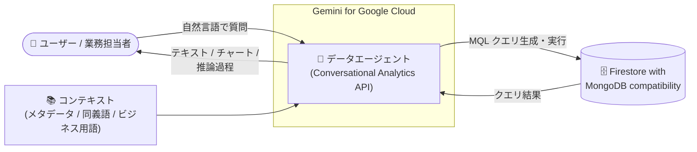

# Firestore with MongoDB compatibility: Conversational Analytics (自然言語によるデータ分析) が Preview で利用可能に

**リリース日**: 2026-11-09

**サービス**: Firestore with MongoDB compatibility

**機能**: Conversational Analytics (自然言語によるオペレーショナルデータのクエリ)

**ステータス**: Preview

📊 [このアップデートのインフォグラフィックを見る](https://takech9203.github.io/google-cloud-news-summary/20261109-firestore-mongodb-conversational-analytics-preview.html)

## 概要

Firestore with MongoDB compatibility で Conversational Analytics (会話型分析) が Preview として利用可能になりました。この機能は Conversational Analytics API (`geminidataanalytics.googleapis.com`) を基盤としており、Firestore に格納されたオペレーショナルデータに対して自然言語で質問し、回答を得ることができます。Gemini for Google Cloud を活用した「チャットでデータと対話する」体験を、MongoDB 互換のドキュメントデータベースに対して提供するものです。

ユーザーはコレクションなどのナレッジソースに紐づけた「データエージェント」を作成し、カスタムメタデータ、同義語・ビジネス用語、キーフィールド、フィルタリング/グルーピングのデフォルト設定といったコンテキストを付与できます。会話は永続化され、フィールド名を意識せずに日常的な言葉でマルチターンの質問が可能です。応答にはテキスト、コード、チャート、エージェントの推論過程が含まれます。

これまで Conversational Analytics API のデータベース系データソースは AlloyDB for PostgreSQL、Spanner、Cloud SQL (MySQL / PostgreSQL) に限られていました。今回のアップデートにより、Firestore with MongoDB compatibility (Enterprise edition) を利用する開発者や業務ユーザーも、BI ツールや MQL の知識なしに運用データから洞察を得られるようになります。

**アップデート前の課題**

- Firestore with MongoDB compatibility のデータを分析するには、MQL (MongoDB Query Language) を記述するか、BigQuery などの分析基盤にデータを移動する必要があった
- Conversational Analytics API のデータベース系データソースは AlloyDB、Spanner、Cloud SQL に限られ、Firestore は対象外だった
- 2026 年 10 月に Preview 化された QueryData はシングルターンの自然言語クエリ生成 (NL → MQL) が中心で、永続化されたマルチターンの会話型分析体験は提供されていなかった

**アップデート後の改善**

- Google Cloud コンソールの Conversations ページからデータエージェントを作成し、自然言語でのマルチターン会話による分析が可能になった
- Guided (コンソールでノーコード作成) と Advanced (Gemini CLI / IDE で詳細制御) の 2 つのコンテキスト作成オプションが提供され、エージェントの回答精度をユースケースに合わせて調整できるようになった
- コンソールで作成したエージェントは Conversational Analytics API 経由でも呼び出せるため、自社アプリケーションへの組み込みが容易になった

## アーキテクチャ図



ユーザーの自然言語の質問を、コンテキストを持つデータエージェントが解釈して Firestore へのクエリに変換・実行し、テキストやチャートを含む回答を返します。

## サービスアップデートの詳細

### 主要機能

1. **データエージェントによる自然言語クエリ**
   - コレクションなどのナレッジソースに紐づくデータエージェントを作成し、自然言語で質問できる
   - フィールド名を正確に指定しなくても、日常的な言葉やビジネス用語で質問できる
   - 応答にはテキスト、コード、チャートに加えて、エージェントの推論過程と会話メタデータが含まれる

2. **2 つのコンテキスト作成オプション**
   - **Guided**: Google Cloud コンソール上でコードを書かずにエージェントを構築
   - **Advanced**: Gemini CLI や IDE を使い、エージェントの品質をより細かく制御
   - カスタムメタデータ、同義語・ビジネス用語、キーフィールド、フィルタリング/グルーピングのデフォルトを設定可能

3. **永続化されたマルチターン会話**
   - 会話は保存され、文脈を引き継いだ複数ターンの質問が可能
   - コンソールの Conversations ページで、サンプルエージェント、下書き/公開済みエージェント、共有されたエージェントを管理できる

4. **API 経由のアプリケーション統合**
   - コンソールで作成したエージェントは Conversational Analytics API からも呼び出せる
   - データソースへの直接会話 (エージェントコンテキストなし) も可能だが、精度が下がる場合があるため、精度重視の場合はエージェントの利用が推奨される

## 技術仕様

### 機能の構成要素

| 項目 | 詳細 |
|------|------|
| 基盤 API | Conversational Analytics API (`geminidataanalytics.googleapis.com`) |
| 対象データベース | Firestore Enterprise edition (MongoDB compatibility) |
| クエリ言語 | 自然言語 → MongoDB 互換クエリ言語 (MQL) |
| コンテキスト作成 | Guided (コンソール) / Advanced (Gemini CLI・IDE) |
| 応答形式 | テキスト、コード、チャート、推論過程、会話メタデータ |
| エンドポイント構成 | コントロールプレーン (オーケストレーション) はグローバルエンドポイント、データプレーン (レコード取得・処理) はリージョナルエンドポイント |
| クォータ | Dynamic Shared Quota (DSQ)。固定のプロジェクト単位スループット上限はないが、高負荷時に一時的な `429 Resource Exhausted` が発生する場合がある |
| 起動ステージ | Preview (Pre-GA Offerings Terms 適用) |

### 主な IAM ロール (Conversational Analytics API)

| ロール | 用途 |
|--------|------|
| `roles/geminidataanalytics.dataAgentCreator` | エージェントの作成 |
| `roles/geminidataanalytics.dataAgentOwner` | エージェントの編集・共有・削除 |
| `roles/geminidataanalytics.dataAgentUser` | エージェントとのチャット |
| `roles/geminidataanalytics.dataAgentViewer` | エージェントの一覧・詳細参照 |

## 設定方法

### 前提条件

1. Firestore Enterprise edition (MongoDB compatibility) のデータベースが作成済みであること
2. Conversational Analytics API (Data Analytics API with Gemini) が有効化されていること
3. 利用者に Conversational Analytics API の適切な IAM ロールが付与されていること

### 手順

#### ステップ 1: データエージェントの作成

Google Cloud コンソールの Firestore の Conversations ページから、対象のナレッジソース (コレクション) を選択してデータエージェントを作成します。

#### ステップ 2: コンテキストと指示の追加 (任意)

まずはエージェントが自動生成したコンテキストで開始し、必要に応じて同義語・ビジネス用語、キーフィールド、フィルタリング/グルーピングのデフォルトなどをカスタマイズすることが推奨されています。より高度な制御が必要な場合は、Gemini CLI または IDE を使用した Advanced オプションを利用します。

#### ステップ 3: 会話の開始

作成したエージェントとの会話を開始し、自然言語でデータについて質問します。コンソールで作成したエージェントは Conversational Analytics API 経由でアプリケーションからも呼び出せます。

## メリット

### ビジネス面

- **データ活用の民主化**: MQL や BI ツールの知識がない業務担当者でも、自然言語で運用データから洞察を得られる
- **意思決定の迅速化**: ダッシュボード作成やクエリ開発を待たずに、その場で質問して回答を得られる
- **追加コストなしで試用可能**: Preview 期間中は機能自体への追加課金がなく、低リスクで評価できる

### 技術面

- **データ移動が不要**: オペレーショナルデータベースに対して直接分析クエリを実行でき、ETL パイプラインの構築が不要
- **コンテキストによる精度向上**: ビジネス用語やキーフィールドをエージェントに教え込むことで、組織固有の質問にも正確に回答できる
- **API 統合**: コンソールで作成・検証したエージェントをそのまま API 経由でアプリケーションに組み込める

## デメリット・制約事項

### 制限事項

- Preview (Pre-GA) のため、Pre-GA Offerings Terms が適用され、サポートが限定される場合がある
- Firestore Enterprise edition (MongoDB compatibility) が前提であり、Standard edition では利用できない
- Dynamic Shared Quota のため、需要が高い時間帯には一時的に `429 Resource Exhausted` エラーが発生する可能性がある (短い待機後のリトライが推奨)

### 考慮すべき点

- Gemini の出力はもっともらしく見えても事実と異なる場合があるため、利用前に回答の検証が推奨される
- エージェントコンテキストを使わないデータソースへの直接会話は精度が下がる可能性があるため、精度が重要な場合はエージェントの作成が推奨される
- 会話型分析によって実行されるクエリには通常の Firestore コンピュート課金が発生するため、大規模コレクションへの探索的な質問はコストに注意が必要

## ユースケース

### ユースケース 1: EC サイトの注文データの即席分析

**シナリオ**: Firestore with MongoDB compatibility に注文・顧客・商品データを格納している EC サイトで、マーケティング担当者が「先月最も売れた商品カテゴリは?」「リピート購入率が高い地域は?」といった質問をしたい。

**実装例**:
```
1. 注文 (orders)・顧客 (customers) コレクションをナレッジソースとしてデータエージェントを作成
2. 「売上」「リピート率」などのビジネス用語とフィールドの対応をコンテキストに追加
3. コンソールの Conversations ページ、または自社管理画面 (API 統合) から自然言語で質問
```

**効果**: BI チームへの依頼や SQL/MQL の習得なしに、業務担当者が自律的にデータから洞察を得られる。

### ユースケース 2: SaaS アプリケーションへの分析チャットの組み込み

**シナリオ**: Firestore をバックエンドに持つ SaaS アプリケーションで、エンドユーザー向けに「自分のデータについて質問できる」チャット機能を提供したい。

**効果**: コンソールで作成・検証したデータエージェントを Conversational Analytics API 経由で呼び出すことで、分析エンジンを自前で開発することなく、会話型分析機能を製品に組み込める。

## 料金

Preview 期間中、Conversational Analytics 機能自体への追加料金はありません。ただし、エージェントの作成時および会話中に実行されるクエリに対しては、通常の Firestore のコンピュート料金が発生します。

### 参考: Firestore Enterprise edition の料金 (抜粋)

| 項目 | 料金 (目安) |
|------|-------------|
| 読み取り | $0.05 / 100 万読み取りユニット (4 KB 単位) から |
| 書き込み | $0.26 / 100 万書き込みユニット (1 KB 単位) から |
| ストレージ | $0.24 / GB・月 から |

最新の料金は [Firestore 料金ページ](https://cloud.google.com/firestore/pricing) および [Data Cloud Agent の料金ページ](https://cloud.google.com/products/data-agents/pricing) を参照してください。

## 利用可能リージョン

コントロールプレーン (オーケストレーション) はグローバルエンドポイントのみ、データプレーン (レコードの取得・処理) はリージョナルエンドポイントを使用します。対応リージョンの詳細は[公式ドキュメント](https://docs.cloud.google.com/gemini/data-agents/conversational-analytics/firestore-mongodb-compatibility)を参照してください。

## 関連サービス・機能

- **Conversational Analytics API**: 本機能の基盤となる API。BigQuery、Looker、Data Studio、AlloyDB、Spanner、Cloud SQL (MySQL / PostgreSQL) もデータソースとしてサポート
- **QueryData (Firestore with MongoDB compatibility)**: 2026 年 10 月に Preview 化された、コンテキストセットを用いた自然言語 → MQL クエリ生成機能。エージェントハーネス (ADK、LangChain など) からのシングルターンクエリに適する
- **Gemini for Google Cloud**: 本機能を支える生成 AI 基盤。データガバナンスポリシーが適用される
- **Gemini Code Assist in Firestore**: 自然言語プロンプトから MQL クエリを生成する開発者向け支援機能

## 参考リンク

- 📊 [インフォグラフィック](https://takech9203.github.io/google-cloud-news-summary/20261109-firestore-mongodb-conversational-analytics-preview.html)
- [公式リリースノート](https://docs.cloud.google.com/release-notes#November_09_2026)
- [Conversational analytics for Firestore with MongoDB compatibility](https://docs.cloud.google.com/gemini/data-agents/conversational-analytics/firestore-mongodb-compatibility)
- [Conversational Analytics API の概要](https://docs.cloud.google.com/gemini/data-agents/conversational-analytics-api/overview)
- [Firestore with MongoDB compatibility の概要](https://docs.cloud.google.com/firestore/mongodb-compatibility/docs/overview)
- [料金ページ (Firestore)](https://cloud.google.com/firestore/pricing)
- [料金ページ (Data Cloud Agent)](https://cloud.google.com/products/data-agents/pricing)

## まとめ

Firestore with MongoDB compatibility に Conversational Analytics が加わったことで、オペレーショナルデータに対する自然言語分析が AlloyDB や Cloud SQL などと同様に利用できるようになりました。Firestore Enterprise edition を利用中のチームは、Preview 期間中に追加費用なしでデータエージェントを作成し、自社のビジネス用語を含むコンテキストでの回答精度を評価することをおすすめします。本番適用にあたっては、Pre-GA である点と、クエリ実行に伴う Firestore コンピュート課金に留意してください。

---

**タグ**: Firestore, MongoDB compatibility, Conversational Analytics, 自然言語クエリ, データエージェント, Gemini, Preview
