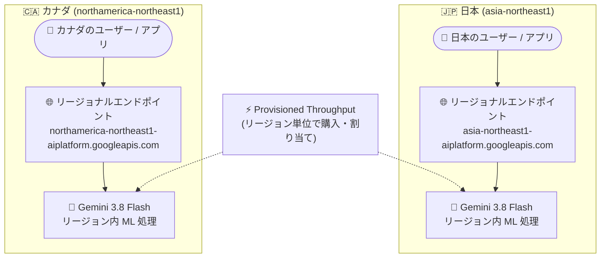

# Gemini Enterprise Agent Platform: Gemini 3.8 Flash がカナダ・日本リージョンで GA

**リリース日**: 2026-11-09

**サービス**: Gemini Enterprise Agent Platform

**機能**: Gemini 3.8 Flash (gemini-3.8-flash) のカナダ (northamerica-northeast1)・日本 (asia-northeast1) リージョンサポート

**ステータス**: GA (一般提供)

📊 [このアップデートのインフォグラフィックを見る](https://takech9203.github.io/google-cloud-news-summary/20261109-gemini-3-8-flash-canada-japan-ga.html)

## 概要

Gemini Enterprise Agent Platform において、Gemini 3.8 Flash (`gemini-3.8-flash`) がカナダ (`northamerica-northeast1`) と日本 (`asia-northeast1`) のリージョンで一般提供 (GA) になりました。両リージョンでリージョナルエンドポイント、データレジデンシーのためのリージョン内 ML 処理 (in-region ML processing)、および Provisioned Throughput がサポートされます。

Gemini 3.8 Flash は、長時間のソフトウェアエンジニアリングタスク、自律型エージェント、複雑なエンタープライズワークフロー向けに設計された Flash 系で最も高性能なモデルです。1M トークンのコンテキストウィンドウ、最大 64K 出力トークン、調整可能な思考レベル (low / medium / high) をサポートします。従来、同モデルのリージョン対応はグローバルエンドポイントと米国 (`us`)・EU (`eu`) マルチリージョンが中心でしたが、今回のアップデートによりカナダと日本でもリージョン内で推論処理を完結させられるようになりました。

金融・医療・公共分野など、データの国内処理 (データレジデンシー) が求められる日本およびカナダの企業にとって、最新の高性能 Flash モデルをコンプライアンス要件を満たしながら利用できる重要なアップデートです。

**アップデート前の課題**

- 日本・カナダのユーザーが Gemini 3.8 Flash を利用するには、グローバルエンドポイントまたは米国・EU マルチリージョンエンドポイントを使う必要があり、ML 処理が国内で完結するという保証が得られなかった
- グローバルエンドポイントはデータをグローバルに処理するため、リージョン分離やデータレジデンシーの保証がなく、国内データ処理が必須の規制業種では最新モデルの採用が困難だった
- 安定したスループットを確保する Provisioned Throughput を、日本・カナダのリージョナルエンドポイントに対して割り当てることができなかった

**アップデート後の改善**

- `asia-northeast1` (東京) および `northamerica-northeast1` (モントリオール) のリージョナルエンドポイント経由で Gemini 3.8 Flash を GA として利用可能になった
- リージョン内 ML 処理により、推論時のデータ処理が日本・カナダの国内に留まることが保証され、データレジデンシー要件 (GDPR 相当の国内規制や社内ガバナンス) への対応が容易になった
- 両リージョンで Provisioned Throughput を購入・割り当てできるようになり、国内処理と安定スループットを両立できるようになった

## アーキテクチャ図



日本・カナダそれぞれのリージョナルエンドポイントにリクエストを送ると、ML 処理 (推論) がリージョン内で完結し、データが国外に出ない構成を実現できます。Provisioned Throughput はリージョン単位で割り当て可能です。

## サービスアップデートの詳細

### 主要機能

1. **リージョナルエンドポイント**
   - `asia-northeast1` (東京) と `northamerica-northeast1` (モントリオール) のエンドポイントで `gemini-3.8-flash` を直接指定可能
   - グローバルエンドポイントと異なり、リクエストのルーティング先リージョンが明示的に固定される

2. **リージョン内 ML 処理 (データレジデンシー)**
   - ロケーショナルエンドポイントを使用すると、ML 処理 (推論) が当該リージョンの地理的境界内に留まる
   - グローバルエンドポイントはリージョン分離やデータレジデンシーの保証を提供しないため、規制対応にはリージョナルエンドポイントの利用が必要

3. **Provisioned Throughput**
   - 両リージョンで Provisioned Throughput (GSU 単位のスループット予約) を購入・割り当て可能
   - 購入量を超過したトラフィックはデフォルトで従量課金 (pay-as-you-go) にスピルオーバーされる
   - `X-Vertex-AI-LLM-Request-Type` ヘッダー (`dedicated` / `shared`) でリクエスト単位の制御が可能

## 技術仕様

### Gemini 3.8 Flash モデル仕様

| 項目 | 詳細 |
|------|------|
| モデル ID | `gemini-3.8-flash` |
| ローンチステージ | GA (初回 GA: 2026 年 9 月 2 日) |
| コンテキストウィンドウ | 1,048,576 トークン |
| 最大出力トークン | 65,536 トークン |
| 入力タイプ | テキスト、画像、音声、動画 |
| 思考レベル | `LOW` / `MEDIUM` (デフォルト) / `HIGH` (`MINIMAL` は非対応) |
| 主なツール | Grounding (Google 検索など)、コード実行、Function Calling、URL コンテキスト、Computer Use |
| 消費オプション | Provisioned Throughput、バッチ推論、Pay-as-you-go |
| セキュリティ制御 | データレジデンシー、CMEK、VPC-SC、AXT |

### 今回追加されたリージョンサポート

| リージョン | ロケーション | リージョナルエンドポイント | リージョン内 ML 処理 | Provisioned Throughput |
|-----------|-------------|---------------------------|--------------------|------------------------|
| `asia-northeast1` | 東京 (日本) | 対応 | 対応 | 対応 |
| `northamerica-northeast1` | モントリオール (カナダ) | 対応 | 対応 | 対応 |

## 設定方法

### 前提条件

1. Google Cloud プロジェクトで課金と Agent Platform API が有効化されていること
2. リージョン内処理が必要な場合、グローバルエンドポイントではなくリージョナルエンドポイントを指定すること

### 手順

#### ステップ 1: リージョナルエンドポイントを指定してリクエストを送信

```bash
curl -X POST \
  -H "Authorization: Bearer $(gcloud auth print-access-token)" \
  -H "Content-Type: application/json" \
  "https://asia-northeast1-aiplatform.googleapis.com/v1/projects/PROJECT_ID/locations/asia-northeast1/publishers/google/models/gemini-3.8-flash:generateContent" \
  -d '{"contents": [{"role": "user", "parts": [{"text": "こんにちは"}]}]}'
```

`asia-northeast1` を `northamerica-northeast1` に置き換えると、カナダリージョンで処理されます。

#### ステップ 2: (任意) Provisioned Throughput を使用する

```bash
curl -X POST \
  -H "Authorization: Bearer $(gcloud auth print-access-token)" \
  -H "Content-Type: application/json" \
  -H "X-Vertex-AI-LLM-Request-Type: dedicated" \
  "https://asia-northeast1-aiplatform.googleapis.com/v1/projects/PROJECT_ID/locations/asia-northeast1/publishers/google/models/gemini-3.8-flash:generateContent" \
  -d '{"contents": [{"role": "user", "parts": [{"text": "Hello."}]}]}'
```

Provisioned Throughput の注文時にリージョンとして `asia-northeast1` または `northamerica-northeast1` を選択します。`dedicated` を指定すると Provisioned Throughput のみを使用し、超過時はエラー 429 が返ります (デフォルトでは従量課金にスピルオーバー)。

## メリット

### ビジネス面

- **データレジデンシー要件への対応**: 金融・医療・公共など、データの国内処理が必須の業種でも、最新の Gemini 3.8 Flash を採用できる
- **コンプライアンスリスクの低減**: ML 処理がリージョン境界内に留まることが文書化されており、監査やガバナンス対応の説明が容易になる

### 技術面

- **レイテンシの改善**: 日本・カナダ国内のアプリケーションからリージョン内で推論が完結するため、グローバルルーティングに比べて安定した低レイテンシが期待できる
- **安定スループットの確保**: Provisioned Throughput により、国内処理の要件を満たしつつピーク時のスループットを予約できる

## デメリット・制約事項

### 制限事項

- グローバルエンドポイントはリージョン分離・データレジデンシーの保証を提供しないため、国内処理が必要な場合は必ずリージョナルエンドポイントを使用する必要がある
- Gemini 3.8 Flash は思考レベル `MINIMAL` に非対応 (`LOW` / `MEDIUM` / `HIGH` のみ)。Tuning (チューニング) も非対応
- 単一リージョンのキャパシティはグローバルエンドポイントより限定的であり、可用性最大化が目的ならグローバルエンドポイントの方が適する

### 考慮すべき点

- Provisioned Throughput はリージョン単位の割り当てのため、複数リージョンで利用する場合はリージョンごとに注文が必要 (マルチリージョンエンドポイントのような統合割り当てはリージョナルエンドポイントには適用されない)
- Provisioned Throughput 超過分はデフォルトで従量課金にスピルオーバーするため、コスト管理には `X-Vertex-AI-LLM-Request-Type: dedicated` の設定やモニタリングが必要

## ユースケース

### ユースケース 1: 日本国内の金融機関におけるエージェント型業務アプリケーション

**シナリオ**: 国内の金融機関が、顧客データを含む文書処理やコード生成を行う社内 AI エージェントを構築する。規制・社内ポリシーにより、データの処理は日本国内で完結する必要がある。

**実装例**:
```python
from google import genai
from google.genai.types import HttpOptions

client = genai.Client(
    vertexai=True,
    project="PROJECT_ID",
    location="asia-northeast1",  # 東京リージョンで ML 処理
    http_options=HttpOptions(api_version="v1"),
)
response = client.models.generate_content(
    model="gemini-3.8-flash",
    contents="この契約書の要点を要約してください。",
)
print(response.text)
```

**効果**: 推論処理が東京リージョン内で完結し、データレジデンシー要件を満たしながら Flash 系最高性能のモデルでエージェントワークフローを実行できる。

### ユースケース 2: カナダの公共機関向け SaaS での安定スループット確保

**シナリオ**: カナダの公共機関向けに AI 機能を提供する SaaS 事業者が、国内処理要件を満たしつつ、業務時間帯のピークトラフィックに対して安定した応答性能を保証したい。

**効果**: `northamerica-northeast1` に Provisioned Throughput を割り当てることで、国内処理と SLA 水準のスループットを両立。超過トラフィックは従量課金へ自動スピルオーバーし、可用性も維持できる。

## 料金

Gemini 3.8 Flash は 2026 年 12 月 31 日まで、入力 $0.75 / 100 万トークン、出力 $3.75 / 100 万トークンの導入価格で提供されています (標準価格は 2027 年 1 月 1 日から適用)。リージョナルエンドポイントの利用自体に追加料金はありません。Provisioned Throughput は GSU 単位の定額コミットメントで、超過分は従量課金レートで課金されます。

| 項目 | 料金 (導入価格、2026 年末まで) |
|--------|-----------------|
| 入力トークン | $0.75 / 100 万トークン |
| 出力トークン | $3.75 / 100 万トークン |

最新の料金は [Gemini Enterprise Agent Platform の料金ページ](https://cloud.google.com/gemini-enterprise-agent-platform/generative-ai/pricing) を参照してください。

## 利用可能リージョン

今回のアップデートで追加:

- **日本**: `asia-northeast1` (東京)
- **カナダ**: `northamerica-northeast1` (モントリオール)

既存のサポート: グローバルエンドポイント (`global`)、米国マルチリージョン (`us`)、EU マルチリージョン (`eu`)。詳細は [Deployments and endpoints](https://docs.cloud.google.com/gemini-enterprise-agent-platform/resources/locations) を参照してください。

## 関連サービス・機能

- **Provisioned Throughput**: GSU 単位でスループットを予約する消費オプション。今回両リージョンでサポートされた
- **データレジデンシー (Data residency)**: データ保存 (at-rest) と ML 処理 (in-use) の地理的制御を提供する Agent Platform の仕組み
- **VPC Service Controls / CMEK / Access Transparency**: Gemini 3.8 Flash のオンライン予測・バッチ推論・コンテキストキャッシュで利用可能なセキュリティ制御
- **組織ポリシー**: グローバルエンドポイントへのトラフィックをブロックし、リージョナルエンドポイントの利用を強制するために使用可能

## 参考リンク

- 📊 [インフォグラフィック](https://takech9203.github.io/google-cloud-news-summary/20261109-gemini-3-8-flash-canada-japan-ga.html)
- [公式リリースノート](https://docs.cloud.google.com/release-notes#November_09_2026)
- [Gemini 3.8 Flash モデルページ](https://docs.cloud.google.com/gemini-enterprise-agent-platform/models/gemini/3-8-flash)
- [Deployments and endpoints](https://docs.cloud.google.com/gemini-enterprise-agent-platform/resources/locations)
- [Data residency](https://docs.cloud.google.com/gemini-enterprise-agent-platform/resources/data-residency)
- [Provisioned Throughput の使用](https://docs.cloud.google.com/gemini-enterprise-agent-platform/models/provisioned-throughput/use-provisioned-throughput)
- [料金ページ](https://cloud.google.com/gemini-enterprise-agent-platform/generative-ai/pricing)

## まとめ

Gemini 3.8 Flash が日本 (asia-northeast1)・カナダ (northamerica-northeast1) で GA となり、リージョナルエンドポイント、リージョン内 ML 処理、Provisioned Throughput がフルサポートされました。データレジデンシー要件により最新モデルの採用を見送っていた日本・カナダの規制業種にとって、導入の障壁が大きく下がるアップデートです。国内処理が必要なワークロードは、グローバルエンドポイントではなくリージョナルエンドポイントの利用と、必要に応じた組織ポリシーによるグローバルエンドポイントの制限を検討してください。

---

**タグ**: #GeminiEnterpriseAgentPlatform #Gemini38Flash #DataResidency #ProvisionedThroughput #asia-northeast1 #northamerica-northeast1 #GA #GenerativeAI
