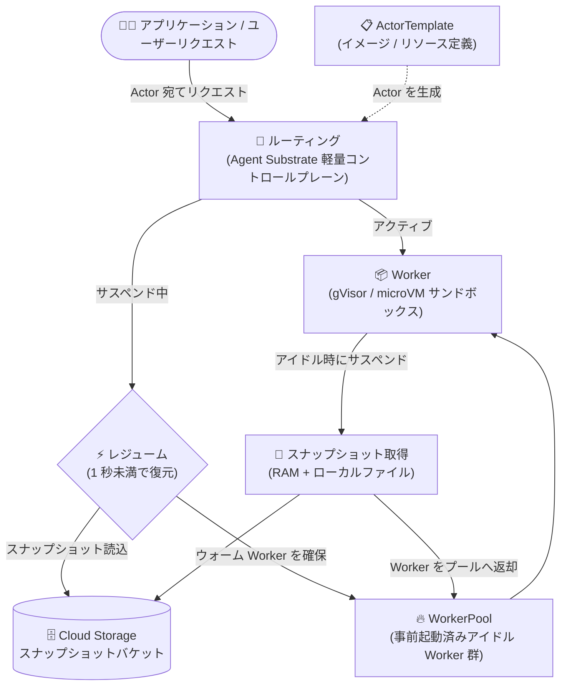

# Google Kubernetes Engine: Agent Substrate on GKE が GA

**リリース日**: 2026-11-09

**サービス**: Google Kubernetes Engine (GKE)

**機能**: Agent Substrate on GKE (大規模・高密度 AI エージェントワークロード向けインフラレイヤー)

**ステータス**: GA (一般提供)

📊 [このアップデートのインフォグラフィックを見る](https://takech9203.github.io/google-cloud-news-summary/20261109-gke-agent-substrate-ga.html)

## 概要

Agent Substrate on GKE が、GKE バージョン 1.37 以降の GKE Standard クラスタ向けに一般提供 (GA) となりました。Agent Substrate は、パーソナルアシスタントやコーディングエージェントのような大規模・高密度の AI エージェントワークロードを効率的に実行するために設計されたインフラストラクチャレイヤーです。オープンソースソフトウェアとして提供され、自身の GKE Standard クラスタにインストールして使用します。

対話型エージェントはユーザー入力や外部トリガーを待つ間アイドル状態になることが多く、従来のマイクロサービス向けインフラで常時稼働させると CPU とメモリを浪費します。Agent Substrate は、標準の Kubernetes Pod スケジューリングの制約をバイパスする軽量コントロールプレーンを採用し、高速なサンドボックスのプロビジョニングと効率的なサスペンド/レジューム機能を提供します。アイドル状態のエージェントをサスペンドすると、システムがエージェントのメモリ (RAM) とローカルファイルのスナップショットを取得し、再度動作が必要になった時点で 1 秒未満で利用可能なサンドボックスに状態を復元します。

対象ユーザーは、数十から数百万規模の同時実行 AI エージェント (長期稼働アシスタント、コーディングエージェント、LLM 生成コードを実行するエフェメラルサンドボックスなど) を Kubernetes 上で運用するプラットフォームチームや AI アプリケーション開発者です。

**アップデート前の課題**

- 標準の Kubernetes デプロイ (Agent Sandbox on GKE を含む) では各エージェントワークロードが専用の Pod に紐づくため、Pod のスケジューリングスループットと起動レイテンシが大規模化のボトルネックになっていた
- Kubernetes は Pod のハイバネーション (休止) をサポートしておらず、数百万のアイドルエージェントをクラスタ内に保持すると Pod 数の上限とコントロールプレーンのメモリを使い果たしてしまう
- アイドル時の計算コストを避けるには Pod を停止し、エージェントの状態を外部ストレージで独自に管理する必要があった
- アイドル状態のエージェントを常時稼働させると、本来アクティブなワークロードに割り当てられるはずの CPU とメモリが浪費されていた

**アップデート後の改善**

- エージェントの状態を基盤となる Pod から分離し、数百万のサスペンド済みスナップショットをストレージに保存して、ウォーム状態の共有 Worker プールへオンデマンドで復元できるようになった
- 軽量コントロールプレーンにより標準 Kubernetes コントロールプレーンのボトルネックを回避し、Agent Sandbox on GKE よりも多くの同時エージェントを 1 台のマシンで実行し、より高速に起動できるようになった
- サスペンドされたエージェントは 1 秒未満で状態を復元して応答でき、エージェントの作業メモリとファイルがセッションをまたいで保持される
- アイドルエージェントは CPU/メモリを消費しないため、エージェントが実際にタスクを処理している間のみ計算リソースの費用が発生する

## アーキテクチャ図



アプリケーションからのリクエストは対象の Actor (エージェントインスタンス) にルーティングされ、サスペンド中であれば WorkerPool のウォーム Worker に Cloud Storage 上のスナップショットが 1 秒未満で復元されます。アイドルになった Actor はスナップショット化され、Worker はプールに返却されて再利用されます。

## サービスアップデートの詳細

### 主要機能

1. **軽量コントロールプレーンによる高密度実行**
   - 標準 Kubernetes コントロールプレーンのスケジューリングスループット/起動レイテンシの制約をバイパス
   - エージェントの状態を Pod から分離し、限られたマシン数で数百万のエージェントを運用可能
   - Agent Sandbox on GKE と比べて、マシンあたりの同時エージェント数が多く、起動も高速

2. **サスペンド & レジューム**
   - アイドルエージェントのメモリ (RAM) とローカルファイルをスナップショットとして Cloud Storage に保存
   - 再開時はウォーム状態の Worker にスナップショットを 1 秒未満で復元し、中断した時点から正確に再開
   - 数週間にわたりコンテキストを維持する長期稼働・ステートフルなエージェントを実現

3. **高速なサンドボックスプロビジョニングと分離**
   - gVisor (デフォルト) または Cloud Hypervisor ベースの microVM ランタイムで、各ワークロードをホストカーネルから分離
   - AI が生成した信頼できないコードを、カーネル/ネットワーク分離のもとで安全に実行可能
   - WorkerPool により事前起動済みのアイドルサンドボックスを常に待機させ、即座に Actor を受け入れ

4. **独自のリソースモデル**
   - Actor (エージェントの実行インスタンス)、ActorTemplate (イメージ・環境変数・リソースの設計図)、Worker (サンドボックス)、WorkerPool (ウォーム Worker 群) で構成
   - WorkerPool と SandboxConfig は Kubernetes カスタムリソース、ActorTemplate と Actor は Agent Substrate API (`kubectl ate` プラグイン) で管理

## 技術仕様

### 要件と構成要素

| 項目 | 詳細 |
|------|------|
| クラスタモード | GKE Standard のみ (Autopilot 非対応) |
| GKE バージョン | コントロールプレーン・ノードプールともに 1.37 以降 |
| リリースチャンネル | Extended チャンネルは不可 (ベータ API の明示的有効化が非サポートのため) |
| 提供形態 | オープンソース (agent-substrate/substrate リポジトリ + GKE 向けツール substrate-gke) |
| サンドボックスランタイム | gVisor (デフォルト)、microVM (Cloud Hypervisor、ネストされた仮想化または x86 ベアメタルノードが必要) |
| スナップショット保存先 | Cloud Storage バケット (Workload Identity Federation for GKE で認証) |
| 状態管理 | PostgreSQL データベース (500 GiB 永続ディスク) が Actor/Worker の状態を追跡 |
| 可観測性 | Managed OpenTelemetry、Cloud Monitoring ダッシュボード (ルーティングレイテンシ、スナップショットサイズ、gRPC トラフィック) |
| マシンタイプ | 混合 CPU アーキテクチャの E2 系列は不可。microVM にはネストされた仮想化対応系列 (C3、C4、N2、N4 など) |

### エージェントのライフサイクル

| フェーズ | 動作 |
|------|------|
| Routing | アプリケーションからのリクエストを対象 Actor にルーティング |
| Resuming | サスペンド中の Actor 宛てなら WorkerPool からウォーム Worker を確保しスナップショットを復元 |
| Executing | アクティブになった Worker にリクエストを転送し、Actor がタスクを処理 |
| Suspending | アイドル Actor のメモリ/ファイルをスナップショット化して保存し、Worker をプールへ返却 |

## 設定方法

### 前提条件

1. GKE Standard クラスタ (バージョン 1.37 以降、Extended チャンネル以外)。インストーラーで新規作成も可能
2. Workload Identity Federation for GKE、GKE Dataplane V2、Managed OpenTelemetry (既存クラスタの場合、インストーラーが未有効の機能を有効化)
3. ローカルマシンでインストーラーを実行 (Cloud Shell は永続ディスク 5 GB のため不可)

### 手順

#### ステップ 1: インストーラーの実行

インストーラー (`setup-gcp` と `ate-setup`) が、必要な API の有効化、クラスタ/Cloud Storage バケット/Artifact Registry リポジトリ (`ate-images`) の作成、`ate-snapshot-transfer` サービスアカウントの作成と IAM 設定、コンポーネントのデプロイを行います。インストールが途中で失敗した場合はコマンドを再実行すると、既存リソースを保持したまま中断箇所から再開します。詳細は [substrate-gke リポジトリ](https://github.com/ai-on-gke/substrate-gke) を参照してください。

#### ステップ 2: kubectl ate プラグインのインストール

```bash
git clone --depth 1 --branch v1.0.0 https://github.com/agent-substrate/substrate.git
cd substrate
go install ./cmd/kubectl-ate
export PATH="$PATH:$(go env GOPATH)/bin"
```

Actor と ActorTemplate は Kubernetes リソースではないため、`kubectl ate` プラグイン経由で Agent Substrate API を使って管理します。

#### ステップ 3: WorkerPool / ActorTemplate の構成と Actor の作成

WorkerPool で待機させるアイドルサンドボックス数とノード選択 (`spec.template.nodeSelector`) を定義し、ActorTemplate でコンテナイメージ・環境変数・リソースを定義します。ActorTemplate の `workerSelector` フィールドでラベルにより対象の WorkerPool を選択します。インストーラーの `--demo` フラグで Counter デモ (サスペンド/レジュームでメモリ内とファイル内のカウントが保持されることを確認できる Web サーバー) をデプロイすることも可能です。

## メリット

### ビジネス面

- **計算コストの削減**: Worker サンドボックスのプールを全エージェントで共有することで、より少ないマシンでより多くのエージェントを実行可能。アイドルエージェントは CPU/メモリを消費しないため、エージェントが実際に処理している時間のみコストが発生
- **追加費用なし**: Agent Substrate on GKE 自体は無償で提供され、作成したリソースに対する通常の GKE 料金のみが適用される
- **スケールへの対応**: 数十から数百万の同時エージェントまで、同一アーキテクチャでスケール可能

### 技術面

- **1 秒未満の状態復元**: サスペンドされたエージェントへのリクエストに対し、リアルタイムに状態を復元して応答
- **ステートフルなエージェントの簡素化**: 作業メモリとファイルがセッションをまたいで保持されるため、外部ストレージへの状態退避ロジックを自前で実装する必要がない
- **安全な信頼できないコード実行**: gVisor / Cloud Hypervisor によるカーネル・ネットワーク分離で、AI 生成コードをインフラ全体へのリスクなく実行

## デメリット・制約事項

### 制限事項

- GKE Standard クラスタのみ対応 (Autopilot 非対応)。GKE 1.37 以降が必須で、Extended リリースチャンネルのクラスタにはインストール不可
- Cloud Shell でのインストール不可 (永続ディスク 5 GB では不足)
- 混合 CPU アーキテクチャのマシンシリーズ (E2 など) は gVisor の既知の問題により非対応
- GPU のデバイスパススルーは非対応 (`nvidia.com/gpu` 指定は GPU ノードへの配置のみで、Actor コンテナに GPU は渡されない)。gVisor はライブ CUDA コンテキストのスナップショットも不可
- サスペンド時にオープン中のネットワーク接続 (DB セッション、MCP サーバーへの接続など) は保持されないため、エージェント側で再接続処理の実装が必要

### 考慮すべき点

- Agent Substrate が稼働するノードプールでは GKE Sandbox を有効にしないこと (独自の gVisor ランタイムを使用するため共存不可。他のワークロードでは GKE Sandbox を利用可能)
- 1 つの ActorTemplate から作成するすべての Actor は同一の VM タイプで実行する必要があり、`workerSelector` と WorkerPool の `nodeSelector` で VM タイプごとに構成を分ける
- microVM ランタイムを使う場合、ネストされた仮想化を有効にしたノードプール (作成時のみ有効化可能) または x86 ベアメタルノードが必要
- 既存クラスタにインストールする場合、インストーラーがベータ API (podcertificaterequests、clustertrustbundles) を有効化するためコントロールプレーンの更新に約 10 分かかる
- 類似の Agent Sandbox on GKE との使い分けは、公式の [AI エージェントワークロードのアーキテクチャ設計ガイド](https://docs.cloud.google.com/kubernetes-engine/docs/concepts/machine-learning/agent-workloads) を参照

## ユースケース

### ユースケース 1: 長期稼働のパーソナルアシスタント (Productivity Agents)

**シナリオ**: 数週間にわたってユーザーのコンテキストを維持するバックグラウンドアシスタントを数十万ユーザー分ホストする。アシスタントは大半の時間、トリガー待ちのアイドル状態にある。

**効果**: アイドル中のアシスタントをサスペンドすることで計算コストを大幅に削減しつつ、ユーザーからのリクエスト時には 1 秒未満でコンテキストを完全に復元して応答できる。

### ユースケース 2: コーディングエージェント

**シナリオ**: 開発者とリアルタイムに対話しながらコードの作成・ビルド・テストを行う AI アシスタント。エージェントはサンドボックス内でターミナルコマンドの実行やファイルの変更を行う。

**効果**: 開発者が次のプロンプトを送るまでの間エージェントをサスペンドし、作業中のファイルとメモリ状態をそのまま保持。Worker プールの共有により少ないマシンで多数の開発者セッションを収容できる。

### ユースケース 3: エフェメラルサンドボックス

**シナリオ**: LLM が生成した信頼できないコードの実行、ツール呼び出し、データ分析のためのオンデマンドな分離環境を提供する。

**効果**: サンドボックスが 1 秒未満で復元されるため、短時間タスク向けの使い捨て環境を即座に提供し、実行終了後はリソースを解放できる。

## 料金

Agent Substrate on GKE 自体は追加料金なしで提供されます。作成したリソース (クラスタ、ノード、Cloud Storage のスナップショットバケット、PostgreSQL 用の 500 GiB 永続ディスクなど) に対して、通常の [GKE 料金](https://cloud.google.com/kubernetes-engine/pricing) および各リソースの料金が適用されます。

## 利用可能リージョン

リージョンごとの提供状況は公式ドキュメントに明記されていません。GKE Standard クラスタ (1.37 以降) が利用可能なリージョンで、クラスタへのインストールにより使用できます。

## 関連サービス・機能

- **Agent Sandbox on GKE**: Agent Substrate の基盤となった、Pod ベースのエージェントサンドボックス機能。Agent Substrate は標準コントロールプレーンのボトルネックを回避することでこれを上回る密度と起動速度を実現。ワークロード特性に応じて使い分ける
- **GKE Sandbox (gVisor)**: Pod 向けのサンドボックス機能。Agent Substrate が稼働するノードプールでは併用不可だが、他のワークロードでは利用可能
- **Cloud Storage**: エージェントのスナップショット保存先。Workload Identity Federation for GKE で鍵レス認証
- **Workload Identity Federation for GKE**: `ate-snapshot-transfer` サービスアカウントを通じて、Actor 単位の最小権限でスナップショットの保存/復元を実行
- **Managed OpenTelemetry for GKE / Cloud Monitoring**: ルーティングレイテンシ、スナップショットサイズ、gRPC トラフィックのダッシュボードを自動作成
- **GKE Dataplane V2**: エージェントへのリクエストルーティングに必要なネットワーキングを担当

## 参考リンク

- 📊 [インフォグラフィック](https://takech9203.github.io/google-cloud-news-summary/20261109-gke-agent-substrate-ga.html)
- [公式リリースノート](https://docs.cloud.google.com/release-notes#November_09_2026)
- [About Agent Substrate on GKE](https://docs.cloud.google.com/kubernetes-engine/ai-ml/about-agent-substrate)
- [Agent Substrate on GKE のインストール](https://docs.cloud.google.com/kubernetes-engine/ai-ml/install-overview-substrate)
- [AI エージェントワークロードのアーキテクチャ設計](https://docs.cloud.google.com/kubernetes-engine/docs/concepts/machine-learning/agent-workloads)
- [Agent Substrate (オープンソースリポジトリ)](https://github.com/agent-substrate/substrate)
- [substrate-gke (GKE 向けデプロイツール)](https://github.com/ai-on-gke/substrate-gke)
- [GKE 料金ページ](https://cloud.google.com/kubernetes-engine/pricing)

## まとめ

Agent Substrate on GKE の GA により、数百万規模の AI エージェントを Pod スケジューリングの制約なしに GKE 上で高密度にホストし、サスペンド/レジュームでアイドルコストを排除する基盤が正式に利用可能になりました。大規模なエージェントプラットフォームを構築するチームは、まず公式のアーキテクチャ設計ガイドで Agent Sandbox on GKE との使い分けを確認し、GKE 1.37 以降の Standard クラスタでインストーラーと Counter デモから評価を始めることを推奨します。

---

**タグ**: #GKE #AgentSubstrate #AIエージェント #Kubernetes #gVisor #サンドボックス #GA
